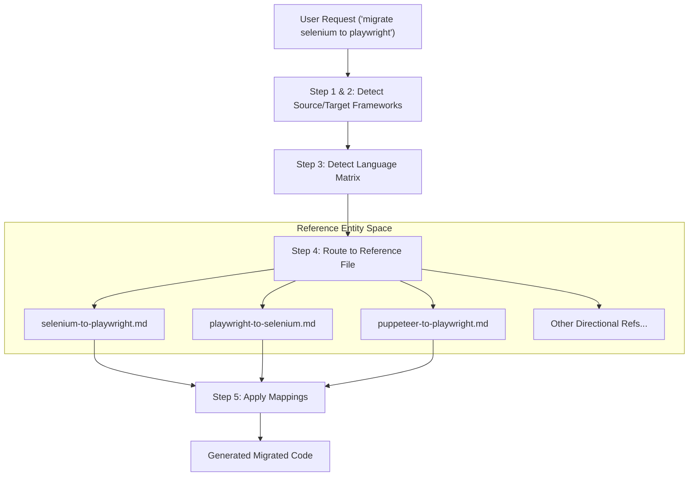
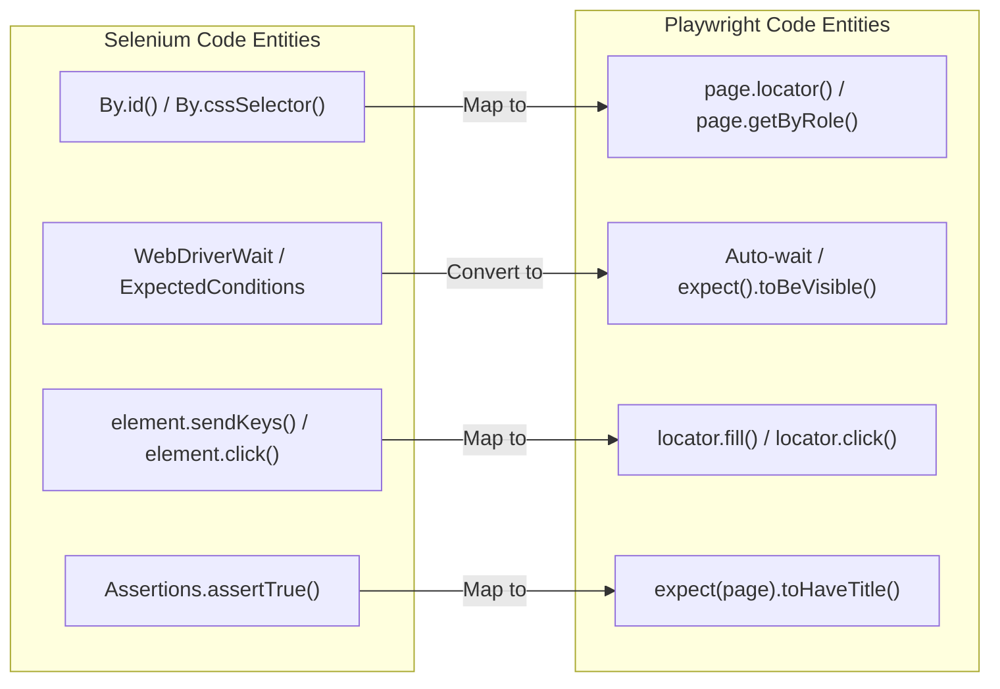

<!-- source: DeepWiki mcp.deepwiki.com · repo LambdaTest/agent-skills · page 8 Test Framework Migration Skill · fetched 2026-10-26 -->

# Test Framework Migration Skill

Relevant source files

The following files were used as context for generating this wiki page:

- [test-framework-migration-skill/SKILL.md](test-framework-migration-skill/SKILL.md)
- [test-framework-migration-skill/reference/overview.md](test-framework-migration-skill/reference/overview.md)
- [test-framework-migration-skill/reference/playwright-to-puppeteer.md](test-framework-migration-skill/reference/playwright-to-puppeteer.md)
- [test-framework-migration-skill/reference/playwright-to-selenium.md](test-framework-migration-skill/reference/playwright-to-selenium.md)
- [test-framework-migration-skill/reference/puppeteer-to-playwright.md](test-framework-migration-skill/reference/puppeteer-to-playwright.md)
- [test-framework-migration-skill/reference/puppeteer-to-selenium.md](test-framework-migration-skill/reference/puppeteer-to-selenium.md)
- [test-framework-migration-skill/reference/selenium-to-playwright.md](test-framework-migration-skill/reference/selenium-to-playwright.md)
- [test-framework-migration-skill/reference/selenium-to-puppeteer.md](test-framework-migration-skill/reference/selenium-to-puppeteer.md)

The **Test Framework Migration Skill** provides a structured methodology for converting test automation suites between major E2E testing frameworks: **Selenium**, **Playwright**, **Puppeteer**, and **Cypress**. It focuses on mapping API commands, adjusting synchronization strategies (e.g., explicit waits vs. auto-waiting), and adapting test lifecycle patterns to the target framework's architecture [test-framework-migration-skill/SKILL.md:4-11]().

## Migration Overview

Migrating between frameworks often involves shifting not just syntax, but the underlying execution model and language ecosystem.

### Framework Comparison Matrix
The following matrix compares the core architectural differences between the supported frameworks:

| Aspect | Selenium | Playwright | Puppeteer | Cypress |
|--------|----------|------------|-----------|---------|
| **Protocol** | WebDriver (W3C) | CDP / WebDriver BiDi | CDP | Proprietary |
| **Waits** | Explicit (Required) | Auto-wait | Manual | Built-in Retry |
| **Multi-tab** | Yes | Yes | Yes | No (True) |
| **Cross-browser**| All (via Drivers) | Chromium, FF, WebKit | Chrome/Chromium | Most (Limited) |

Sources: [test-framework-migration-skill/reference/overview.md:5-12]()

### Language Support Matrix
When migrating, the target language is often dictated by the framework's primary ecosystem. For example, migrating from Selenium (Java) to Playwright frequently implies a rewrite into TypeScript [test-framework-migration-skill/reference/overview.md:36-38]().

| Framework | Java | Python | JS/TS | C# | Ruby/PHP |
|-----------|------|--------|-------|----|----------|
| **Selenium** | Yes | Yes | Yes | Yes | Yes |
| **Playwright** | Yes | Yes | Yes | Yes | No |
| **Puppeteer** | No | No | Yes | No | No |
| **Cypress** | No | No | Yes | No | No |

Sources: [test-framework-migration-skill/reference/overview.md:29-34]()

## Migration Workflow

The migration process follows a 5-step workflow to ensure architectural consistency:

### System Interaction Diagram: Migration Logic
This diagram illustrates how the `test-framework-migration-skill` processes a migration request by routing through specific reference entities.

Sources: [test-framework-migration-skill/SKILL.md:29-85]()

### Mapping Code Entities
Migration involves mapping specific code symbols from the source framework to the equivalent entity in the target framework.

Sources: [test-framework-migration-skill/reference/selenium-to-playwright.md:5-46](), [test-framework-migration-skill/reference/playwright-to-selenium.md:5-47]()

## Supported Migration Paths

There are 10 bidirectional migration paths supported by this skill. These are grouped into two detailed child pages based on the involvement of the Playwright framework.

### Playwright Migration Paths
This category covers migrations where Playwright is either the source or the target. These paths often focus on moving from manual/explicit waiting to Playwright's auto-wait model and utilizing `Locators` instead of `ElementHandles` [test-framework-migration-skill/reference/puppeteer-to-playwright.md:85-89]().

*   **Selenium ↔ Playwright**: Mapping `WebDriver` lifecycle to Playwright `fixtures`.
*   **Puppeteer ↔ Playwright**: Transitioning from CDP-based manual waits to high-level Playwright APIs.
*   **Cypress ↔ Playwright**: Converting Cypress command chains to async/await Playwright locators.

For detailed API mapping tables and code snippets, see **[Playwright Migration Paths — To and From Playwright (#8.1)]**.

### Selenium and Puppeteer Migration Paths
This category covers migrations between Selenium, Puppeteer, and Cypress that do not involve Playwright. These paths often require maintaining explicit synchronization logic (like `WebDriverWait`) or specific browser-driven protocols [test-framework-migration-skill/reference/puppeteer-to-selenium.md:88-92]().

*   **Puppeteer ↔ Selenium**: Moving from Chrome-only CDP to multi-browser W3C WebDriver.
*   **Cypress ↔ Selenium**: Converting proprietary Cypress runner patterns to standard WebDriver scripts.
*   **Selenium ↔ Puppeteer**: Transitioning from enterprise multi-language drivers to JS-native Chrome automation.

For detailed conversion guides and "Gotchas," see **[Selenium and Puppeteer Migration Paths (#8.2)]**.

## Cloud Integration (TestMu)
Regardless of the framework, all migrated tests can be routed to the LambdaTest/TestMu AI cloud. Migration requires updating the connection logic:
*   **Selenium**: Uses `RemoteWebDriver` with `LT:Options` [test-framework-migration-skill/reference/selenium-to-playwright.md:86-88]().
*   **Playwright**: Uses CDP connection via `wss://cdp.lambdatest.com/playwright` [test-framework-migration-skill/reference/playwright-to-selenium.md:84-87]().
*   **Puppeteer**: Connects via a specific LambdaTest WebSocket endpoint [test-framework-migration-skill/reference/puppeteer-to-selenium.md:83-84]().

Sources: [test-framework-migration-skill/SKILL.md:98-106](), [shared/testmu-cloud-reference.md]()

---

