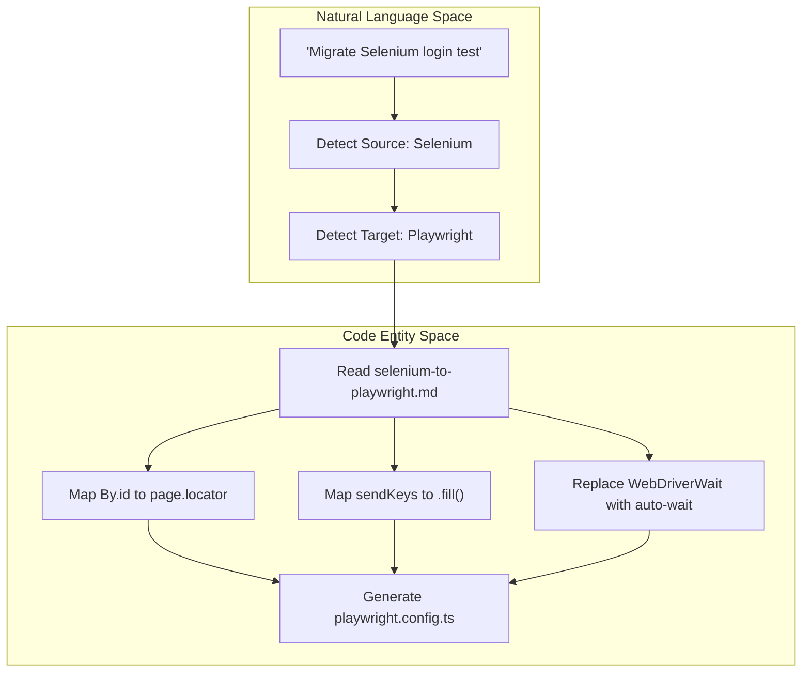
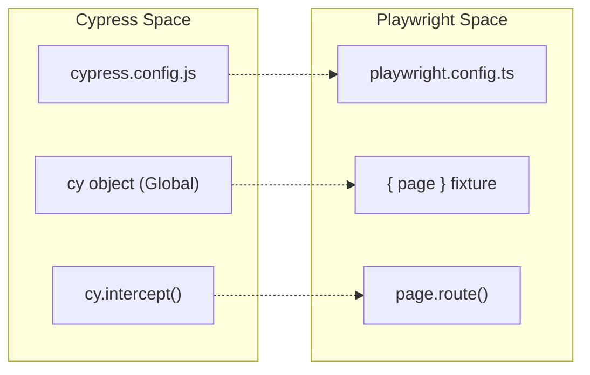

<!-- source: DeepWiki mcp.deepwiki.com · repo LambdaTest/agent-skills · page 8.1 Playwright Migration Paths — To and From Playwright · fetched 2026-10-26 -->

# Playwright Migration Paths — To and From Playwright

Relevant source files

The following files were used as context for generating this wiki page:

- [test-framework-migration-skill/SKILL.md](test-framework-migration-skill/SKILL.md)
- [test-framework-migration-skill/reference/cypress-to-playwright.md](test-framework-migration-skill/reference/cypress-to-playwright.md)
- [test-framework-migration-skill/reference/overview.md](test-framework-migration-skill/reference/overview.md)
- [test-framework-migration-skill/reference/playwright-to-cypress.md](test-framework-migration-skill/reference/playwright-to-cypress.md)
- [test-framework-migration-skill/reference/playwright-to-selenium.md](test-framework-migration-skill/reference/playwright-to-selenium.md)
- [test-framework-migration-skill/reference/puppeteer-to-playwright.md](test-framework-migration-skill/reference/puppeteer-to-playwright.md)
- [test-framework-migration-skill/reference/selenium-to-playwright.md](test-framework-migration-skill/reference/selenium-to-playwright.md)

This page provides technical guidance for migrating test automation suites between Playwright and other major frameworks (Selenium, Puppeteer, and Cypress). It covers API mapping, locator strategy conversion, wait mechanics, and lifecycle management.

## 1. Migration Strategy Overview

The `test-framework-migration-skill` facilitates bidirectional transitions by mapping source framework signals to target framework implementations [test-framework-migration-skill/SKILL.md:29-83]().

### Framework Capability Comparison
| Aspect | Selenium | Playwright | Puppeteer | Cypress |
|--------|----------|------------|-----------|---------|
| **Protocol** | WebDriver (W3C) | CDP / BiDi | CDP | Proprietary |
| **Wait Strategy** | Explicit (`WebDriverWait`) | Auto-wait | Manual (`waitForSelector`) | Retry-ability |
| **Multi-Tab** | Yes | Yes | Yes | No |
| **Languages** | Java, PY, JS, C#, RB, PHP | JS, TS, PY, Java, C# | JS, TS | JS, TS |

**Sources:** [test-framework-migration-skill/reference/overview.md:5-12](), [test-framework-migration-skill/reference/overview.md:29-34]()

---

## 2. Selenium ↔ Playwright Migration

### 2.1 Selenium to Playwright (The Modernization Path)
Migration from Selenium often targets a reduction in flakiness via Playwright's auto-wait mechanism [test-framework-migration-skill/reference/overview.md:18-18]().

#### API Mapping Table
| Feature | Selenium (Java/JS) | Playwright (TS/JS) |
|---------|--------------------|--------------------|
| **Locator** | `By.id("x")` | `page.locator('#x')` |
| **Semantic** | N/A | `page.getByRole('button', { name: 'Submit' })` |
| **Wait** | `wait.until(EC.visibilityOf(...))` | `await expect(locator).toBeVisible()` |
| **Input** | `element.sendKeys("text")` | `await locator.fill('text')` |
| **Frame** | `driver.switchTo().frame("n")` | `page.frameLocator('iframe[name="n"]')` |
| **Alert** | `driver.switchTo().alert()` | `page.on('dialog', d => d.accept())` |

**Sources:** [test-framework-migration-skill/reference/selenium-to-playwright.md:7-37](), [test-framework-migration-skill/reference/selenium-to-playwright.md:95-95]()

#### Data Flow: Selenium to Playwright Logic
The following diagram illustrates how the `test-framework-migration-skill` transforms a Selenium command into a Playwright action.

**Title: Selenium to Playwright Command Transformation**

**Sources:** [test-framework-migration-skill/SKILL.md:29-54](), [test-framework-migration-skill/reference/selenium-to-playwright.md:3-37]()

---

### 2.2 Playwright to Selenium (The Enterprise Path)
Used when a project requires integration with legacy Selenium Grid or specific language support (Ruby/PHP) not natively prioritized by Playwright [test-framework-migration-skill/reference/overview.md:20-20]().

**Key Requirement:** Playwright's implicit auto-waits must be replaced with explicit `WebDriverWait` and `ExpectedConditions` in Selenium [test-framework-migration-skill/reference/playwright-to-selenium.md:91-91]().

**Sources:** [test-framework-migration-skill/reference/playwright-to-selenium.md:19-27](), [test-framework-migration-skill/reference/playwright-to-selenium.md:91-95]()

---

## 3. Puppeteer ↔ Playwright Migration

### 3.1 Puppeteer to Playwright
Since both frameworks use CDP, the transition is structural. Playwright introduces `Locators` which are lazily evaluated, whereas Puppeteer uses `ElementHandles` which can become stale [test-framework-migration-skill/reference/puppeteer-to-playwright.md:87-87]().

| Puppeteer | Playwright | Note |
|-----------|------------|------|
| `page.$('#x')` | `page.locator('#x')` | Locator re-resolves on action |
| `page.waitForNavigation()` | N/A | Usually redundant in Playwright |
| `page.type()` | `locator.fill()` | `fill()` clears existing text |
| `page.setViewport()` | `context.setViewportSize()` | Set at context level |

**Sources:** [test-framework-migration-skill/reference/puppeteer-to-playwright.md:7-34](), [test-framework-migration-skill/reference/puppeteer-to-playwright.md:85-87]()

---

## 4. Cypress ↔ Playwright Migration

### 4.1 Cypress to Playwright
The primary shift is from Cypress's custom "command queue" (synchronous-looking) to standard JavaScript `async/await` [test-framework-migration-skill/reference/cypress-to-playwright.md:83-83]().

#### Technical Mapping
| Cypress Command | Playwright Equivalent |
|-----------------|-----------------------|
| `cy.get('[data-cy="x"]')` | `page.getByTestId('x')` |
| `cy.intercept('GET', '/api')` | `page.route('**/api', ...)` |
| `cy.visit('/path')` | `await page.goto('/path')` |
| `cy.url().should('include', 'd')` | `await expect(page).toHaveURL(/d/)` |

**Sources:** [test-framework-migration-skill/reference/cypress-to-playwright.md:7-38](), [test-framework-migration-skill/reference/cypress-to-playwright.md:86-86]()

#### Entity Mapping: Cypress Runner vs Playwright Fixtures
This diagram bridges the execution models between the two frameworks.

**Title: Cypress Runner to Playwright Fixture Mapping**

**Sources:** [test-framework-migration-skill/reference/cypress-to-playwright.md:71-74](), [test-framework-migration-skill/reference/playwright-to-cypress.md:81-86]()

---

## 5. Cloud Migration (LambdaTest/TestMu)

Regardless of the framework path, cloud integration must be updated to the target framework's connection method.

| Target Framework | Connection Method | Endpoint / Tool |
|------------------|-------------------|-----------------|
| **Playwright** | CDP WebSocket | `wss://cdp.lambdatest.com/playwright` |
| **Selenium** | RemoteWebDriver | `hub.lambdatest.com/wd/hub` |
| **Cypress** | CLI / Plugin | `lambdatest-cypress` CLI |

**Sources:** [test-framework-migration-skill/reference/selenium-to-playwright.md:87-88](), [test-framework-migration-skill/reference/cypress-to-playwright.md:78-79](), [test-framework-migration-skill/reference/playwright-to-selenium.md:85-87]()

---

