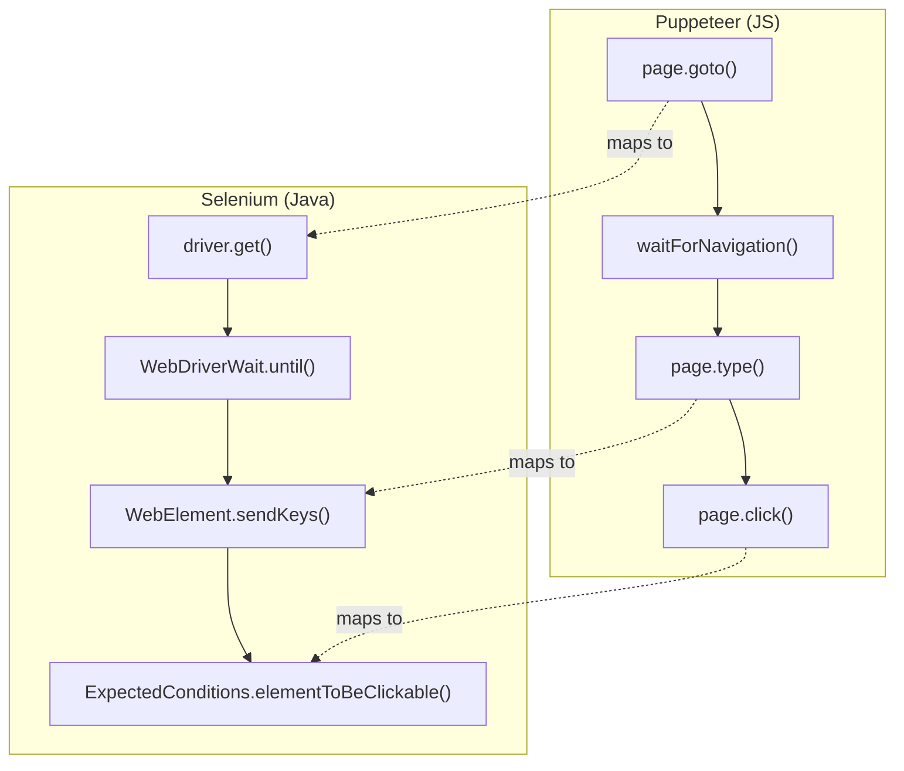
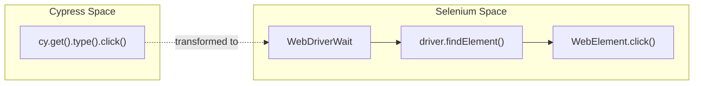

<!-- source: DeepWiki mcp.deepwiki.com · repo LambdaTest/agent-skills · page 8.2 Selenium and Puppeteer Migration Paths · fetched 2026-10-26 -->

# Selenium and Puppeteer Migration Paths

Relevant source files

The following files were used as context for generating this wiki page:

- [test-framework-migration-skill/reference/cypress-to-selenium.md](test-framework-migration-skill/reference/cypress-to-selenium.md)
- [test-framework-migration-skill/reference/playwright-to-puppeteer.md](test-framework-migration-skill/reference/playwright-to-puppeteer.md)
- [test-framework-migration-skill/reference/puppeteer-to-selenium.md](test-framework-migration-skill/reference/puppeteer-to-selenium.md)
- [test-framework-migration-skill/reference/selenium-to-cypress.md](test-framework-migration-skill/reference/selenium-to-cypress.md)
- [test-framework-migration-skill/reference/selenium-to-puppeteer.md](test-framework-migration-skill/reference/selenium-to-puppeteer.md)

This page covers technical migration paths for end-to-end testing frameworks that do not involve Playwright as a primary target or source. It provides detailed API mapping, pattern conversion guides, and lifecycle management for transitions between **Selenium**, **Puppeteer**, and **Cypress**.

## 1. Puppeteer to Selenium Migration

Migrating from Puppeteer to Selenium typically involves moving from a JavaScript-only, Chrome-specific environment to a multi-language, multi-browser ecosystem.

### API Mapping Table
| Category | Puppeteer (JS) | Selenium (Java/JS) |
| :--- | :--- | :--- |
| **Locators** | `await page.$('#x')` | `driver.findElement(By.id("x"))` [test-framework-migration-skill/reference/puppeteer-to-selenium.md:9-9]() |
| **Waits** | `await page.waitForSelector('.sel')` | `wait.until(ExpectedConditions.visibilityOfElementLocated(By.cssSelector(".sel")))` [test-framework-migration-skill/reference/puppeteer-to-selenium.md:20-20]() |
| **Actions** | `await page.type('#x', 'text')` | `el.sendKeys("text")` [test-framework-migration-skill/reference/puppeteer-to-selenium.md:29-29]() |
| **Navigation** | `await page.goto(url)` | `driver.get(url)` [test-framework-migration-skill/reference/puppeteer-to-selenium.md:49-49]() |
| **Alerts** | `page.on('dialog', d => d.accept())` | `driver.switchTo().alert().accept()` [test-framework-migration-skill/reference/puppeteer-to-selenium.md:32-32]() |

### Key Differences and Implementation
*   **Explicit Waits:** Unlike Puppeteer's `waitForSelector`, Selenium requires the use of `WebDriverWait` combined with `ExpectedConditions` for almost every interaction to ensure DOM readiness [test-framework-migration-skill/reference/puppeteer-to-selenium.md:88-88]().
*   **Element Handles:** Puppeteer returns `ElementHandle`, while Selenium returns `WebElement`. It is recommended to store `By` locators and re-find elements to avoid `StaleElementReferenceException` [test-framework-migration-skill/reference/puppeteer-to-selenium.md:91-91]().
*   **Network Idle:** Puppeteer's `networkidle0` has no direct Selenium equivalent. Migration requires waiting for specific URL changes or element visibilities [test-framework-migration-skill/reference/puppeteer-to-selenium.md:92-92]().

### Conversion Diagram: Puppeteer JS to Selenium Java
The following diagram illustrates the translation of a login flow from Puppeteer's asynchronous JS to Selenium's synchronous Java pattern.

"Natural Language Space to Code Entity Space: Puppeteer vs Selenium"

Sources: [test-framework-migration-skill/reference/puppeteer-to-selenium.md:55-74]()

## 2. Selenium to Puppeteer Migration

This path is common when teams prioritize execution speed in Chromium-based browsers and want to leverage the Chrome DevTools Protocol (CDP) directly.

### API Mapping Table
| Category | Selenium | Puppeteer |
| :--- | :--- | :--- |
| **Locators** | `By.xpath("//button")` | `page.$('xpath///button')` [test-framework-migration-skill/reference/selenium-to-puppeteer.md:11-11]() |
| **Input** | `element.clear()` | `page.evaluate(s => { document.querySelector(s).value = ''; })` [test-framework-migration-skill/reference/selenium-to-puppeteer.md:32-32]() |
| **Frames** | `driver.switchTo().frame(name)` | `page.frames().find(f => f.name() === name)` [test-framework-migration-skill/reference/selenium-to-puppeteer.md:35-35]() |
| **Window** | `driver.manage().window().maximize()` | `page.setViewport({ width: 1920, height: 1080 })` [test-framework-migration-skill/reference/selenium-to-puppeteer.md:52-52]() |

### Implementation Gotchas
*   **Language Shift:** Moving to Puppeteer usually requires rewriting tests in JavaScript or TypeScript [test-framework-migration-skill/reference/selenium-to-puppeteer.md:86-86]().
*   **No Auto-Wait:** Like Selenium, Puppeteer does not auto-wait (unlike Playwright). You must explicitly call `page.waitForSelector()` [test-framework-migration-skill/reference/selenium-to-puppeteer.md:87-87]().
*   **Browser Limitation:** Migration to Puppeteer implies a move to Chrome/Chromium-only testing [test-framework-migration-skill/reference/selenium-to-puppeteer.md:85-85]().

Sources: [test-framework-migration-skill/reference/selenium-to-puppeteer.md:1-90]()

## 3. Cypress to Selenium Migration

This migration is often driven by requirements for multi-tab support, native mobile automation via Appium, or the need for a non-JavaScript language.

### API Mapping Table
| Category | Cypress | Selenium (Java) |
| :--- | :--- | :--- |
| **Locators** | `cy.contains('Submit')` | `By.xpath("//*[contains(text(),'Submit')]")` [test-framework-migration-skill/reference/cypress-to-selenium.md:12-12]() |
| **Assertions** | `should('be.visible')` | `ExpectedConditions.visibilityOfElementLocated()` [test-framework-migration-skill/reference/cypress-to-selenium.md:22-22]() |
| **Network** | `cy.intercept()` | No direct equivalent; use DevTools or app-level mocks [test-framework-migration-skill/reference/cypress-to-selenium.md:36-36]() |
| **API** | `cy.request()` | Use `HttpClient` or `OkHttp` [test-framework-migration-skill/reference/cypress-to-selenium.md:37-37]() |

### Pattern Conversion: Cypress Chain to Selenium Block
Cypress uses a command queue (non-async/await), whereas Selenium uses standard imperative control flow.

"Cypress Command Queue to Selenium Imperative Flow"

Sources: [test-framework-migration-skill/reference/cypress-to-selenium.md:49-66](), [test-framework-migration-skill/reference/cypress-to-selenium.md:80-80]()

## 4. Selenium to Cypress Migration

This path is chosen for developers who prefer the "all-in-one" test runner experience and built-in retry-ability.

### API Mapping Table
| Category | Selenium | Cypress |
| :--- | :--- | :--- |
| **Wait for URL** | `ExpectedConditions.urlContains()` | `cy.url().should('include', ...)` [test-framework-migration-skill/reference/selenium-to-cypress.md:23-23]() |
| **Alerts** | `driver.switchTo().alert()` | `cy.on('window:confirm', ...)` [test-framework-migration-skill/reference/selenium-to-cypress.md:33-33]() |
| **Lifecycle** | `@BeforeEach` | `beforeEach(() => { cy.visit('/'); })` [test-framework-migration-skill/reference/selenium-to-cypress.md:50-50]() |

### Key Migration Considerations
*   **Retry-ability:** Selenium's `WebDriverWait` logic should be replaced with Cypress's `.should()` assertions, which automatically retry until the timeout [test-framework-migration-skill/reference/selenium-to-cypress.md:89-89]().
*   **No Async/Await:** Cypress commands are serial and managed by a internal runner; using `async/await` inside `it` blocks is an anti-pattern [test-framework-migration-skill/reference/selenium-to-cypress.md:87-87]().
*   **Single Tab:** Cypress does not support switching between multiple browser tabs, a common pattern in Selenium [test-framework-migration-skill/reference/selenium-to-cypress.md:90-90]().

Sources: [test-framework-migration-skill/reference/selenium-to-cypress.md:1-91]()

## 5. Playwright to Puppeteer Migration

While less common, this path may be required for projects needing specific Puppeteer plugins or lighter-weight execution for simple scraping tasks.

### API Mapping Table
| Category | Playwright | Puppeteer |
| :--- | :--- | :--- |
| **Locators** | `page.getByTestId('btn')` | `page.$('[data-testid="btn"]')` [test-framework-migration-skill/reference/playwright-to-puppeteer.md:12-12]() |
| **Filling** | `locator.fill('text')` | `element.type('text')` or `page.evaluate()` [test-framework-migration-skill/reference/playwright-to-puppeteer.md:30-30]() |
| **New Tabs** | `context.waitForEvent('page')` | `page.once('popup', ...)` [test-framework-migration-skill/reference/playwright-to-puppeteer.md:35-35]() |

### Critical Changes
*   **Auto-wait Removal:** Playwright's automatic waiting on actions (like `.click()`) is absent in Puppeteer. Every action must be preceded by an explicit `waitForSelector` [test-framework-migration-skill/reference/playwright-to-puppeteer.md:86-86]().
*   **Selector Logic:** Semantic locators like `getByRole` or `getByLabel` must be converted to standard CSS or XPath selectors [test-framework-migration-skill/reference/playwright-to-puppeteer.md:87-87]().

Sources: [test-framework-migration-skill/reference/playwright-to-puppeteer.md:1-91]()

## 6. Cloud Integration (TestMu/LambdaTest)

All migration paths involve updating the cloud connection logic to utilize the `LambdaTest` infrastructure.

| Framework | Connection Method |
| :--- | :--- |
| **Selenium** | `RemoteWebDriver` via Hub URL + `LT:Options` capabilities [test-framework-migration-skill/reference/puppeteer-to-selenium.md:84-84]() |
| **Puppeteer** | `puppeteer.connect()` via LambdaTest WebSocket endpoint [test-framework-migration-skill/reference/selenium-to-puppeteer.md:81-81]() |
| **Cypress** | Execution via `lambdatest-cypress` CLI [test-framework-migration-skill/reference/selenium-to-cypress.md:82-82]() |

Sources: [test-framework-migration-skill/reference/puppeteer-to-selenium.md:81-85](), [test-framework-migration-skill/reference/selenium-to-puppeteer.md:78-82]()

---

