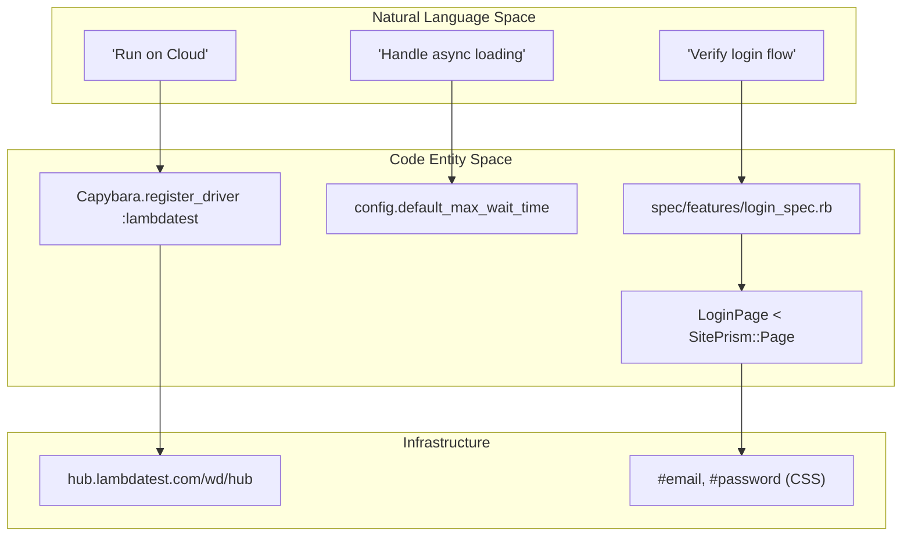
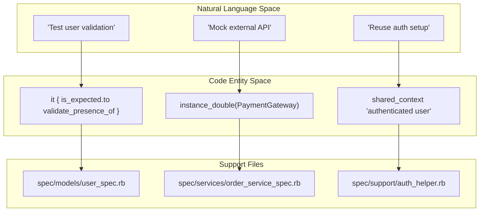

<!-- source: DeepWiki mcp.deepwiki.com · repo LambdaTest/agent-skills · page 9 Capybara and RSpec Skills — Ruby on Rails Testing · fetched 2026-10-26 -->

# Capybara and RSpec Skills — Ruby on Rails Testing

Relevant source files

The following files were used as context for generating this wiki page:

- [capybara-skill/SKILL.md](capybara-skill/SKILL.md)
- [capybara-skill/reference/advanced-patterns.md](capybara-skill/reference/advanced-patterns.md)
- [capybara-skill/reference/cloud-integration.md](capybara-skill/reference/cloud-integration.md)
- [capybara-skill/reference/playbook.md](capybara-skill/reference/playbook.md)
- [protractor-skill/reference/cloud-integration.md](protractor-skill/reference/cloud-integration.md)
- [rspec-skill/SKILL.md](rspec-skill/SKILL.md)
- [rspec-skill/reference/advanced-patterns.md](rspec-skill/reference/advanced-patterns.md)
- [rspec-skill/reference/playbook.md](rspec-skill/reference/playbook.md)

This page provides a high-level overview of the Ruby on Rails testing ecosystem within the Agent Skills framework. It focuses on the integration of **Capybara** for end-to-end feature testing and **RSpec** for unit and integration testing. These skills enable AI agents to generate robust, maintainable test suites using industry-standard Ruby patterns.

## Overview of Ruby Testing Skills

The Ruby testing stack in this repository is designed to cover the entire testing pyramid, from low-level model validations to complex multi-step browser interactions.

| Skill | Primary Purpose | Key Technologies |
|-------|-----------------|------------------|
| **Capybara** | Feature & Acceptance Testing | Selenium, SitePrism, Chrome Headless, TestMu AI |
| **RSpec** | Unit, Functional & Request Testing | Shoulda Matchers, FactoryBot, Mockito-style doubles |

### Natural Language to Code Entity Mapping (E2E)

The following diagram illustrates how natural language testing requirements are mapped to specific Ruby code entities and configurations.

**E2E Testing Entity Map**

**Sources:** [capybara-skill/reference/playbook.md:20-57](), [capybara-skill/reference/playbook.md:189-204](), [capybara-skill/reference/advanced-patterns.md:72-78]()

---

## Capybara Skill — Feature and Acceptance Testing

The Capybara skill focuses on high-level "Feature Specs" that simulate user behavior in a browser. It leverages `Selenium::WebDriver` for browser automation and `SitePrism` for implementing the Page Object Model (POM).

### Key Features
*   **SitePrism Integration:** Encapsulates UI elements into reusable Page and Section classes [capybara-skill/reference/playbook.md:189-218]().
*   **Wait Mechanics:** Utilizes Capybara's automatic waiting to handle asynchronous content without `sleep` calls [capybara-skill/reference/advanced-patterns.md:91-97]().
*   **Database Isolation:** Employs `DatabaseCleaner` with transaction and truncation strategies to ensure test hermeticity [capybara-skill/reference/playbook.md:14-15]().
*   **Cloud Execution:** Native support for LambdaTest via custom driver registration using `LT:Options` [capybara-skill/reference/cloud-integration.md:14-34]().

For detailed implementation patterns, including JavaScript modal handling and screenshot capture, see **[Capybara Skill — Feature and Acceptance Testing](#9.1)**.

---

## RSpec Skill — Ruby Unit and Integration Testing

The RSpec skill provides the foundation for testing Ruby logic. It covers unit tests for Models and Services, as well as Request specs for API testing.

### Key Features
*   **Expressive DSL:** Uses `describe`, `context`, and `it` blocks to create readable test hierarchies [rspec-skill/SKILL.md:21-47]().
*   **Verification Doubles:** Uses `instance_double` to create strict mocks that verify interface consistency [rspec-skill/reference/playbook.md:97-110]().
*   **Shared Logic:** Implements `shared_examples` and `shared_context` to reduce duplication across the test suite [rspec-skill/reference/advanced-patterns.md:3-25]().
*   **Rails Integration:** Deep integration with `rspec-rails` for testing controllers, models (via Shoulda Matchers), and routing [rspec-skill/reference/playbook.md:59-89]().

### Natural Language to Code Entity Mapping (Unit/Logic)

**Logic Testing Entity Map**

**Sources:** [rspec-skill/reference/playbook.md:161-169](), [rspec-skill/reference/advanced-patterns.md:15-19](), [rspec-skill/reference/advanced-patterns.md:59-62]()

For details on advanced matchers, FactoryBot traits, and service object testing, see **[RSpec Skill — Ruby Unit and Integration Testing](#9.2)**.

---

## Cloud Integration with TestMu AI

Both Capybara and RSpec (via request specs) can be integrated with cloud environments. For browser-based tests, Capybara registers a `:lambdatest` driver that points to the remote hub.

| Component | Configuration Key | Purpose |
|-----------|-------------------|---------|
| **Hub URL** | `hub.lambdatest.com/wd/hub` | Remote WebDriver endpoint [capybara-skill/reference/playbook.md:54-55]() |
| **Capabilities** | `LT:Options` | Sets platform, build name, and video recording [capybara-skill/reference/cloud-integration.md:18-26]() |
| **Auth** | `LT_USERNAME` / `LT_ACCESS_KEY` | Environment variables for secure access [capybara-skill/reference/cloud-integration.md:31-34]() |

**Sources:** [capybara-skill/reference/playbook.md:43-57](), [capybara-skill/reference/cloud-integration.md:1-39]()

---

