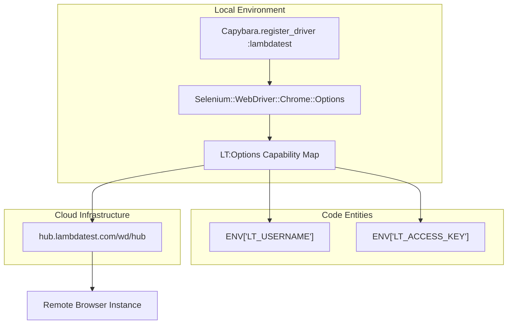
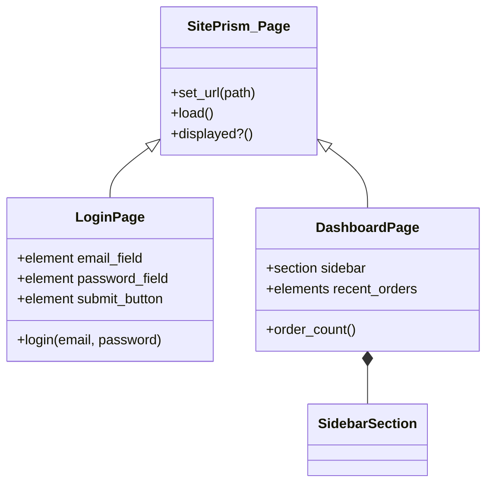

<!-- source: DeepWiki mcp.deepwiki.com · repo LambdaTest/agent-skills · page 9.1 Capybara Skill — Feature and Acceptance Testing · fetched 2026-10-26 -->

# Capybara Skill — Feature and Acceptance Testing

<details>
<summary>Relevant source files</summary>

The following files were used as context for generating this wiki page:

- [capybara-skill/SKILL.md](capybara-skill/SKILL.md)
- [capybara-skill/reference/advanced-patterns.md](capybara-skill/reference/advanced-patterns.md)
- [capybara-skill/reference/cloud-integration.md](capybara-skill/reference/cloud-integration.md)
- [capybara-skill/reference/playbook.md](capybara-skill/reference/playbook.md)
- [protractor-skill/reference/cloud-integration.md](protractor-skill/reference/cloud-integration.md)
- [rspec-skill/reference/playbook.md](rspec-skill/reference/playbook.md)

</details>


Capybara is a Ruby-based acceptance testing framework that simulates how a real user would interact with a web application. This page details the integration of Capybara with RSpec, the use of SitePrism for Page Object modeling, and configuration for both local headless execution and LambdaTest cloud execution.

## §1 Driver Configuration and Selenium Setup

Capybara requires a driver to interface with browsers. While it supports multiple drivers, `selenium-webdriver` is the standard for modern web applications.

### Local Headless Configuration
For CI/CD and local development, a headless Chrome driver is typically registered to run tests without a GUI [capybara-skill/reference/playbook.md:34-41]().

```ruby
Capybara.register_driver :selenium_chrome_headless do |app|
  options = Selenium::WebDriver::Chrome::Options.new
  options.add_argument('--headless=new')
  options.add_argument('--no-sandbox')
  options.add_argument('--window-size=1920,1080')
  Capybara::Selenium::Driver.new(app, browser: :chrome, options: options)
end
```
**Sources:** [capybara-skill/reference/playbook.md:34-41](), [capybara-skill/reference/advanced-patterns.md:80-86]()

### LambdaTest Cloud Integration
To run tests on the LambdaTest cloud, a remote driver must be registered using the `LT:Options` capability block [capybara-skill/reference/playbook.md:44-56](). This requires `LT_USERNAME` and `LT_ACCESS_KEY` environment variables [capybara-skill/reference/cloud-integration.md:22-23]().

**Driver Registration Flow**
The following diagram illustrates how the Capybara driver connects to the LambdaTest Hub.

Title: Capybara to LambdaTest Driver Registration

**Sources:** [capybara-skill/reference/playbook.md:44-56](), [capybara-skill/reference/cloud-integration.md:14-34]()

## §2 SitePrism Page Objects

SitePrism provides a DSL for defining Page Objects in Capybara, allowing for better abstraction of UI elements and sections [capybara-skill/reference/playbook.md:189-218]().

### Elements and Sections
*   **Elements:** Single UI components defined by CSS or XPath selectors [capybara-skill/reference/playbook.md:193-197]().
*   **Sections:** Reusable groups of elements (e.g., a Sidebar or Navbar) [capybara-skill/reference/playbook.md:213]().
*   **Loaders:** Methods like `load` and `be_displayed` that manage navigation and URL matching [capybara-skill/reference/playbook.md:207-208](), [capybara-skill/reference/playbook.md:226-228]().

**Page Object Structure**
Title: SitePrism Class Hierarchy and Mapping

**Sources:** [capybara-skill/reference/playbook.md:189-218](), [capybara-skill/reference/advanced-patterns.md:5-29]()

## §3 Automatic Waiting and Interaction

Capybara's core strength is its automatic waiting mechanism. It synchronizes the test with the browser by retrying finders and matchers until the `default_max_wait_time` is reached [capybara-skill/reference/playbook.md:28]().

### Key Interaction Methods
*   **Navigation:** `visit(path)` [capybara-skill/SKILL.md:50]().
*   **Forms:** `fill_in`, `choose`, `check`, `select` [capybara-skill/SKILL.md:55-59]().
*   **Buttons/Links:** `click_button`, `click_link` [capybara-skill/SKILL.md:61-62]().
*   **Scoping:** `within(selector)` restricts the search scope for all nested commands [capybara-skill/SKILL.md:86-89]().

### JavaScript-Enabled Specs
Specs requiring JavaScript execution must be tagged with `js: true` [capybara-skill/reference/playbook.md:108](). This switches the driver to the `javascript_driver` (usually Selenium) instead of the default `rack_test` [capybara-skill/reference/advanced-patterns.md:88-89]().

**Sources:** [capybara-skill/SKILL.md:49-89](), [capybara-skill/reference/playbook.md:108-151](), [capybara-skill/reference/advanced-patterns.md:73-78]()

## §4 Database Isolation Strategy

When running feature tests, the test runner and the application server often run in different threads or processes, making standard database transactions problematic for data sharing.

### Transaction vs. Truncation
*   **Transactions:** Used for standard RSpec unit/model tests where the database connection is shared [rspec-skill/reference/playbook.md:69]().
*   **Truncation:** Required for JavaScript-enabled feature specs (`js: true`). The `DatabaseCleaner` gem is used to wipe the database between tests to ensure isolation [rspec-skill/reference/playbook.md:77-80]().

| Strategy | Usage Context | Performance |
| :--- | :--- | :--- |
| **Transaction** | Model/Request Specs | Fast |
| **Truncation** | Feature Specs (JS enabled) | Slower |

**Sources:** [rspec-skill/reference/playbook.md:68-81](), [capybara-skill/reference/playbook.md:14-17]()

## §5 Failure Handling and Screenshots

Capybara can be configured to capture the state of the application automatically upon test failure.

*   **Screenshot Capture:** Using `capybara-screenshot`, the system saves the HTML and a PNG of the page when a spec fails [capybara-skill/reference/playbook.md:12]().
*   **Save Path:** The location is defined via `Capybara.save_path` [capybara-skill/reference/playbook.md:30]().
*   **Alert Handling:** For JS alerts, Capybara provides `accept_alert` and `dismiss_confirm` blocks to handle browser dialogs [capybara-skill/reference/playbook.md:175-180](), [capybara-skill/reference/advanced-patterns.md:64-66]()

**Sources:** [capybara-skill/reference/playbook.md:12-30](), [capybara-skill/reference/playbook.md:175-180](), [capybara-skill/reference/advanced-patterns.md:64-66]()

---

