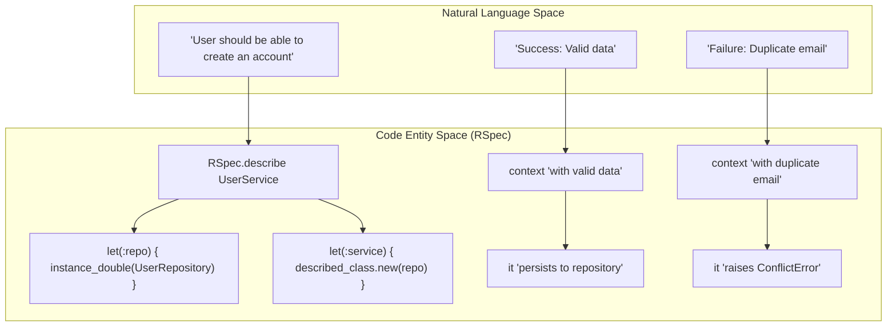
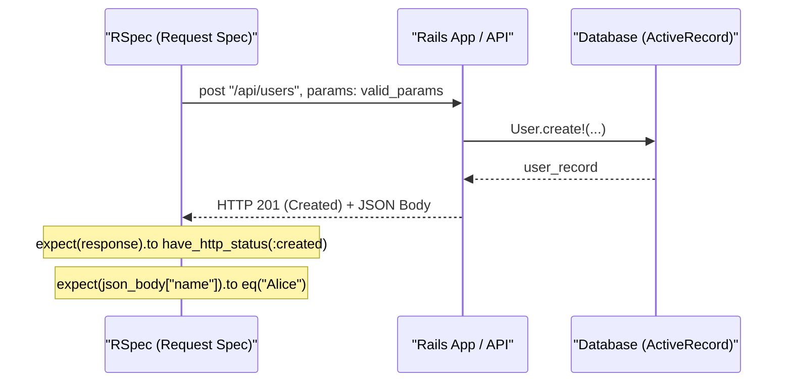

<!-- source: DeepWiki mcp.deepwiki.com · repo LambdaTest/agent-skills · page 9.2 RSpec Skill — Ruby Unit and Integration Testing · fetched 2026-10-26 -->

# RSpec Skill — Ruby Unit and Integration Testing

Relevant source files

The following files were used as context for generating this wiki page:

- [capybara-skill/SKILL.md](capybara-skill/SKILL.md)
- [capybara-skill/reference/advanced-patterns.md](capybara-skill/reference/advanced-patterns.md)
- [capybara-skill/reference/cloud-integration.md](capybara-skill/reference/cloud-integration.md)
- [capybara-skill/reference/playbook.md](capybara-skill/reference/playbook.md)
- [protractor-skill/reference/cloud-integration.md](protractor-skill/reference/cloud-integration.md)
- [rspec-skill/SKILL.md](rspec-skill/SKILL.md)
- [rspec-skill/reference/advanced-patterns.md](rspec-skill/reference/advanced-patterns.md)
- [rspec-skill/reference/playbook.md](rspec-skill/reference/playbook.md)

The RSpec skill provides a comprehensive framework for behavior-driven development (BDD) in Ruby. It covers unit testing for models and service objects, integration testing via request specs, and advanced mocking techniques using verification doubles.

## Core Implementation Architecture

RSpec organizes tests into logical blocks (`describe`, `context`, `it`) to define behavior. It utilizes a domain-specific language (DSL) for assertions (`expect().to`) and lifecycle management (`let`, `subject`, `before`).

### Test Structure and Data Flow

The following diagram illustrates the flow from a Natural Language requirement to the RSpec code entities that implement the test logic.

**Requirement to Code Mapping**

**Sources:** [rspec-skill/SKILL.md:21-47](), [rspec-skill/reference/playbook.md:97-158]()

## Project Configuration

A standard RSpec setup requires a `Gemfile` for dependency management and configuration files (`.rspec`, `spec_helper.rb`) to define execution behavior.

### Essential Dependencies
The testing environment typically includes `rspec-rails` for Rails integration, `factory_bot_rspec` for test data, and `shoulda-matchers` for concise model assertions.
[rspec-skill/reference/playbook.md:5-19]()

### Configuration Files
- **`.rspec`**: Sets default CLI arguments like `--color` and `--order random` [rspec-skill/reference/playbook.md:21-28]().
- **`spec/spec_helper.rb`**: Configures the RSpec framework, including expectation syntax and mock verification [rspec-skill/reference/playbook.md:30-57]().
- **`spec/rails_helper.rb`**: (Rails only) Loads the Rails environment and configures database cleaning strategies [rspec-skill/reference/playbook.md:59-89]().

## Unit Testing: Models and Services

### Service Object Testing with Doubles
Service objects are tested by isolating them from their dependencies using `instance_double`. This ensures that the test only verifies the logic within the service itself.

| Feature | Code Entity | Purpose |
| :--- | :--- | :--- |
| **Dependency** | `instance_double(UserRepository)` | Creates a verified mock of the repository [rspec-skill/reference/playbook.md:98](). |
| **Subject** | `described_class.new(repo)` | Instantiates the class under test [rspec-skill/reference/playbook.md:100](). |
| **Stubbing** | `allow(repo).to receive(:save)` | Defines the behavior of the mock [rspec-skill/reference/playbook.md:108](). |
| **Verification** | `expect(repo).to have_received(:save)` | Asserts that the dependency was called [rspec-skill/reference/playbook.md:124](). |

### Rails Model Validations
Using `shoulda-matchers`, model tests become declarative, verifying presence, uniqueness, and associations with minimal boilerplate.
[rspec-skill/reference/playbook.md:161-185]()

## Integration Testing: Request Specs

Request specs (API tests) verify the entire stack from the routing layer down to the database. They use `have_http_status` and JSON parsing to validate responses.

**Request Spec Data Flow**

**Sources:** [rspec-skill/reference/advanced-patterns.md:88-106](), [capybara-skill/reference/playbook.md:239-252]()

## Advanced Patterns

### Shared Examples and Contexts
To adhere to DRY (Don't Repeat Yourself) principles, RSpec provides mechanisms to share test logic across multiple specs.
- **Shared Examples**: Used to test common behavior across different classes (e.g., "a searchable resource") [rspec-skill/reference/playbook.md:193-224]().
- **Shared Context**: Used to share setup code, such as authentication headers [rspec-skill/reference/playbook.md:227-245]().

### Custom Matchers
Developers can define domain-specific matchers to improve test readability. For example, a `have_json_body_with` matcher can encapsulate JSON parsing and key-value verification [rspec-skill/reference/advanced-patterns.md:111-120]().

### Mocking with Spies
While `instance_double` requires pre-defining expectations, `spy` allows for "act-then-assert" patterns where calls are verified after the action has occurred [rspec-skill/reference/advanced-patterns.md:61-75]().

## CI/CD and Coverage

### SimpleCov Integration
RSpec integrates with `SimpleCov` to generate code coverage reports. Minimum coverage thresholds can be enforced in `spec_helper.rb` to ensure testing rigor.
[rspec-skill/reference/playbook.md:32-39]()

### Database Cleaning Strategy
To maintain test isolation, `DatabaseCleaner` is used to reset the database state between examples. The standard strategy is `:transaction` for speed, with `:truncation` used for the initial suite setup.
[rspec-skill/reference/playbook.md:77-81](), [rspec-skill/reference/advanced-patterns.md:133-135]()

## Summary of Best Practices

| Category | Recommended Pattern | Avoid (Anti-Pattern) |
| :--- | :--- | :--- |
| **Setup** | Use lazy `let` blocks [rspec-skill/SKILL.md:150]() | Using `before` for heavy data setup [rspec-skill/SKILL.md:150]() |
| **Subjects** | Use named subjects: `subject(:service)` [rspec-skill/reference/advanced-patterns.md:141]() | Anonymous `subject { ... }` [rspec-skill/reference/advanced-patterns.md:141]() |
| **Mocking** | Inject dependencies/doubles [rspec-skill/reference/advanced-patterns.md:144]() | Using `allow_any_instance_of` [rspec-skill/reference/advanced-patterns.md:144]() |
| **Syntax** | Use `expect().to` [rspec-skill/SKILL.md:153]() | Using legacy `should` syntax [rspec-skill/SKILL.md:153]() |

**Sources:** [rspec-skill/SKILL.md:147-154](), [rspec-skill/reference/advanced-patterns.md:139-145]()

---

