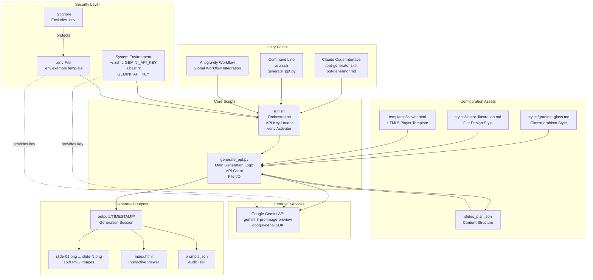

<!-- source: DeepWiki mcp.deepwiki.com · repo op7418/NanoBanana-PPT-Skills · page 1 Home · fetched 2026-10-26 -->

# Home

<details>
<summary>Relevant source files</summary>

The following files were used as context for generating this wiki page:

- [QUICKSTART.md](QUICKSTART.md)
- [README.md](README.md)

</details>


## Purpose and Scope

This wiki documents the **NanoBanana PPT Generator**, an automated presentation generation system that transforms document content into high-quality presentation slides using Google's Gemini AI image generation API. This page provides an overview of the system architecture, core components, and navigation to detailed subsections.

**Navigation Guide:**
- For installation and first-time setup, see [Getting Started](#2)
- For API key configuration and security practices, see [Security & Configuration](#3)
- For detailed usage instructions across different interfaces, see [Usage Guide](#4)
- For understanding the generation process, see [Generation Pipeline](#5)
- For visual style customization, see [Style System](#6)

---

## System Overview

The NanoBanana PPT Generator is a Python-based automation tool that converts textual documents into presentation slides. It leverages the Gemini 3 Pro Image Preview model (also known as "Nano Banana Pro") to generate 16:9 aspect ratio slide images at 2K or 4K resolution.

**Core Capabilities:**
- Automated document analysis and content extraction
- Structured slide planning with configurable page counts (5, 10, 15, 20-25 pages)
- AI-powered image generation via [generate_ppt.py:1-200]()
- Built-in style system with extensible templates in `styles/` directory
- Interactive HTML5 presentation viewer with keyboard navigation
- Multiple entry points: Claude Code integration, command-line interface, and Antigravity workflow

**Key Technologies:**
- Python 3.8+ with `google-genai==1.57.0` and `pillow==12.1.0` dependencies
- Google Gemini API (`gemini-3-pro-image-preview` model)
- Bash orchestration via `run.sh` script
- HTML/CSS/JavaScript viewer template

**Sources:** [README.md:1-93](), [QUICKSTART.md:1-44]()

---

## System Component Architecture

The following diagram maps the system's major components to their concrete implementations in the codebase:

**Diagram: Code Entity Mapping**



**Sources:** [README.md:339-356](), [generate_ppt.py:1-200](), [run.sh:1-50]()

---

## Generation Workflow

This diagram shows the execution flow through actual scripts and data files:

**Diagram: Execution Flow with Code Entities**

```mermaid
flowchart LR
    subgraph "Input Phase"
        DOC["User Document<br/>Markdown/Text Content"]
        PARAMS["User Parameters<br/>--plan<br/>--style<br/>--resolution"]
    end
    
    subgraph "Shell Orchestration"
        RUNSH_EXEC["run.sh execution"]
        VENV_ACT["venv/bin/activate"]
        KEY_LOAD["Load GEMINI_API_KEY<br/>from env or .env"]
        VALIDATION["Validate API Key<br/>Exit if missing"]
    end
    
    subgraph "Python Generation"
        GENPY_EXEC["generate_ppt.py execution"]
        PARSE_ARGS["Parse --plan --style<br/>--resolution --output"]
        LOAD_PLAN["Load slides_plan.json"]
        LOAD_STYLE["Load styles/*.md template"]
        LOOP["For each slide in plan"]
        PROMPT_BUILD["Build prompt:<br/>style + page_type + content"]
        API_CALL["google.genai.ImageGenerationModel<br/>generate_images()"]
        SAVE_IMG["Save slide-XX.png"]
        LOG_PROMPT["Append to prompts.json"]
    end
    
    subgraph "Assembly Phase"
        READ_TEMPLATE["Read templates/viewer.html"]
        INJECT_PATHS["Inject slide paths<br/>into HTML template"]
        WRITE_HTML["Write index.html"]
        COPY_OUTPUT["Copy all to outputs/TIMESTAMP/"]
    end
    
    subgraph "Output"
        RESULT["outputs/TIMESTAMP/<br/>slide-XX.png<br/>index.html<br/>prompts.json"]
    end
    
    DOC --> PARAMS
    PARAMS --> RUNSH_EXEC
    
    RUNSH_EXEC --> VENV_ACT
    VENV_ACT --> KEY_LOAD
    KEY_LOAD --> VALIDATION
    VALIDATION --> GENPY_EXEC
    
    GENPY_EXEC --> PARSE_ARGS
    PARSE_ARGS --> LOAD_PLAN
    PARSE_ARGS --> LOAD_STYLE
    LOAD_PLAN --> LOOP
    LOAD_STYLE --> LOOP
    
    LOOP --> PROMPT_BUILD
    PROMPT_BUILD --> API_CALL
    API_CALL --> SAVE_IMG
    SAVE_IMG --> LOG_PROMPT
    LOG_PROMPT --> LOOP
    
    LOOP -.all complete.-> READ_TEMPLATE
    READ_TEMPLATE --> INJECT_PATHS
    INJECT_PATHS --> WRITE_HTML
    WRITE_HTML --> COPY_OUTPUT
    
    COPY_OUTPUT --> RESULT
```



**Sources:** [run.sh:1-50](), [generate_ppt.py:1-200](), [QUICKSTART.md:1-44]()

---

## System Configuration Reference

The following table maps user-facing concepts to their code implementations:

| Component | Implementation | Location | Purpose |
|-----------|---------------|----------|---------|
| **API Key** | `GEMINI_API_KEY` environment variable | `~/.zshrc` or `.env` | Authentication for Gemini API |
| **Orchestration Script** | `run.sh` bash script | `./run.sh` | Virtual environment activation, key loading, script execution |
| **Core Generator** | `generate_ppt.py` Python script | `./generate_ppt.py` | Main generation logic, API client, file I/O |
| **Style Definitions** | Markdown template files | `styles/gradient-glass.md`<br/>`styles/vector-illustration.md` | Visual style prompt templates |
| **Content Structure** | JSON planning file | `slides_plan.json` | Slide-by-slide content specification |
| **Viewer Template** | HTML5 template file | `templates/viewer.html` | Interactive presentation player |
| **Output Directory** | Timestamped folder | `outputs/YYYYMMDD_HHMMSS/` | Contains all generated assets |
| **Generated Slides** | PNG image files | `slide-01.png` to `slide-N.png` | 16:9 aspect ratio, 2K or 4K resolution |
| **Audit Log** | JSON log file | `prompts.json` | Complete prompt history for debugging |
| **Security Config** | Git ignore rules | `.gitignore` | Prevents `.env` file from being committed |

**Sources:** [README.md:339-356](), [ENV_SETUP.md:1-100](), [.gitignore:1-20]()

---

## Entry Point Options

Users can interact with the system through three distinct interfaces:

### 1. Claude Code Interface
Natural language interaction via the `/ppt-generator` skill defined in `ppt-generator.md`. Claude Code automates the entire workflow from document analysis to output generation. Users specify requirements in natural language, and Claude handles parameter selection and script execution.

**Typical Usage Pattern:**
```
"Generate a 10-page PPT from my-document.md using gradient-glass style at 2K resolution"
```

### 2. Command Line Interface
Direct execution via `run.sh` wrapper script, which:
1. Activates Python virtual environment at `venv/`
2. Loads `GEMINI_API_KEY` from system environment or `.env` file
3. Validates API key presence
4. Executes `generate_ppt.py` with provided arguments

**Typical Usage Pattern:**
```bash
./run.sh --plan slides_plan.json --style styles/gradient-glass.md --resolution 2K
```

### 3. Antigravity Global Workflow
Integration as a reusable workflow component in the Antigravity task automation system. Configuration and execution managed through Antigravity's workflow engine.

**Sources:** [README.md:60-123](), [QUICKSTART.md:38-51]()

---

## Key Architectural Principles

### Security-First Design
The system implements defense-in-depth for API key protection:
- **Priority Order:** System environment variables → `.env` file → fail with instructions
- **Version Control Protection:** `.gitignore` excludes all `.env` files
- **Template Approach:** `.env.example` provides structure without secrets
- **Runtime Validation:** `run.sh` validates key presence before execution

For comprehensive security documentation, see [Security & Configuration](#3).

### Modular Style System
Visual styles are defined in self-contained Markdown files in `styles/` directory. Each style file contains:
- Base prompt template (visual language, aesthetic rules)
- Page-type-specific variants (cover, content, data pages)
- Color scheme and typography specifications
- Layout and composition guidelines

This architecture enables style extensibility without code modification. See [Style System](#6) for details.

### Transparent Output Structure
Each generation session creates an isolated output directory at `outputs/YYYYMMDD_HHMMSS/` containing:
- **slide-XX.png:** Individual slide images
- **index.html:** Self-contained HTML5 viewer with keyboard controls
- **prompts.json:** Complete audit trail of all prompts sent to API

This structure supports debugging, iterative refinement, and prompt engineering workflow.

**Sources:** [SECURITY.md:1-100](), [README.md:339-356](), [QUICKSTART.md:145-154]()

---

## Performance Characteristics

| Metric | 2K Resolution | 4K Resolution |
|--------|---------------|---------------|
| **Generation Time** | ~30 seconds per slide | ~60 seconds per slide |
| **File Size** | ~2.5 MB per slide | ~8 MB per slide |
| **API Model** | `gemini-3-pro-image-preview` | `gemini-3-pro-image-preview` |
| **Output Dimensions** | 2752 × 1536 pixels | 5504 × 3072 pixels |
| **Recommended Use** | Daily presentations, online sharing | Print output, large displays |

**Total Generation Time Examples:**
- 5-page presentation at 2K: ~2.5 minutes
- 10-page presentation at 2K: ~5 minutes
- 15-page presentation at 4K: ~15 minutes

**Sources:** [README.md:364-368](), [QUICKSTART.md:96-103]()

---

## Quick Navigation

**Getting Started:**
- First-time setup and installation → [Installation](#2.2)
- Generate your first presentation → [Your First Presentation](#2.3)

**Configuration:**
- Obtain and configure API keys → [API Key Setup](#3.1)
- Set up environment variables → [Environment Variables](#3.2)
- Security best practices → [Security Best Practices](#3.3)

**Usage:**
- Claude Code natural language interface → [Claude Code Interface](#4.1)
- Direct command-line usage → [Command Line Usage](#4.2)
- Workflow automation integration → [Antigravity Workflow Integration](#4.3)

**Customization:**
- Understand the generation process → [Generation Pipeline](#5)
- Create custom visual styles → [Creating Custom Styles](#6.4)
- Modify the HTML viewer → [HTML Viewer](#7.2)

**Reference:**
- File format specifications → [Configuration Files](#8.1)
- API parameters and models → [Technical Specifications](#8.2)
- Troubleshooting common issues → [Troubleshooting](#8.3)

---

## Repository Structure

```
NanoBanana-PPT-Skills/
├── generate_ppt.py          # Core generation engine
├── run.sh                   # Orchestration wrapper script
├── ppt-generator.md         # Claude Code skill definition
├── .env.example             # Environment variable template
├── .gitignore               # Security: excludes .env files
├── README.md                # User-facing documentation
├── QUICKSTART.md            # 5-minute getting started guide
├── ENV_SETUP.md             # Environment configuration guide
├── SECURITY.md              # Security best practices
├── styles/                  # Visual style template library
│   ├── gradient-glass.md
│   └── vector-illustration.md
├── templates/               # Output templates
│   └── viewer.html          # HTML5 presentation player
├── venv/                    # Python virtual environment (created)
└── outputs/                 # Generated presentations (created)
    └── YYYYMMDD_HHMMSS/     # Timestamped session folder
        ├── slide-01.png
        ├── slide-02.png
        ├── ...
        ├── index.html
        └── prompts.json
```

**Sources:** [README.md:339-356]()

---

## Technology Stack Summary

| Layer | Technology | Package/Tool | Version |
|-------|-----------|--------------|---------|
| **User Interface** | Natural Language | Claude Code | - |
| **User Interface** | Command Line | Bash (`run.sh`) | - |
| **Runtime** | Python | Python 3.8+ | >= 3.8 |
| **API Client** | Google Generative AI SDK | `google-genai` | 1.57.0 |
| **Image Processing** | Python Imaging Library | `pillow` | 12.1.0 |
| **AI Model** | Google Gemini | `gemini-3-pro-image-preview` | API v1 |
| **Output Format** | Slide Images | PNG | 2K/4K |
| **Viewer** | Interactive Player | HTML5 + CSS + JavaScript | - |

**Sources:** [README.md:131-135](), [requirements.txt:1-10]()

---

