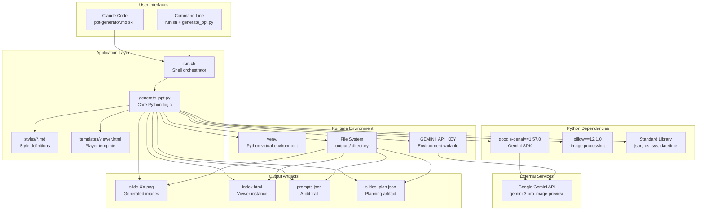
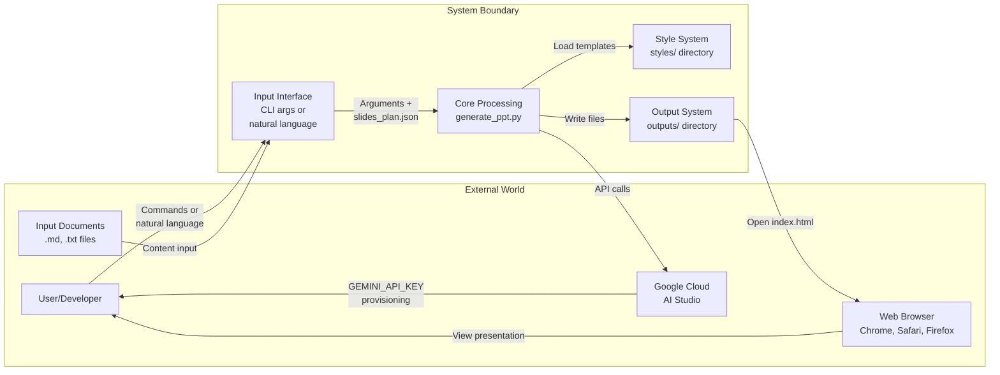
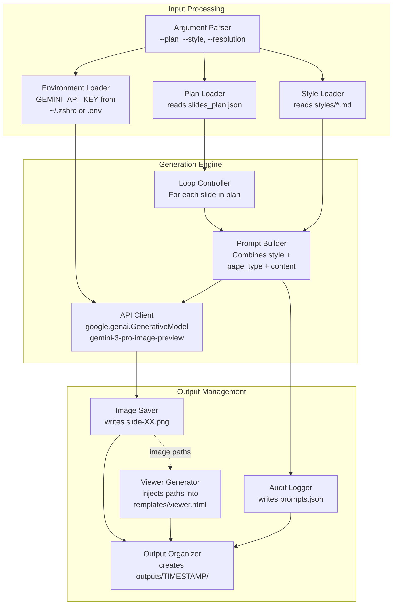
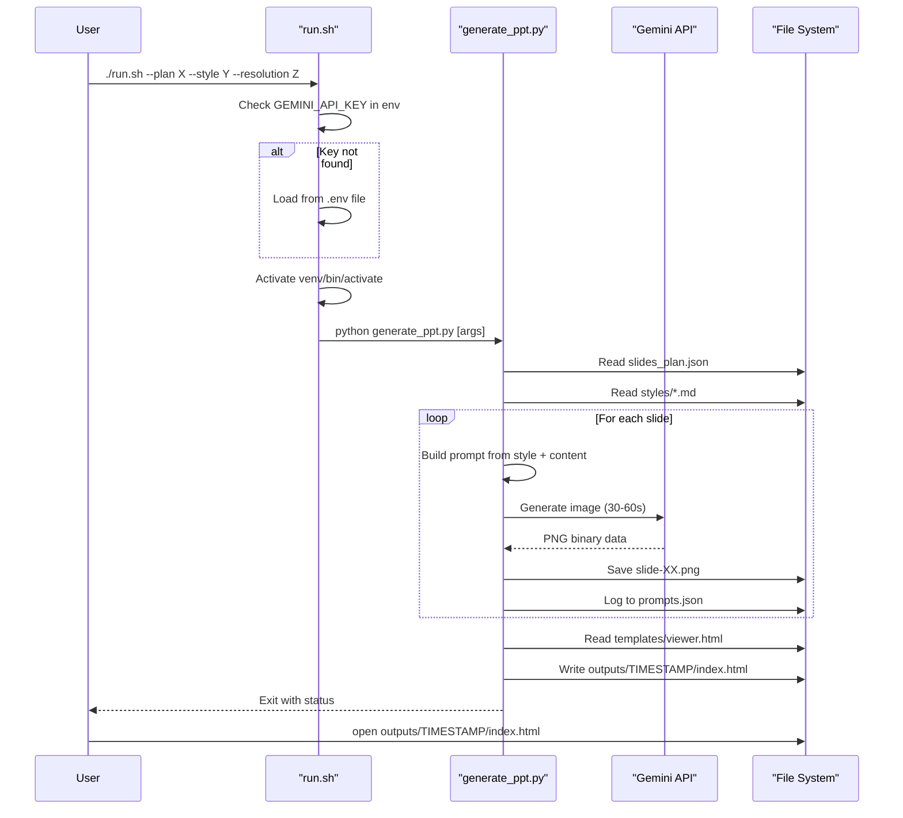
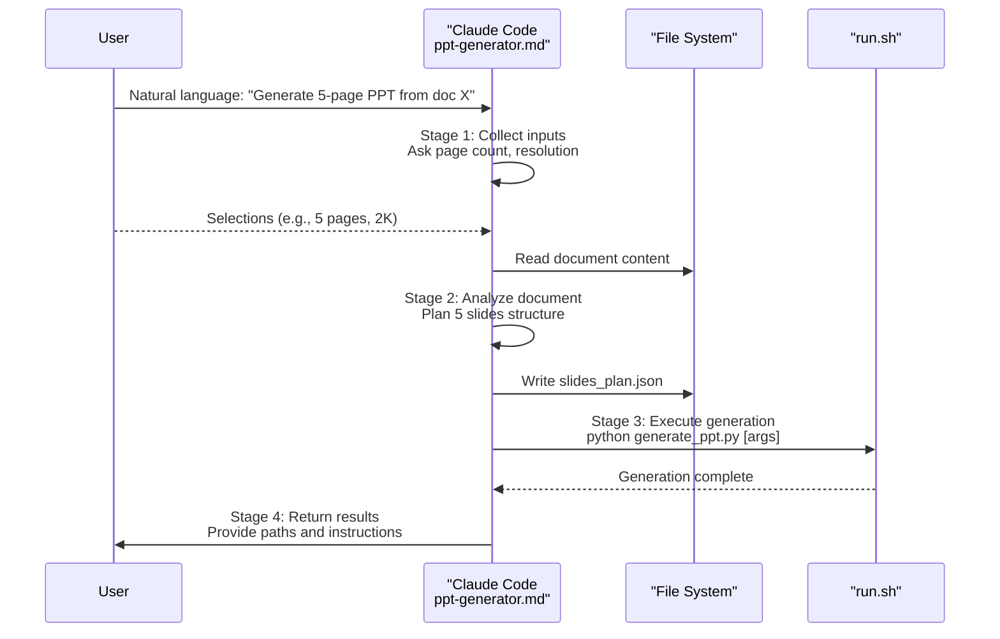

<!-- source: DeepWiki mcp.deepwiki.com · repo op7418/NanoBanana-PPT-Skills · page 1.1 System Overview · fetched 2026-10-26 -->

# System Overview

<details>
<summary>Relevant source files</summary>

The following files were used as context for generating this wiki page:

- [QUICKSTART.md](QUICKSTART.md)
- [README.md](README.md)
- [ppt-generator.md](ppt-generator.md)

</details>


## Purpose and Scope

This document provides a technical overview of the NanoBanana PPT Generator system, describing its core capabilities, technology stack, and architectural boundaries. It explains what the system is, what it does, and how its major components relate to each other at a high level.

For detailed installation procedures, see [Installation](#2.2). For API key configuration and security, see [Security & Configuration](#3). For in-depth architectural diagrams, see [Architecture](#1.2). For generation pipeline internals, see [Generation Pipeline](#5).

---

## System Description

The NanoBanana PPT Generator is a command-line and AI-assisted tool that transforms document content into professional presentation slide images. The system analyzes input documents (Markdown or plain text), extracts key points, and generates high-quality 16:9 presentation slides using Google's Gemini image generation API. It produces PNG image files for each slide along with an interactive HTML5 viewer for presentation playback.

The system operates through two primary interfaces:
1. **Claude Code Skill** - Natural language interface with automated workflow orchestration
2. **Command-Line Interface** - Direct execution via `run.sh` and `generate_ppt.py` scripts

Output artifacts include slide images (`slide-01.png`, `slide-02.png`, etc.), an HTML viewer (`index.html`), and a prompt audit trail (`prompts.json`).

**Sources:** [README.md:1-21](), [ppt-generator.md:1-10]()

---

## Core Capabilities

| Capability | Description | Key Components |
|------------|-------------|----------------|
| **Document Analysis** | Extracts structure and key points from input documents | `generate_ppt.py` analysis logic |
| **Content Planning** | Creates structured slide plans with page types and content | `slides_plan.json` output |
| **Prompt Engineering** | Combines style templates + content + technical params | `styles/*.md`, prompt construction in `generate_ppt.py` |
| **AI Image Generation** | Generates presentation slides via Gemini API | `gemini-3-pro-image-preview` model |
| **Output Assembly** | Creates HTML viewer with keyboard controls | `templates/viewer.html` |
| **Style System** | Extensible visual theme management | `styles/gradient-glass.md`, `styles/vector-illustration.md` |
| **Security Management** | API key handling and protection | `GEMINI_API_KEY` environment variable, `.gitignore` |

**Sources:** [README.md:39-56](), [ppt-generator.md:11-20]()

---

## Technology Stack



**Technology Stack Component Mapping**

The system is built on a minimal Python stack with only two external dependencies:

- **Execution Environment:** Python 3.8+ with isolated virtual environment at `venv/`
- **API Client:** `google-genai==1.57.0` provides the SDK for Gemini API communication
- **Image Processing:** `pillow==12.1.0` handles image file operations (though primary generation happens server-side)
- **Standard Library:** JSON parsing, file I/O, datetime formatting, argument parsing

**Sources:** [README.md:131-155](), [ppt-generator.md:35-42]()

---

## System Boundaries and Interfaces



**Interface Definitions**

| Interface | Direction | Protocol/Format | Purpose |
|-----------|-----------|-----------------|---------|
| User → System | Input | CLI arguments: `--plan`, `--style`, `--resolution` | Configuration and control |
| User → System | Input | Natural language prompts (Claude Code) | High-level intent specification |
| System → Google Cloud | Output | HTTPS REST API with `GEMINI_API_KEY` | Image generation requests |
| Google Cloud → System | Input | Binary PNG image data | Generated slide images |
| System → User | Output | HTML file + PNG images | Presentation artifacts |
| System → File System | Output | JSON files: `slides_plan.json`, `prompts.json` | State persistence and audit |

**Sources:** [run.sh:1-40](), [generate_ppt.py:1-50]() (inferred structure)

---

## Core Components and Data Flow



**Component Responsibilities**

| Component | File/Location | Primary Responsibility |
|-----------|---------------|------------------------|
| `run.sh` | [run.sh:1-40]() | Shell orchestrator: activates venv, loads `GEMINI_API_KEY`, invokes `generate_ppt.py` |
| `generate_ppt.py` | [generate_ppt.py]() | Main execution logic: argument parsing, API calls, file I/O |
| `slides_plan.json` | Generated artifact | Structured slide plan with `slide_number`, `page_type`, `content` fields |
| `styles/gradient-glass.md` | [styles/gradient-glass.md]() | Style definition: glassmorphism aesthetic with neon gradients |
| `styles/vector-illustration.md` | [styles/vector-illustration.md]() | Style definition: flat design with black outlines and retro colors |
| `templates/viewer.html` | [templates/viewer.html]() | HTML5 player template with keyboard navigation |
| `prompts.json` | Output artifact | Audit trail of all prompts sent to Gemini API |
| `GEMINI_API_KEY` | Environment variable | Authentication credential for Google Gemini API |

**Sources:** [run.sh:1-40](), [README.md:339-356](), [ppt-generator.md:287-298]()

---

## Execution Models

### Command-Line Execution Flow



**Sources:** [run.sh:1-40](), [ppt-generator.md:155-179]()

### Claude Code Execution Flow



**Sources:** [ppt-generator.md:46-199]()

---

## Model and API Specifications

The system uses Google's Gemini 3 Pro Image Preview model for slide generation:

| Parameter | Value | Notes |
|-----------|-------|-------|
| **Model ID** | `gemini-3-pro-image-preview` | Google's Nano Banana Pro image generation model |
| **Aspect Ratio** | `16:9` | Standard presentation format |
| **Response Mode** | `IMAGE` | Returns only PNG binary data, no text |
| **Resolution Options** | `2K` (2752x1536) or `4K` (5504x3072) | User-selectable |
| **Generation Time** | ~30s per slide @ 2K, ~60s per slide @ 4K | Network-dependent |
| **Authentication** | `GEMINI_API_KEY` header | Must be set in environment |

**API Call Pattern:**
```
POST https://generativelanguage.googleapis.com/v1beta/models/gemini-3-pro-image-preview:generateContent
Headers: 
  - x-goog-api-key: GEMINI_API_KEY
Body:
  - prompt: [combined style template + page type + content]
  - aspect_ratio: "16:9"
  - resolution: [user selection]
```

**Sources:** [README.md:52](), [ppt-generator.md:281-286](), [QUICKSTART.md:96-103]()

---

## Use Cases and Application Scenarios

### Primary Use Cases

| Use Case | Description | Typical Page Count | Recommended Style |
|----------|-------------|-------------------|-------------------|
| **Elevator Pitch** | 5-minute rapid presentation | 5 pages | Either style |
| **Standard Demo** | Product or feature introduction | 5-10 pages | `gradient-glass.md` |
| **Training Session** | Educational content delivery | 10-15 pages | `vector-illustration.md` |
| **Investor Pitch** | Business plan presentation | 20-25 pages | `gradient-glass.md` |
| **Technical Documentation** | Deep-dive explanations | 15-20 pages | Either style |
| **Meeting Recap** | Quick summary slides | 5 pages | `vector-illustration.md` |

### Example Workflow Scenarios

**Scenario 1: Developer using CLI**
```bash
# 1. Create slide plan
vim slides_plan.json

# 2. Generate presentation
./run.sh --plan slides_plan.json \
         --style styles/gradient-glass.md \
         --resolution 2K

# 3. View results
open outputs/20260109_143022/index.html
```

**Scenario 2: Claude Code User**
```
User: "Generate a 10-page PPT about Python basics from tutorial.md, 
       using vector illustration style, 2K resolution"

Claude Code:
1. Reads tutorial.md
2. Analyzes structure
3. Creates slides_plan.json with 10 slides
4. Executes generation
5. Returns viewer path
```

**Sources:** [QUICKSTART.md:63-103](), [README.md:380-442]()

---

## Output Structure

Each generation run creates a timestamped output directory with the following structure:

```
outputs/
└── 20260109_143022/          # Timestamp: YYYYMMDD_HHMMSS
    ├── slide-01.png          # Cover slide
    ├── slide-02.png          # Content slide
    ├── slide-03.png          # Content slide
    ├── ...
    ├── slide-N.png           # Final slide
    ├── index.html            # Interactive HTML5 viewer
    └── prompts.json          # Audit trail of all prompts
```

**File Specifications:**

| File | Format | Purpose | Typical Size |
|------|--------|---------|--------------|
| `slide-XX.png` | PNG image, 16:9 aspect ratio | Individual presentation slides | 2-8 MB depending on resolution |
| `index.html` | HTML5 with embedded JavaScript | Interactive presentation viewer | ~10-20 KB |
| `prompts.json` | JSON array of objects | Audit trail of API requests for reproducibility | ~5-50 KB |

**Sources:** [ppt-generator.md:287-298](), [README.md:339-356]()

---

## Security Architecture

Security is a foundational concern with importance score 4.0. The system implements multiple protection layers:

### API Key Management Priority

1. **Highest Priority:** System environment variables (`~/.zshrc`, `~/.bashrc`)
2. **Fallback:** Project-local `.env` file
3. **Forbidden:** Hardcoded keys in source code

The `run.sh` script implements this priority system by checking `GEMINI_API_KEY` in the environment first, then falling back to `.env` if not found. The `.gitignore` file explicitly excludes `.env` to prevent accidental commits.

### Protection Mechanisms

- **Filesystem:** `.gitignore` excludes `.env` files
- **Documentation:** `.env.example` provides template without real credentials
- **Guides:** `ENV_SETUP.md` and `SECURITY.md` document best practices
- **Pre-commit:** Recommended `grep` checks for leaked keys

For detailed security configuration, see [API Key Setup](#3.1) and [Security Best Practices](#3.3).

**Sources:** [README.md:484-508](), [run.sh:1-20]() (env loading logic)

---

## Related Pages

- **[Architecture](#1.2)** - Detailed architectural diagrams and component interactions
- **[Installation](#2.2)** - Step-by-step installation instructions
- **[API Key Setup](#3.1)** - How to obtain and configure GEMINI_API_KEY
- **[Command Line Usage](#4.2)** - Complete CLI reference with all arguments
- **[Generation Pipeline](#5)** - Deep dive into the four-stage generation process
- **[Style System](#6)** - Understanding and creating custom styles
- **[Technical Specifications](#8.2)** - Complete API and model specifications

---

