<!-- source: DeepWiki mcp.deepwiki.com · repo op7418/NanoBanana-PPT-Skills · page 1.2 Architecture · fetched 2026-10-26 -->

# Architecture

Relevant source files

The following files were used as context for generating this wiki page:

- [README.md](README.md)
- [generate_ppt.py](generate_ppt.py)
- [run.sh](run.sh)

## Purpose and Scope

This document provides a technical overview of the NanoBanana PPT Generator's architecture, describing the major components, their interactions, and the data flow through the system. It focuses on the structural organization of the codebase and how the components work together to transform document content into presentation slides.

For installation and setup procedures, see [Getting Started](#2). For detailed security configuration, see [Security & Configuration](#3). For usage patterns and interfaces, see [Usage Guide](#4).

---

## System Components Overview

The system follows a **layered architecture** with four primary subsystems: security layer, generation pipeline, style system, and output system. Each subsystem is implemented through a combination of shell scripts, Python modules, configuration files, and templates.

### High-Level Component Diagram

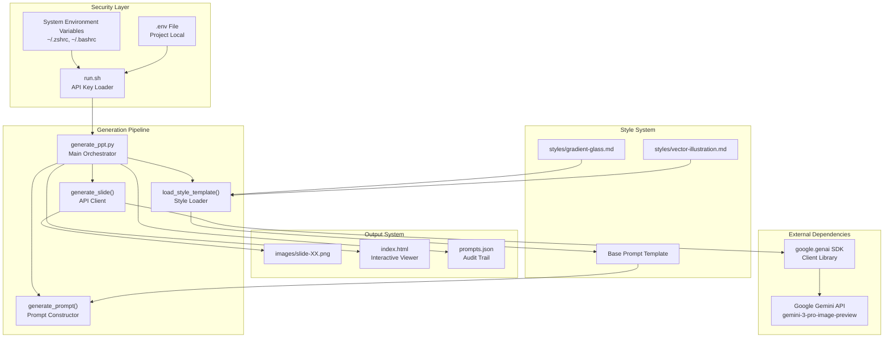

**Sources:** [generate_ppt.py:1-273](), [run.sh:1-48]()

---

## Security Layer Architecture

The security layer implements a **defense-in-depth strategy** for API key management, with multiple protection mechanisms and a clear priority system for credential sources.

### Credential Loading and Validation

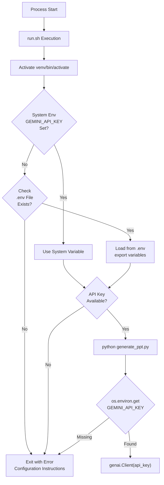

**Sources:** [run.sh:12-48](), [generate_ppt.py:73-77]()

### Credential Priority System

| Priority | Source | Configuration | Protected By |
|----------|--------|---------------|--------------|
| 1 (Highest) | System Environment | `~/.zshrc`, `~/.bashrc` | OS-level permissions |
| 2 (Fallback) | `.env` File | Project directory | `.gitignore` exclusion |
| 3 (Forbidden) | Hardcoded | Source code | Code review, pre-commit checks |

The system checks credential sources in priority order. If the system environment variable `GEMINI_API_KEY` is set, the `.env` file is ignored. This allows users to override project-specific settings with system-wide credentials.

**Sources:** [run.sh:12-38](), [.gitignore]()

---

## Generation Pipeline Architecture

The generation pipeline transforms structured slide plans into rendered images through a **four-stage linear process**: planning, prompt engineering, image generation, and output assembly.

### Pipeline Data Flow

```mermaid
graph LR
    Input["slides_plan.json<br/>Input Specification"]
    MainFunc["main()<br/>Orchestrator"]
    LoadPlan["json.load()<br/>Parse Plan"]
    LoadStyleFunc["load_style_template()<br/>Extract Base Template"]
    StyleFile["styles/*.md<br/>Markdown Template"]
    
    subgraph PromptLoop["For Each Slide Loop"]
        GenPromptFunc["generate_prompt()<br/>style + page_type + content"]
        GenSlideFunc["generate_slide()<br/>API Call + Save"]
        GenAIClient["genai.Client.models.generate_content()"]
        SaveImage["part.as_image().save()"]
    end
    
    GenViewerFunc["generate_viewer_html()<br/>Inject Image Paths"]
    SavePromptsFunc["save_prompts()<br/>Audit Trail"]
    
    Output["outputs/TIMESTAMP/<br/>Complete Package"]
    
    Input --> MainFunc
    MainFunc --> LoadPlan
    MainFunc --> LoadStyleFunc
    StyleFile --> LoadStyleFunc
    LoadPlan --> PromptLoop
    LoadStyleFunc --> GenPromptFunc
    GenPromptFunc --> GenSlideFunc
    GenSlideFunc --> GenAIClient
    GenAIClient --> SaveImage
    SaveImage --> GenViewerFunc
    SaveImage --> SavePromptsFunc
    GenViewerFunc --> Output
    SavePromptsFunc --> Output
```

**Sources:** [generate_ppt.py:144-269]()

### Core Pipeline Functions

#### 1. Style Template Loading

The `load_style_template()` function extracts the base prompt template from style markdown files by parsing section markers.

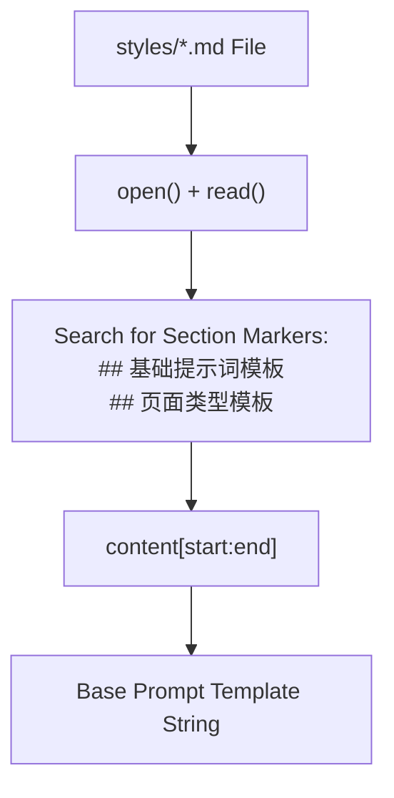

**Sources:** [generate_ppt.py:15-32]()

#### 2. Prompt Construction

The `generate_prompt()` function combines the base style template with page-specific content and type-specific formatting rules.

| Page Type | Trigger Condition | Template Applied | Key Elements |
|-----------|------------------|------------------|--------------|
| `cover` | `page_type == "cover"` OR `slide_number == 1` | Cover page template | 3D glass object, title text, aurora background |
| `data` | `page_type == "data"` OR `slide_number == total_slides` | Data/summary template | Split screen, 3D data visualization |
| `content` | All other cases | Content page template | Bento grid layout, glass containers |

**Sources:** [generate_ppt.py:35-59]()

#### 3. Image Generation

The `generate_slide()` function executes the API call to Google Gemini and handles the response.

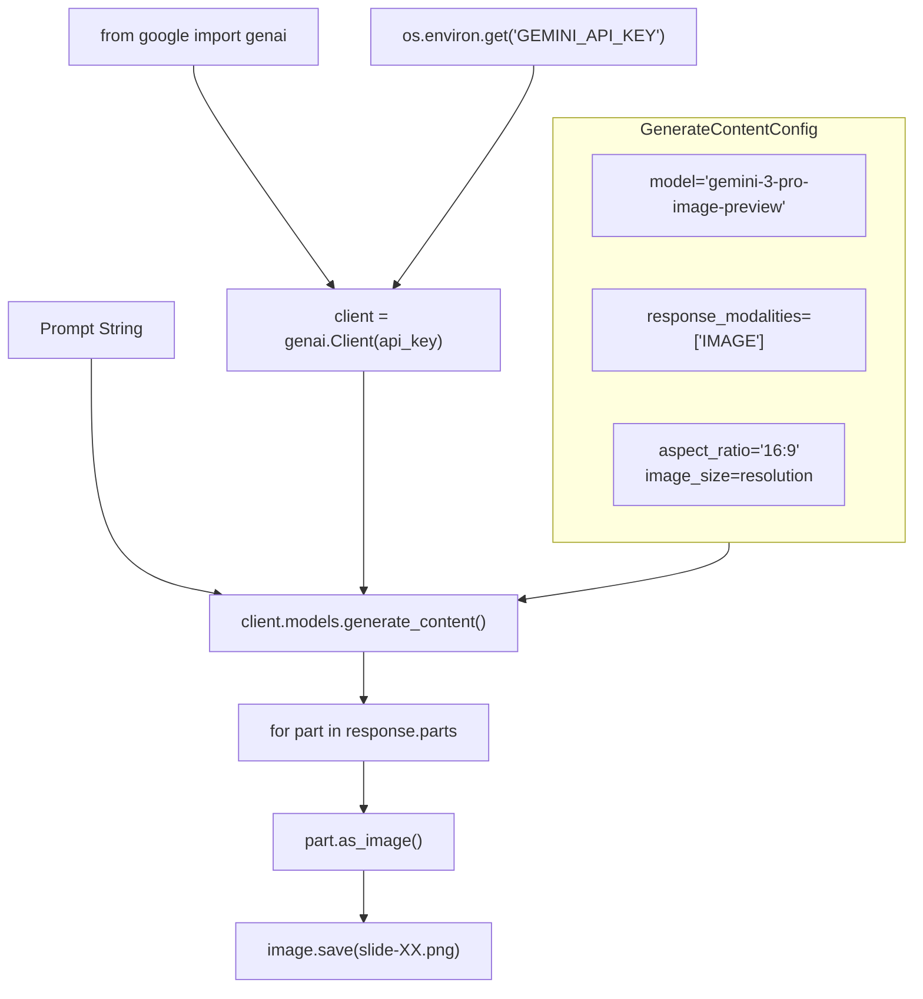

**Sources:** [generate_ppt.py:62-110]()

#### 4. Output Assembly

Two assembly functions produce the final deliverables:

**`generate_viewer_html()`** - Creates the interactive HTML viewer by:
1. Reading the template from `templates/viewer.html`
2. Generating a JavaScript array of image paths: `['images/slide-01.png', ...]`
3. Replacing the `/* IMAGE_LIST_PLACEHOLDER */` marker
4. Writing `index.html` to the output directory

**`save_prompts()`** - Creates an audit trail by:
1. Collecting metadata (title, resolution, style, timestamp)
2. Recording per-slide data (slide_number, page_type, content, prompt, image_path)
3. Serializing to `prompts.json` with UTF-8 encoding and pretty formatting

**Sources:** [generate_ppt.py:112-142]()

---

## Style System Architecture

The style system implements a **template inheritance pattern** where base visual definitions are specialized for different page types. Styles are self-contained markdown documents that define comprehensive visual languages.

### Style File Structure

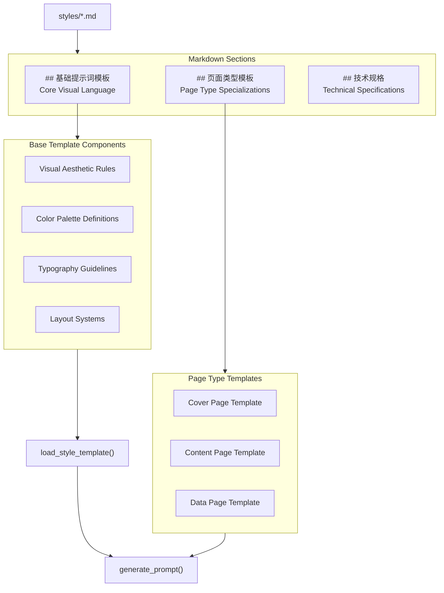

**Sources:** [styles/gradient-glass.md](), [styles/vector-illustration.md]()

### Style Template Extraction Logic

The system extracts only the base template section from style files:

1. **Marker-based parsing**: Searches for `## 基础提示词模板` and `## 页面类型模板` markers
2. **Content extraction**: Returns text between these markers
3. **Fallback behavior**: If markers not found, returns entire file content

This approach allows style files to include documentation and examples while maintaining a clean template extraction process.

**Sources:** [generate_ppt.py:15-32]()

### Built-in Styles Comparison

| Aspect | gradient-glass.md | vector-illustration.md |
|--------|------------------|------------------------|
| Visual Language | Glassmorphism, 3D objects | Flat design, geometric simplification |
| Color Palette | Neon purple, electric blue, coral orange | Retro pastel colors, soft tones |
| Typography | Bold, modern, sans-serif | Playful, outlined, friendly |
| Layout System | Bento grid, floating elements | Structured grids, centered composition |
| Material Effects | Frosted glass, bloom, blur | Solid fills, black outlines |
| Use Cases | Tech products, business presentations | Education, creative proposals |

**Sources:** [styles/gradient-glass.md](), [styles/vector-illustration.md]()

---

## Output System Architecture

The output system produces three distinct artifact types, each serving a different purpose in the presentation workflow.

### Output Directory Structure

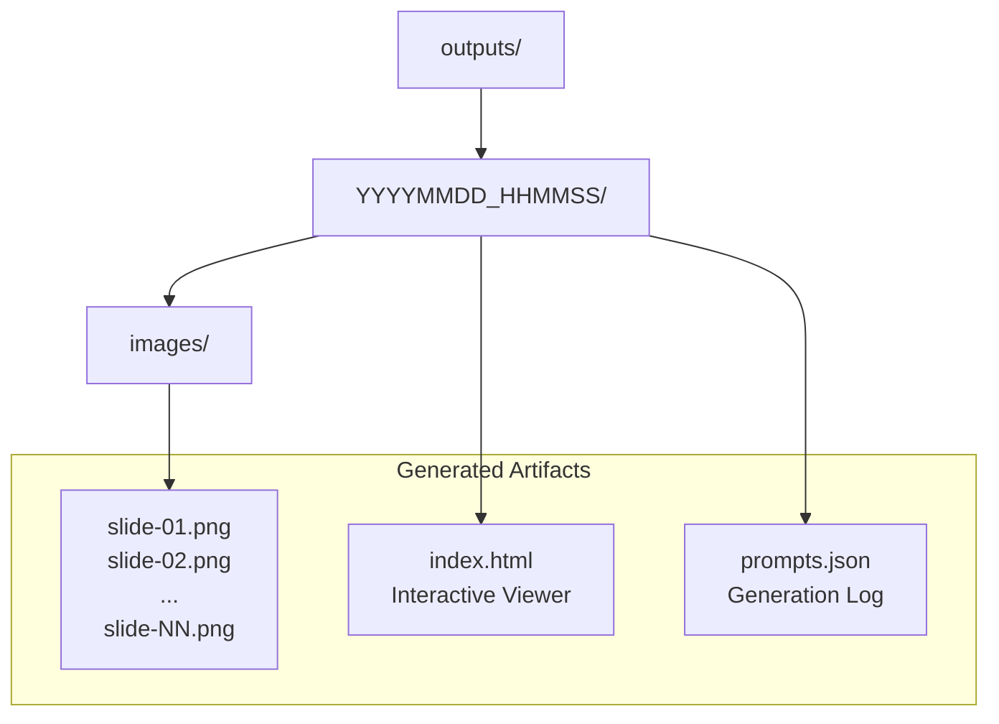

**Sources:** [generate_ppt.py:192-199]()

### Artifact Specifications

#### Image Files (`slide-XX.png`)

- **Naming**: Zero-padded sequential numbering (`slide-01.png`, `slide-02.png`, etc.)
- **Format**: PNG with transparency support
- **Resolution**: 
  - 2K: 2752×1536 pixels (~2.5MB per file)
  - 4K: 5504×3072 pixels (~8MB per file)
- **Aspect Ratio**: 16:9 (standard presentation format)
- **Generation**: Saved by `part.as_image().save()` from Pillow library

**Sources:** [generate_ppt.py:96-101]()

#### HTML Viewer (`index.html`)

The viewer is generated by injecting image paths into a template:

1. **Template source**: `templates/viewer.html` contains the base structure
2. **Placeholder**: `/* IMAGE_LIST_PLACEHOLDER */` marks the injection point
3. **Injection**: JavaScript array of image paths: `['images/slide-01.png', ...]`
4. **Output**: Self-contained HTML file with embedded JavaScript for navigation

**Sources:** [generate_ppt.py:112-133](), [templates/viewer.html]()

#### Audit Trail (`prompts.json`)

The prompts file records complete generation metadata:

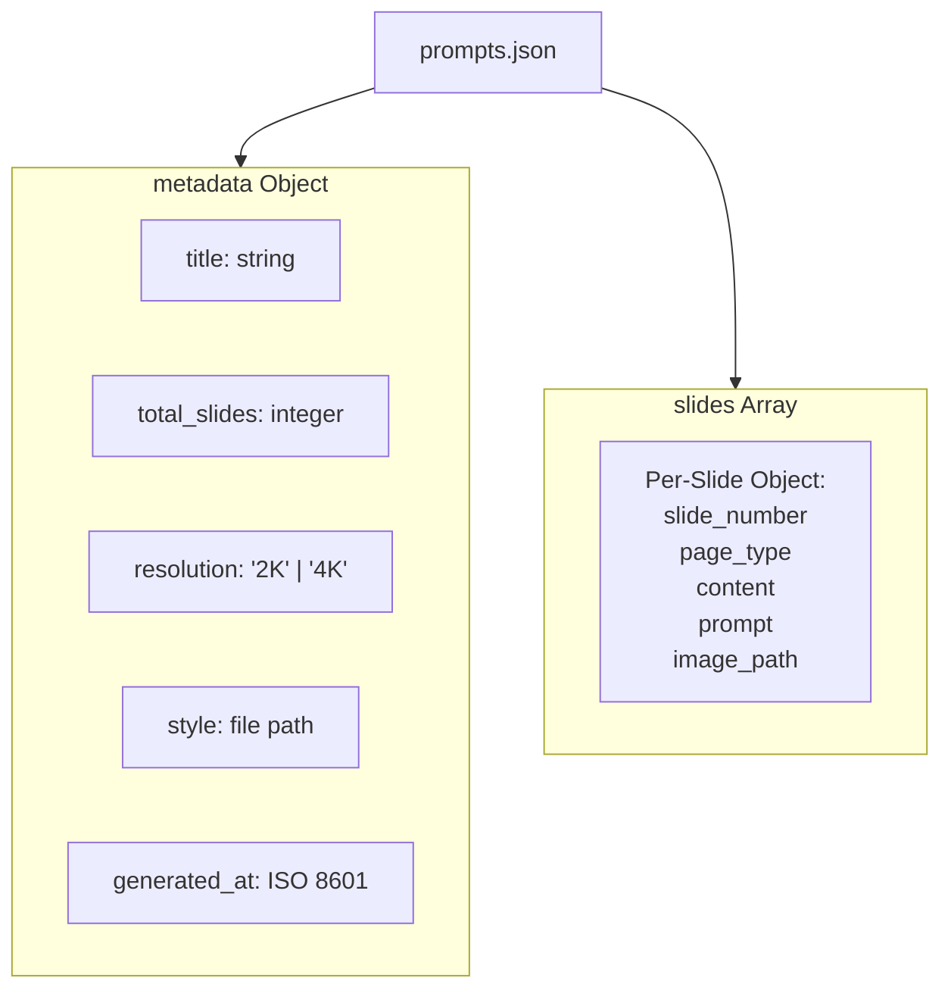

This file enables:
- **Debugging**: Review exact prompts sent to the API
- **Iteration**: Modify prompts and regenerate specific slides
- **Auditing**: Track what content was generated when
- **Documentation**: Understand the mapping between content and visual output

**Sources:** [generate_ppt.py:136-142](), [generate_ppt.py:212-249]()

---

## Execution Flow Architecture

The system execution is orchestrated by two scripts that handle environment setup and generation logic separately.

### Script Responsibility Separation

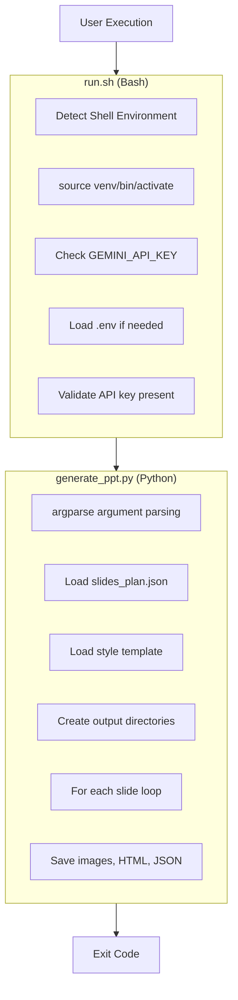

**Sources:** [run.sh:1-48](), [generate_ppt.py:144-272]()

### run.sh Responsibilities

| Line Range | Functionality | Purpose |
|------------|---------------|---------|
| [1-7]() | Shebang and directory detection | Portability across environments |
| [10]() | Virtual environment activation | Isolate Python dependencies |
| [16-35]() | API key priority logic | Implement security best practices |
| [40-44]() | Final validation | Prevent execution without credentials |
| [47]() | Python script invocation | Pass-through all command-line arguments |

**Sources:** [run.sh:1-48]()

### generate_ppt.py Entry Point

The `main()` function at [generate_ppt.py:144-269]() orchestrates the complete pipeline:

1. **Argument parsing** (lines 145-183): Defines CLI interface with `argparse`
2. **Input loading** (lines 186-190): Reads `slides_plan.json` and style template
3. **Directory creation** (lines 192-199): Creates timestamped output directory
4. **Status reporting** (lines 201-209): Prints configuration summary
5. **Generation loop** (lines 223-251): Iterates through slides, generating each
6. **Artifact saving** (lines 254-257): Saves prompts and HTML viewer
7. **Completion report** (lines 259-268): Prints output locations and next steps

**Sources:** [generate_ppt.py:144-272]()

---

## External Dependencies Architecture

The system has a minimal dependency footprint, relying primarily on the Google Gemini SDK and standard library components.

### Dependency Graph

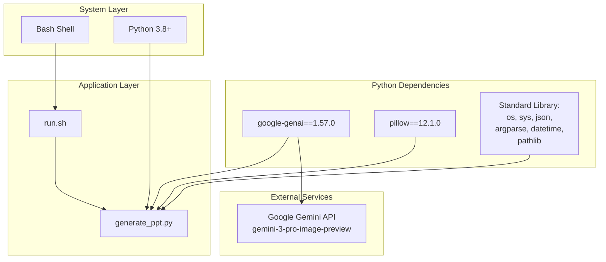

**Sources:** [generate_ppt.py:1-13](), [generate_ppt.py:65-66]()

### Dependency Details

#### google-genai (v1.57.0)

- **Purpose**: Official SDK for Google Gemini API
- **Import**: `from google import genai`, `from google.genai import types`
- **Usage**: 
  - Client instantiation: `genai.Client(api_key)`
  - Content generation: `client.models.generate_content()`
  - Configuration: `types.GenerateContentConfig()`, `types.ImageConfig()`
- **Critical path**: All image generation depends on this library

**Sources:** [generate_ppt.py:65-94]()

#### pillow (v12.1.0)

- **Purpose**: Image processing and format conversion
- **Usage**: Called implicitly by `part.as_image()` from google-genai SDK
- **Function**: Converts API response data to PNG format and saves to disk

**Sources:** [generate_ppt.py:98-100]()

#### Standard Library Modules

| Module | Usage | Functions Used |
|--------|-------|---------------|
| `os` | File system operations, env vars | `os.environ.get()`, `os.makedirs()`, `os.path.join()` |
| `sys` | Exit codes, error handling | `sys.exit()` |
| `json` | Data serialization | `json.load()`, `json.dump()` |
| `argparse` | CLI parsing | `ArgumentParser()`, `add_argument()`, `parse_args()` |
| `datetime` | Timestamps | `datetime.now()`, `strftime()`, `isoformat()` |
| `pathlib` | Path manipulation | `Path()` (imported but not used) |

**Sources:** [generate_ppt.py:7-12]()

---

## API Integration Architecture

The system integrates with Google Gemini API through a structured configuration and response handling pattern.

### API Call Configuration

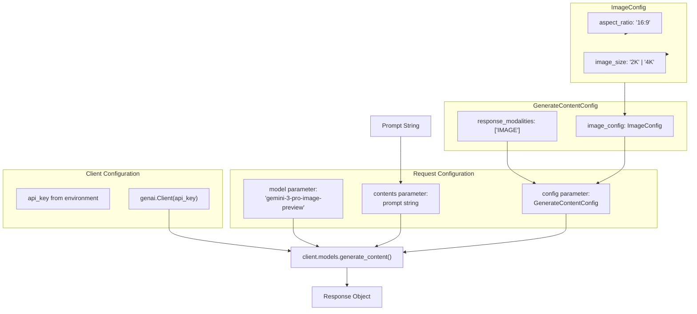

**Sources:** [generate_ppt.py:82-94]()

### Response Processing

The API returns a response object containing parts. Each part may contain:
- `inline_data`: Binary image data
- `as_image()`: Method to convert to Pillow Image object

Processing flow:
1. Iterate through `response.parts`
2. Check if `part.inline_data is not None`
3. Convert to image: `image = part.as_image()`
4. Save to disk: `image.save(image_path)`

**Sources:** [generate_ppt.py:96-105]()

### Error Handling

The system implements error handling at three levels:

1. **Import validation**: Check if `google-genai` is installed [generate_ppt.py:65-70]()
2. **Credential validation**: Check if API key is available [generate_ppt.py:73-77]()
3. **Generation errors**: Catch exceptions during API calls and continue [generate_ppt.py:107-109]()

Each slide generation is isolated, so a failure on one slide does not prevent generation of subsequent slides.

**Sources:** [generate_ppt.py:62-110]()

---

## Data Flow Summary

The complete end-to-end data flow through the system:

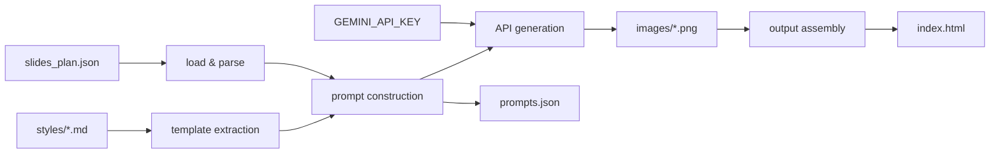

Each slide follows this transformation pipeline independently, with shared style templates and configuration but isolated generation contexts. The timestamp-based output directory ensures multiple generation runs do not conflict.

**Sources:** [generate_ppt.py:144-269]()

---

