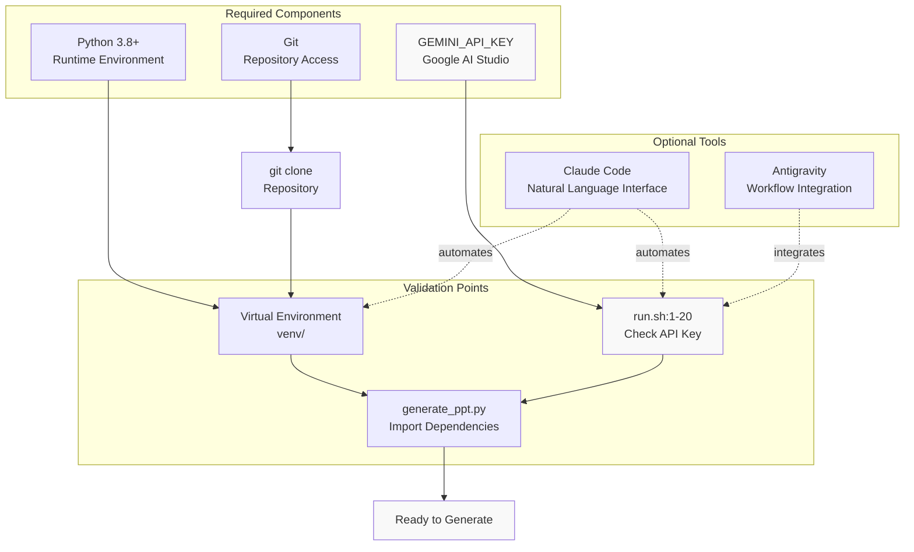
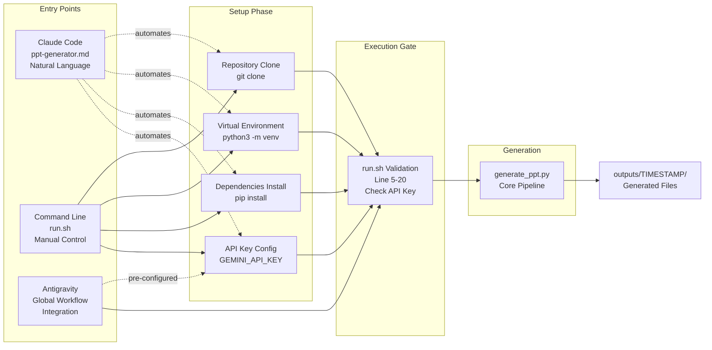
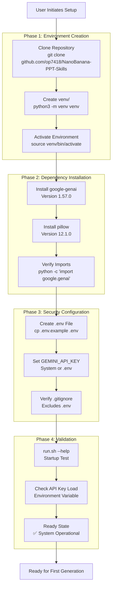

<!-- source: DeepWiki mcp.deepwiki.com · repo op7418/NanoBanana-PPT-Skills · page 2 Getting Started · fetched 2026-10-26 -->

# Getting Started

<details>
<summary>Relevant source files</summary>

The following files were used as context for generating this wiki page:

- [QUICKSTART.md](QUICKSTART.md)
- [README.md](README.md)
- [SETUP_COMPLETE.md](SETUP_COMPLETE.md)

</details>


This document provides an overview of the initial setup and first-run experience for the NanoBanana PPT Generator. It covers prerequisites, available entry points, and the high-level workflow from installation to your first generated presentation.

**Scope**: This page provides orientation and conceptual understanding. For step-by-step instructions, see:
- [Quick Start Guide](#2.1) - Fastest path to a working presentation
- [Installation](#2.2) - Detailed dependency and environment setup
- [Your First Presentation](#2.3) - Complete walkthrough with examples

For API key management and security practices, see [Security & Configuration](#3).

---

## System Prerequisites

Before using the PPT Generator, you need three foundational components. The system validates these during startup and provides clear error messages if any are missing.



**Sources**: [README.md:131-134](), [run.sh:1-20](), [QUICKSTART.md:5-17]()

### Component Details

| Component | Requirement | Validation Method | Error Handling |
|-----------|------------|-------------------|----------------|
| Python | Version 3.8 or higher | `python3 --version` | Script exits with version message |
| API Key | Valid `GEMINI_API_KEY` | Environment variable check in `run.sh` | "❌ 错误: 未设置API密钥" message |
| Git | Any recent version | `git --version` | Manual verification only |
| Dependencies | `google-genai==1.57.0`, `pillow==12.1.0` | Import statements in `generate_ppt.py` | Python ImportError with package name |

**Sources**: [README.md:131-134](), [SETUP_COMPLETE.md:5-8](), [run.sh:1-20]()

---

## Entry Points and User Journeys

The system provides three distinct entry points, each optimized for different user expertise levels and workflow integration needs. All entry points converge on the same security validation and generation pipeline.



**Sources**: [README.md:60-106](), [ppt-generator.md](), [QUICKSTART.md:38-51]()

### Entry Point Comparison

| Entry Point | Automation Level | Setup Time | Best For | Key File |
|-------------|-----------------|------------|----------|----------|
| **Claude Code** | Fully automated | ~2 minutes | First-time users, quick iterations | `ppt-generator.md` |
| **Command Line** | Manual | ~10 minutes | Developers, customization, CI/CD | `run.sh`, `generate_ppt.py` |
| **Antigravity** | Partially automated | ~5 minutes | Workflow integration, repeated tasks | Workflow configuration |

**Sources**: [README.md:60-122](), [QUICKSTART.md:38-62]()

---

## Setup Workflow Architecture

The setup process follows a four-phase linear progression. Each phase must complete successfully before the next can begin. The system creates checkpoint artifacts that prevent redundant work on subsequent runs.



**Sources**: [README.md:138-194](), [SETUP_COMPLETE.md:3-18](), [QUICKSTART.md:14-17]()

### Phase Checkpoints

Each phase creates verifiable artifacts that persist across terminal sessions:

| Phase | Checkpoint File | Validation Command | Recovery Action |
|-------|----------------|-------------------|-----------------|
| 1. Environment | `venv/bin/activate` | `test -d venv && echo "OK"` | Re-run `python3 -m venv venv` |
| 2. Dependencies | `venv/lib/python3.x/site-packages/google/` | `pip list \| grep genai` | Re-run `pip install google-genai pillow` |
| 3. Security | `.env` or `~/.zshrc` entry | `echo $GEMINI_API_KEY` | Reconfigure API key (see [3.1](#3.1)) |
| 4. Validation | Successful `run.sh --help` output | Run validation command | Debug error message output |

**Sources**: [SETUP_COMPLETE.md:76-90](), [README.md:184-194]()

---

## First Run Expectations

When you execute your first generation command, the system progresses through distinct stages with visible progress indicators. Understanding these stages helps set realistic timing expectations and troubleshoot issues.

### Execution Timeline Diagram

```mermaid
gantt
    title First Generation Timeline (5 Pages, 2K Resolution)
    dateFormat X
    axisFormat %Ss
    
    section Startup
    Environment Activation : 0, 2
    API Key Loading : 2, 3
    Import Dependencies : 3, 5
    
    section Planning
    Parse slides_plan.json : 5, 7
    Load Style Template : 7, 9
    
    section Generation
    Slide 1 API Call : 9, 39
    Slide 2 API Call : 39, 69
    Slide 3 API Call : 69, 99
    Slide 4 API Call : 99, 129
    Slide 5 API Call : 129, 159
    
    section Assembly
    Generate index.html : 159, 161
    Copy Templates : 161, 162
    Save prompts.json : 162, 163
```



**Sources**: [QUICKSTART.md:96-103](), [README.md:362-367]()

### Console Output Sequence

```bash
# Phase 1: Startup (2-3 seconds)
✅ 使用系统环境变量中的API密钥
Loading style template: styles/gradient-glass.md
Parsing slides plan: slides_plan.json

# Phase 2: Generation Loop (5 x 30 seconds = 150 seconds)
Generating slide 1/5... (cover page)
✓ Slide 1 saved: outputs/20260109_143022/slide-01.png
Generating slide 2/5... (content page)
✓ Slide 2 saved: outputs/20260109_143022/slide-02.png
[... continues for all slides ...]

# Phase 3: Assembly (1-2 seconds)
Creating HTML viewer...
✓ Viewer created: outputs/20260109_143022/index.html
Saving generation log...
✓ Log saved: outputs/20260109_143022/prompts.json

# Phase 4: Completion
🎉 Generation complete!
Open: outputs/20260109_143022/index.html
```

**Sources**: [generate_ppt.py](), [run.sh:1-30]()

### Generated Output Structure

After successful generation, the `outputs/` directory contains a timestamped folder with all artifacts:

```
outputs/
└── 20260109_143022/          # Timestamp format: YYYYMMDD_HHMMSS
    ├── slide-01.png           # Cover page image (2752x1536 @ 2K)
    ├── slide-02.png           # Content page image
    ├── slide-03.png           # Content page image
    ├── slide-04.png           # Content page image
    ├── slide-05.png           # Content page image
    ├── index.html             # Interactive viewer (from templates/viewer.html)
    └── prompts.json           # Complete prompt log for debugging
```

**File Size Expectations**:
- **2K Resolution**: ~2-2.5MB per PNG, ~10-12MB total for 5 slides
- **4K Resolution**: ~7-8MB per PNG, ~35-40MB total for 5 slides
- **HTML Viewer**: ~15-20KB (embedded CSS/JS)
- **Prompts Log**: ~5-10KB (depends on content length)

**Sources**: [README.md:339-356](), [QUICKSTART.md:54-62](), [templates/viewer.html]()

---

## Minimal Working Example

This is the absolute minimum command sequence to generate a presentation, assuming prerequisites are met:

```bash
# 1. Clone and enter repository
git clone https://github.com/op7418/NanoBanana-PPT-Skills.git
cd NanoBanana-PPT-Skills

# 2. Set API key (choose one method)
export GEMINI_API_KEY="your-key-here"           # Option A: Session variable
echo 'export GEMINI_API_KEY="key"' >> ~/.zshrc  # Option B: Permanent (recommended)

# 3. Install dependencies
python3 -m venv venv
source venv/bin/activate
pip install google-genai pillow

# 4. Generate with test data (if available)
./run.sh --plan test_slides_plan.json \
         --style styles/gradient-glass.md \
         --resolution 2K

# 5. View result
open outputs/*/index.html
```

**Sources**: [QUICKSTART.md:5-56](), [README.md:138-194]()

### Claude Code Alternative (Zero-Command Setup)

For users with Claude Code access, the entire setup reduces to a single natural language prompt:

```
Please install PPT Generator and generate a 5-page presentation about [topic]
using the gradient glass style at 2K resolution.

My API key is: [your-key-here]
```

Claude Code will execute all setup commands automatically and generate the presentation.

**Sources**: [README.md:64-106](), [ppt-generator.md]()

---

## Troubleshooting First Run

Common issues and their diagnostic procedures:

### Issue: "API Key Not Found"

```bash
# Symptom in console:
❌ 错误: 未设置API密钥

# Diagnosis:
echo $GEMINI_API_KEY
# If empty, key not loaded

# Solution:
export GEMINI_API_KEY="your-key"
# OR edit ~/.zshrc to add permanent variable
```

**Sources**: [run.sh:5-20](), [ENV_SETUP.md]()

### Issue: "Module Not Found: google.genai"

```bash
# Symptom:
ModuleNotFoundError: No module named 'google.genai'

# Diagnosis:
which python  # Check if venv is active
# Should show: /path/to/NanoBanana-PPT-Skills/venv/bin/python

# Solution:
source venv/bin/activate
pip install google-genai pillow
```

**Sources**: [SETUP_COMPLETE.md:142-149](), [README.md:153-156]()

### Issue: "Permission Denied: ./run.sh"

```bash
# Symptom:
bash: ./run.sh: Permission denied

# Solution:
chmod +x run.sh
```

**Sources**: [run.sh:1]()

---

## Next Steps

After completing first run successfully:

1. **Explore Built-in Styles**: Review [6.2](#6.2) (Gradient Glass) and [6.3](#6.3) (Vector Illustration) to understand visual options
2. **Learn HTML Viewer Controls**: See [7.2](#7.2) for keyboard shortcuts and features
3. **Customize Content Structure**: Study [5.1](#5.1) to understand how `slides_plan.json` controls output
4. **Integrate into Workflow**: Review [4.3](#4.3) for Antigravity integration or [4.2](#4.2) for advanced CLI usage

**For detailed step-by-step guidance, proceed to**:
- [Quick Start Guide](#2.1) - Condensed 5-minute walkthrough
- [Installation](#2.2) - Comprehensive environment setup
- [Your First Presentation](#2.3) - Complete tutorial with examples

**Sources**: [README.md:13](), [QUICKSTART.md:63-237]()

---

