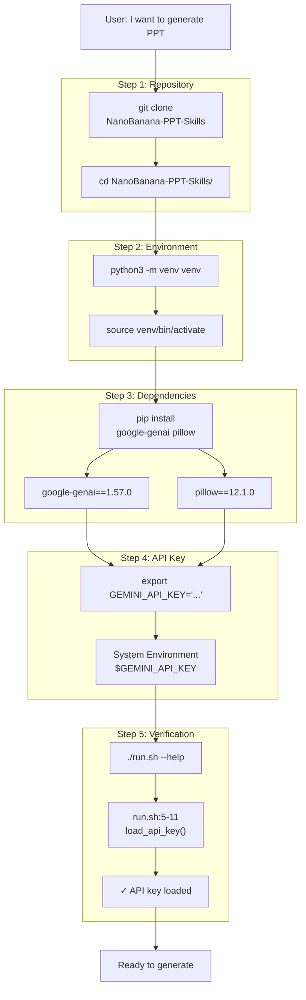
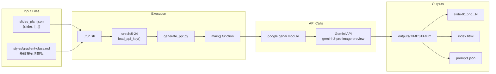

<!-- source: DeepWiki mcp.deepwiki.com · repo op7418/NanoBanana-PPT-Skills · page 2.1 Quick Start Guide · fetched 2026-10-26 -->

# Quick Start Guide

<details>
<summary>Relevant source files</summary>

The following files were used as context for generating this wiki page:

- [QUICKSTART.md](QUICKSTART.md)
- [README.md](README.md)

</details>


This page provides the fastest path to generating your first presentation using the NanoBanana PPT Generator. It covers essential prerequisites, minimal setup commands, and basic execution. For detailed installation instructions, see [Installation](#2.2). For a comprehensive walkthrough of your first presentation, see [Your First Presentation](#2.3).

---

## Purpose and Scope

This guide targets users who want to generate a presentation in under 5 minutes with minimal configuration. It assumes basic familiarity with command-line interfaces and covers:

- Essential prerequisites and verification
- API key configuration (critical path only)
- Basic execution commands
- Expected outputs and validation

For detailed API key management and security practices, see [API Key Setup](#3.1). For advanced usage patterns, see [Command Line Usage](#4.2).

---

## Prerequisites Check

Before starting, verify you have the following:

| Requirement | Verification Command | Expected Output |
|-------------|---------------------|-----------------|
| Python 3.8+ | `python3 --version` | `Python 3.8.x` or higher |
| Git | `git --version` | `git version 2.x.x` |
| Google AI API Key | Visit [Google AI Studio](https://makersuite.google.com/app/apikey) | Active API key string starting with `AIzaSy...` |

**Sources:** [README.md:131-134](), [QUICKSTART.md:5-11]()

---

## Quick Setup Flow

The following diagram maps the minimal setup steps to their corresponding code entities and files:

**Diagram: Minimal Setup Path**



**Sources:** [README.md:60-107](), [QUICKSTART.md:3-61]()

---

## Step-by-Step Execution

### Step 1: Clone and Navigate

```bash
git clone https://github.com/op7418/NanoBanana-PPT-Skills.git
cd NanoBanana-PPT-Skills
```

This creates a local copy of the repository with the following critical files:
- [generate_ppt.py]() - Core generation logic
- [run.sh]() - Shell orchestration script
- [styles/]() - Visual style definitions

**Sources:** [README.md:140-143]()

### Step 2: Create Virtual Environment

```bash
python3 -m venv venv
source venv/bin/activate  # On Windows: venv\Scripts\activate
```

The `venv/` directory isolates Python dependencies and is excluded from version control via [.gitignore:1]().

**Sources:** [README.md:147-150]()

### Step 3: Install Dependencies

```bash
pip install google-genai pillow
```

This installs two required packages:
- `google-genai==1.57.0` - Gemini API client SDK
- `pillow==12.1.0` - Image processing library

**Sources:** [README.md:154-156](), [QUICKSTART.md:14-17]()

### Step 4: Configure API Key

**Option A: System Environment Variable (Recommended)**

```bash
# For zsh (macOS default)
echo 'export GEMINI_API_KEY="your-api-key-here"' >> ~/.zshrc
source ~/.zshrc

# For bash
echo 'export GEMINI_API_KEY="your-api-key-here"' >> ~/.bashrc
source ~/.bashrc
```

**Option B: Project .env File (Fallback)**

```bash
cp .env.example .env
# Edit .env and add: GEMINI_API_KEY=your-api-key-here
```

The [run.sh:5-24]() script implements a priority system: system environment variables are checked first, then `.env` file as fallback.

**Sources:** [README.md:160-183](), [QUICKSTART.md:5-11]()

### Step 5: Verify Installation

```bash
./run.sh --help
```

**Expected Output:**
```
✅ 使用系统环境变量中的API密钥
usage: generate_ppt.py [-h] --plan PLAN --style STYLE ...
```

If you see this message, the API key was successfully loaded from system environment. The verification logic is in [run.sh:5-11]().

**Sources:** [README.md:185-195]()

---

## Basic Generation Command

The following diagram shows the minimal execution path from command to output:

**Diagram: Basic Execution Flow (Code Entities)**



**Sources:** [run.sh](), [generate_ppt.py]()

### Minimal Command

```bash
./run.sh --plan slides_plan.json \
         --style styles/gradient-glass.md \
         --resolution 2K
```

**Parameter Breakdown:**

| Parameter | Description | File Reference |
|-----------|-------------|----------------|
| `--plan` | Slide content structure (JSON format) | See format in [README.md:239-258]() |
| `--style` | Visual style template | [styles/gradient-glass.md]() or [styles/vector-illustration.md]() |
| `--resolution` | Output resolution (`2K` or `4K`) | `2K` = 2752x1536px, `4K` = 5504x3072px |

**Sources:** [README.md:262-266](), [QUICKSTART.md:96-103]()

### Creating slides_plan.json

Create a minimal plan file:

```json
{
  "title": "Quick Start Demo",
  "total_slides": 3,
  "slides": [
    {
      "slide_number": 1,
      "page_type": "cover",
      "content": "Quick Start Demo\nNanoBanana PPT Generator"
    },
    {
      "slide_number": 2,
      "page_type": "content",
      "content": "Key Features\n- AI-powered generation\n- Multiple visual styles\n- 16:9 HD output"
    },
    {
      "slide_number": 3,
      "page_type": "content",
      "content": "Getting Started\n1. Setup API key\n2. Run generation\n3. View results"
    }
  ]
}
```

The `page_type` field determines which template section from the style file is used. Valid types: `cover`, `content`, `data`.

**Sources:** [README.md:239-258](), [QUICKSTART.md:19-36]()

---

## Expected Output and Validation

### Generation Process Timeline

| Phase | Duration (2K) | Console Output | Code Location |
|-------|---------------|----------------|---------------|
| Initialization | < 1s | "使用系统环境变量中的API密钥" | [run.sh:5-24]() |
| Slide 1 generation | ~30s | "Generating slide 1/3..." | [generate_ppt.py]() |
| Slide 2 generation | ~30s | "Generating slide 2/3..." | [generate_ppt.py]() |
| Slide 3 generation | ~30s | "Generating slide 3/3..." | [generate_ppt.py]() |
| Assembly | < 1s | "Creating viewer..." | [generate_ppt.py]() |
| **Total** | **~1.5 min** | "✓ Complete" | |

**Sources:** [QUICKSTART.md:96-103](), [README.md:366-367]()

### Output Directory Structure

```
outputs/
└── 20260109_143022/          # Timestamp-based directory
    ├── slide-01.png          # Generated slide images
    ├── slide-02.png
    ├── slide-03.png
    ├── index.html            # Interactive viewer (from templates/viewer.html)
    └── prompts.json          # Complete prompts used for generation
```

**Sources:** [README.md:339-356]()

### Viewing Results

```bash
# Open the HTML viewer
open outputs/20260109_143022/index.html

# Or manually in browser
# Navigate to: file:///path/to/outputs/TIMESTAMP/index.html
```

**Keyboard Controls in Viewer:**

| Key | Action |
|-----|--------|
| `→` `↓` | Next slide |
| `←` `↑` | Previous slide |
| `ESC` | Toggle fullscreen |
| `Space` | Auto-play toggle |
| `Home` | Jump to first slide |
| `End` | Jump to last slide |
| `H` | Hide/show controls |

The viewer logic is defined in [templates/viewer.html]().

**Sources:** [README.md:323-333](), [QUICKSTART.md:54-61]()

---

## Validation Checklist

After execution, verify the following:

```bash
# 1. Check output directory exists
ls -la outputs/20260109_143022/

# 2. Verify all slides generated
ls -1 outputs/20260109_143022/slide-*.png | wc -l
# Should match total_slides count

# 3. Check prompts were logged
cat outputs/20260109_143022/prompts.json

# 4. Verify file sizes (approximate)
# 2K: ~2-3 MB per slide
# 4K: ~7-9 MB per slide
du -h outputs/20260109_143022/slide-*.png

# 5. Test viewer opens
open outputs/20260109_143022/index.html
```

**Sources:** [QUICKSTART.md:183-219]()

---

## Common Quick-Start Issues

### Issue 1: API Key Not Found

**Symptom:**
```
❌ 未找到GEMINI_API_KEY
```

**Solution:**
```bash
# Verify environment variable is set
echo $GEMINI_API_KEY

# If empty, re-run export command and verify
export GEMINI_API_KEY='your-key-here'
echo $GEMINI_API_KEY
```

The API key check is in [run.sh:5-24]().

**Sources:** [QUICKSTART.md:183-189]()

### Issue 2: Dependencies Missing

**Symptom:**
```
ModuleNotFoundError: No module named 'google.genai'
```

**Solution:**
```bash
# Verify virtual environment is activated
which python3  # Should show venv/bin/python3

# Reinstall dependencies
pip install google-genai pillow
```

**Sources:** [QUICKSTART.md:183-189]()

### Issue 3: Permission Denied on run.sh

**Symptom:**
```
bash: ./run.sh: Permission denied
```

**Solution:**
```bash
chmod +x run.sh
./run.sh --help
```

**Sources:** [README.md:187]()

---

## Resolution and Style Options

### Quick Reference: Resolutions

| Option | Dimensions | File Size | Generation Time | Use Case |
|--------|------------|-----------|-----------------|----------|
| `2K` | 2752×1536 | ~2.5 MB/slide | ~30s/slide | **Recommended**: Daily presentations, online sharing |
| `4K` | 5504×3072 | ~8 MB/slide | ~60s/slide | Print output, large displays |

**Sources:** [README.md:363-367](), [QUICKSTART.md:96-103]()

### Quick Reference: Built-in Styles

| Style File | Visual Aesthetic | Best For | Key Features |
|------------|------------------|----------|--------------|
| `styles/gradient-glass.md` | Glassmorphism, neon gradients, 3D objects | Tech products, business presentations | Bento grid, volumetric lighting |
| `styles/vector-illustration.md` | Flat design, black outlines, retro colors | Education, creative proposals | Geometric simplification, toy-like |

For detailed style specifications, see [Gradient Glass Style](#6.2) and [Vector Illustration Style](#6.3).

**Sources:** [README.md:278-318]()

---

## Next Steps

Once you've successfully generated your first presentation:

1. **Explore Full Features** → See [Your First Presentation](#2.3) for detailed walkthrough
2. **Secure Your API Key** → Review [Security Best Practices](#3.3) and [Environment Variables](#3.2)
3. **Use Claude Code Interface** → Simplify workflow with [Claude Code Interface](#4.1)
4. **Customize Styles** → Learn [Creating Custom Styles](#6.4)
5. **Export Options** → See [Exporting & Sharing](#7.3) for PDF conversion

For troubleshooting beyond quick fixes, see [Troubleshooting](#8.3).

**Sources:** [QUICKSTART.md:220-226](), [README.md:197-277]()

---

