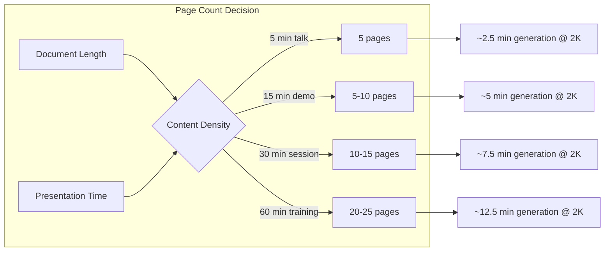
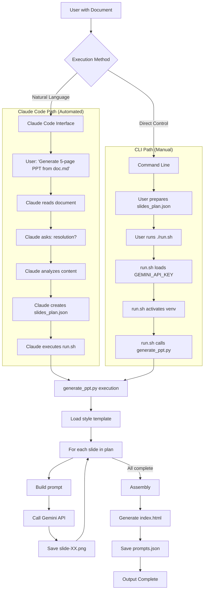
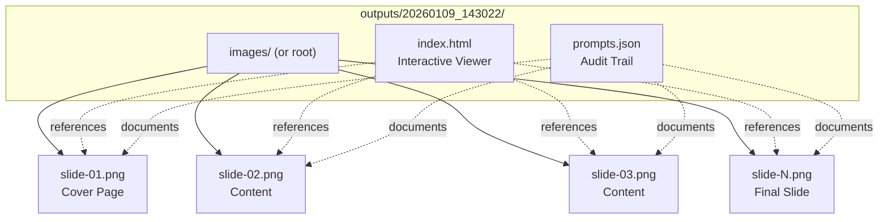
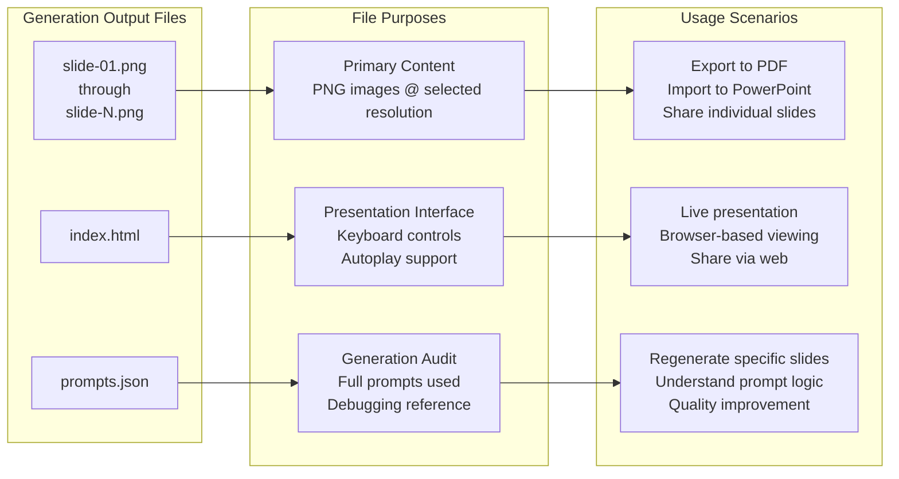

<!-- source: DeepWiki mcp.deepwiki.com · repo op7418/NanoBanana-PPT-Skills · page 2.3 Your First Presentation · fetched 2026-10-26 -->

# Your First Presentation

<details>
<summary>Relevant source files</summary>

The following files were used as context for generating this wiki page:

- [QUICKSTART.md](QUICKSTART.md)
- [SETUP_COMPLETE.md](SETUP_COMPLETE.md)
- [ppt-generator.md](ppt-generator.md)

</details>


## Purpose and Scope

This page provides a complete walkthrough for generating your first presentation using the NanoBanana PPT Generator. It covers input document preparation, parameter selection, execution methods, and viewing the final output. This guide assumes you have completed the installation steps described in [Installation](#2.2).

For the fastest minimal setup, see [Quick Start Guide](#2.1). For details on using specific interfaces, see [Claude Code Interface](#4.1) or [Command Line Usage](#4.2). For technical details on the generation process, see [Generation Pipeline](#5).

---

## Prerequisites Checklist

Before generating your first presentation, verify the following are complete:

| Requirement | Verification Command | Expected Result |
|-------------|---------------------|-----------------|
| Python dependencies installed | `pip list \| grep genai` | `google-genai==1.57.0` |
| Virtual environment activated | `which python` | Path contains `/venv/bin/python` |
| API key configured | `echo $GEMINI_API_KEY` | Non-empty key string |
| Repository cloned | `ls run.sh` | File exists |

If any prerequisite fails, return to [Installation](#2.2) to complete setup.

**Sources:** [SETUP_COMPLETE.md:1-40](), [QUICKSTART.md:5-17]()

---

## Preparing Your Input Document

The system works best with structured text content. The document format determines how effectively the system can extract key points and organize slides.

### Recommended Document Structure

```markdown
# Main Title

## Section 1: Background
Context and motivation...

## Section 2: Core Concepts
- Key point 1
- Key point 2
- Key point 3

## Section 3: Implementation
Detailed explanation...

## Section 4: Conclusion
Summary and takeaways...
```

### Document Format Support

| Format | Support Level | Notes |
|--------|--------------|-------|
| Markdown (`.md`) | Optimal | Best structure extraction |
| Plain Text (`.txt`) | Good | Manual structure parsing |
| Inline text | Good | Direct content provision |

### Content Guidelines

**Well-structured content characteristics:**
- Clear section headings (`##` level)
- Bullet points for key concepts
- 3-5 main points per section
- Concise explanations (not walls of text)

**Example input document** [QUICKSTART.md:19-36]():
```markdown
# My Presentation Topic

## Part 1: Background
Introduction and context...

## Part 2: Core Ideas
- Concept 1: Explanation
- Concept 2: Explanation
- Concept 3: Explanation

## Part 3: Summary
Key findings and recommendations...
```

**Sources:** [QUICKSTART.md:19-95](), [ppt-generator.md:51-53]()

---

## Selecting Generation Parameters

The generation process requires three parameter decisions that affect output quality, generation time, and content coverage.

### Page Count Selection



**Sources:** [QUICKSTART.md:66-70](), [ppt-generator.md:60-65]()

### Style Selection

The system scans the `styles/` directory to discover available visual themes. Currently two built-in styles exist:

| Style File | Visual Theme | Best For |
|-----------|--------------|----------|
| `gradient-glass.md` | Glassmorphism, 3D objects, neon gradients | Tech presentations, business |
| `vector-illustration.md` | Flat design, geometric shapes, retro colors | Education, creative topics |

The system will prompt for style selection if multiple options exist. See [Style System](#6) for detailed style descriptions and [Creating Custom Styles](#6.4) for extension options.

**Sources:** [ppt-generator.md:56-58](), [QUICKSTART.md:119-140]()

### Resolution Selection

| Resolution | Dimensions | Use Case | Generation Time | File Size |
|-----------|-----------|----------|-----------------|-----------|
| 2K (Recommended) | 2752×1536 | Daily presentations, screen viewing | ~30s per slide | ~2MB per slide |
| 4K | 5504×3072 | Print output, large displays | ~60s per slide | ~8MB per slide |

**Recommendation:** Use 2K for initial generation. Regenerate in 4K only for final high-quality output.

**Sources:** [QUICKSTART.md:96-103](), [SETUP_COMPLETE.md:122-124]()

---

## Execution Workflow

The system supports two primary execution paths: automated via Claude Code and manual via command line.

### Execution Path Overview



**Sources:** [ppt-generator.md:46-199](), [SETUP_COMPLETE.md:20-48]()

### Method 1: Claude Code Interface (Recommended for First-Time Users)

The Claude Code interface automates document analysis and parameter selection through natural language interaction.

**Execution steps:**

1. Open Claude Code in your terminal
2. Navigate to the repository directory
3. Issue natural language command [ppt-generator.md:250-254]():

```
I want to generate a 5-page PPT based on my-document.md 
using gradient glass style at 2K resolution.
```

4. Claude will:
   - Read document via Read tool
   - Extract key points and structure
   - Create `slides_plan.json` via Write tool
   - Execute `run.sh` with appropriate parameters
   - Display progress and completion status

**Expected console output** [ppt-generator.md:181-198]():
```
✅ PPT generation successful!

📁 Output directory: ppt-generator/outputs/20260109_143022/
🎬 Viewer page: ppt-generator/outputs/20260109_143022/index.html
📝 Prompt log: ppt-generator/outputs/20260109_143022/prompts.json

Open viewer:
open ppt-generator/outputs/20260109_143022/index.html
```

**Sources:** [ppt-generator.md:46-199](), [SETUP_COMPLETE.md:40-48]()

### Method 2: Command Line Interface

For direct control, execute via shell scripts with explicit parameters.

**Basic command structure** [SETUP_COMPLETE.md:23-25]():
```bash
./run.sh --plan ../test_slides_plan.json \
         --style styles/gradient-glass.md \
         --resolution 2K
```

**The `run.sh` script performs** [SETUP_COMPLETE.md:15-16]():
1. Loads `GEMINI_API_KEY` from `.env` or environment
2. Activates Python virtual environment at `venv/`
3. Calls `generate_ppt.py` with forwarded arguments

**Manual alternative** (when `run.sh` not used) [SETUP_COMPLETE.md:28-38]():
```bash
# Activate environment manually
source venv/bin/activate

# Ensure API key is set
export GEMINI_API_KEY="your-key-here"

# Run generator directly
python generate_ppt.py --plan ../test_slides_plan.json \
                       --style styles/gradient-glass.md \
                       --resolution 2K
```

**Sources:** [SETUP_COMPLETE.md:20-38](), [QUICKSTART.md:109-115]()

---

## Understanding slides_plan.json Structure

Both execution methods require a `slides_plan.json` file that defines presentation structure. Claude Code generates this automatically; CLI users must create it manually or use a pre-generated version.

### File Structure

```json
{
  "title": "Presentation Title",
  "total_slides": 5,
  "slides": [
    {
      "slide_number": 1,
      "page_type": "cover",
      "content": "Title: Main Topic\nSubtitle: Key Theme"
    },
    {
      "slide_number": 2,
      "page_type": "content",
      "content": "Point 1: Description\n- Subpoint A\n- Subpoint B"
    },
    {
      "slide_number": 3,
      "page_type": "content",
      "content": "Point 2: Description\n- Subpoint A\n- Subpoint B"
    }
  ]
}
```

### Page Type Reference

| `page_type` | Purpose | Typical Slides |
|-------------|---------|----------------|
| `cover` | Title slide with hero visual | Slide 1 |
| `content` | Key points with icons/illustrations | Slides 2-N-1 |
| `data` | Summary, conclusions, charts | Final slide(s) |

The `page_type` field determines which prompt template variant is applied during generation. See [Prompt Engineering](#5.2) for details on template application.

**Sources:** [ppt-generator.md:113-149](), [ppt-generator.md:237-241]()

---

## Viewing Your Presentation

Generation produces a timestamped output directory containing all presentation assets.

### Output Directory Structure



**Sources:** [ppt-generator.md:289-298](), [SETUP_COMPLETE.md:66-72]()

### Opening the Viewer

**macOS/Linux** [SETUP_COMPLETE.md:69]():
```bash
open outputs/20260109_143022/index.html
```

**Windows**:
```bash
start outputs/20260109_143022/index.html
```

**Alternative**: Navigate to the directory and double-click `index.html` in file explorer.

### Viewer Controls

The HTML viewer (`templates/viewer.html`) provides keyboard-based navigation:

| Key | Action | Description |
|-----|--------|-------------|
| `←` `→` | Navigate | Previous/Next slide |
| `↑` `Home` | Jump | First slide |
| `↓` `End` | Jump | Last slide |
| `Space` | Autoplay | Toggle automatic progression |
| `ESC` | Fullscreen | Toggle fullscreen mode |
| `H` | UI Toggle | Show/hide controls |

See [HTML Viewer](#7.2) for detailed viewer features and customization options.

**Sources:** [SETUP_COMPLETE.md:132-139](), [ppt-generator.md:192-197]()

---

## Generated Output Files

Each generation creates three types of output files with distinct purposes.

### File Inventory



**Sources:** [ppt-generator.md:289-298](), [SETUP_COMPLETE.md:73-89]()

### Image Files: `slide-XX.png`

PNG files numbered sequentially starting from `01`. Each file contains a complete slide rendered at the selected resolution.

**Properties:**
- Format: PNG with transparency support (if style includes it)
- Aspect ratio: 16:9 (standard presentation format)
- Resolution: 2752×1536 (2K) or 5504×3072 (4K)
- File size: ~2MB (2K) or ~8MB (4K) per slide

**Usage:** Can be directly imported into PowerPoint, Keynote, or Google Slides via "Insert Image" functionality.

### Viewer File: `index.html`

Self-contained HTML document that references slide images and provides interactive navigation. Built from `templates/viewer.html` template with dynamic image path injection.

**Features:**
- Responsive layout adapting to window size
- Keyboard shortcuts for navigation
- Autoplay mode with configurable timing
- Fullscreen API integration
- Mobile gesture support (swipe)

The viewer requires no server; double-clicking the file opens it in any modern browser with full functionality.

### Audit File: `prompts.json`

Complete record of all prompts sent to the Gemini API during generation. Useful for understanding generation logic and debugging unexpected results.

**Structure:**
```json
{
  "slides": [
    {
      "slide_number": 1,
      "page_type": "cover",
      "prompt": "Complete prompt text including style template, content, and technical parameters...",
      "content": "Title: Main Topic\nSubtitle: Theme"
    }
  ]
}
```

**Use cases:**
- Regenerate specific slides with modified prompts
- Understand why certain visual elements appeared
- Create custom variations by editing prompts manually

See [Prompt Engineering](#5.2) for details on prompt construction logic.

**Sources:** [ppt-generator.md:289-298](), [QUICKSTART.md:146-154]()

---

## Common First-Time Scenarios

### Scenario 1: Testing with Minimal Content

**Goal:** Verify system functionality before committing to full generation.

**Approach:**
1. Create simple 3-slide document [QUICKSTART.md:23-36]():
```markdown
# Test Topic
## Point 1
Key concept here
## Point 2
Another concept
```

2. Generate 5-page presentation at 2K
3. Total time: ~2.5 minutes
4. Review output quality before larger projects

### Scenario 2: Converting Existing Documentation

**Goal:** Transform technical documentation into presentation format.

**Approach:**
1. Identify 3-5 core sections from documentation
2. Extract key bullet points from each section
3. Create condensed markdown with clear headings
4. Generate 10-page presentation for comprehensive coverage
5. Review `prompts.json` to understand content extraction

**Tip:** The system extracts better when document has clear hierarchy (`#`, `##`, bullet points) rather than prose paragraphs.

### Scenario 3: Iterative Refinement

**Goal:** Improve presentation through multiple generations.

**Approach:**
1. Generate initial version at 2K resolution
2. Review `prompts.json` to see what content was extracted
3. Adjust source document structure based on extraction quality
4. Regenerate with refined input
5. Only move to 4K resolution when content is finalized

This workflow minimizes 4K generation time (60s/slide) by iterating at 2K speed (30s/slide).

**Sources:** [QUICKSTART.md:63-103](), [QUICKSTART.md:142-154]()

### Scenario 4: Multiple Style Comparison

**Goal:** Test which visual style best fits content.

**Approach:** [QUICKSTART.md:109-115]()
```bash
# Generate with gradient-glass style
python generate_ppt.py --plan plan.json \
  --style styles/gradient-glass.md \
  --resolution 2K \
  --output outputs/v1-gradient

# Generate with vector-illustration style
python generate_ppt.py --plan plan.json \
  --style styles/vector-illustration.md \
  --resolution 2K \
  --output outputs/v2-vector
```

Both use same `plan.json` but different style templates, enabling direct visual comparison.

**Sources:** [QUICKSTART.md:105-115]()

---

## Troubleshooting First Generation

### Issue: API Key Not Found

**Error message:**
```
Error: GEMINI_API_KEY environment variable not set
```

**Resolution:**
1. Verify key is set: `echo $GEMINI_API_KEY`
2. If empty, export manually: `export GEMINI_API_KEY='your-key'`
3. For persistent setup, see [Environment Variables](#3.2)

### Issue: Dependency Import Error

**Error message:**
```
ModuleNotFoundError: No module named 'google.genai'
```

**Resolution:**
1. Activate virtual environment: `source venv/bin/activate`
2. Verify installation: `pip list | grep genai`
3. If missing: `pip install google-genai==1.57.0 pillow==12.1.0`

### Issue: Generation Timeout

**Symptoms:** Script appears frozen at "Generating slide X/N..."

**Common causes:**
- Network connectivity issues
- API rate limiting
- Invalid API key

**Resolution:**
1. Check network: `curl https://google.com`
2. Verify API key validity at [Google AI Studio](https://makersuite.google.com/app/apikey)
3. Wait 60 seconds and retry
4. If persistent, try 2K resolution instead of 4K

For comprehensive troubleshooting, see [Troubleshooting](#8.3).

**Sources:** [ppt-generator.md:200-226](), [SETUP_COMPLETE.md:140-165]()

---

## Next Steps

After successfully generating your first presentation:

1. **Explore styles:** Try the alternative visual style (see [Style System](#6))
2. **Learn advanced parameters:** Review full CLI options in [Command Line Usage](#4.2)
3. **Understand generation logic:** Read [Generation Pipeline](#5) for technical details
4. **Export presentations:** Learn PDF export in [Exporting & Sharing](#7.3)
5. **Create custom styles:** Design your own visual themes in [Creating Custom Styles](#6.4)

**Sources:** [QUICKSTART.md:227-239](), [SETUP_COMPLETE.md:103-119]()

---

