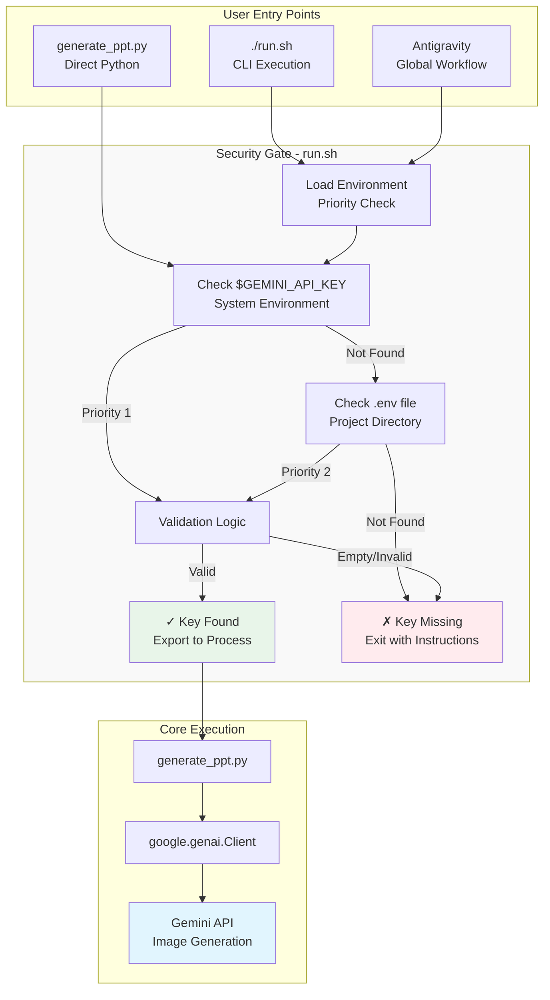
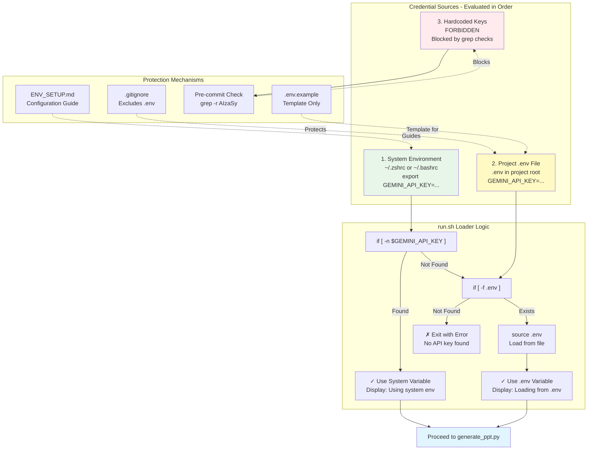
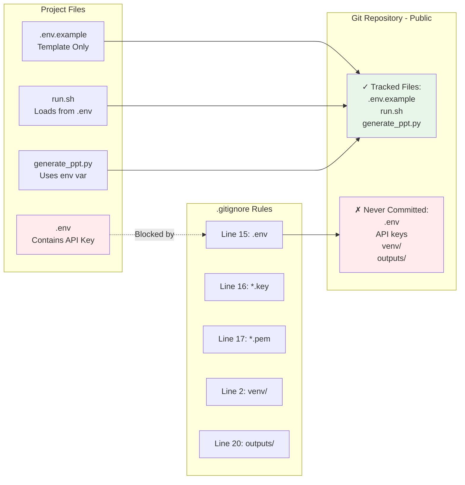
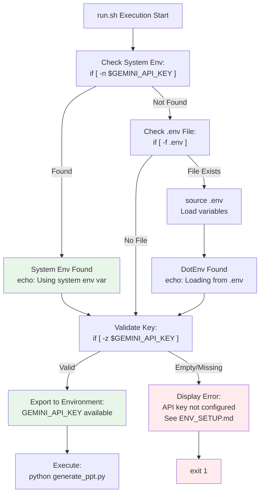

<!-- source: DeepWiki mcp.deepwiki.com · repo op7418/NanoBanana-PPT-Skills · page 3 Security & Configuration · fetched 2026-10-26 -->

# Security & Configuration

<details>
<summary>Relevant source files</summary>

The following files were used as context for generating this wiki page:

- [.env.example](.env.example)
- [.gitignore](.gitignore)
- [ENV_SETUP.md](ENV_SETUP.md)
- [SECURITY.md](SECURITY.md)

</details>


## Purpose and Scope

This document provides a comprehensive guide to the security architecture and configuration management of the NanoBanana PPT Generator. The system implements a **defense-in-depth security model** where API key protection is the highest priority, as all functionality depends on secure access to the Google Gemini API.

This page covers the overall security architecture and configuration strategy. For detailed step-by-step instructions, see:
- [API Key Setup](#3.1) - obtaining and configuring your GEMINI_API_KEY
- [Environment Variables](#3.2) - system-level configuration details
- [Security Best Practices](#3.3) - key rotation, monitoring, and emergency procedures
- [Git Safety](#3.4) - preventing accidental credential exposure

## Security Architecture Overview

The system implements a **four-layer security model** where each layer provides independent protection, ensuring that even if one mechanism fails, others remain active.

### Security Gate Architecture



**How the Security Gate Works:**

1. **Entry Point**: All user interfaces converge on `run.sh` script
2. **Priority Check**: System environment variable `$GEMINI_API_KEY` is checked first
3. **Fallback**: If system variable not found, checks `.env` file in project directory
4. **Validation**: Ensures the key exists and is non-empty
5. **Export**: Valid key is exported to the execution environment
6. **Execution**: Only proceeds if validation succeeds

**Sources:** [ENV_SETUP.md:32-42](), [SECURITY.md:19-29]()

## Credential Management System

The system supports **three credential sources** with a strict priority hierarchy. Hardcoded keys are explicitly forbidden and blocked by pre-commit checks.

### Credential Source Priority



### Priority Rationale

| Priority | Source | Security Level | Portability | Use Case |
|----------|--------|----------------|-------------|----------|
| **1** | System Environment (`~/.zshrc`) | ✅ Highest | ✅ Cross-project | Recommended for all users |
| **2** | Project `.env` File | ⚠️ Medium | ⚠️ Per-project | Legacy/fallback support |
| **3** | Hardcoded in Code | ❌ Forbidden | ❌ None | Blocked by security checks |

**Sources:** [ENV_SETUP.md:7-13](), [ENV_SETUP.md:32-42](), [SECURITY.md:19-29]()

## Defense-in-Depth Protection Layers

The system implements **four independent protection layers**, each addressing a different attack vector.

### Layer 1: Filesystem Protection



**File-Level Protection Mapping:**

| File/Directory | Sensitivity | .gitignore Rule | Status |
|----------------|-------------|-----------------|--------|
| `.env` | 🔴 Critical | Line 15: `.env` | ✅ Protected |
| `venv/` | 🟡 Medium | Line 2: `venv/` | ✅ Protected |
| `outputs/` | 🟢 Low | Line 20: `outputs/` | ✅ Protected |
| `.env.example` | 🟢 Safe | Not ignored | ✅ Tracked |
| `run.sh` | 🟢 Safe | Not ignored | ✅ Tracked |

**Sources:** [.gitignore:14-17](), [SECURITY.md:5-17](), [SECURITY.md:30-45]()

### Layer 2: Runtime Validation

The `run.sh` script performs validation before execution begins, ensuring that missing or invalid keys are caught early.

**Validation Flow in run.sh:**



**Sources:** [ENV_SETUP.md:32-42]()

### Layer 3: Pre-Commit Security Checks

Manual security verification commands prevent accidental key exposure before commits.

**Security Check Commands:**

```bash
# Check if .env is properly ignored
git check-ignore -v .env
# Expected: .gitignore:15:.env    .env

# Search for API keys in codebase
grep -r "AIzaSy" --exclude-dir=.git --exclude-dir=venv --exclude-dir=outputs .
# Expected: No output (or only in .env which won't be committed)

# Verify what files will be committed
git add -n .
# Verify .env is NOT in the list

# Check if .env was ever committed
git log --all --full-history --source -- .env
# Expected: No output (or follow cleanup procedure)
```

**Sources:** [SECURITY.md:47-79](), [ENV_SETUP.md:69-74]()

### Layer 4: Documentation and Templates

The system provides comprehensive documentation and safe templates to guide users toward secure configurations.

**Documentation Files:**

| File | Purpose | Key Content |
|------|---------|-------------|
| `ENV_SETUP.md` | Environment variable setup | System env var configuration for zsh/bash/fish |
| `SECURITY.md` | Git safety procedures | Pre-commit checks, history cleanup |
| `.env.example` | Safe configuration template | Template with placeholder `your-api-key-here` |

**Sources:** [ENV_SETUP.md:1-6](), [SECURITY.md:1-5](), [.env.example:1-10]()

## Configuration Quick Reference

### First-Time Setup

**Recommended: System Environment Variables**

```bash
# For zsh users (macOS default)
echo 'export GEMINI_API_KEY="your-api-key"' >> ~/.zshrc
source ~/.zshrc

# For bash users (Linux default)
echo 'export GEMINI_API_KEY="your-api-key"' >> ~/.bashrc
source ~/.bashrc

# For fish users
set -Ux GEMINI_API_KEY "your-api-key"

# Verify configuration
echo $GEMINI_API_KEY
```

**Alternative: Project .env File**

```bash
# Copy template
cp .env.example .env

# Edit .env file
# GEMINI_API_KEY=your-api-key-here

# Verify .env is in .gitignore
git check-ignore -v .env
```

**Sources:** [ENV_SETUP.md:101-119](), [SECURITY.md:169-184]()

### Verification Commands

| Task | Command | Expected Result |
|------|---------|-----------------|
| Check system variable | `echo $GEMINI_API_KEY` | Displays your API key |
| Verify .env ignored | `git check-ignore -v .env` | `.gitignore:15:.env .env` |
| Search for keys in code | `grep -r "AIzaSy" --exclude-dir=.git .` | No output (or only in .env) |
| Test execution | `./run.sh --help` | Shows help without errors |
| Check what Git tracks | `git status` | No .env in the list |

**Sources:** [ENV_SETUP.md:26-30](), [SECURITY.md:49-75]()

## Security Checklist

Before committing code or deploying to production, verify all items:

### Pre-Commit Checklist

- [ ] API key stored in system environment variable OR .env file
- [ ] `.env` file listed in `.gitignore` (line 15)
- [ ] Run `grep -r "AIzaSy" .` returns no matches in tracked files
- [ ] `.env.example` contains only placeholder `your-api-key-here`
- [ ] `run.sh` contains no hardcoded API keys
- [ ] `git status` does not show `.env` file
- [ ] Documentation files use placeholders, not real keys
- [ ] `venv/` and `outputs/` directories are ignored

### Deployment Checklist

- [ ] Production environment uses secure secret management (GitHub Secrets, AWS Secrets Manager, HashiCorp Vault)
- [ ] API keys are rotated regularly (every 3-6 months)
- [ ] API usage monitoring is enabled
- [ ] Different projects use different API keys (recommended)
- [ ] Emergency key revocation procedure is documented
- [ ] Backup of environment variable configuration exists (stored securely)

**Sources:** [ENV_SETUP.md:201-212](), [SECURITY.md:157-167](), [SECURITY.md:206-223]()

## Emergency Procedures

### If API Key is Exposed

If you accidentally commit an API key to Git:

1. **Immediately revoke the key** at https://makersuite.google.com/app/apikey
2. **Generate a new API key** and configure it in your environment
3. **Clean Git history** to remove the exposed key:

```bash
# Remove .env from all Git history
git filter-branch --force --index-filter \
  "git rm --cached --ignore-unmatch .env" \
  --prune-empty --tag-name-filter cat -- --all

# Force push (coordinate with team first!)
git push origin --force --all
```

4. **For public repositories**, consider deleting and recreating the repository
5. **Monitor API usage** for unusual activity with the exposed key

**Sources:** [SECURITY.md:125-155]()

## Multi-Environment Support

The system supports different deployment environments with appropriate security models:

| Environment | Credential Storage | Protection Mechanism | Use Case |
|-------------|-------------------|---------------------|----------|
| **Development** | `.env` file or system env var | `.gitignore` exclusion | Local development |
| **Collaboration** | `.env.example` template | Documentation guides | Team onboarding |
| **CI/CD** | GitHub Secrets | Encrypted at rest | Automated testing |
| **Production** | KMS (AWS/Azure/Vault) | Centralized key management | Enterprise deployment |

**Sources:** [ENV_SETUP.md:91-126](), [SECURITY.md:206-223]()

---

**Key Takeaway:** The system's security architecture is built on the principle that **API keys must never exist in version control**. Multiple independent protection layers ensure this principle is maintained even if individual mechanisms fail. System environment variables are the recommended approach for maximum security and convenience.

---

