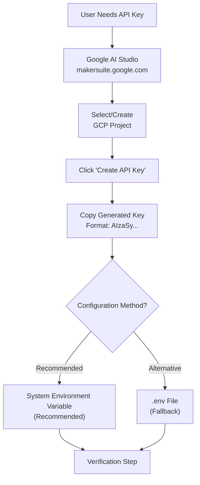
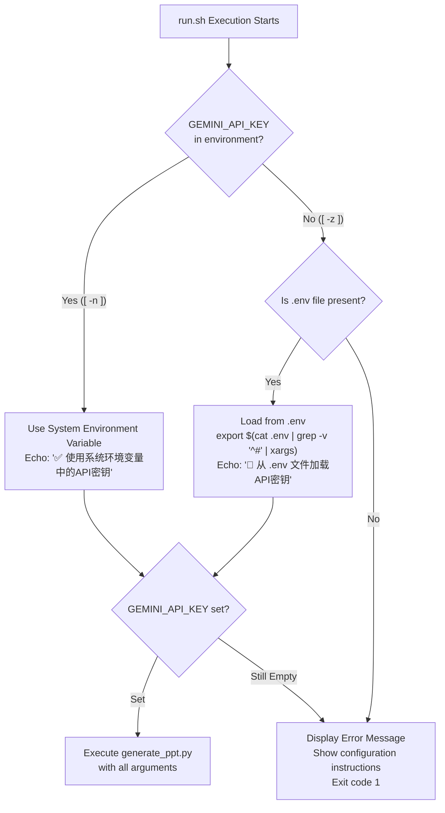
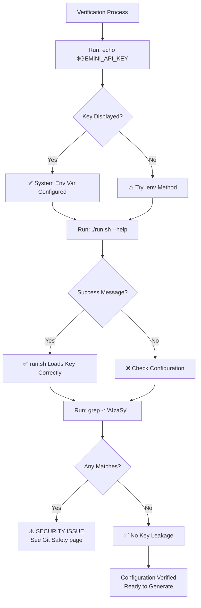
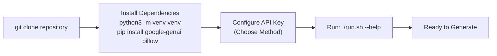

<!-- source: DeepWiki mcp.deepwiki.com · repo op7418/NanoBanana-PPT-Skills · page 3.1 API Key Setup · fetched 2026-10-26 -->

# API Key Setup

<details>
<summary>Relevant source files</summary>

The following files were used as context for generating this wiki page:

- [.env.example](.env.example)
- [ENV_SETUP.md](ENV_SETUP.md)
- [run.sh](run.sh)

</details>


This document explains how to obtain a Google Gemini API key and configure it for use with the NanoBanana PPT Generator. It covers the acquisition process, two configuration methods (system environment variables and `.env` files), and verification procedures.

For information about environment variable priority and cross-shell configuration, see [Environment Variables](#3.2). For security best practices including key rotation and emergency response, see [Security Best Practices](#3.3). For preventing accidental commits of API keys, see [Git Safety](#3.4).

---

## Overview

The system requires a `GEMINI_API_KEY` to authenticate with Google's Gemini API (`gemini-3-pro-image-preview` model). This key serves as the security gate through which all generation requests must pass. The system supports two configuration methods with a defined priority order:

| Priority | Method | Security Level | Use Case |
|----------|--------|----------------|----------|
| 1 (Highest) | System Environment Variable | High | Recommended for all users |
| 2 (Fallback) | `.env` File | Medium | Alternative for local development |
| ❌ Forbidden | Hardcoded in Scripts | None | Never use this approach |

Sources: [ENV_SETUP.md:7-13](), [run.sh:12-14]()

---

## API Key Acquisition

### Obtaining Your Key from Google AI Studio

**Step 1: Access Google AI Studio**

Navigate to the Google AI Studio API key management page:
```
https://makersuite.google.com/app/apikey
```

**Step 2: Create or Select a Project**

- If this is your first time, Google will prompt you to create a Google Cloud project
- Select an existing project or create a new one for the PPT Generator

**Step 3: Generate API Key**

- Click "Create API Key" button
- The system will generate a key in the format: `AIzaSy...` (approximately 39 characters)
- Copy the key immediately (it may not be shown again in full)

**Step 4: Store Securely**

Do not paste the key directly into any files in the repository. Proceed to the configuration methods below.

### API Key Format

The `GEMINI_API_KEY` follows this format:
- Prefix: `AIzaSy`
- Total length: ~39 characters
- Character set: Alphanumeric plus hyphens and underscores

**Key Acquisition Flow Diagram**



Sources: [.env.example:9](), [ENV_SETUP.md:205]()

---

## Configuration Method 1: System Environment Variables (Recommended)

System environment variables provide the highest security and convenience. The API key is stored in your shell configuration file and available to all terminal sessions without being tied to any specific project directory.

### Configuration Steps by Shell

**For zsh (macOS default, modern Linux)**

Add the API key to your `~/.zshrc` file:

```bash
echo 'export GEMINI_API_KEY="your-api-key-here"' >> ~/.zshrc
source ~/.zshrc
```

**For bash (Linux default, older macOS)**

Add the API key to your `~/.bashrc` file:

```bash
echo 'export GEMINI_API_KEY="your-api-key-here"' >> ~/.bashrc
source ~/.bashrc
```

**For fish shell**

Use fish's universal variable system:

```bash
set -Ux GEMINI_API_KEY "your-api-key-here"
```

### Manual Configuration (Alternative)

Open your shell configuration file in a text editor:

```bash
nano ~/.zshrc  # or ~/.bashrc, depending on your shell
```

Add this line to the end of the file:

```bash
# Google AI API Key for PPT Generator
export GEMINI_API_KEY="your-api-key-here"
```

Save and reload the configuration:

```bash
source ~/.zshrc  # or source ~/.bashrc
```

### Why This Method is Recommended

| Advantage | Description |
|-----------|-------------|
| **Git Safety** | Key never enters the project directory or Git repository |
| **Cross-Project** | Single key available to multiple projects automatically |
| **Persistence** | Survives across terminal sessions and system reboots |
| **No File Management** | No need to copy/manage `.env` files per project |
| **Priority** | Highest priority in `run.sh` loading sequence |

Sources: [ENV_SETUP.md:103-118](), [ENV_SETUP.md:169-177]()

---

## Configuration Method 2: .env File (Fallback)

The `.env` file method stores the API key in a project-local file. This method is automatically used if no system environment variable is found.

### Configuration Steps

**Step 1: Create `.env` from Template**

```bash
cp .env.example .env
```

**Step 2: Edit `.env` File**

Open `.env` in your editor and replace the placeholder:

```bash
# Before
GEMINI_API_KEY=your-api-key-here

# After
GEMINI_API_KEY=AIzaSyABC123...your-actual-key
```

**Step 3: Verify `.gitignore` Protection**

The `.env` file must be excluded from version control. This is already configured in `.gitignore`, but verify:

```bash
grep "^\.env$" .gitignore
```

Expected output: `.env`

### File Structure

The `.env` file follows this format:

```
# Comments start with hash
GEMINI_API_KEY=value-with-no-quotes-needed

# Multiple variables can be added
# ANOTHER_KEY=another-value
```

### When to Use This Method

- **Local testing**: When you need different keys for different projects
- **Team development**: When team members have individual API keys
- **Temporary override**: When you want to temporarily use a different key without changing system settings
- **No shell access**: When you cannot modify shell configuration files

### Security Considerations

⚠️ **Important**: The `.env` file contains sensitive credentials. Ensure:
- It is listed in `.gitignore` (already configured)
- File permissions are restrictive: `chmod 600 .env`
- You never commit it to version control
- You delete it when sharing the project directory

Sources: [.env.example:1-10](), [ENV_SETUP.md:43-48]()

---

## Runtime Loading and Priority System

The `run.sh` script implements a priority-based loading system that determines which API key source to use.

### Loading Logic

**Priority System Diagram**



Sources: [run.sh:16-44]()

### Code Implementation

The priority logic is implemented in [run.sh:16-38]():

```bash
# Line 16-17: Check if system environment variable exists
if [ -z "$GEMINI_API_KEY" ]; then
    # Lines 18-20: Fallback to .env file
    if [ -f "$SCRIPT_DIR/.env" ]; then
        echo "📌 从 .env 文件加载API密钥"
        export $(cat "$SCRIPT_DIR/.env" | grep -v '^#' | xargs)
    else
        # Lines 22-34: Error message with instructions
        echo "❌ 错误: API密钥未配置"
        # ... configuration instructions ...
        exit 1
    fi
else
    # Lines 36-38: Confirm system variable usage
    echo "✅ 使用系统环境变量中的API密钥"
fi
```

### What Happens at Runtime

| Scenario | run.sh Behavior | Message Displayed |
|----------|----------------|-------------------|
| System env var set | Uses immediately | ✅ 使用系统环境变量中的API密钥 |
| No system var, `.env` exists | Loads from `.env` | 📌 从 .env 文件加载API密钥 |
| No system var, no `.env` | Exits with error | ❌ 错误: API密钥未配置 |
| Key loaded but empty string | Exits with error | ❌ 错误: GEMINI_API_KEY 仍未设置 |

The final validation occurs at [run.sh:41-44](), ensuring the key is not empty before proceeding to [run.sh:47]() where `generate_ppt.py` is executed.

Sources: [run.sh:16-48]()

---

## Verification

After configuring your API key, verify it is accessible before attempting to generate presentations.

### Verification Commands

**Check System Environment Variable**

```bash
echo $GEMINI_API_KEY
```

Expected output: Your API key (e.g., `AIzaSy...`)

If empty, the system environment variable is not set.

**Test run.sh Loading**

```bash
./run.sh --help
```

Expected output:
```
✅ 使用系统环境变量中的API密钥
[help text from generate_ppt.py]
```

Or if using `.env`:
```
📌 从 .env 文件加载API密钥
[help text from generate_ppt.py]
```

**Verify .gitignore Protection**

Ensure your API key will not be committed to Git:

```bash
grep -r "AIzaSy" --exclude-dir=.git --exclude-dir=venv .
```

Expected output: **Nothing** (no matches found). If your actual API key appears, you have a security issue that must be resolved immediately (see [Git Safety](#3.4)).

### Verification Flow Diagram



Sources: [ENV_SETUP.md:26-30](), [ENV_SETUP.md:69-74](), [run.sh:36-38]()

---

## Troubleshooting

### Common Issues

**Issue: "❌ 错误: API密钥未配置"**

Cause: Neither system environment variable nor `.env` file is configured.

Solution:
1. Choose configuration method (system env var recommended)
2. Follow configuration steps above
3. For system env vars, ensure you ran `source ~/.zshrc` (or `.bashrc`)
4. For `.env` file, ensure file exists and contains `GEMINI_API_KEY=...`

**Issue: Key set but still getting error**

Cause: The key variable is defined but contains an empty string.

Solution:
```bash
# Check if variable exists but is empty
echo "[$GEMINI_API_KEY]"  # Should show [AIzaSy...], not []

# If empty, reconfigure
unset GEMINI_API_KEY
# Then follow configuration steps again
```

**Issue: `.env` file not being recognized**

Cause: File may be in wrong location or have incorrect name.

Solution:
```bash
# Verify file location (must be in project root)
ls -la .env

# Verify run.sh is in same directory
ls -la run.sh

# Check file contents
cat .env
```

**Issue: Wrong shell configuration file**

Cause: Modified `.bashrc` but using `zsh`, or vice versa.

Solution:
```bash
# Check your current shell
echo $SHELL

# Output examples:
# /bin/zsh  → modify ~/.zshrc
# /bin/bash → modify ~/.bashrc
# /usr/bin/fish → use set -Ux command
```

### Testing API Key Validity

To verify your key is valid and has API access:

```bash
# This will attempt a full generation and reveal API errors
./run.sh --plan test_slides_plan.json --style styles/gradient-glass.md --resolution 2K
```

If the key is invalid, you'll see an API authentication error from the Gemini API rather than a configuration error from `run.sh`.

Sources: [run.sh:22-34](), [ENV_SETUP.md:130-134]()

---

## Configuration on New Machines

When cloning the repository to a new development environment, follow this setup sequence:

### Setup Sequence



**Commands:**

```bash
# Step 1: Clone repository
git clone https://github.com/op7418/NanoBanana-PPT-Skills.git
cd NanoBanana-PPT-Skills

# Step 2: Create virtual environment and install dependencies
python3 -m venv venv
source venv/bin/activate
pip install google-genai pillow

# Step 3: Configure API key (choose one method)
# Method A: System environment variable (recommended)
echo 'export GEMINI_API_KEY="your-api-key"' >> ~/.zshrc
source ~/.zshrc

# Method B: .env file (alternative)
cp .env.example .env
# Edit .env and add your key

# Step 4: Verify configuration
./run.sh --help
```

Expected output on successful configuration:
```
✅ 使用系统环境变量中的API密钥
usage: generate_ppt.py [-h] --plan PLAN --style STYLE [--resolution RESOLUTION]
```

Sources: [ENV_SETUP.md:92-126]()

---

## Key Management Operations

### View Current Key

```bash
echo $GEMINI_API_KEY
```

⚠️ Be careful when running this command in shared environments or screen recordings.

### Temporary Key Override (Current Session Only)

```bash
export GEMINI_API_KEY="temporary-key-here"
./run.sh --plan ...
```

This override lasts only for the current terminal session. When you close the terminal or open a new one, it reverts to the configured value.

### Permanent Key Update

**For System Environment Variable:**

```bash
# Edit configuration file
nano ~/.zshrc  # or ~/.bashrc

# Find and modify this line:
export GEMINI_API_KEY="new-key-here"

# Save and reload
source ~/.zshrc
```

**For .env File:**

```bash
# Edit file directly
nano .env

# Or use sed for scripted updates
sed -i 's/GEMINI_API_KEY=.*/GEMINI_API_KEY=new-key-here/' .env
```

### Remove Key Configuration

**From System Environment:**

```bash
# Edit configuration file and delete the GEMINI_API_KEY line
nano ~/.zshrc

# Reload and unset
source ~/.zshrc
unset GEMINI_API_KEY
```

**From .env File:**

```bash
rm .env
```

Sources: [ENV_SETUP.md:130-165]()

---

## Configuration File Reference

### .env.example Template

The template file at [.env.example:1-10]() provides the structure for local `.env` files:

```bash
# PPT生成器环境变量配置
#
# 使用说明：
# 1. 复制此文件为 .env
# 2. 将 your-api-key-here 替换为您的实际API密钥
# 3. .env 文件不会被提交到Git（已在 .gitignore 中配置）

# Google AI API密钥（必需）
# 获取地址: https://makersuite.google.com/app/apikey
GEMINI_API_KEY=your-api-key-here
```

This file is committed to the repository and serves as documentation. Never modify it to contain real API keys.

### Shell Configuration Files

| Shell | Configuration File | Location |
|-------|-------------------|----------|
| zsh | `.zshrc` | `~/.zshrc` |
| bash | `.bashrc` | `~/.bashrc` |
| fish | Universal vars | `~/.config/fish/fish_variables` |

The system environment variable must be exported in these files to persist across terminal sessions.

### run.sh Environment Loading

The [run.sh:1-48]() script structure:

| Lines | Function | Description |
|-------|----------|-------------|
| 1-7 | Header & Setup | Determine script directory, prepare environment |
| 9-10 | Virtual Env | Activate Python virtual environment from `venv/` |
| 12-14 | Comments | Document priority system |
| 16-38 | Key Loading Logic | Check env var → check .env → error handling |
| 40-44 | Final Validation | Ensure key is non-empty before proceeding |
| 46-47 | Execution | Pass control to `generate_ppt.py` with all arguments |

Sources: [.env.example:1-10](), [run.sh:1-48](), [ENV_SETUP.md:101-118]()

---

## Next Steps

After successfully configuring your API key:

1. **Verify Configuration**: Run `./run.sh --help` to confirm key loading
2. **Learn More About Security**: See [Environment Variables](#3.2) for cross-shell configuration and priority details
3. **Review Best Practices**: See [Security Best Practices](#3.3) for key rotation schedules and multi-project strategies
4. **Ensure Git Safety**: See [Git Safety](#3.4) to prevent accidental key commits
5. **Generate Your First Presentation**: See [Your First Presentation](#2.3) to start using the system

Sources: [ENV_SETUP.md:242-245]()

---

