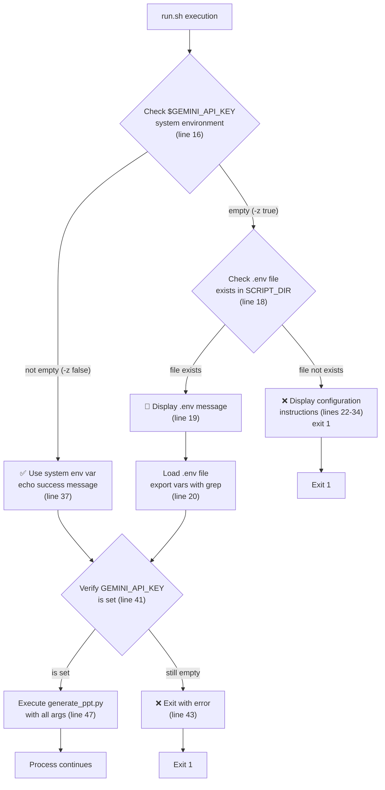
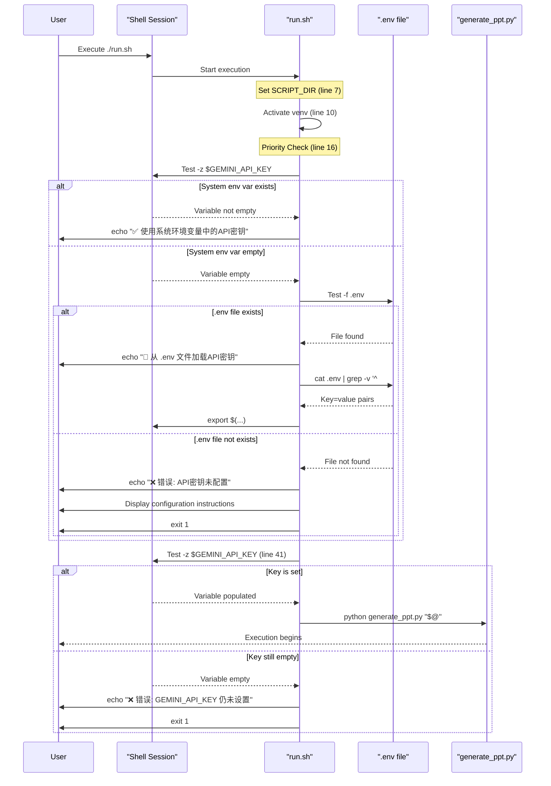
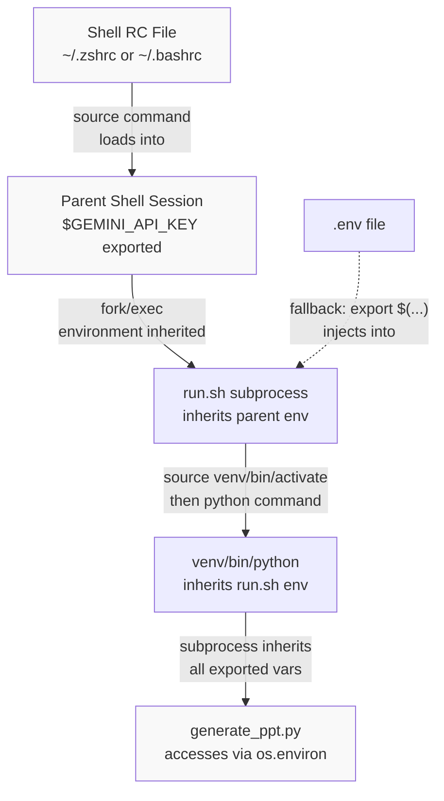

<!-- source: DeepWiki mcp.deepwiki.com · repo op7418/NanoBanana-PPT-Skills · page 3.2 Environment Variables · fetched 2026-10-26 -->

# Environment Variables

<details>
<summary>Relevant source files</summary>

The following files were used as context for generating this wiki page:

- [ENV_SETUP.md](ENV_SETUP.md)
- [run.sh](run.sh)

</details>


## Purpose and Scope

This page provides a comprehensive technical guide to configuring and managing the `GEMINI_API_KEY` environment variable across different shell environments. It covers the priority loading system, shell-specific configuration methods, verification procedures, and runtime management operations.

For information about obtaining an API key, see [API Key Setup](#3.1). For security best practices around key management, see [Security Best Practices](#3.3).

---

## Priority System Architecture

The system implements a two-tier priority mechanism for loading the `GEMINI_API_KEY`:

| Priority | Source | Scope | Persistence | Security Level |
|----------|--------|-------|-------------|----------------|
| **1 (Highest)** | System Environment Variable | Global (all projects) | Permanent across sessions | High - outside repository |
| **2 (Fallback)** | `.env` File | Project-local | Permanent within project | Medium - requires `.gitignore` |
| **❌ Forbidden** | Hardcoded in code | N/A | N/A | None - will be committed |

The priority system ensures that system-level configuration takes precedence over project-level configuration, enabling users to override project settings globally while maintaining backward compatibility with `.env`-based workflows.

**Priority System Flow Diagram**



**Sources:** [run.sh:12-47]()

---

## Shell-Specific Configuration

### zsh Configuration (Recommended)

The **zsh** shell is the default on macOS since Catalina (10.15) and is widely used on Linux. Configuration is stored in `~/.zshrc`.

**Setup Command:**
```bash
echo 'export GEMINI_API_KEY="your-api-key-here"' >> ~/.zshrc
source ~/.zshrc
```

**Manual Configuration:**
1. Open `~/.zshrc` in a text editor:
   ```bash
   nano ~/.zshrc
   # or
   vim ~/.zshrc
   ```

2. Add the export statement at the end of the file:
   ```bash
   # Google AI API Key for PPT Generator
   export GEMINI_API_KEY="your-actual-api-key"
   ```

3. Save and reload configuration:
   ```bash
   source ~/.zshrc
   ```

**Verification:**
```bash
echo $GEMINI_API_KEY
# Should output: your-actual-api-key
```

### bash Configuration

The **bash** shell is the traditional Unix shell, default on older macOS versions and many Linux distributions. Configuration is stored in `~/.bashrc` (Linux) or `~/.bash_profile` (macOS).

**Setup Command (Linux):**
```bash
echo 'export GEMINI_API_KEY="your-api-key-here"' >> ~/.bashrc
source ~/.bashrc
```

**Setup Command (macOS):**
```bash
echo 'export GEMINI_API_KEY="your-api-key-here"' >> ~/.bash_profile
source ~/.bash_profile
```

**Note:** On some systems, `~/.bashrc` is sourced by `~/.bash_profile`, so you may need to configure both files or add a source statement.

### fish Configuration

The **fish** shell (Friendly Interactive Shell) uses a different syntax for environment variables and stores configuration in `~/.config/fish/config.fish`.

**Setup Command:**
```bash
set -Ux GEMINI_API_KEY "your-api-key-here"
```

**Explanation of flags:**
- `-U`: Universal variable (persisted across sessions)
- `-x`: Exported to subprocesses (equivalent to bash's `export`)

**Verification:**
```bash
echo $GEMINI_API_KEY
# Should output: your-api-key-here
```

**Sources:** [ENV_SETUP.md:101-119]()

---

## Verification Methods

### Basic Verification

The simplest verification method checks if the variable is set in the current shell session:

```bash
echo $GEMINI_API_KEY
```

**Expected output:** Your API key string (starts with `AIzaSy...`)  
**Error condition:** Empty output indicates the variable is not set

### Run Script Verification

The `run.sh` script provides built-in verification feedback when executed:

```bash
./run.sh --help
```

**Expected outputs:**

| Message | Meaning | Source |
|---------|---------|--------|
| `✅ 使用系统环境变量中的API密钥` | System env var found (priority 1) | [run.sh:37]() |
| `📌 从 .env 文件加载API密钥` | Loading from `.env` file (priority 2) | [run.sh:19]() |
| `❌ 错误: API密钥未配置` | No configuration found | [run.sh:22]() |

### Comprehensive System Check

To verify the variable is properly exported and accessible to subprocesses:

```bash
# Check current shell value
echo $GEMINI_API_KEY

# Check if variable is exported (bash/zsh)
export -p | grep GEMINI_API_KEY

# Check in new subprocess
bash -c 'echo $GEMINI_API_KEY'
```

All three commands should return your API key for proper configuration.

**Sources:** [ENV_SETUP.md:26-29](), [run.sh:16-38]()

---

## Runtime Management Operations

### View Current Value

Display the current value of the environment variable:

```bash
echo $GEMINI_API_KEY
```

**Security note:** Only execute this in trusted terminals, as the key will be displayed in plaintext.

### Temporary Modification (Session-Only)

Override the environment variable for the current shell session without persisting changes:

```bash
export GEMINI_API_KEY="temporary-key-for-testing"
```

**Scope:** Current shell session only  
**Duration:** Until shell is closed or variable is unset  
**Use case:** Testing with different API keys without modifying configuration files

To verify the temporary change:
```bash
echo $GEMINI_API_KEY
# Should show: temporary-key-for-testing
```

### Permanent Modification

Update the persistent configuration in your shell's RC file.

**For zsh:**
```bash
nano ~/.zshrc
# Find the line: export GEMINI_API_KEY="old-key"
# Update to:     export GEMINI_API_KEY="new-key"
# Save and exit
source ~/.zshrc
```

**For bash:**
```bash
nano ~/.bashrc  # or ~/.bash_profile on macOS
# Make same modification as above
source ~/.bashrc
```

**For fish:**
```bash
set -Ux GEMINI_API_KEY "new-key"
# fish automatically persists universal variables
```

### Deletion

Remove the environment variable from the current session and persistent configuration.

**Step 1: Remove from RC file**
```bash
# For zsh
nano ~/.zshrc
# Delete the line containing: export GEMINI_API_KEY="..."

# For bash
nano ~/.bashrc  # or ~/.bash_profile
# Delete the line containing: export GEMINI_API_KEY="..."

# For fish
set -Ue GEMINI_API_KEY
# The -e flag erases the variable
```

**Step 2: Remove from current session**
```bash
unset GEMINI_API_KEY
```

**Step 3: Reload configuration**
```bash
source ~/.zshrc  # or ~/.bashrc
```

**Verification:**
```bash
echo $GEMINI_API_KEY
# Should output: empty line (no value)
```

**Sources:** [ENV_SETUP.md:130-165]()

---

## Loading Sequence Implementation

The following diagram maps the technical implementation of the environment variable loading system in `run.sh`.

**run.sh Variable Loading Sequence**



**Sources:** [run.sh:1-48]()

---

## Variable Scope and Inheritance

Understanding how environment variables propagate through process hierarchies:

**Environment Variable Propagation Model**



**Key points:**
- **Shell RC files** define variables that are exported to all child processes
- **Export statement** (`export GEMINI_API_KEY="..."`) makes the variable available to subprocesses
- **run.sh** inherits the parent shell's environment automatically
- **Python scripts** access environment variables via `os.environ['GEMINI_API_KEY']`
- **.env file loading** injects variables into the current subprocess using `export $(...)`

**Sources:** [run.sh:10-20](), [ENV_SETUP.md:15-42]()

---

## Shell Detection and Configuration

**Determining Your Current Shell**

```bash
echo $SHELL
```

**Common outputs:**
- `/bin/zsh` or `/usr/bin/zsh` → Use zsh configuration
- `/bin/bash` or `/usr/bin/bash` → Use bash configuration  
- `/usr/bin/fish` → Use fish configuration

**Configuration File Lookup Order**

| Shell | Primary Config | Secondary Config | Session Type |
|-------|---------------|------------------|--------------|
| zsh | `~/.zshrc` | `~/.zprofile` | Interactive |
| bash (Linux) | `~/.bashrc` | `~/.bash_profile` | Interactive |
| bash (macOS) | `~/.bash_profile` | `~/.bashrc` | Login |
| fish | `~/.config/fish/config.fish` | N/A | All sessions |

**Sources:** [ENV_SETUP.md:101-119]()

---

## Multi-Environment Configuration

For users managing multiple environments (development, staging, production), the system supports environment-specific key management:

**Strategy 1: Conditional Loading in RC File**
```bash
# In ~/.zshrc
if [[ "$ENVIRONMENT" == "production" ]]; then
    export GEMINI_API_KEY="production-key"
elif [[ "$ENVIRONMENT" == "staging" ]]; then
    export GEMINI_API_KEY="staging-key"
else
    export GEMINI_API_KEY="development-key"
fi
```

**Strategy 2: Project-Specific .env Files**
```bash
# Development: use .env
./run.sh --plan plan.json

# Production: override with system var
export GEMINI_API_KEY="production-key"
./run.sh --plan plan.json
```

**Strategy 3: Separate Keys for Different Projects**
```bash
# In ~/.zshrc
export GEMINI_API_KEY_PROJECT_A="key-for-project-a"
export GEMINI_API_KEY_PROJECT_B="key-for-project-b"
export GEMINI_API_KEY="$GEMINI_API_KEY_PROJECT_A"  # default
```

**Sources:** [ENV_SETUP.md:169-186]()

---

## Debugging and Troubleshooting

### Common Issues and Solutions

| Symptom | Cause | Solution |
|---------|-------|----------|
| `echo $GEMINI_API_KEY` returns empty | Variable not set or RC file not sourced | Run `source ~/.zshrc` and retry |
| Variable set but `run.sh` shows error | Variable not exported | Use `export` keyword in RC file |
| Works in one terminal but not others | RC file modified but not reloaded | Open new terminal or source RC file |
| Works manually but not in scripts | Variable not in environment | Check `export -p \| grep GEMINI` |

### Debug Commands

**Check if variable is defined but not exported:**
```bash
set | grep GEMINI_API_KEY    # Shows all variables
export -p | grep GEMINI_API_KEY  # Shows only exported variables
```

If the first command shows the variable but the second doesn't, it's not exported and won't be available to subprocesses.

**Verify RC file syntax:**
```bash
# For zsh
zsh -n ~/.zshrc  # Check for syntax errors without executing

# For bash  
bash -n ~/.bashrc  # Check for syntax errors without executing
```

**Test in isolated subprocess:**
```bash
bash -c 'echo "In subprocess: $GEMINI_API_KEY"'
```

If this returns empty while `echo $GEMINI_API_KEY` in your main shell returns the key, the variable is not exported.

### Verbose run.sh Execution

To debug the loading process, add debugging output to `run.sh`:

```bash
# Temporary debugging - add after line 15 in run.sh
echo "DEBUG: GEMINI_API_KEY value: '${GEMINI_API_KEY:0:10}...'"
echo "DEBUG: .env file exists: $([ -f .env ] && echo yes || echo no)"
```

**Sources:** [run.sh:16-44](), [ENV_SETUP.md:26-29]()

---

## Security Considerations

### Variable Visibility

Environment variables are visible to:
- ✅ All child processes of the shell session
- ✅ Scripts executed from the shell
- ✅ Programs launched from the terminal
- ❌ Other user accounts (properly configured systems)
- ❌ Remote systems (unless explicitly transmitted)
- ❌ Git repositories (unless hardcoded in files)

### Best Practices for Variable Management

1. **Never echo API keys in shared scripts**
   ```bash
   # ❌ BAD - logs key to output
   echo "Using key: $GEMINI_API_KEY"
   
   # ✅ GOOD - shows only that key exists
   echo "✅ API key is configured"
   ```

2. **Use partial display for verification**
   ```bash
   # Show only first 10 characters
   echo ${GEMINI_API_KEY:0:10}...
   ```

3. **Avoid command history exposure**
   ```bash
   # Instead of typing the key in terminal:
   export GEMINI_API_KEY="secret-key"  # This goes to history!
   
   # Use editor to modify RC file:
   nano ~/.zshrc  # Safer - not in command history
   ```

4. **Regular rotation schedule**
   - Rotate keys every 3-6 months
   - Rotate immediately if exposure is suspected
   - Document rotation in change logs

**Sources:** [ENV_SETUP.md:167-200]()

---

## Cross-Platform Considerations

### Windows (Git Bash / WSL)

**Git Bash:**
```bash
echo 'export GEMINI_API_KEY="your-key"' >> ~/.bash_profile
source ~/.bash_profile
```

**WSL (Windows Subsystem for Linux):**
```bash
echo 'export GEMINI_API_KEY="your-key"' >> ~/.bashrc
source ~/.bashrc
```

**Windows Command Prompt (not recommended):**
```cmd
setx GEMINI_API_KEY "your-key"
```

**PowerShell (not recommended):**
```powershell
[Environment]::SetEnvironmentVariable("GEMINI_API_KEY", "your-key", "User")
```

### macOS Version-Specific Notes

- **macOS 10.15+ (Catalina and later):** Default shell is zsh, use `~/.zshrc`
- **macOS 10.14 and earlier:** Default shell is bash, use `~/.bash_profile`
- **Check your shell:** Run `echo $SHELL` to confirm

### Linux Distribution Variations

- **Ubuntu/Debian:** Uses bash by default, configure `~/.bashrc`
- **Fedora/RHEL:** Uses bash by default, configure `~/.bashrc`  
- **Arch Linux:** May use zsh, check with `echo $SHELL`
- **NixOS:** Environment management may differ, consult NixOS documentation

**Sources:** [ENV_SETUP.md:92-127]()

---

