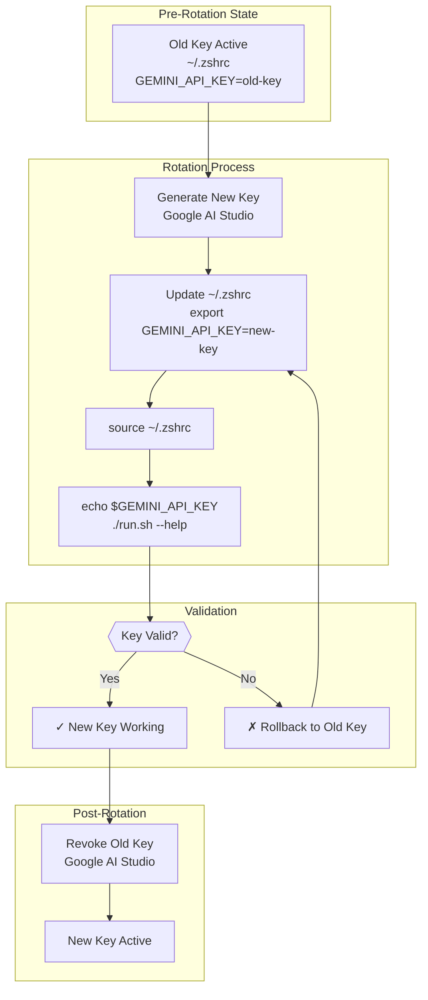
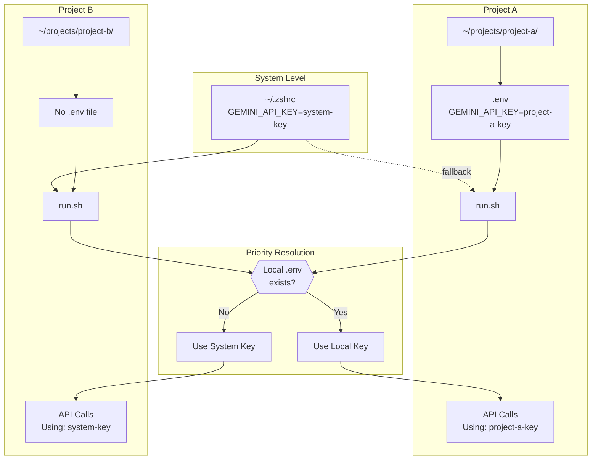
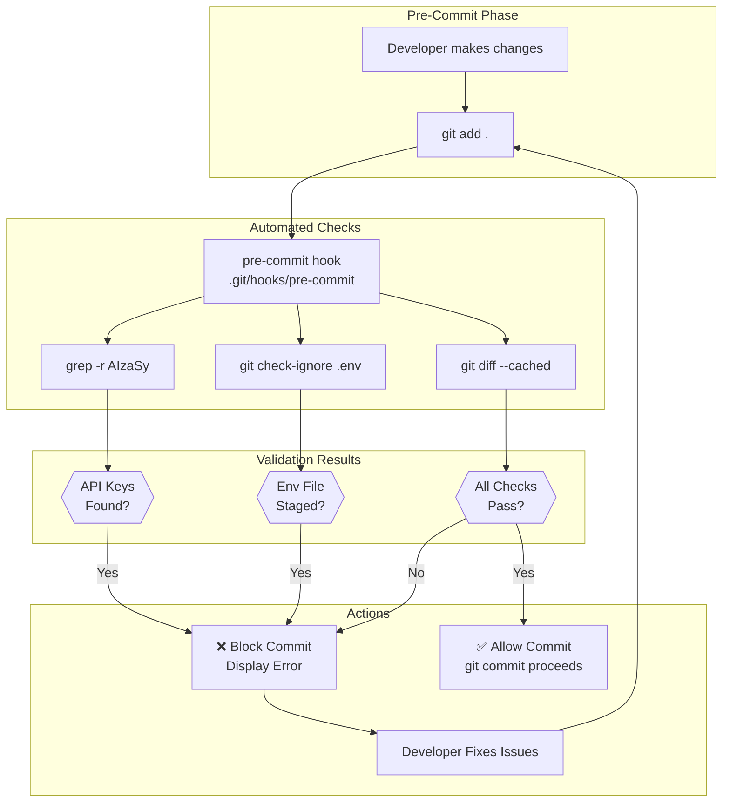
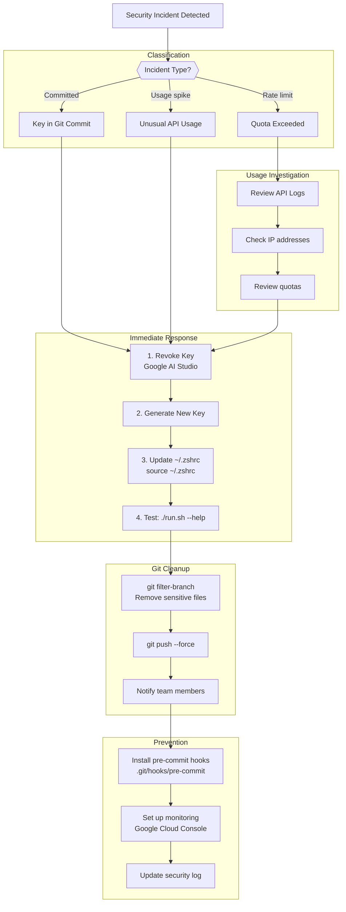

<!-- source: DeepWiki mcp.deepwiki.com · repo op7418/NanoBanana-PPT-Skills · page 3.3 Security Best Practices · fetched 2026-10-26 -->

# Security Best Practices

<details>
<summary>Relevant source files</summary>

The following files were used as context for generating this wiki page:

- [ENV_SETUP.md](ENV_SETUP.md)
- [SECURITY.md](SECURITY.md)

</details>


## Purpose and Scope

This page documents best practices for ongoing API key management, security maintenance, and emergency response procedures for the NanoBanana PPT Generator. It covers key rotation schedules, multi-project strategies, backup procedures, security verification workflows, and incident response protocols.

For initial API key configuration, see [API Key Setup](#3.1). For environment variable setup details, see [Environment Variables](#3.2). For Git-specific safety measures, see [Git Safety](#3.4).

---

## API Key Rotation Schedule

Regular key rotation limits the impact of potential compromises and follows security compliance requirements.

### Recommended Rotation Intervals

| Scenario | Rotation Interval | Rationale |
|----------|------------------|-----------|
| **Standard Use** | 3-6 months | Balances security and convenience |
| **High-Volume Projects** | Monthly | Limits exposure window for heavily-used keys |
| **Shared Development** | Bi-monthly | More frequent rotation when multiple users access keys |
| **Detected Anomaly** | Immediate | Suspicious usage patterns require instant action |

### Rotation Procedure

**Step 1: Generate New Key**

Visit Google AI Studio at `https://makersuite.google.com/app/apikey` and create a new API key. Keep both old and new keys temporarily active to prevent service disruption.

**Step 2: Update System Environment**

For `zsh` users (primary configuration method):

```bash
# Edit configuration file
nano ~/.zshrc

# Update the export statement
export GEMINI_API_KEY="new-api-key-here"

# Reload configuration
source ~/.zshrc
```

For `bash` users:

```bash
nano ~/.bashrc
export GEMINI_API_KEY="new-api-key-here"
source ~/.bashrc
```

**Step 3: Verify New Key**

```bash
# Check environment variable updated
echo $GEMINI_API_KEY

# Test with actual generation
./run.sh --plan test_slides_plan.json --style styles/gradient-glass.md --resolution 2K
```

The [run.sh:3-10]() script validates the key presence and displays confirmation messages.

**Step 4: Revoke Old Key**

Return to Google AI Studio and delete the old API key only after confirming the new key works correctly.

**Diagram: API Key Rotation Workflow**



**Sources:** [ENV_SETUP.md:179-191]()

---

## Multi-Project Strategy

When managing multiple projects using the Gemini API, choose between shared keys or project-specific keys based on your security and monitoring requirements.

### Strategy Comparison

| Strategy | Advantages | Disadvantages | Use Case |
|----------|-----------|---------------|----------|
| **Single Shared Key** | Simple management, unified billing | No usage attribution, higher blast radius | Personal projects, low security requirements |
| **Project-Specific Keys** | Granular tracking, isolated security boundaries | More keys to manage | Team environments, production systems |
| **Environment-Specific Keys** | Separate dev/prod environments | Doubled management overhead | Enterprise deployments |

### Shared Key Configuration

The system prioritizes environment variables, making shared keys across projects straightforward:

```bash
# Single key in ~/.zshrc used by all projects
export GEMINI_API_KEY="shared-key-for-all-projects"
```

All projects on the system automatically inherit this key. The [run.sh:3-10]() script reads this environment variable with highest priority.

### Project-Specific Key Configuration

Override the global key for specific projects using local `.env` files:

**Project A:**
```bash
cd ~/projects/project-a
echo 'GEMINI_API_KEY=project-a-specific-key' > .env
```

**Project B:**
```bash
cd ~/projects/project-b
echo 'GEMINI_API_KEY=project-b-specific-key' > .env
```

The [run.sh:3-19]() script implements a priority system:
1. System environment variable (`~/.zshrc`)
2. Local `.env` file (project override)

To verify which key is being used:

```bash
./run.sh --help
# Output shows: "✅ 使用系统环境变量中的API密钥"
# or: "✅ 使用.env文件中的API密钥"
```

**Diagram: Multi-Project Key Management Architecture**



**Sources:** [ENV_SETUP.md:32-41](), [ENV_SETUP.md:169-186]()

---

## Backup and Recovery Procedures

### Configuration Backup

System environment configurations should be backed up securely to enable rapid recovery on new machines or after system failures.

**Backup Command:**

```bash
# Extract all API key exports from ~/.zshrc
grep "export.*_KEY" ~/.zshrc > ~/secure-backup/env-keys.txt

# Backup complete shell configuration
cp ~/.zshrc ~/secure-backup/zshrc-backup-$(date +%Y%m%d)
```

**Storage Recommendations:**

| Method | Security Level | Use Case |
|--------|---------------|----------|
| Encrypted USB drive | High | Physical backup for disaster recovery |
| Password manager vault | High | Convenient daily access |
| Encrypted cloud storage | Medium | Multi-device synchronization |
| Local encrypted disk | High | Primary backup location |

**Never store backups in:**
- Unencrypted cloud storage (Dropbox, Google Drive)
- Email drafts or sent folders
- Plain text files in home directory
- Git repositories (even private ones)

### Recovery Procedure

When setting up a new machine or recovering from failure:

**Step 1: Restore Environment Configuration**

```bash
# Copy backup to new machine via secure method
scp user@old-machine:~/secure-backup/zshrc-backup-20240115 ~/.zshrc-restored

# Review contents before applying
cat ~/.zshrc-restored | grep GEMINI_API_KEY

# Apply to active configuration
cat ~/.zshrc-restored >> ~/.zshrc
source ~/.zshrc
```

**Step 2: Verify Key Functionality**

```bash
# Check environment variable
echo $GEMINI_API_KEY

# Test API connectivity
cd /path/to/ppt-generator
./run.sh --help
```

**Step 3: Update Dependencies**

```bash
# Recreate virtual environment
python3 -m venv venv
source venv/bin/activate
pip install google-genai==1.57.0 pillow==12.1.0
```

The [ENV_SETUP.md:187-191]() documents the backup procedure as a best practice.

**Sources:** [ENV_SETUP.md:187-191](), [ENV_SETUP.md:91-126]()

---

## Security Verification Workflows

Regular security audits ensure no API keys leak into version control or project files.

### Pre-Commit Verification

Before committing any changes to Git, run the following verification suite:

**1. Search for API Keys in Code**

```bash
# Search for Google API key patterns
grep -r "AIzaSy" --exclude-dir=.git --exclude-dir=venv --exclude-dir=outputs .

# Expected: No output (keys only in ~/.zshrc or .env)
```

**2. Verify .gitignore Protection**

```bash
# Confirm .env is ignored
git check-ignore -v .env
# Expected: .gitignore:15:.env	.env

# Simulate what would be committed
git add -n .
# Verify: .env, venv/, outputs/ not listed
```

**3. Check Staged Files**

```bash
# Review exactly what will be committed
git status
# Confirm: Only safe files (*.md, *.py, styles/, templates/)
```

The [SECURITY.md:49-69]() provides detailed verification commands.

### Automated Security Checks

Create a pre-commit hook to automatically verify security before each commit:

**Create Hook Script**

```bash
# Create pre-commit hook
cat > .git/hooks/pre-commit << 'EOF'
#!/bin/bash

# Search for API keys
if grep -r "AIzaSy" --exclude-dir=.git --exclude-dir=venv --exclude-dir=outputs . >/dev/null 2>&1; then
    echo "❌ ERROR: Potential API key found in commit"
    echo "Run: grep -r 'AIzaSy' --exclude-dir=.git ."
    exit 1
fi

# Check if .env would be committed
if git diff --cached --name-only | grep -q "^\.env$"; then
    echo "❌ ERROR: Attempting to commit .env file"
    exit 1
fi

echo "✅ Security checks passed"
exit 0
EOF

# Make executable
chmod +x .git/hooks/pre-commit
```

This hook automatically blocks commits containing API keys or `.env` files.

**Diagram: Security Verification Workflow**



**Sources:** [SECURITY.md:49-78](), [SECURITY.md:157-167]()

### Periodic Audit Schedule

| Frequency | Check | Tool/Command |
|-----------|-------|--------------|
| **Every commit** | API key presence | `grep -r "AIzaSy"` |
| **Weekly** | Git history scan | `git log --all -- .env` |
| **Monthly** | Dependency audit | `pip list --outdated` |
| **Quarterly** | Full security review | Manual review + key rotation |

---

## Emergency Response Procedures

### Scenario 1: API Key Accidentally Committed

If an API key is committed to Git, immediate action is required to prevent unauthorized access.

**Immediate Actions (First 5 Minutes)**

```bash
# 1. Revoke compromised key immediately
# Visit: https://makersuite.google.com/app/apikey
# Click "Delete" on the exposed key

# 2. Generate replacement key
# Create new key in Google AI Studio
# Note the new key ID

# 3. Update local environment
echo 'export GEMINI_API_KEY="new-key-here"' >> ~/.zshrc
source ~/.zshrc
```

**Git History Cleanup (If Pushed)**

```bash
# WARNING: This rewrites Git history
# Coordinate with team members first

# Remove .env from all commits
git filter-branch --force --index-filter \
  "git rm --cached --ignore-unmatch .env" \
  --prune-empty --tag-name-filter cat -- --all

# Remove run.sh if it contained hardcoded keys
git filter-branch --force --index-filter \
  "git rm --cached --ignore-unmatch run.sh" \
  --prune-empty --tag-name-filter cat -- --all

# Force push (destructive)
git push origin --force --all
git push origin --force --tags
```

**Post-Incident Actions**

1. Enable pre-commit hooks to prevent recurrence
2. Review recent API usage for unauthorized calls
3. Document incident in security log
4. Update team security training

The [SECURITY.md:126-155]() documents the complete emergency procedure.

### Scenario 2: Unusual API Activity Detected

**Detection Indicators:**
- Unexpectedly high API usage
- API calls from unknown IP addresses
- Quota warnings from Google

**Response Steps:**

```bash
# 1. Check current API usage
# Visit Google Cloud Console > APIs & Services > Credentials
# Review usage metrics and logs

# 2. Rotate key immediately
# Generate new key and update environment

# 3. Review access logs
# Check which projects/machines are using the key

# 4. Implement usage monitoring
# Set up quota alerts in Google Cloud Console
```

**Diagram: Emergency Response Decision Tree**



**Sources:** [SECURITY.md:126-155](), [ENV_SETUP.md:179-182]()

---

## Environment-Specific Strategies

Different deployment environments require different security approaches.

### Development Environment

**Configuration:**
- Local `.env` file for quick iteration
- System environment variable for shared projects
- Direct file access acceptable

**Security Level:** Medium
- Protected by `.gitignore`
- File permissions: `chmod 600 .env`
- Located in project root

**Setup:**
```bash
# Option 1: Local .env file
echo 'GEMINI_API_KEY=dev-key' > .env
chmod 600 .env

# Option 2: System environment (recommended)
echo 'export GEMINI_API_KEY=dev-key' >> ~/.zshrc
source ~/.zshrc
```

### Collaborative/Shared Repository

**Configuration:**
- `.env.example` template provided
- Actual `.env` excluded via `.gitignore`
- Documentation guides contributors

**Security Level:** High
- No keys in repository
- Each contributor maintains own keys
- Git history clean

**For Contributors:**
```bash
# Clone repository
git clone https://github.com/username/ppt-generator.git
cd ppt-generator

# Create local .env from template
cp .env.example .env

# Add personal API key
nano .env  # Replace "your-api-key-here" with actual key
```

The [ENV_SETUP.md:91-126]() provides complete setup instructions for new machines.

### Production/CI-CD Environment

**Configuration:**
- GitHub Secrets for GitHub Actions
- Cloud KMS for cloud deployments
- Kubernetes Secrets for container environments

**Security Level:** Very High
- Encrypted at rest
- Access audit logs
- Automatic rotation support

**GitHub Actions Setup:**

```yaml
# .github/workflows/generate.yml
name: Generate Presentation

on: [push]

jobs:
  generate:
    runs-on: ubuntu-latest
    steps:
      - uses: actions/checkout@v2
      - name: Setup Python
        uses: actions/setup-python@v2
      - name: Install dependencies
        run: pip install google-genai pillow
      - name: Generate PPT
        env:
          GEMINI_API_KEY: ${{ secrets.GEMINI_API_KEY }}
        run: ./run.sh --plan plan.json --style styles/gradient-glass.md
```

**Cloud KMS Example (AWS Secrets Manager):**

```bash
# Store secret
aws secretsmanager create-secret \
    --name ppt-generator/gemini-api-key \
    --secret-string "actual-api-key"

# Retrieve in application
aws secretsmanager get-secret-value \
    --secret-id ppt-generator/gemini-api-key \
    --query SecretString --output text
```

The [SECURITY.md:206-223]() recommends enterprise key management services.

**Sources:** [ENV_SETUP.md:91-126](), [SECURITY.md:206-223]()

---

## Comprehensive Security Checklist

### Daily Operations

- [ ] Environment variable set: `echo $GEMINI_API_KEY` returns value
- [ ] API key not in code: `grep -r "AIzaSy" .` returns nothing
- [ ] Pre-commit hooks active: `.git/hooks/pre-commit` exists and executable

### Before Each Git Commit

- [ ] Run security scan: `grep -r "AIzaSy" --exclude-dir=.git .`
- [ ] Verify gitignore: `git check-ignore -v .env` shows exclusion
- [ ] Check staged files: `git status` shows no sensitive files
- [ ] Review diff: `git diff --cached` contains no keys

### Weekly Maintenance

- [ ] Review API usage in Google Cloud Console
- [ ] Check for unauthorized access patterns
- [ ] Verify `.env` still in `.gitignore`
- [ ] Confirm backups are current

### Monthly Security Review

- [ ] Scan Git history: `git log --all -- .env` should be empty
- [ ] Update dependencies: `pip list --outdated`
- [ ] Review access permissions
- [ ] Test key rotation procedure

### Quarterly Actions

- [ ] Rotate API keys (every 3-6 months)
- [ ] Review and update backup procedures
- [ ] Audit all projects using shared keys
- [ ] Update security documentation

### Annual Security Audit

- [ ] Full codebase security scan
- [ ] Review emergency response procedures
- [ ] Update team security training
- [ ] Compliance review (if applicable)

**Sources:** [ENV_SETUP.md:201-212](), [SECURITY.md:157-167]()

---

## Best Practices Summary

### Recommended Approaches ✓

| Practice | Implementation | Benefit |
|----------|----------------|---------|
| System environment variables | `~/.zshrc` with `export GEMINI_API_KEY` | Cross-project consistency |
| Regular rotation | 3-6 month schedule | Limits exposure window |
| Encrypted backups | Password manager or encrypted storage | Disaster recovery capability |
| Pre-commit hooks | Automated key detection | Prevents accidental commits |
| Project-specific keys | Separate keys for each project | Granular usage tracking |
| Monitoring alerts | Google Cloud Console quotas | Early detection of anomalies |

### Approaches to Avoid ✗

| Anti-Pattern | Risk | Alternative |
|--------------|------|-------------|
| Hardcoded keys in code | High - Version control exposure | Environment variables |
| Keys in README.md | High - Public documentation | `.env.example` template |
| Email/chat key sharing | High - Permanent records | In-person or encrypted channels |
| Same key across teams | Medium - No attribution | Team-specific keys |
| No rotation policy | Medium - Extended exposure | Quarterly rotation |
| Unencrypted backups | Medium - Theft exposure | Encrypted storage |

**Sources:** [ENV_SETUP.md:167-200](), [SECURITY.md:185-203]()

---

## Related Documentation

- **[API Key Setup](#3.1)** - Initial API key acquisition and configuration
- **[Environment Variables](#3.2)** - Detailed shell configuration for different environments
- **[Git Safety](#3.4)** - Version control protection mechanisms and history cleanup

---

