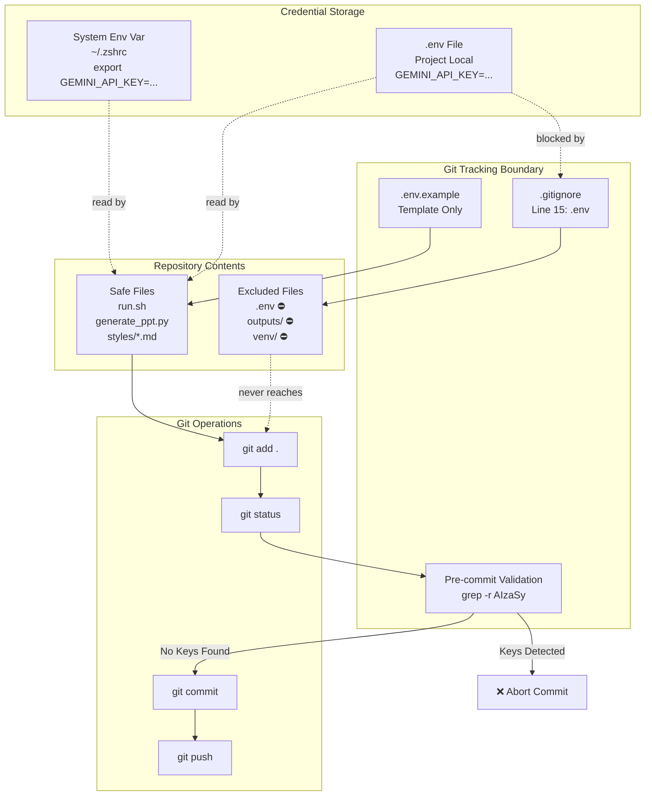
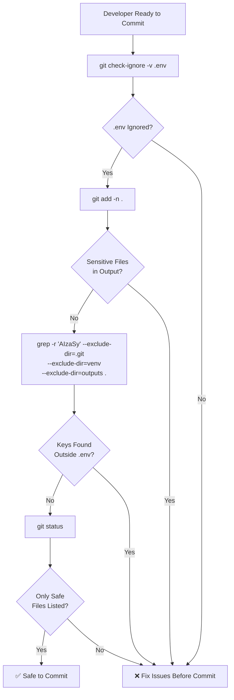
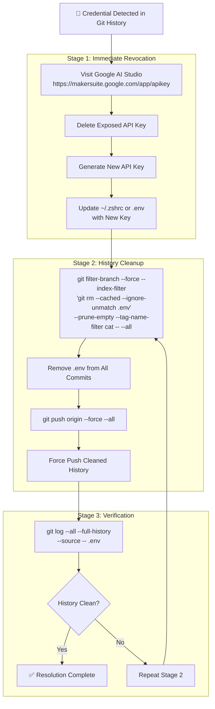
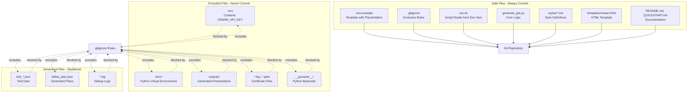
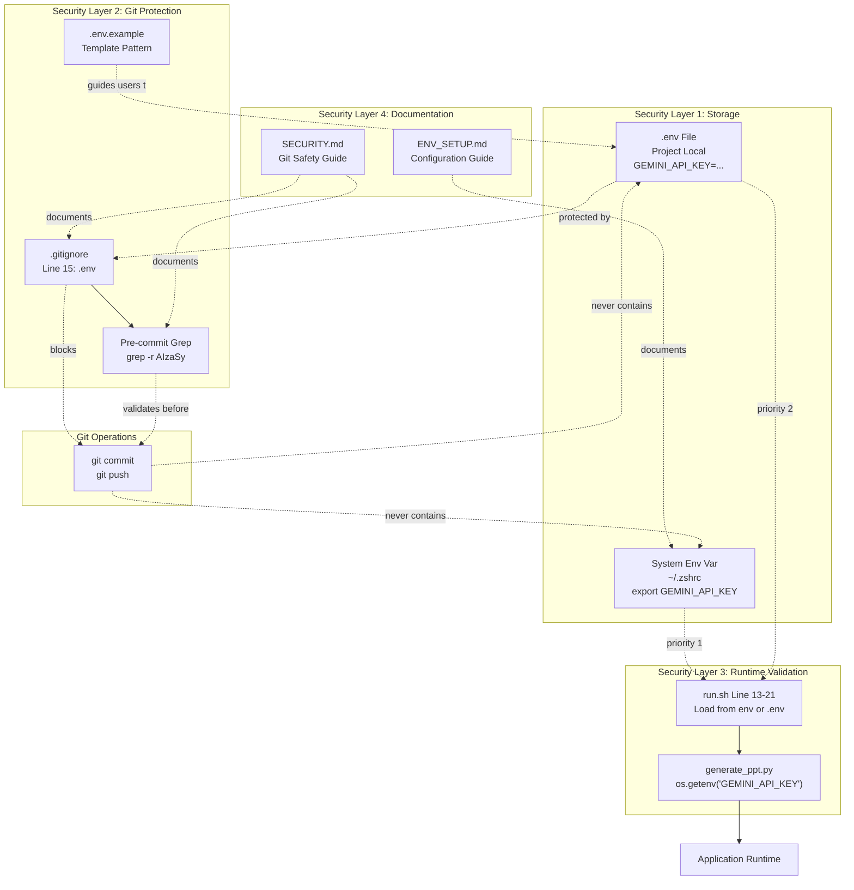

<!-- source: DeepWiki mcp.deepwiki.com · repo op7418/NanoBanana-PPT-Skills · page 3.4 Git Safety · fetched 2026-10-26 -->

# Git Safety

<details>
<summary>Relevant source files</summary>

The following files were used as context for generating this wiki page:

- [.gitignore](.gitignore)
- [ENV_SETUP.md](ENV_SETUP.md)
- [SECURITY.md](SECURITY.md)

</details>


## Purpose and Scope

This page documents the Git safety mechanisms that prevent accidental exposure of API keys and sensitive credentials to version control. It covers `.gitignore` configuration, pre-commit validation workflows, and emergency response procedures for credential exposure. 

For information about obtaining and storing API keys, see [API Key Setup](#3.1). For the complete environment variable configuration process, see [Environment Variables](#3.2). For broader security practices including key rotation, see [Security Best Practices](#3.3).

---

## Protection Architecture

The system implements a **multi-layer defense** strategy to prevent credentials from entering Git history:

**Defense Layer 1: `.gitignore` Exclusion**  
Files containing credentials are explicitly excluded from Git tracking.

**Defense Layer 2: External Storage**  
Credentials are stored in system environment variables (`~/.zshrc`, `~/.bashrc`) or local `.env` files, both outside the repository.

**Defense Layer 3: Validation Commands**  
Pre-commit checks scan for credential patterns before allowing commits.

**Defense Layer 4: Documentation**  
Template files (`.env.example`) guide users to the correct configuration pattern.

### Git Protection Flow Diagram



**Sources:** [.gitignore:1-35](), [ENV_SETUP.md:50-66](), [SECURITY.md:1-227]()

---

## `.gitignore` Configuration

The `.gitignore` file defines exclusion patterns for files that should never enter version control. The system uses four categories of exclusions:

### File Categories

| Category | Pattern | Purpose | Lines |
|----------|---------|---------|-------|
| **Credentials** | `.env`, `*.key`, `*.pem` | API keys and certificates | [.gitignore:15-17]() |
| **Python Runtime** | `venv/`, `__pycache__/`, `*.pyc` | Virtual environment and bytecode | [.gitignore:2-12]() |
| **Generated Outputs** | `outputs/`, `*.png`, `*.jpg` | Presentation images | [.gitignore:20-23]() |
| **Development Files** | `.DS_Store`, `.vscode/`, `.idea/` | Editor and OS artifacts | [.gitignore:26-30]() |

### Critical Exclusion Rules

The most critical rules for security are:

```
.env
*.key
*.pem
```

These patterns ensure that:
- Local `.env` files containing `GEMINI_API_KEY` are never tracked
- Certificate files (`.key`, `.pem`) are excluded
- No credential files can accidentally be committed

**Sources:** [.gitignore:14-17](), [SECURITY.md:6-17]()

---

## Pre-Commit Validation

Before committing code, developers must verify that no credentials have entered the staging area. The system provides validation commands that search for API key patterns.

### Validation Commands



### Command Reference

**Step 1: Verify `.env` Exclusion**
```bash
git check-ignore -v .env
```
Expected output: `.gitignore:15:.env	.env`

This confirms that line 15 of `.gitignore` is actively excluding the `.env` file.

**Step 2: Dry-Run Add**
```bash
git add -n .
```
The `-n` flag simulates `git add` without actually staging files. Review the output to ensure no `.env`, `*.key`, or credential files appear.

**Step 3: Grep for API Keys**
```bash
grep -r "AIzaSy" --exclude-dir=.git --exclude-dir=venv --exclude-dir=outputs .
```
Google Gemini API keys begin with the prefix `AIzaSy`. This command searches the entire repository (excluding binary/generated directories) for this pattern. **Expected result: No output** (if the `.env` file doesn't exist) or **only `.env` file matches** (which is excluded by `.gitignore`).

**Step 4: Git Status Check**
```bash
git status
```
Verify that only safe files appear in the "Changes to be committed" or "Untracked files" sections.

**Sources:** [SECURITY.md:49-78](), [ENV_SETUP.md:67-74]()

---

## Emergency Response for Exposed Keys

If API keys have been accidentally committed to Git history, immediate action is required. The response follows a three-stage process: **revoke**, **clean**, and **verify**.

### Emergency Response Workflow



### Detailed Commands

**Stage 1: Revoke the Compromised Key**

1. Access the Google AI Studio API key management interface
2. Delete the exposed key immediately to prevent unauthorized usage
3. Generate a replacement key
4. Update the credential storage:
   ```bash
   # For system environment variables
   nano ~/.zshrc
   # Find line: export GEMINI_API_KEY="old-key"
   # Replace with: export GEMINI_API_KEY="new-key"
   source ~/.zshrc
   ```

**Stage 2: Remove from Git History**

```bash
git filter-branch --force --index-filter \
  "git rm --cached --ignore-unmatch .env" \
  --prune-empty --tag-name-filter cat -- --all
```

This command rewrites Git history to remove the `.env` file from all commits. The `--cached` flag removes it from the index without deleting the local working copy.

**Warning:** This operation rewrites Git history. All collaborators must re-clone the repository after force-pushing.

```bash
git push origin --force --all
```

**Stage 3: Verify Cleanup**

```bash
git log --all --full-history --source -- .env
```

If this command produces no output, the `.env` file has been successfully removed from all history.

**Alternative: Repository Recreation**

For public repositories where the exposed key may have been scraped, consider:
1. Revoking the API key
2. Deleting the GitHub repository
3. Creating a new repository with the cleaned codebase
4. Pushing only the secure version

**Sources:** [SECURITY.md:126-155]()

---

## File Classification System

The system classifies all files into three categories for Git tracking purposes:

### Classification Diagram



### Safe Files

These files **should be committed** and contain no sensitive information:

| File | Lines | Safe Because |
|------|-------|--------------|
| `.env.example` | All | Contains only placeholders like `your-api-key-here` |
| `run.sh` | All | Reads from `$GEMINI_API_KEY` environment variable, no hardcoded keys |
| `generate_ppt.py` | All | Uses `os.getenv("GEMINI_API_KEY")` for credential access |
| `.gitignore` | All | Contains exclusion rules, not credentials |
| `styles/*.md` | All | Visual definitions only, no credentials |
| `templates/viewer.html` | All | HTML/CSS/JavaScript, no server-side credentials |

### Excluded Files

These files **must never be committed**:

| File/Pattern | `.gitignore` Line | Contains |
|--------------|-------------------|----------|
| `.env` | [.gitignore:15]() | `GEMINI_API_KEY=AIzaSy...` actual credential |
| `venv/` | [.gitignore:2]() | Python packages (3rd party code) |
| `outputs/` | [.gitignore:20]() | Generated presentation images (large files) |
| `*.key`, `*.pem` | [.gitignore:16-17]() | Certificate private keys |
| `__pycache__/` | [.gitignore:3]() | Python bytecode (binary artifacts) |

**Sources:** [.gitignore:1-35](), [SECURITY.md:30-45]()

---

## Security Checklist

Before executing `git push`, verify all items in this checklist:

### Pre-Commit Checklist

| Check | Command | Expected Result | Status |
|-------|---------|-----------------|--------|
| `.env` excluded | `git check-ignore -v .env` | `.gitignore:15:.env	.env` | ☐ |
| No hardcoded keys in `run.sh` | `grep "AIzaSy" run.sh` | No output | ☐ |
| No keys in codebase | `grep -r "AIzaSy" --exclude-dir=.git --exclude-dir=venv .` | No output or only `.env` | ☐ |
| `.env.example` uses placeholders | `grep "your-api-key" .env.example` | Found | ☐ |
| `git status` clean | `git status` | Only safe files listed | ☐ |
| `~/.zshrc` not in repo | `git ls-files \| grep zshrc` | No output | ☐ |

### Verification Script

The following shell script automates the security checklist:

```bash
#!/bin/bash
echo "🔒 Git Safety Verification"
echo "=========================="

# Check 1: .env excluded
echo -n "1. .env excluded: "
if git check-ignore -q .env; then
    echo "✅ PASS"
else
    echo "❌ FAIL - Add .env to .gitignore"
    exit 1
fi

# Check 2: No hardcoded keys in run.sh
echo -n "2. run.sh clean: "
if ! grep -q "AIzaSy" run.sh 2>/dev/null; then
    echo "✅ PASS"
else
    echo "❌ FAIL - Remove hardcoded key from run.sh"
    exit 1
fi

# Check 3: No keys in codebase
echo -n "3. Codebase clean: "
KEY_MATCHES=$(grep -r "AIzaSy" --exclude-dir=.git --exclude-dir=venv --exclude-dir=outputs . 2>/dev/null | grep -v "\.env:" | wc -l)
if [ "$KEY_MATCHES" -eq 0 ]; then
    echo "✅ PASS"
else
    echo "❌ FAIL - Found keys outside .env"
    grep -r "AIzaSy" --exclude-dir=.git --exclude-dir=venv --exclude-dir=outputs . 2>/dev/null | grep -v "\.env:"
    exit 1
fi

# Check 4: Git status
echo -n "4. Git status: "
if git status --porcelain | grep -q "^?? \.env$"; then
    echo "❌ WARNING - .env is untracked (should be ignored)"
elif git status --porcelain | grep -q "\.env"; then
    echo "❌ FAIL - .env is staged for commit"
    exit 1
else
    echo "✅ PASS"
fi

echo ""
echo "✅ All checks passed - Safe to commit!"
```

**Sources:** [SECURITY.md:159-167](), [ENV_SETUP.md:201-211]()

---

## Integration with Security Architecture

Git safety is one layer in the overall security architecture. The following diagram shows how it integrates with other security mechanisms:

### Security Layer Integration



**Key Integration Points:**

1. **Storage → Git Protection**: The `.env` file is excluded via `.gitignore` line 15
2. **Git Protection → Runtime**: `run.sh` reads from environment variables or `.env`, never hardcodes keys
3. **Git Protection → Documentation**: `SECURITY.md` provides the pre-commit checklist
4. **Documentation → Storage**: `ENV_SETUP.md` guides users to system environment variables as the preferred method

**Sources:** [ENV_SETUP.md:1-246](), [SECURITY.md:1-227](), [.gitignore:1-35]()

---

## Best Practices Summary

### Recommended Practices

1. **Use System Environment Variables** ([ENV_SETUP.md:5-13]())
   - Configure `GEMINI_API_KEY` in `~/.zshrc` or `~/.bashrc`
   - Avoids the need for `.env` files entirely
   - Single configuration for multiple projects

2. **Run Pre-Commit Checks** ([SECURITY.md:62-69]())
   - Execute `grep -r "AIzaSy" .` before every commit
   - Verify `git status` shows only safe files
   - Automate with Git hooks if possible

3. **Regular Security Audits** ([ENV_SETUP.md:179-191]())
   - Review API key usage every 3-6 months
   - Rotate keys after any suspected exposure
   - Monitor Google Cloud Console for unusual activity

### Prohibited Practices

1. **Never Hardcode Keys** ([ENV_SETUP.md:11]())
   - Do not embed `GEMINI_API_KEY` directly in `run.sh` or Python scripts
   - Do not include keys in documentation or comments

2. **Never Commit `.env` Files** ([.gitignore:15]())
   - Ensure `.env` is in `.gitignore`
   - Delete any existing `.env` from Git history

3. **Never Share Credentials via Git** ([SECURITY.md:197-203]())
   - Do not commit keys to public repositories
   - Do not include keys in README files or examples
   - Use `.env.example` with placeholders only

**Sources:** [ENV_SETUP.md:169-200](), [SECURITY.md:186-203]()

---

