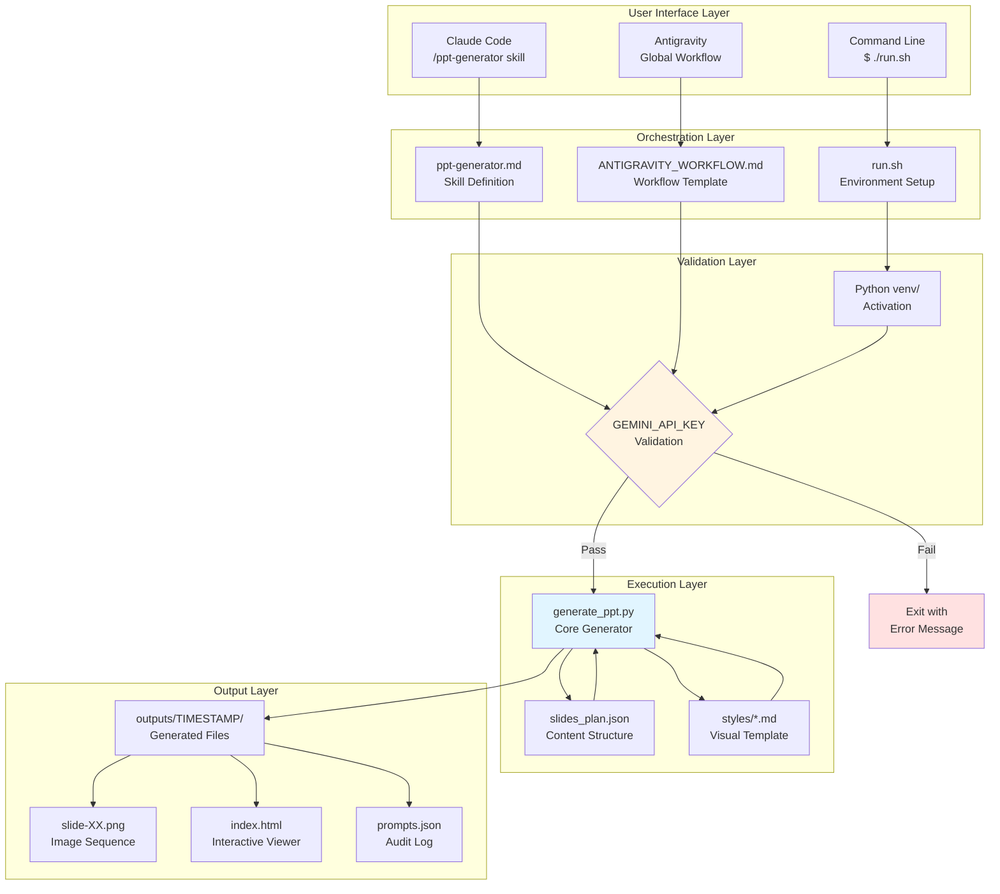
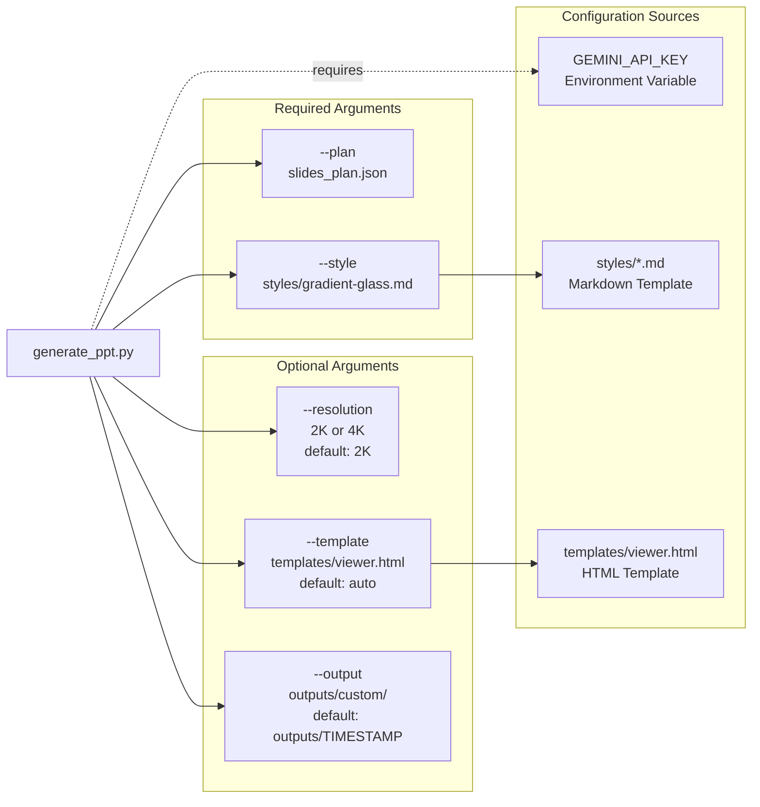
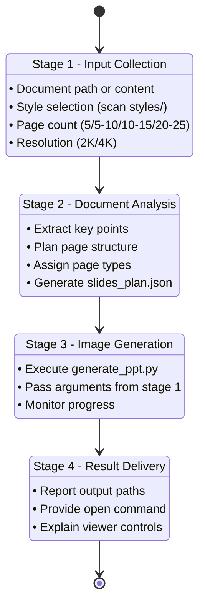
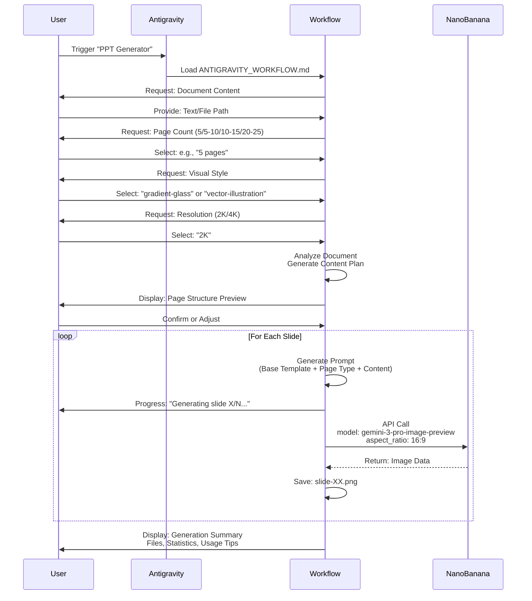
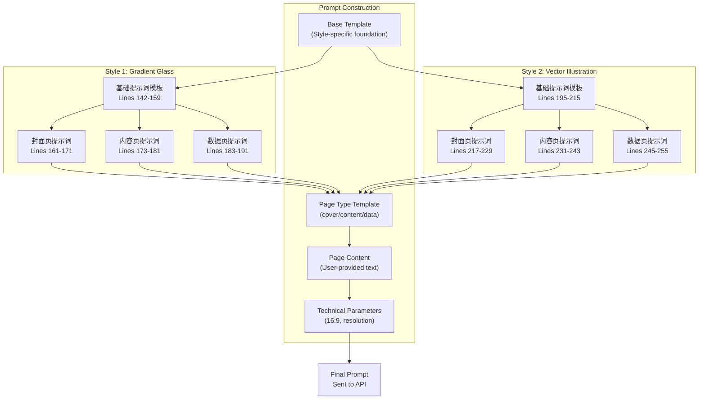
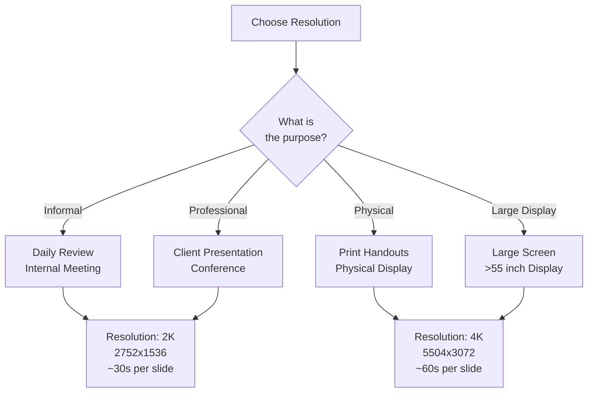

<!-- source: DeepWiki mcp.deepwiki.com · repo op7418/NanoBanana-PPT-Skills · page 4 Usage Guide · fetched 2026-10-26 -->

# Usage Guide

<details>
<summary>Relevant source files</summary>

The following files were used as context for generating this wiki page:

- [ANTIGRAVITY_WORKFLOW.md](ANTIGRAVITY_WORKFLOW.md)
- [QUICKSTART.md](QUICKSTART.md)
- [ppt-generator.md](ppt-generator.md)

</details>


## Purpose and Scope

This document provides comprehensive instructions for using the NanoBanana PPT Generator through its three supported interfaces: Claude Code natural language interaction, direct command-line execution, and Antigravity global workflow integration. Each interface targets different user personas and automation levels while executing the same underlying generation pipeline.

For initial setup and dependency installation, see [Installation](#2.2). For API key configuration (required before use), see [API Key Setup](#3.1). For understanding the internal generation process, see [Generation Pipeline](#5).

---

## Interface Overview

The system provides three distinct entry points that converge on the same generation pipeline but differ in automation level and user control.

### Interface Comparison Matrix

| Feature | Claude Code | Command Line | Antigravity Workflow |
|---------|-------------|--------------|---------------------|
| **Execution Method** | Natural language prompts | Direct script invocation | Global workflow trigger |
| **Setup Complexity** | Medium (skill installation) | Low (Python + dependencies) | Low (built-in) |
| **User Control** | Conversational | Full parameter control | Guided prompts |
| **File Management** | Automated | Manual | Automated |
| **API Configuration** | System environment required | System environment required | Built-in Nano Banana Pro |
| **Ideal User** | Non-technical users | Developers | Integrated workflow users |
| **Batch Processing** | Single generation per session | Multi-generation with flags | Single generation per trigger |

Sources: [ppt-generator.md:1-326](), [ANTIGRAVITY_WORKFLOW.md:496-508](), [QUICKSTART.md:1-240]()

---

## Entry Point Execution Flow

This diagram maps each user interface to its execution path through the codebase:



**Key Execution Paths:**

1. **Claude Code Path**: `ppt-generator.md` → skill interpreter → `generate_ppt.py`
2. **CLI Path**: `run.sh` → environment validation → `venv` activation → `generate_ppt.py`
3. **Antigravity Path**: workflow engine → `ANTIGRAVITY_WORKFLOW.md` template → Nano Banana Pro API

Sources: [ppt-generator.md:46-179](), [run.sh]() (referenced in architecture), [ANTIGRAVITY_WORKFLOW.md:1-517]()

---

## Command-Line Argument Structure

The `generate_ppt.py` script accepts the following arguments:



### Argument Reference Table

| Argument | Type | Default | Description | Example |
|----------|------|---------|-------------|---------|
| `--plan` | Path | **Required** | JSON file containing slide structure | `slides_plan.json` |
| `--style` | Path | **Required** | Markdown file defining visual style | `styles/gradient-glass.md` |
| `--resolution` | Enum | `2K` | Image resolution: `2K` or `4K` | `4K` |
| `--template` | Path | `templates/viewer.html` | HTML viewer template | `custom_viewer.html` |
| `--output` | Path | `outputs/TIMESTAMP/` | Output directory | `outputs/my-ppt/` |

Sources: [ppt-generator.md:156-164](), [QUICKSTART.md:106-115]()

---

## Claude Code Interface

### Skill Invocation Pattern

The Claude Code interface uses the `/ppt-generator` skill defined in [ppt-generator.md:1-326](). The skill orchestrates a four-stage conversational flow:



### Skill Execution Stages

#### Stage 1: Input Collection

The skill uses `AskUserQuestion` to gather parameters:

**Document Content Acquisition:**
```
If path provided → Read tool reads file
If text provided → Use directly
If neither → Prompt user
```

**Style Selection Logic:**
```bash
# Skill scans directory
styles/
├── gradient-glass.md  → "Glassmorphism Tech Style"
├── vector-illustration.md → "Flat Retro Illustration Style"
└── custom-*.md → User-defined styles
```

If multiple styles exist, skill prompts selection. If only one style exists, it is auto-selected.

**Page Count Options:**
- `5` pages: Quick demo (5 minutes)
- `5-10` pages: Standard presentation (15 minutes)
- `10-15` pages: Deep dive (30 minutes)
- `20-25` pages: Complete training (60 minutes)

Sources: [ppt-generator.md:46-71](), [ppt-generator.md:232-235]()

#### Stage 2: Content Planning

The skill analyzes document content and generates `slides_plan.json` with the following structure:

```json
{
  "title": "Document Title",
  "total_slides": 5,
  "slides": [
    {
      "slide_number": 1,
      "page_type": "cover",
      "content": "Title: Main Topic\nSubtitle: Brief Description"
    },
    {
      "slide_number": 2,
      "page_type": "content",
      "content": "Point 1: Topic\n- Sub-point 1\n- Sub-point 2"
    },
    {
      "slide_number": 5,
      "page_type": "data",
      "content": "Summary\n- Key Finding 1\n- Action Items"
    }
  ]
}
```

**Page Type Assignment Rules:**
- `slide_number == 1` → `"page_type": "cover"`
- `slide_number < total_slides` → `"page_type": "content"`
- `slide_number == total_slides OR contains data/stats` → `"page_type": "data"`

Sources: [ppt-generator.md:113-149](), [ppt-generator.md:74-111]()

#### Stage 3: Script Execution

The skill constructs and executes a bash command:

```bash
cd ppt-generator
python generate_ppt.py \
  --plan ../slides_plan.json \
  --style styles/[selected_style].md \
  --resolution [2K|4K] \
  --template templates/viewer.html
```

**Critical Environment Check:**
The script validates `GEMINI_API_KEY` presence before execution. If missing, returns error:
```
Error: GEMINI_API_KEY environment variable not set
Solution: export GEMINI_API_KEY='your-api-key'
```

Sources: [ppt-generator.md:155-169](), [ppt-generator.md:201-211]()

#### Stage 4: Result Presentation

Upon completion, the skill outputs:

```
✅ PPT Generation Complete

📁 Output Directory: ppt-generator/outputs/20260109_143022/
🎬 Viewer: ppt-generator/outputs/20260109_143022/index.html
📝 Prompts: ppt-generator/outputs/20260109_143022/prompts.json

Open viewer:
open ppt-generator/outputs/20260109_143022/index.html

Viewer Controls:
← → : Navigate slides
↑ Home : First slide
↓ End : Last slide
Space : Pause/resume autoplay
ESC : Toggle fullscreen
H : Hide/show controls
```

Sources: [ppt-generator.md:173-198](), [ppt-generator.md:289-298]()

### Skill File Structure Reference

The skill definition [ppt-generator.md:1-326]() contains:

| Section | Line Range | Purpose |
|---------|-----------|---------|
| Metadata | 1-9 | Skill identification and versioning |
| Features | 11-20 | Capability listing |
| Usage | 22-42 | Invocation instructions |
| Stage 1 | 48-71 | Input collection logic |
| Stage 2 | 73-151 | Document analysis algorithms |
| Stage 3 | 153-169 | Script execution commands |
| Stage 4 | 171-198 | Result formatting |
| Error Handling | 200-227 | Common failure scenarios |
| Examples | 246-267 | Complete workflow demonstration |

Sources: [ppt-generator.md:1-326]()

---

## Command-Line Usage

### Direct Invocation via run.sh

The [run.sh]() script provides the recommended CLI entry point. It performs:

1. **Environment Validation**: Checks for `GEMINI_API_KEY` in environment
2. **Virtual Environment Activation**: Sources `venv/bin/activate`
3. **Script Execution**: Delegates to `generate_ppt.py` with passed arguments

**Basic Invocation:**
```bash
./run.sh
```

This executes with defaults. For custom parameters, invoke `generate_ppt.py` directly after manual environment setup.

Sources: Architecture diagrams (Diagram 4), [QUICKSTART.md:1-10]()

### Direct Python Script Execution

**Prerequisites:**
```bash
# 1. Activate virtual environment
source venv/bin/activate

# 2. Verify API key
echo $GEMINI_API_KEY

# 3. Confirm dependencies
pip list | grep -E "google-genai|pillow"
```

**Full Command Syntax:**
```bash
python generate_ppt.py \
  --plan path/to/slides_plan.json \
  --style styles/gradient-glass.md \
  --resolution 2K \
  --template templates/viewer.html \
  --output outputs/custom-name
```

**Minimal Command (with defaults):**
```bash
python generate_ppt.py \
  --plan slides_plan.json \
  --style styles/gradient-glass.md
```

This uses default resolution `2K` and auto-generates timestamp output directory.

Sources: [QUICKSTART.md:14-17](), [ppt-generator.md:156-164]()

### Batch Processing Pattern

Generate multiple presentations in sequence:

```bash
# Generate brief 5-page version
python generate_ppt.py \
  --plan plan_5.json \
  --style styles/gradient-glass.md \
  --resolution 2K \
  --output outputs/v1-brief

# Generate detailed 15-page version
python generate_ppt.py \
  --plan plan_15.json \
  --style styles/vector-illustration.md \
  --resolution 4K \
  --output outputs/v2-detailed

# Generate alternate style
python generate_ppt.py \
  --plan plan_5.json \
  --style styles/vector-illustration.md \
  --resolution 2K \
  --output outputs/v1-alternate
```

**Parallel Execution (Background Jobs):**
```bash
python generate_ppt.py --plan plan1.json --style styles/gradient-glass.md --output outputs/v1 &
python generate_ppt.py --plan plan2.json --style styles/gradient-glass.md --output outputs/v2 &
wait
echo "All versions complete"
```

⚠️ **Warning**: Parallel execution may hit API rate limits. Sequential execution recommended for reliability.

Sources: [QUICKSTART.md:106-115](), [QUICKSTART.md:172-180]()

### slides_plan.json Manual Creation

For advanced users bypassing the Claude Code interface:

**Required Structure:**
```json
{
  "title": "Presentation Title",
  "total_slides": 5,
  "slides": [
    {
      "slide_number": 1,
      "page_type": "cover",
      "content": "Main Title\nSubtitle or tagline"
    },
    {
      "slide_number": 2,
      "page_type": "content", 
      "content": "Section Title\n- Key point 1\n- Key point 2\n- Key point 3"
    }
  ]
}
```

**Field Specifications:**

| Field | Type | Constraints | Example |
|-------|------|-------------|---------|
| `title` | String | 1-100 chars | `"Product Launch Q4"` |
| `total_slides` | Integer | Must match array length | `5` |
| `slides` | Array | Non-empty | `[...]` |
| `slide_number` | Integer | Sequential starting at 1 | `1` |
| `page_type` | Enum | `cover`, `content`, or `data` | `"cover"` |
| `content` | String | Newline-separated text | `"Title\n- Point A\n- Point B"` |

Sources: [ppt-generator.md:113-149](), [QUICKSTART.md:156-169]()

### Style File Selection

Available built-in styles in `styles/` directory:

**gradient-glass.md:**
```
Style: Glassmorphism with 3D objects
Visual Language: Apple Keynote minimalism + SaaS design
Color Palette: Void black / ceramic white + aurora gradients
Use Cases: Tech presentations, business demos, product launches
```

**vector-illustration.md:**
```
Style: Flat vector illustration with monoline strokes
Visual Language: Retro, geometric, toy-like simplification
Color Palette: Cream background + coral/mint/mustard accents
Use Cases: Education, creative proposals, friendly presentations
```

To use custom styles, create new `.md` files following the template structure in existing style files.

Sources: [ppt-generator.md:232-235](), Architecture Diagram 6 (Style System)

### Output Directory Structure

After execution, the following structure is created:

```
outputs/
└── 20260109_143022/          # Timestamp: YYYYMMDD_HHMMSS
    ├── slide-01.png          # Cover slide
    ├── slide-02.png          # Content slide
    ├── slide-03.png          # Content slide
    ├── slide-04.png          # Content slide
    ├── slide-05.png          # Data/summary slide
    ├── prompts.json          # Audit trail of all prompts
    └── index.html            # Interactive HTML viewer
```

**File Naming Convention:**
- Images: `slide-{number:02d}.png` (e.g., `slide-01.png`, `slide-02.png`)
- Timestamps: `YYYYMMDD_HHMMSS` format
- Audit log: Always named `prompts.json`
- Viewer: Always named `index.html`

Sources: [ppt-generator.md:289-298](), Architecture Diagram 1 (System Overview)

---

## Antigravity Workflow Integration

### Workflow Template Structure

The Antigravity integration uses [ANTIGRAVITY_WORKFLOW.md:1-517]() as a global workflow template. The template is split into two fields:

**Description Field (0-250 characters):**
```
基于文档内容自动生成专业PPT图片。支持2种风格（渐变毛玻璃/矢量插画），16:9比例，2K/4K分辨率。智能分析文档，规划页面结构，调用Nano Banana Pro生成高质量演示文稿。适用于商务演示、教育培训、创意提案等场景。
```
Character count: 132/250 ✅

**Content Field (0-12000 characters):**
Contains the complete workflow logic including:
- Step 1: User input collection (lines 39-68)
- Step 2: Document analysis (lines 69-135)
- Step 3: Prompt generation (lines 137-255)
- Step 4: Nano Banana Pro invocation (lines 257-285)
- Step 5: Result summary (lines 287-314)
- Step 6: Follow-up support (lines 316-334)

Sources: [ANTIGRAVITY_WORKFLOW.md:10-23](), [ANTIGRAVITY_WORKFLOW.md:477-495]()

### Workflow Execution Stages



### Workflow Steps Detail

#### Step 1: User Input Collection

**Prompts Sequence:**

1. **Document Content** [ANTIGRAVITY_WORKFLOW.md:43-45]()
   ```
   Query: "请提供您的文档内容，可以是文本、Markdown或文件路径"
   Action: If file path → Read file content
   ```

2. **Page Count** [ANTIGRAVITY_WORKFLOW.md:47-55]()
   ```
   Query: "您希望生成多少页PPT？"
   Options:
   - 5页（快速演示，5分钟）
   - 5-10页（标准演示，15分钟）
   - 10-15页（深入讲解，30分钟）
   - 20-25页（完整培训，60分钟）
   - 自定义页数
   ```

3. **Visual Style** [ANTIGRAVITY_WORKFLOW.md:56-62]()
   ```
   Query: "请选择视觉风格："
   Options:
   - 渐变毛玻璃卡片风格: 科技感，未来感，3D玻璃，霓虹渐变
   - 矢量插画风格: 温暖可爱，扁平化，黑色轮廓线，复古配色
   ```

4. **Resolution** [ANTIGRAVITY_WORKFLOW.md:63-68]()
   ```
   Query: "选择图片分辨率："
   Options:
   - 2K (2752x1536) - 推荐，日常使用
   - 4K (5504x3072) - 高质量，打印/大屏
   ```

Sources: [ANTIGRAVITY_WORKFLOW.md:39-68]()

#### Step 2: Content Planning Strategy

The workflow applies structure templates based on page count:

**5-Page Structure** [ANTIGRAVITY_WORKFLOW.md:75-78]():
```
Page 1: Cover (Title + Subtitle)
Pages 2-4: Core Content (1-2 points per page)
Page 5: Summary or Call-to-Action
```

**10-15 Page Structure** [ANTIGRAVITY_WORKFLOW.md:86-91]():
```
Page 1: Cover
Pages 2-3: Introduction/Background
Pages 4-12: Core Content (3-4 chapters)
Pages 13-14: Case Studies/Data
Page 15: Summary
```

**Planning Output Format** [ANTIGRAVITY_WORKFLOW.md:111-133]():
```
📋 PPT内容规划（共X页）

第1页 [封面]
标题：[文档主题]
副标题：[简短描述]

第2页 [内容]
主题：[第一个核心观点]
要点：
- [要点1]
- [要点2]
- [要点3]
...
```

Sources: [ANTIGRAVITY_WORKFLOW.md:69-135]()

#### Step 3: Prompt Engineering

The workflow constructs prompts by combining three components:

**Component Hierarchy:**


**Example Prompt Assembly (Gradient Glass Cover Page):**

```
[基础提示词模板 - Lines 146-159]
+
[封面页特定指令 - Lines 163-170]
+
[用户内容注入]
标题：AI产品设计原则
副标题：打造用户喜爱的智能产品
+
[技术参数]
16:9, 2K Resolution
```

Sources: [ANTIGRAVITY_WORKFLOW.md:137-255]()

#### Step 4: Nano Banana Pro Invocation

**API Configuration** [ANTIGRAVITY_WORKFLOW.md:268-276]():
```python
model: "gemini-3-pro-image-preview"
aspect_ratio: "16:9"
image_size: "2K" or "4K"  # Based on user selection
```

**Progress Display** [ANTIGRAVITY_WORKFLOW.md:261-266]():
```
🎨 正在生成第 X/总页数 页...
页面类型：[封面/内容/数据]
内容主题：[简短描述]
```

**File Naming** [ANTIGRAVITY_WORKFLOW.md:277-279]():
```python
filename_format: f"slide-{page_number:02d}.png"
examples: ["slide-01.png", "slide-02.png", "slide-10.png"]
```

Sources: [ANTIGRAVITY_WORKFLOW.md:257-285]()

#### Step 5: Result Summary

**Generation Statistics Display** [ANTIGRAVITY_WORKFLOW.md:290-308]():
```
✅ PPT生成完成！

📊 生成统计：
- 总页数：X 页
- 成功：X 页
- 失败：X 页
- 总用时：约 X 分钟

📁 生成的文件：
slide-01.png - 封面：[标题]
slide-02.png - 内容：[主题]
...

💡 使用建议：
1. 所有图片已按顺序命名（slide-01 到 slide-XX）
2. 可以直接导入到演示软件（Keynote、PowerPoint等）
3. 也可以在网页中按顺序展示
```

Sources: [ANTIGRAVITY_WORKFLOW.md:287-314]()

### Workflow vs. Other Interfaces

**Key Differences:**

| Aspect | Antigravity Workflow | Claude Code Skill |
|--------|---------------------|------------------|
| **Execution Environment** | Built-in Nano Banana Pro | External Gemini API via `GEMINI_API_KEY` |
| **File System Access** | Automatic management | Manual file operations |
| **HTML Viewer Generation** | Optional, user must implement | Automatic via `templates/viewer.html` |
| **Prompt Storage** | Not automatically logged | Saved to `prompts.json` |
| **Installation Required** | None (built-in) | Python environment + dependencies |

Sources: [ANTIGRAVITY_WORKFLOW.md:496-508]()

### Installation Instructions

1. **Open Antigravity Global Workflows Editor**
   ```
   Path: .gemini > antigravity > global_workflows
   ```

2. **Create New Workflow File**
   ```
   Filename: ppt-generator.md
   ```

3. **Fill Description Field**
   - Copy content from [ANTIGRAVITY_WORKFLOW.md:14]()
   - Character limit: 250
   - Actual usage: 132 characters ✅

4. **Fill Content Field**
   - Copy complete markdown from [ANTIGRAVITY_WORKFLOW.md:24-471]()
   - Character limit: 12,000
   - Actual usage: ~11,500 characters ✅

5. **Save and Test**
   ```
   Action: Save workflow
   Test: Trigger workflow with sample document
   Verify: Generation completes successfully
   ```

Sources: [ANTIGRAVITY_WORKFLOW.md:477-495]()

---

## Timing and Performance Expectations

### Generation Speed by Resolution

| Resolution | Dimensions | Time per Slide | 5-Page PPT | 15-Page PPT |
|------------|------------|----------------|------------|-------------|
| 2K | 2752 x 1536 | ~30 seconds | ~2.5 minutes | ~7.5 minutes |
| 4K | 5504 x 3072 | ~60 seconds | ~5 minutes | ~15 minutes |

**Factors Affecting Speed:**
- Network latency to Gemini API
- API rate limits (sequential processing enforced)
- Complexity of prompt (more detailed prompts may take longer)
- Server load (Google infrastructure)

Sources: [QUICKSTART.md:98-104](), [ANTIGRAVITY_WORKFLOW.md:351-363]()

### File Size Expectations

| Resolution | Per-Slide Size | 5-Page Total | 15-Page Total |
|------------|----------------|--------------|---------------|
| 2K | ~2-3 MB | ~10-15 MB | ~30-45 MB |
| 4K | ~8-10 MB | ~40-50 MB | ~120-150 MB |

**Storage Implications:**
- PNG format (lossless compression)
- Typical 10-slide presentation at 2K: ~25 MB
- Typical 10-slide presentation at 4K: ~90 MB

Sources: [QUICKSTART.md:98-104](), [ANTIGRAVITY_WORKFLOW.md:361-363]()

---

## Error Handling Patterns

### Common Errors and Resolution

**API Key Missing:**
```bash
Error: GEMINI_API_KEY environment variable not set
Location: run.sh validation, generate_ppt.py initialization
Solution: export GEMINI_API_KEY='your-api-key-here'
Verification: echo $GEMINI_API_KEY
```

**Dependency Missing:**
```bash
Error: No module named 'google.genai'
Location: Python import statements
Solution: pip install google-genai==1.57.0 pillow==12.1.0
Verification: pip list | grep google-genai
```

**Invalid slides_plan.json:**
```bash
Error: JSON parsing failed
Location: generate_ppt.py --plan argument processing
Solution: Validate JSON syntax using: python -m json.tool slides_plan.json
Common Issues: 
- Missing commas between array elements
- Trailing commas (not valid in JSON)
- Unescaped quotes in content strings
```

**API Call Timeout:**
```bash
Error: API request timed out
Location: Gemini API network call
Solution: 
- Check network connection
- Verify API key validity
- Retry after brief delay
- Reduce resolution from 4K to 2K
```

**Output Directory Permission Error:**
```bash
Error: Permission denied writing to outputs/
Location: File system operations in generate_ppt.py
Solution: 
- Check write permissions: ls -la outputs/
- Specify alternate output: --output ~/Documents/ppt-output/
```

Sources: [ppt-generator.md:201-227](), [QUICKSTART.md:182-220]()

---

## Best Practices

### Input Document Optimization

**Good Structure:**
```markdown
# Main Topic

## Section 1: Core Concept
- Key point with 8-10 words
- Supporting detail
- Data or example

## Section 2: Next Concept
- Concise bullet point
- Actionable insight
```

**Avoid:**
```markdown
# Topic
Long paragraph without structure... continues for many lines with no
clear separation or bullet points making it difficult to extract
discrete slide content.
```

**Recommendations:**
- Use clear headings (H2/H3 for sections)
- Bullet points: 3-5 per section
- Each bullet: 5-12 words
- Avoid nested bullets beyond 2 levels

Sources: [QUICKSTART.md:72-95](), [ANTIGRAVITY_WORKFLOW.md:336-350]()

### Resolution Selection Strategy



**Decision Table:**

| Use Case | Recommended | Rationale |
|----------|-------------|-----------|
| Team standup | 2K | Speed priority, screen viewing |
| Client pitch | 2K | Balance quality and generation time |
| Conference talk | 2K | Projector resolution typically ≤1080p |
| Print materials | 4K | High DPI required |
| Trade show display | 4K | Large format, close viewing |
| Social media | 2K | Sufficient for web/mobile |

Sources: [QUICKSTART.md:96-104](), [ANTIGRAVITY_WORKFLOW.md:351-363]()

### Batch Processing Workflow

**Sequential Processing Script:**
```bash
#!/bin/bash
# batch_generate.sh

PLANS=("plan_5.json" "plan_10.json" "plan_15.json")
STYLES=("gradient-glass" "vector-illustration")

for plan in "${PLANS[@]}"; do
  for style in "${STYLES[@]}"; do
    echo "Generating: $plan with $style"
    python generate_ppt.py \
      --plan "$plan" \
      --style "styles/${style}.md" \
      --resolution 2K \
      --output "outputs/${plan%.json}_${style}"
    echo "Completed: $plan with $style"
    sleep 5  # Respect API rate limits
  done
done

echo "All batches complete"
```

**Result Organization:**
```
outputs/
├── plan_5_gradient-glass/
├── plan_5_vector-illustration/
├── plan_10_gradient-glass/
├── plan_10_vector-illustration/
├── plan_15_gradient-glass/
└── plan_15_vector-illustration/
```

Sources: [QUICKSTART.md:106-180]()

---

