<!-- source: DeepWiki mcp.deepwiki.com · repo op7418/NanoBanana-PPT-Skills · page 4.1 Claude Code Interface · fetched 2026-10-26 -->

# Claude Code Interface

<details>
<summary>Relevant source files</summary>

The following files were used as context for generating this wiki page:

- [QUICKSTART.md](QUICKSTART.md)
- [ppt-generator.md](ppt-generator.md)

</details>


## Purpose and Scope

This document describes the Claude Code interface for the NanoBanana PPT Generator, accessed via the `/ppt-generator` skill. This interface provides a natural language abstraction layer over the core generation pipeline, automating environment setup, document analysis, parameter selection, and script execution.

For direct command-line usage without AI assistance, see [Command Line Usage](#4.2). For Antigravity workflow automation, see [Antigravity Workflow Integration](#4.3).

**Sources**: [ppt-generator.md:1-45]()

---

## Skill Metadata and Capabilities

The Claude Code interface is implemented as a skill with the following characteristics:

| Property | Value |
|----------|-------|
| **Skill Name** | `ppt-generator` |
| **Version** | 1.0.0 |
| **Primary Model** | `gemini-3-pro-image-preview` |
| **Interface Type** | Natural Language → Python Script Orchestration |
| **Automation Level** | High (handles setup, planning, execution) |

**Core Capabilities**:
- Intelligent document content extraction and analysis
- Automatic slide structure planning based on page count ranges
- Style selection through natural language or menu prompts
- Resolution selection (2K/4K) with time/quality tradeoffs
- Orchestrated execution of `generate_ppt.py` with proper parameters
- Result presentation with viewer instructions

**Sources**: [ppt-generator.md:3-20]()

---

## Skill Architecture

### High-Level Orchestration Flow

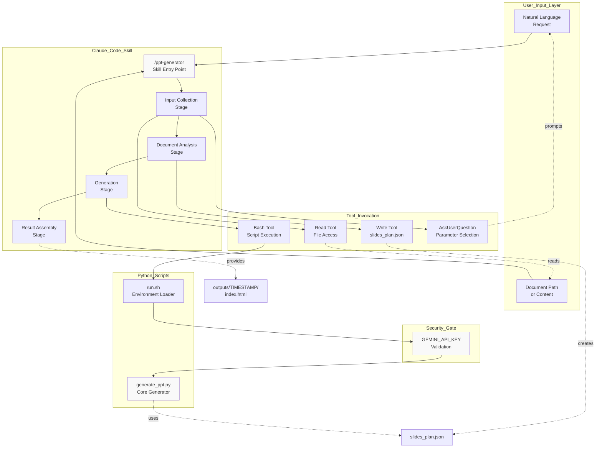

**Architectural Principles**:
- **Skill-as-Orchestrator**: Claude Code skill acts as a workflow coordinator, not a code executor
- **Tool-Mediated Interaction**: All file I/O and script execution happens through Claude Code tools
- **Security Gateway**: All execution paths must pass through `GEMINI_API_KEY` validation before reaching `generate_ppt.py`
- **JSON Bridge**: `slides_plan.json` serves as the interface contract between analysis and generation stages

**Sources**: [ppt-generator.md:44-178]()

---

## Four-Stage Workflow

### Stage 1: Input Collection

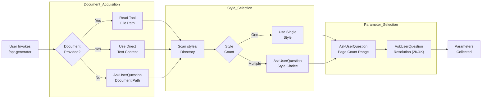

**Page Count Ranges**:

| Range | Description | Use Case | Example Output |
|-------|-------------|----------|----------------|
| 5 pages | Elevator pitch | 5-minute presentation | Cover, 3 key points, Summary |
| 5-10 pages | Standard presentation | 10-15 minute talk | Cover, Intro, 3-4 sections, Data, Summary |
| 10-15 pages | Deep dive | 20-30 minute session | Cover, TOC, 3 chapters (3 pages each), Case study, Summary |
| 20-25 pages | Full training | 45-60 minute workshop | Cover, TOC, Intro, 3 parts (4 pages each), Cases, Data, Summary, Thanks |

**Resolution Options**:

| Resolution | Dimensions | Generation Time | File Size | Use Case |
|-----------|------------|-----------------|-----------|----------|
| 2K | 2752x1536 | ~30s per slide | ~2MB per slide | Daily presentations, web viewing |
| 4K | 5504x3072 | ~60s per slide | ~8MB per slide | Print output, large displays |

**Sources**: [ppt-generator.md:48-71](), [QUICKSTART.md:96-104]()

---

### Stage 2: Document Analysis and Planning

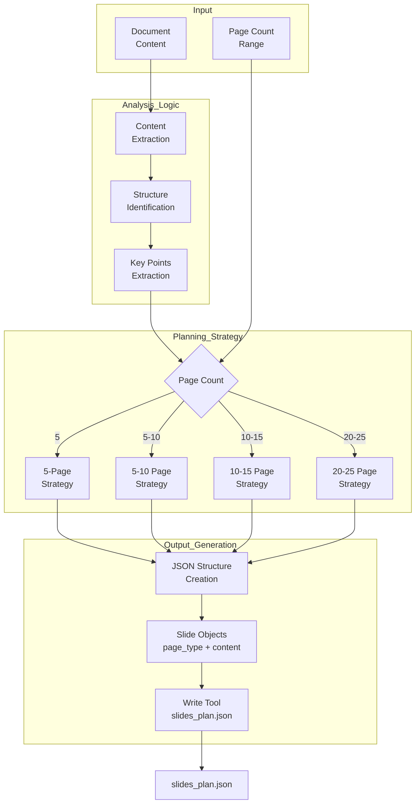

**JSON Output Format**:

The analysis stage produces `slides_plan.json` with the following structure:

```json
{
  "title": "Document Title",
  "total_slides": 5,
  "slides": [
    {
      "slide_number": 1,
      "page_type": "cover",
      "content": "Title: [Main Title]\nSubtitle: [Subtitle]"
    },
    {
      "slide_number": 2,
      "page_type": "content",
      "content": "Key Point 1\n- Sub-point A\n- Sub-point B"
    }
  ]
}
```

**Page Type Mapping**:

| Page Type | Purpose | Typical Position | Content Structure |
|-----------|---------|------------------|-------------------|
| `cover` | Title slide | Slide 1 | Title + Subtitle + Visual theme |
| `content` | Information delivery | Middle slides | Heading + 3-5 bullet points |
| `data` | Visualization/Summary | End slides | Charts/Graphs or Summary points |

**Sources**: [ppt-generator.md:72-149]()

---

### Stage 3: Image Generation Execution

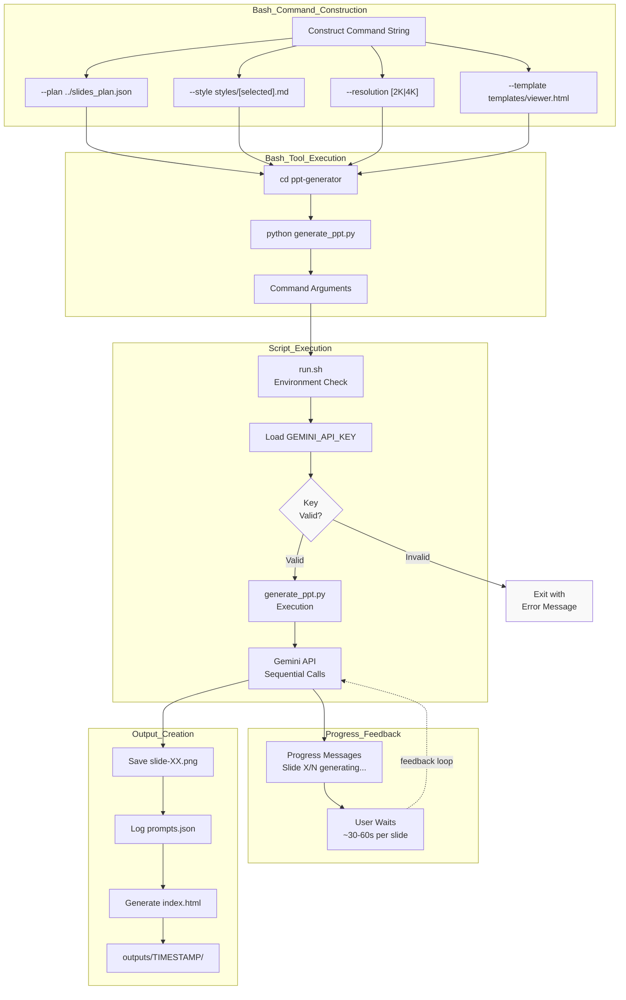

**Command Structure**:

```bash
cd ppt-generator
python generate_ppt.py \
  --plan ../slides_plan.json \
  --style styles/gradient-glass.md \
  --resolution 2K \
  --template templates/viewer.html
```

**Timing Expectations**:

| Resolution | Time per Slide | 5 Slides | 10 Slides | 25 Slides |
|-----------|---------------|----------|-----------|-----------|
| 2K | ~30 seconds | ~2.5 min | ~5 min | ~12.5 min |
| 4K | ~60 seconds | ~5 min | ~10 min | ~25 min |

**Sources**: [ppt-generator.md:153-170](), [QUICKSTART.md:197-201]()

---

### Stage 4: Result Assembly and Presentation

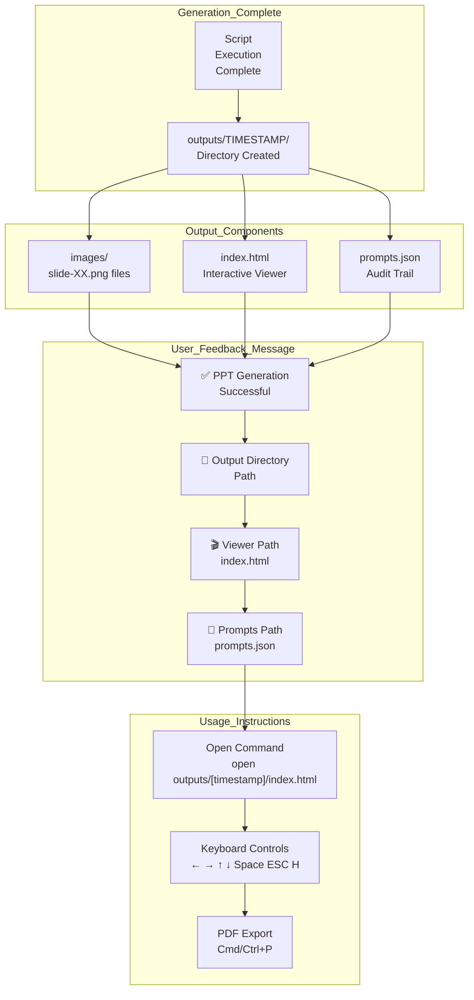

**Example Output Message**:

```
✅ PPT生成成功！

📁 输出目录: ppt-generator/outputs/20260109_143022/
🎬 播放网页: ppt-generator/outputs/20260109_143022/index.html
📝 提示词记录: ppt-generator/outputs/20260109_143022/prompts.json

打开播放网页:
open ppt-generator/outputs/20260109_143022/index.html

播放器使用说明:
- ← → 键: 切换页面
- ↑ Home: 回到首页
- ↓ End: 跳到末页
- 空格: 暂停/继续自动播放
- ESC: 全屏切换
- H: 隐藏/显示控件
```

**Output Directory Structure**:

```
outputs/20260109_143022/
├── images/
│   ├── slide-01.png
│   ├── slide-02.png
│   ├── slide-03.png
│   ├── slide-04.png
│   └── slide-05.png
├── prompts.json
└── index.html
```

**Sources**: [ppt-generator.md:172-198]()

---

## Natural Language Interface Capabilities

### Request Pattern Recognition

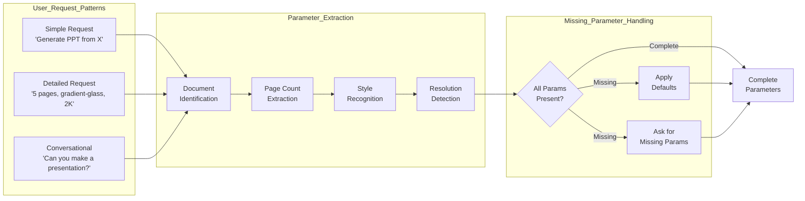

**Example Natural Language Requests**:

| User Input | Extracted Parameters | Missing Parameters | Skill Action |
|------------|---------------------|-------------------|--------------|
| "Generate PPT from doc.md" | Document: `doc.md` | Pages, Style, Resolution | Ask user for all 3 |
| "5 pages, gradient-glass, 2K from doc.md" | All complete | None | Proceed directly |
| "Make a presentation" | None | All | Ask for document first, then others |
| "I want a 10-page presentation about AI" | Pages: 10 | Document, Style, Resolution | Ask for document path |

**Sources**: [ppt-generator.md:48-71](), [QUICKSTART.md:38-44]()

---

## Automation Features

### Automatic Environment Setup

Claude Code automates several setup tasks that would be manual in CLI usage:

| Task | Manual (CLI) | Automated (Claude Code) |
|------|-------------|------------------------|
| **API Key Check** | User must verify `export GEMINI_API_KEY` | Skill checks environment automatically |
| **Dependency Check** | User must run `pip install` | Can be detected and prompted |
| **Directory Navigation** | User must `cd ppt-generator` | Handled by Bash tool with `cd` command |
| **File Path Resolution** | User provides absolute paths | Read tool handles path resolution |
| **Error Interpretation** | User reads raw Python errors | Skill translates to actionable messages |

### Style Directory Scanning

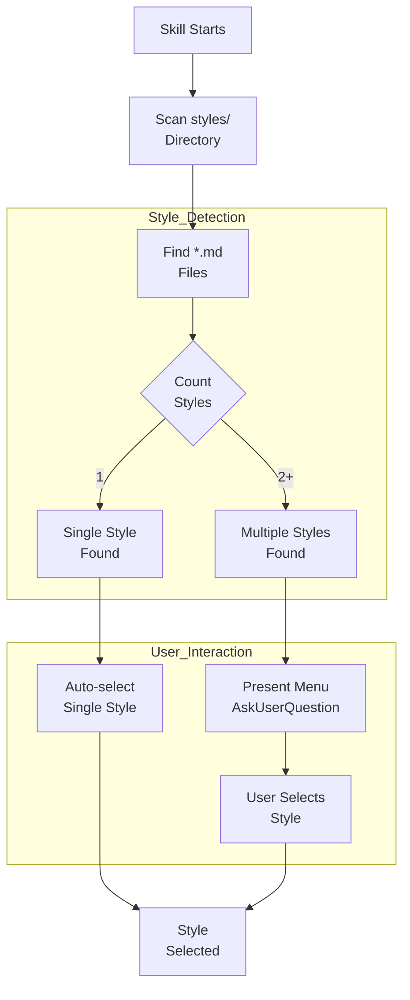

**Available Styles Detection**:
- Scans `ppt-generator/styles/` directory
- Identifies `*.md` files (e.g., `gradient-glass.md`, `vector-illustration.md`)
- If single style: automatically uses it
- If multiple styles: presents selection menu with style descriptions

**Sources**: [ppt-generator.md:55-58]()

---

## Integration with Core System

### Tool-to-Script Mapping

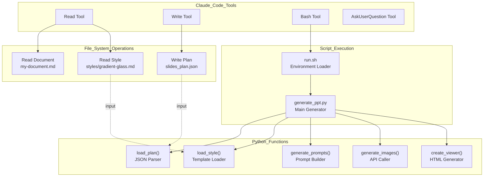

**Execution Flow Mapping**:

| Stage | Claude Code Tool | Filesystem Operation | Python Function | API Call |
|-------|------------------|---------------------|-----------------|----------|
| **Read Document** | Read Tool | Read `my-document.md` | N/A | N/A |
| **Write Plan** | Write Tool | Write `slides_plan.json` | N/A | N/A |
| **Execute Script** | Bash Tool | Execute `python generate_ppt.py` | `main()` entry point | N/A |
| **Load Plan** | N/A (Python) | Read `slides_plan.json` | `load_plan()` | N/A |
| **Load Style** | N/A (Python) | Read `styles/*.md` | `load_style()` | N/A |
| **Generate Images** | N/A (Python) | Write `slide-XX.png` | `generate_images()` | `gemini-3-pro-image-preview` |
| **Create Viewer** | N/A (Python) | Write `index.html` | `create_viewer()` | N/A |

**Sources**: [ppt-generator.md:153-178]()

---

## Error Handling and User Feedback

### Common Error Scenarios

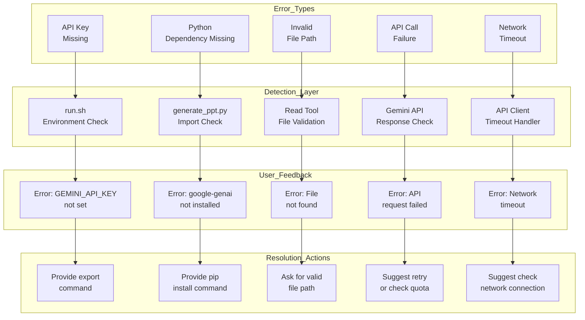

**Error Message Translation**:

| Raw Error | User-Facing Message | Suggested Action |
|-----------|-------------------|------------------|
| `KeyError: 'GEMINI_API_KEY'` | "未设置 GEMINI_API_KEY 环境变量" | `export GEMINI_API_KEY='your-key'` |
| `ModuleNotFoundError: google-genai` | "未安装 google-genai 库" | `pip install google-genai pillow` |
| `FileNotFoundError: 'doc.md'` | "文件不存在" | "检查文件路径是否正确，使用绝对路径" |
| `API timeout after 120s` | "API调用超时或失败" | "检查网络连接，确认API密钥有效，稍后重试" |

**Sources**: [ppt-generator.md:200-227]()

---

## Comparison with Other Interfaces

### Interface Feature Matrix

| Feature | Claude Code | Command Line ([4.2](#4.2)) | Antigravity ([4.3](#4.3)) |
|---------|-------------|-------------------|----------------------|
| **Invocation** | `/ppt-generator` | `./run.sh` or `python generate_ppt.py` | Global Workflow trigger |
| **Input Method** | Natural language | Command arguments | Workflow prompts |
| **Document Analysis** | Automatic | Manual (pre-created JSON) | Configurable |
| **Style Selection** | Interactive menu | CLI argument `--style` | Workflow parameter |
| **Resolution Selection** | Interactive prompt | CLI argument `--resolution` | Workflow parameter |
| **Error Handling** | User-friendly messages | Raw Python errors | Workflow error handlers |
| **Setup Automation** | High | None | Medium |
| **Batch Processing** | Sequential only | Supports `&` parallelization | Workflow-defined |
| **Output Feedback** | Formatted messages | Script output | Workflow notifications |
| **Learning Curve** | Low (natural language) | Medium (CLI syntax) | Medium (workflow config) |
| **Flexibility** | Medium | High (direct control) | High (programmable) |

### Architectural Position

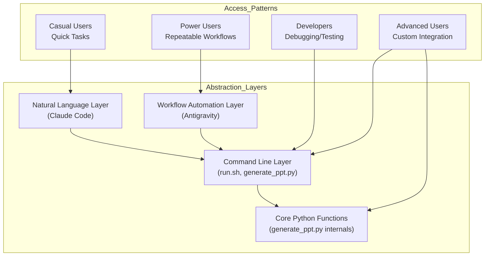

**When to Use Claude Code Interface**:

| Scenario | Claude Code Best? | Reason |
|----------|------------------|--------|
| First-time user | ✅ Yes | No setup knowledge required, guided prompts |
| Quick one-off presentation | ✅ Yes | Fastest path from idea to result |
| Non-technical user | ✅ Yes | Natural language, no CLI familiarity needed |
| Batch processing 10+ presentations | ❌ No | Use CLI with shell scripting ([4.2](#4.2)) |
| Automated CI/CD pipeline | ❌ No | Use direct Python with environment variables |
| Custom style development | ❌ No | Use CLI for fast iteration |
| Debugging generation issues | ❌ No | Use CLI to see raw errors |
| Integrating into existing workflow | ⚠️ Maybe | Consider Antigravity ([4.3](#4.3)) instead |

**Sources**: [ppt-generator.md:1-326](), [QUICKSTART.md:1-240]()

---

## Example Workflow Session

### Complete User Interaction

**User Input**:
```
/ppt-generator

I want to create a 5-page presentation based on my document about 
"The Moylan Arrow: IA Lessons for AI-Powered Experiences"
```

**Skill Response Sequence**:

1. **Document Location**:
   ```
   I'll help you create a 5-page presentation. First, could you provide 
   the document path?
   
   Example: /Users/username/documents/moylan-arrow.md
   ```

2. **Style Selection** (assuming multiple styles exist):
   ```
   Which style would you like to use?
   
   1. gradient-glass: Glassmorphism + 3D objects + neon gradients
   2. vector-illustration: Flat design + retro colors + geometric shapes
   
   Please select 1 or 2.
   ```

3. **Resolution Selection**:
   ```
   Choose resolution:
   
   1. 2K (2752x1536) - Recommended, ~30s per slide
   2. 4K (5504x3072) - High quality, ~60s per slide
   
   Please select 1 or 2.
   ```

4. **Processing Notification**:
   ```
   Analyzing document and planning 5 slides...
   ✓ Document analyzed
   ✓ Slide structure planned
   ✓ slides_plan.json created
   
   Starting image generation (this will take ~2.5 minutes)...
   ```

5. **Progress Updates**:
   ```
   Generating slide 1/5...
   Generating slide 2/5...
   Generating slide 3/5...
   Generating slide 4/5...
   Generating slide 5/5...
   ```

6. **Completion Message**:
   ```
   ✅ PPT生成成功！
   
   📁 输出目录: ppt-generator/outputs/20260109_143022/
   🎬 播放网页: ppt-generator/outputs/20260109_143022/index.html
   📝 提示词记录: ppt-generator/outputs/20260109_143022/prompts.json
   
   打开播放网页:
   open ppt-generator/outputs/20260109_143022/index.html
   
   播放器使用说明:
   - ← → 键: 切换页面
   - 空格: 自动播放
   - ESC: 全屏模式
   ```

**Sources**: [ppt-generator.md:246-268]()

---

## Skill Extension Points

### Adding Custom Styles

Claude Code automatically detects new style files without code changes:

```markdown
# styles/custom-corporate.md

## 风格ID
corporate-professional

## 基础提示词模板
Professional business presentation with clean layouts, 
corporate color scheme, data-driven visualizations...
```

Once the file is added to `styles/`, Claude Code will:
1. Detect it during style directory scan
2. Add it to the style selection menu
3. Pass it to `generate_ppt.py --style styles/custom-corporate.md`

**No skill modification required** - extensibility is built into the directory scanning logic.

### Custom Page Types

The skill supports extending page types in `slides_plan.json`:

| Built-in Types | Custom Extension Examples |
|----------------|--------------------------|
| `cover` | `title-with-logo` |
| `content` | `two-column-content` |
| `data` | `timeline`, `comparison`, `process-flow` |

Custom types require corresponding templates in the style file's page-type sections.

**Sources**: [ppt-generator.md:229-242]()

---

## Performance Characteristics

### Time Complexity Analysis

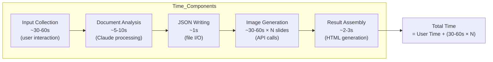

**Time Breakdown by Presentation Size**:

| Pages | User Input | Analysis | Generation @ 2K | Generation @ 4K | Total @ 2K | Total @ 4K |
|-------|-----------|----------|----------------|----------------|-----------|-----------|
| 5 | ~60s | ~10s | ~150s (5×30s) | ~300s (5×60s) | ~3.5 min | ~6 min |
| 10 | ~60s | ~10s | ~300s (10×30s) | ~600s (10×60s) | ~6 min | ~11 min |
| 15 | ~60s | ~15s | ~450s (15×30s) | ~900s (15×60s) | ~9 min | ~16 min |
| 25 | ~60s | ~20s | ~750s (25×30s) | ~1500s (25×60s) | ~14 min | ~26 min |

**Bottleneck**: Image generation via Gemini API is the dominant time factor (80-90% of total time).

**Sources**: [QUICKSTART.md:96-104](), [QUICKSTART.md:197-201]()

---

## Limitations and Constraints

### Current Limitations

| Limitation | Impact | Workaround |
|------------|--------|------------|
| **Sequential API Calls** | Cannot parallelize slide generation | Use CLI with shell `&` for parallel runs ([4.2](#4.2)) |
| **Single Style per Run** | Cannot mix styles in one presentation | Generate separately and manually combine |
| **No Real-Time Preview** | Must wait for full generation to see results | Start with 5-page version to validate |
| **No Incremental Regeneration** | Cannot regenerate single slide | Must regenerate entire deck |
| **Natural Language Ambiguity** | Skill may misinterpret vague requests | Be explicit about document path and parameters |
| **No Progress Cancellation** | Cannot stop mid-generation | Must wait for completion or terminate process |

### API Constraints

- **Rate Limits**: Gemini API has rate limits (specifics vary by account)
- **Quota Management**: High-volume use may exhaust daily quota
- **Network Dependency**: Requires stable internet connection throughout generation
- **API Key Security**: Must be set before skill execution, cannot be provided interactively

**Sources**: [ppt-generator.md:200-227]()

---

## Security Considerations

### API Key Handling

Claude Code does not provide interactive API key input. The key must be set before skill invocation:

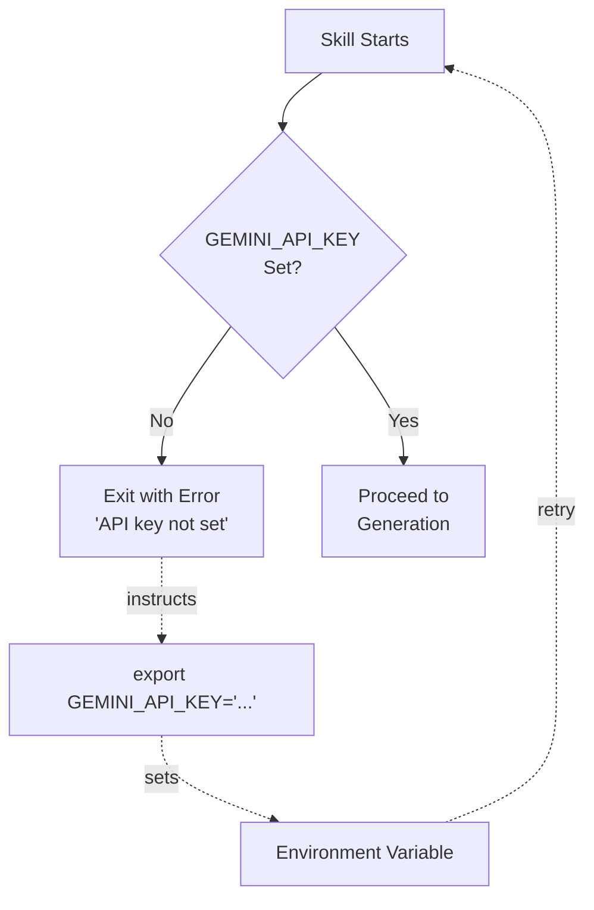

**Security Properties**:
- ✅ **Never Prompts for API Key**: Prevents accidental exposure in conversation logs
- ✅ **Environment Variable Only**: Consistent with security best practices ([3.2](#3.2))
- ✅ **No Inline Storage**: Never writes key to files or chat history
- ❌ **No Validation**: Cannot verify key validity until first API call

For comprehensive API key security, see [Security Best Practices](#3.3).

**Sources**: [ppt-generator.md:200-227](), [QUICKSTART.md:5-11]()

---

