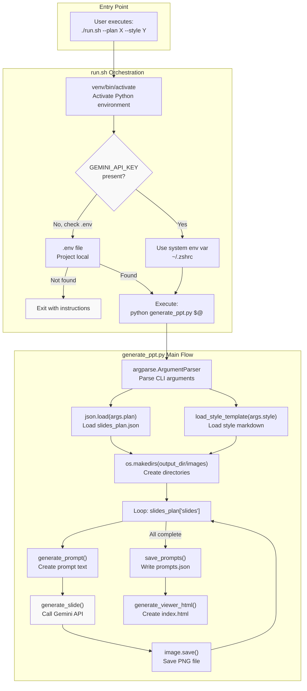
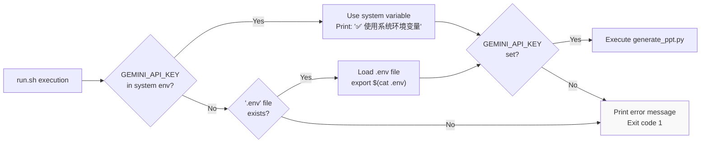
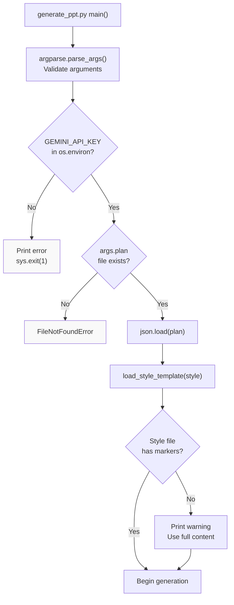
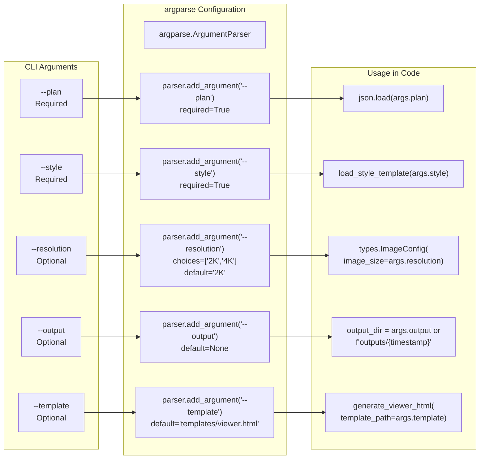

<!-- source: DeepWiki mcp.deepwiki.com · repo op7418/NanoBanana-PPT-Skills · page 4.2 Command Line Usage · fetched 2026-10-26 -->

# Command Line Usage

<details>
<summary>Relevant source files</summary>

The following files were used as context for generating this wiki page:

- [QUICKSTART.md](QUICKSTART.md)
- [SETUP_COMPLETE.md](SETUP_COMPLETE.md)
- [generate_ppt.py](generate_ppt.py)
- [run.sh](run.sh)

</details>


This page covers direct command-line usage of the PPT Generator through the `run.sh` orchestration script and the `generate_ppt.py` Python script. For automated usage through Claude Code, see [Claude Code Interface](#4.1). For global workflow integration, see [Antigravity Workflow Integration](#4.3). For internal details about how `run.sh` works, see [Execution Scripts](#5.4).

---

## Quick Reference

**Basic usage (recommended):**
```bash
./run.sh --plan slides_plan.json --style styles/gradient-glass.md --resolution 2K
```

**Direct Python usage:**
```bash
source venv/bin/activate
export GEMINI_API_KEY='your-key'
python generate_ppt.py --plan slides_plan.json --style styles/gradient-glass.md --resolution 2K
```

**Common patterns:**
| Pattern | Command |
|---------|---------|
| Basic generation | `./run.sh --plan plan.json --style styles/gradient-glass.md` |
| High quality output | `./run.sh --plan plan.json --style styles/gradient-glass.md --resolution 4K` |
| Custom output path | `./run.sh --plan plan.json --style styles/gradient-glass.md --output outputs/my-presentation` |
| Alternative style | `./run.sh --plan plan.json --style styles/vector-illustration.md` |

Sources: [QUICKSTART.md:1-44](), [SETUP_COMPLETE.md:20-39]()

---

## Execution Flow Overview

### Command Execution Architecture



This diagram maps the complete execution path from shell command to generated output, showing how `run.sh` handles environment setup before delegating to `generate_ppt.py`.

Sources: [run.sh:1-48](), [generate_ppt.py:144-272]()

---

## Using run.sh (Recommended)

The `run.sh` script is the recommended entry point. It handles virtual environment activation and API key loading automatically.

### Basic Syntax

```bash
./run.sh --plan <path> --style <path> [options]
```

### What run.sh Does

The script performs three critical setup tasks before execution:

1. **Virtual Environment Activation** - Sources `venv/bin/activate` to ensure all Python dependencies are available
2. **API Key Loading** - Loads `GEMINI_API_KEY` with priority: system env → `.env` file
3. **Argument Forwarding** - Passes all command-line arguments to `generate_ppt.py`

### API Key Priority Logic



Sources: [run.sh:12-44]()

### Usage Examples

**Standard generation:**
```bash
./run.sh --plan slides_plan.json --style styles/gradient-glass.md --resolution 2K
```

**Custom output directory:**
```bash
./run.sh --plan slides_plan.json \
         --style styles/gradient-glass.md \
         --output outputs/client-presentation-v2
```

**Using vector illustration style:**
```bash
./run.sh --plan slides_plan.json \
         --style styles/vector-illustration.md \
         --resolution 4K
```

Sources: [QUICKSTART.md:109-115](), [SETUP_COMPLETE.md:22-37]()

---

## Using generate_ppt.py Directly

Direct Python script usage provides more control and is useful for debugging or custom workflows.

### Prerequisites

Before running `generate_ppt.py` directly:

1. Activate the virtual environment: `source venv/bin/activate`
2. Set API key: `export GEMINI_API_KEY='your-key'`
3. Ensure dependencies are installed: `pip list | grep genai`

### Basic Syntax

```bash
python generate_ppt.py --plan <path> --style <path> [options]
```

### Runtime Validation

The script performs validation at startup:



Sources: [generate_ppt.py:72-77](), [generate_ppt.py:15-32](), [generate_ppt.py:144-189]()

### Usage Examples

**Basic generation:**
```bash
python generate_ppt.py \
  --plan slides_plan.json \
  --style styles/gradient-glass.md \
  --resolution 2K
```

**With custom template:**
```bash
python generate_ppt.py \
  --plan slides_plan.json \
  --style styles/gradient-glass.md \
  --template templates/custom-viewer.html
```

Sources: [generate_ppt.py:148-154](), [SETUP_COMPLETE.md:29-38]()

---

## Command-Line Arguments Reference

### Argument Mapping to Code



Sources: [generate_ppt.py:145-181]()

### Complete Argument Reference

| Argument | Type | Required | Default | Description |
|----------|------|----------|---------|-------------|
| `--plan` | `str` | Yes | - | Path to slides plan JSON file (typically generated by document analysis) |
| `--style` | `str` | Yes | - | Path to style template markdown file in `styles/` directory |
| `--resolution` | `str` | No | `2K` | Image resolution: `2K` (2752×1536) or `4K` (5504×3072) |
| `--output` | `str` | No | `outputs/TIMESTAMP` | Custom output directory path (timestamp format: `%Y%m%d_%H%M%S`) |
| `--template` | `str` | No | `templates/viewer.html` | Path to HTML viewer template for presentation |

Sources: [generate_ppt.py:157-181]()

### Resolution Impact

| Resolution | Dimensions | Generation Time | File Size | Use Case |
|------------|------------|-----------------|-----------|----------|
| `2K` | 2752 × 1536 | ~30 seconds/slide | ~2 MB/slide | Daily presentations, standard displays |
| `4K` | 5504 × 3072 | ~60 seconds/slide | ~8 MB/slide | Print output, large displays, archival |

Sources: [QUICKSTART.md:96-103](), [SETUP_COMPLETE.md:122-124]()

### Argument Validation

The following validation occurs at runtime:

- `--plan`: File must exist and contain valid JSON with `slides` array
- `--style`: File must exist and be readable as UTF-8 text
- `--resolution`: Must be exactly `2K` or `4K` (case-sensitive)
- `--output`: Directory will be created if it doesn't exist
- `--template`: File must exist and contain `/* IMAGE_LIST_PLACEHOLDER */` marker

Sources: [generate_ppt.py:186-199](), [generate_ppt.py:112-133]()

---

## Batch Processing

### Sequential Batch Generation

Generate multiple presentations in sequence:

```bash
# Generate 5-page brief version
./run.sh --plan plan_5.json \
         --style styles/gradient-glass.md \
         --resolution 2K \
         --output outputs/v1-brief

# Generate 15-page detailed version
./run.sh --plan plan_15.json \
         --style styles/gradient-glass.md \
         --resolution 2K \
         --output outputs/v2-detailed
```

### Parallel Generation Pattern

Execute multiple generations concurrently (use with caution due to API rate limits):

```bash
python generate_ppt.py \
  --plan plan1.json \
  --style styles/gradient-glass.md \
  --output outputs/v1 &

python generate_ppt.py \
  --plan plan2.json \
  --style styles/gradient-glass.md \
  --output outputs/v2 &

wait
echo "All versions generated"
```

**Warning:** Parallel execution may trigger API rate limits. Monitor quota usage.

Sources: [QUICKSTART.md:105-116](), [QUICKSTART.md:170-179]()

### Style Comparison Workflow

Generate the same content in multiple styles:

```bash
# Create base directory
mkdir -p outputs/style-comparison

# Generate in gradient-glass style
./run.sh --plan slides_plan.json \
         --style styles/gradient-glass.md \
         --output outputs/style-comparison/gradient-glass

# Generate in vector-illustration style
./run.sh --plan slides_plan.json \
         --style styles/vector-illustration.md \
         --output outputs/style-comparison/vector-illustration
```

### Resolution Comparison Workflow

Compare output quality at different resolutions:

```bash
# 2K version (fast preview)
./run.sh --plan plan.json \
         --style styles/gradient-glass.md \
         --resolution 2K \
         --output outputs/preview-2k

# 4K version (final quality)
./run.sh --plan plan.json \
         --style styles/gradient-glass.md \
         --resolution 4K \
         --output outputs/final-4k
```

Sources: [QUICKSTART.md:96-103]()

---

## Advanced Usage Patterns

### Custom Template Usage

Override the default HTML viewer with a custom template:

```bash
./run.sh --plan plan.json \
         --style styles/gradient-glass.md \
         --template templates/custom-viewer.html
```

The custom template must contain the placeholder `/* IMAGE_LIST_PLACEHOLDER */` which will be replaced with the generated slide image paths.

Sources: [generate_ppt.py:178-181](), [generate_ppt.py:112-133]()

### Manual Prompt Adjustment Workflow

For fine-tuning specific slides:

1. **Generate initial presentation:**
   ```bash
   ./run.sh --plan plan.json --style styles/gradient-glass.md --output outputs/draft
   ```

2. **Inspect generated prompts:**
   ```bash
   cat outputs/draft/prompts.json
   ```

3. **Modify plan JSON with adjusted content:**
   ```json
   {
     "slides": [
       {
         "slide_number": 1,
         "page_type": "cover",
         "content": "Adjusted cover text with more emphasis"
       }
     ]
   }
   ```

4. **Regenerate with modified plan:**
   ```bash
   ./run.sh --plan plan_modified.json --style styles/gradient-glass.md --output outputs/final
   ```

Sources: [QUICKSTART.md:144-154]()

### Mixed Page Type Strategy

Control page types explicitly in the plan JSON:

```json
{
  "title": "My Presentation",
  "slides": [
    {
      "slide_number": 1,
      "page_type": "cover",
      "content": "Presentation Title"
    },
    {
      "slide_number": 2,
      "page_type": "content",
      "content": "First content slide with bullets"
    },
    {
      "slide_number": 3,
      "page_type": "data",
      "content": "Data visualization slide"
    },
    {
      "slide_number": 4,
      "page_type": "content",
      "content": "More content"
    }
  ]
}
```

The `page_type` field controls which prompt template is used: `cover`, `content`, or `data`.

Sources: [QUICKSTART.md:156-168](), [generate_ppt.py:35-58]()

### Environment-Specific Configuration

Use different API keys for different environments:

```bash
# Development environment
export GEMINI_API_KEY='dev-key-xxx'
./run.sh --plan plan.json --style styles/gradient-glass.md

# Production environment
export GEMINI_API_KEY='prod-key-yyy'
./run.sh --plan plan.json --style styles/gradient-glass.md
```

Sources: [run.sh:12-38]()

---

## Output Management

### Output Directory Structure

Each generation creates a timestamped directory with the following structure:

```
outputs/
└── 20240315_143022/
    ├── images/
    │   ├── slide-01.png
    │   ├── slide-02.png
    │   └── slide-XX.png
    ├── index.html          # Interactive viewer
    └── prompts.json        # Audit trail
```

### Custom Output Paths

Specify custom output paths for organized storage:

```bash
# Organized by client
./run.sh --plan plan.json --style styles/gradient-glass.md \
         --output outputs/clients/acme-corp/presentation-2024-03

# Organized by project
./run.sh --plan plan.json --style styles/gradient-glass.md \
         --output outputs/projects/q1-roadmap/v1
```

The directory will be created automatically if it doesn't exist.

Sources: [generate_ppt.py:192-199]()

### Timestamped Output Logic

When `--output` is not specified, the system generates a timestamp:

```python
timestamp = datetime.now().strftime("%Y%m%d_%H%M%S")
output_dir = f"outputs/{timestamp}"
```

This creates directories like `outputs/20240315_143022`, ensuring unique output paths for each generation.

Sources: [generate_ppt.py:195-197]()

### Opening Generated Output

After generation completes, the script prints:

```
生成完成！
输出目录: outputs/20240315_143022
播放网页: outputs/20240315_143022/index.html

打开播放网页查看PPT:
  open outputs/20240315_143022/index.html
```

**macOS:**
```bash
open outputs/20240315_143022/index.html
```

**Linux:**
```bash
xdg-open outputs/20240315_143022/index.html
```

**Windows:**
```bash
start outputs/20240315_143022/index.html
```

Sources: [generate_ppt.py:259-268](), [QUICKSTART.md:54-56]()

### Audit Trail Access

The `prompts.json` file contains complete generation metadata:

```json
{
  "metadata": {
    "title": "Presentation Title",
    "total_slides": 5,
    "resolution": "2K",
    "style": "styles/gradient-glass.md",
    "generated_at": "2024-03-15T14:30:22.123456"
  },
  "slides": [
    {
      "slide_number": 1,
      "page_type": "cover",
      "content": "...",
      "prompt": "Full prompt text...",
      "image_path": "outputs/.../images/slide-01.png"
    }
  ]
}
```

This file serves as:
- **Audit log** - Complete record of what was generated
- **Debug tool** - Inspect prompts that produced specific outputs
- **Reproduction guide** - Regenerate exact slides by copying prompts

Sources: [generate_ppt.py:136-141](), [generate_ppt.py:211-249]()

---

## Error Handling

### Common Errors and Solutions

| Error Message | Cause | Solution |
|--------------|-------|----------|
| `❌ 错误: API密钥未配置` | `GEMINI_API_KEY` not set | Configure via `~/.zshrc` or `.env` file (see [API Key Setup](#3.1)) |
| `错误: 未安装 google-genai 库` | Missing Python dependency | Run `pip install google-genai pillow` |
| `FileNotFoundError` on `--plan` | Plan file doesn't exist | Verify path to JSON file |
| `✗ 第 X 页生成失败: 未收到图片数据` | API returned no image | Check network connection and API quota |
| `KeyError: 'slides'` | Invalid plan JSON format | Ensure JSON has `slides` array |

Sources: [run.sh:22-34](), [generate_ppt.py:67-70](), [generate_ppt.py:104-109]()

### Exit Codes

| Exit Code | Meaning |
|-----------|---------|
| `0` | Successful generation |
| `1` | Missing API key or invalid configuration |
| Python exception | Runtime error (file not found, API failure, etc.) |

Sources: [run.sh:34-43](), [generate_ppt.py:76-77]()

---

## Integration with Other Tools

### Using with Make/Build Systems

Create a `Makefile` for repeatable builds:

```makefile
.PHONY: generate-brief generate-detailed clean

generate-brief:
	./run.sh --plan plans/brief.json \
	         --style styles/gradient-glass.md \
	         --output outputs/brief

generate-detailed:
	./run.sh --plan plans/detailed.json \
	         --style styles/gradient-glass.md \
	         --resolution 4K \
	         --output outputs/detailed

clean:
	rm -rf outputs/*
```

### Shell Script Integration

Embed in deployment scripts:

```bash
#!/bin/bash
set -e

# Generate quarterly presentation
echo "Generating Q1 presentation..."
./run.sh --plan data/q1-plan.json \
         --style styles/gradient-glass.md \
         --output outputs/q1-2024

# Convert to PDF
echo "Converting to PDF..."
# (Use browser automation or wkhtmltopdf)

echo "Deployment complete"
```

### CI/CD Integration

Example GitHub Actions workflow:

```yaml
name: Generate Presentation
on: [push]
jobs:
  generate:
    runs-on: ubuntu-latest
    steps:
      - uses: actions/checkout@v2
      - name: Setup Python
        uses: actions/setup-python@v2
      - name: Install dependencies
        run: pip install -r requirements.txt
      - name: Generate PPT
        env:
          GEMINI_API_KEY: ${{ secrets.GEMINI_API_KEY }}
        run: |
          python generate_ppt.py \
            --plan slides_plan.json \
            --style styles/gradient-glass.md
```

Sources: [run.sh:1-48](), [generate_ppt.py:1-272]()

---

