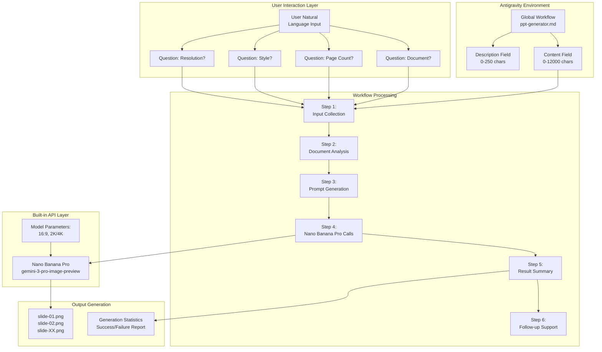
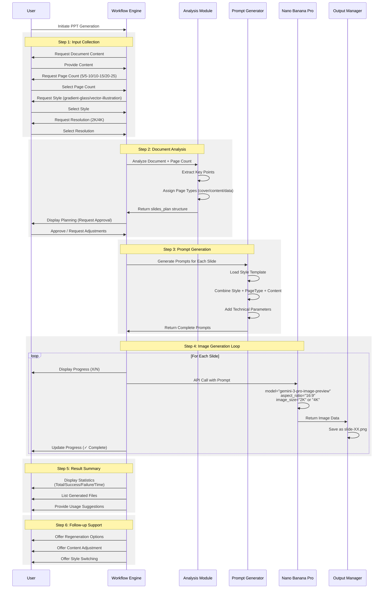
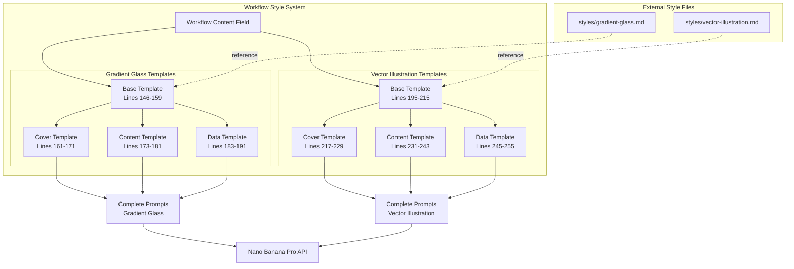
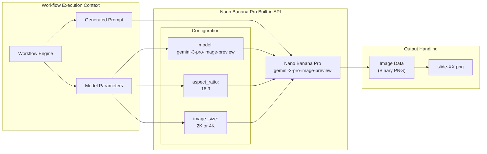

<!-- source: DeepWiki mcp.deepwiki.com · repo op7418/NanoBanana-PPT-Skills · page 4.3 Antigravity Workflow Integration · fetched 2026-10-26 -->

# Antigravity Workflow Integration

<details>
<summary>Relevant source files</summary>

The following files were used as context for generating this wiki page:

- [ANTIGRAVITY_WORKFLOW.md](ANTIGRAVITY_WORKFLOW.md)

</details>


## Purpose and Scope

This document describes how to use the NanoBanana PPT Generator as a Global Workflow within Antigravity, an AI coding assistant with built-in Nano Banana Pro (Gemini image generation) capabilities. The workflow provides a natural language interface for automated presentation generation without manual Python environment setup or API key management.

For information about using the system through Claude Code (which requires local setup), see [Claude Code Interface](#4.1). For direct command-line usage, see [Command Line Usage](#4.2). For details about the underlying generation pipeline that this workflow invokes, see [Generation Pipeline](#5).

---

## What is Antigravity?

Antigravity is an AI-powered programming environment with Nano Banana Pro (Google Gemini's image generation model) natively integrated. Unlike Claude Code or command-line usage, Antigravity workflows:

- **Require no local installation** - No Python environment or dependency management
- **Have built-in API access** - No `GEMINI_API_KEY` configuration needed
- **Use Global Workflows** - Reusable templates stored in `.gemini/antigravity/global_workflows/`
- **Provide guided interactions** - Step-by-step prompts for user input collection

The Antigravity workflow implements the same generation logic as the Python scripts but operates entirely within the AI assistant's context.

**Sources:** [ANTIGRAVITY_WORKFLOW.md:1-23]()

---

## Workflow Architecture



**Diagram: Antigravity Workflow Integration Architecture**

The workflow operates as a state machine that guides users through six sequential steps, collecting input through natural language questions and invoking Nano Banana Pro for each slide generation.

**Sources:** [ANTIGRAVITY_WORKFLOW.md:1-509]()

---

## Workflow Configuration Structure

### File Location

The workflow is stored as a Markdown file in Antigravity's global workflows directory:

```
.gemini/antigravity/global_workflows/ppt-generator.md
```

### Configuration Fields

| Field | Character Limit | Purpose | Content Location |
|-------|----------------|---------|------------------|
| **Description** | 0-250 | Short summary displayed in workflow selector | [ANTIGRAVITY_WORKFLOW.md:12-18]() |
| **Content** | 0-12000 | Complete workflow logic and instructions | [ANTIGRAVITY_WORKFLOW.md:22-471]() |

### Description Field Content

```
基于文档内容自动生成专业PPT图片。支持2种风格（渐变毛玻璃/矢量插画），16:9比例，2K/4K分辨率。
智能分析文档，规划页面结构，调用Nano Banana Pro生成高质量演示文稿。
适用于商务演示、教育培训、创意提案等场景。
```

**Character count:** 132/250

This description appears in Antigravity's workflow selection interface, providing users with a quick overview of capabilities.

**Sources:** [ANTIGRAVITY_WORKFLOW.md:12-18]()

---

## Six-Step Workflow Execution



**Diagram: Workflow Execution Sequence**

**Sources:** [ANTIGRAVITY_WORKFLOW.md:39-334]()

### Step 1: Input Collection

The workflow collects four required parameters through interactive questions:

| Parameter | Options | Default/Recommended | Purpose |
|-----------|---------|---------------------|---------|
| **Document Content** | Text/Markdown/File path | N/A | Source material for slides |
| **Page Count** | 5, 5-10, 10-15, 20-25, Custom | 5-10 | Determines presentation length |
| **Visual Style** | `gradient-glass`, `vector-illustration` | `gradient-glass` | Aesthetic framework |
| **Resolution** | `2K` (2752x1536), `4K` (5504x3072) | `2K` | Output quality |

**Input Collection Questions:**

```
1. "请提供您的文档内容，可以是文本、Markdown或文件路径"
2. "您希望生成多少页PPT？"
3. "请选择视觉风格："
4. "选择图片分辨率："
```

**Sources:** [ANTIGRAVITY_WORKFLOW.md:39-67]()

### Step 2: Document Analysis & Planning

The workflow analyzes document content and generates a structured slide plan based on page count:

#### Page Structure Rules

**5-Page Structure:**
```
Page 1: cover     - Title + Subtitle
Page 2-4: content - Core points (1-2 per page)
Page 5: data      - Summary / Call-to-action
```

**5-10 Page Structure:**
```
Page 1: cover     - Cover
Page 2: content   - Table of contents / Introduction
Page 3-8: content - Detailed content (by chapter)
Page 9-10: data   - Summary + Next steps
```

**10-15 Page Structure:**
```
Page 1: cover     - Cover
Page 2-3: content - Introduction / Background
Page 4-12: content - Core content (3-4 chapters)
Page 13-14: content - Case studies / Data
Page 15: data     - Summary
```

**20-25 Page Structure:**
```
Page 1: cover     - Cover
Page 2: content   - Table of contents
Page 3-5: content - Introduction
Page 6-20: content - Detailed content (multiple chapters)
Page 21-23: content - Case studies
Page 24: content   - Key findings
Page 25: data     - Summary
```

**Page Type Mapping:**
- `cover`: Always page 1
- `content`: Middle pages with text and bullet points
- `data`: Final pages with statistics, comparisons, or summaries

**Planning Output Format:**

```
📋 PPT内容规划（共X页）

第1页 [封面]
标题：[Document Topic]
副标题：[Brief Description]

第2页 [内容]
主题：[First Core Point]
要点：
- [Point 1]
- [Point 2]
- [Point 3]

...
```

The workflow then asks: `"这个规划是否满意？需要调整吗？"`

**Sources:** [ANTIGRAVITY_WORKFLOW.md:69-135]()

### Step 3: Prompt Generation

For each slide, the workflow generates a complete prompt by combining:

1. **Base Style Template** - Visual language foundation
2. **Page Type Template** - Structure for cover/content/data
3. **Actual Content** - Extracted from document analysis
4. **Technical Parameters** - Model configuration

#### Gradient Glass Style Prompts

**Base Template:**
```
你是一位专家级UI UX演示设计师，请生成高保真、未来科技感的16比9演示文稿幻灯片。
全局视觉语言方面，风格要无缝融合Apple Keynote的极简主义、现代SaaS产品设计和玻璃拟态风格。
配色方案选择深邃的虚空黑或纯净的陶瓷白作为基底，并以流动的极光渐变色即霓虹紫、电光蓝、
柔和珊瑚橙、青色作为背景和UI高光点缀。
排版引擎采用Bento便当盒网格系统...
```

**Cover Page Prompt:**
```
[基础提示词模板]

请根据视觉平衡美学，生成封面页。在中心放置一个巨大的复杂3D玻璃物体，并覆盖粗体大字：
[页面标题内容]
背景有延伸的极光波浪。
```

**Content Page Prompt:**
```
[基础提示词模板]

请生成内容页。使用Bento网格布局，将以下内容组织在模块化的圆角矩形容器中，
容器材质必须是带有模糊效果的磨砂玻璃：
[页面内容]
```

**Data Page Prompt:**
```
[基础提示词模板]

请生成数据页或总结页。使用分屏设计，左侧排版以下文字，右侧悬浮巨大的发光3D数据可视化图表：
[页面内容]
```

**Sources:** [ANTIGRAVITY_WORKFLOW.md:137-191]()

#### Vector Illustration Style Prompts

**Base Template:**
```
你是一位专家级插画设计师，请生成16比9的矢量插画风格演示文稿幻灯片。
插画风格：扁平化矢量插画（Flat Vector Illustration）。
必须包含清晰、统一粗细的黑色轮廓线（Monoline/Stroke）。
配色方案：复古且柔和的色调。背景使用米色/奶油色（Cream/Off-white）纸张纹理感底色。
强调色使用珊瑚红、薄荷绿、芥末黄、赭石色（Burnt Orange）和岩石蓝。
```

**Cover Page Prompt:**
```
[基础提示词模板]

请生成封面页。在顶部1/3区域绘制横向全景式的矢量插画场景，包含几何化简化的建筑、
棒棒糖树木和装饰元素。
主标题使用巨大的复古衬线体，内容为：
[页面标题内容]
背景使用米色/奶油色纸张纹理。
```

**Content Page Prompt:**
```
[基础提示词模板]

请生成内容页。顶部绘制横向插画装饰带。
内容区域展示以下要点，每个要点配合简洁的矢量图标，所有元素都有统一的黑色轮廓线：
[页面内容]
使用彩色矩形块（珊瑚红、薄荷绿、芥末黄）分隔不同要点。
```

**Data Page Prompt:**
```
[基础提示词模板]

请生成数据页。使用几何化的矢量图表形式展示以下数据，所有图表元素都有清晰的黑色轮廓：
[页面内容]
配色使用复古柔和色调，添加装饰性的几何元素（小圆点、星星、放射线）平衡画面。
```

**Sources:** [ANTIGRAVITY_WORKFLOW.md:193-255]()

### Step 4: Nano Banana Pro API Calls

For each slide, the workflow:

1. **Displays Progress:**
   ```
   🎨 正在生成第 X/总页数 页...
   页面类型：[封面/内容/数据]
   内容主题：[简短描述]
   ```

2. **Invokes Nano Banana Pro with Parameters:**
   ```python
   model: "gemini-3-pro-image-preview"
   aspect_ratio: "16:9"
   image_size: "2K" or "4K"  # Based on user selection
   ```

3. **Saves Output:**
   ```
   File name format: slide-{page:02d}.png
   Examples: slide-01.png, slide-02.png, slide-03.png, ...
   ```

4. **Error Handling:**
   - Records failed generations
   - Continues to next slide
   - Summarizes failures at end
   - Offers selective regeneration

**Sources:** [ANTIGRAVITY_WORKFLOW.md:257-284]()

### Step 5: Result Summary

After all slides are generated, the workflow displays:

```
✅ PPT生成完成！

📊 生成统计：
- 总页数：X 页
- 成功：X 页
- 失败：X 页
- 总用时：约 X 分钟

📁 生成的文件：
slide-01.png - 封面：[标题]
slide-02.png - 内容：[主题]
...
slide-XX.png - 总结：[主题]

💡 使用建议：
1. 所有图片已按顺序命名（slide-01 到 slide-XX）
2. 可以直接导入到演示软件（Keynote、PowerPoint等）
3. 也可以在网页中按顺序展示

🔄 后续操作：
- 重新生成失败的页面
- 调整特定页面的内容
- 生成不同风格的版本
```

**Sources:** [ANTIGRAVITY_WORKFLOW.md:286-314]()

### Step 6: Follow-up Support

The workflow offers iterative refinement options:

| Operation | User Action | Workflow Response |
|-----------|-------------|-------------------|
| **Regenerate Specific Pages** | Provide page numbers | Regenerate selected slides with same or modified prompts |
| **Adjust Content** | Specify page and new content | Update content, regenerate affected page |
| **Switch Style** | Select different style | Regenerate all slides using new style template |
| **Generate HTML Player** | Request viewer | Create simple HTML preview interface (optional) |

**Sources:** [ANTIGRAVITY_WORKFLOW.md:316-334]()

---

## Style Template Integration



**Diagram: Style Template System within Workflow**

The Antigravity workflow embeds complete style templates directly in the `Content` field, whereas the command-line version loads them from external files in `styles/`. This makes the workflow self-contained but harder to extend with custom styles.

**Embedded vs. External Styles:**

| Aspect | Antigravity Workflow | CLI/Python Scripts |
|--------|---------------------|-------------------|
| **Storage** | Embedded in `ANTIGRAVITY_WORKFLOW.md` | External files in `styles/` directory |
| **Line References** | [ANTIGRAVITY_WORKFLOW.md:141-255]() | See [Gradient Glass Style](#6.2), [Vector Illustration Style](#6.3) |
| **Extensibility** | Requires editing workflow file | Drop new `.md` files in `styles/` |
| **Synchronization** | Manual update needed | Automatically reads new styles |
| **Portability** | Fully self-contained | Requires file system access |

**Sources:** [ANTIGRAVITY_WORKFLOW.md:137-255]()

---

## Nano Banana Pro Integration Points



**Diagram: Nano Banana Pro API Integration**

### API Call Parameters

The workflow configures Nano Banana Pro with these parameters:

```python
{
    "model": "gemini-3-pro-image-preview",  # Fixed model specification
    "aspect_ratio": "16:9",                 # Standard presentation ratio
    "image_size": "2K" or "4K",             # User-selected resolution
    "prompt": "[Generated prompt text]"      # Combined style + content
}
```

### Resolution Specifications

| Setting | Dimensions | File Size | Use Case | Generation Time |
|---------|-----------|-----------|----------|-----------------|
| **2K** | 2752 x 1536 | 2-3 MB/slide | Daily presentations, screens | ~30 seconds/slide |
| **4K** | 5504 x 3072 | 8-10 MB/slide | Print, large displays | ~60 seconds/slide |

**Timing Estimate:**
- 5-page presentation at 2K: ~2.5 minutes total
- 10-page presentation at 2K: ~5 minutes total
- 20-page presentation at 4K: ~20 minutes total

**Sources:** [ANTIGRAVITY_WORKFLOW.md:257-284](), [ANTIGRAVITY_WORKFLOW.md:351-364]()

---

## Comparison: Antigravity vs. Other Interfaces

```mermaid
graph TB
    subgraph "Antigravity Workflow"
        AG_USER["Natural Language<br/>Questions"]
        AG_NO_SETUP["No Installation<br/>No API Keys"]
        AG_WORKFLOW["Global Workflow<br/>ppt-generator.md"]
        AG_NANO["Built-in<br/>Nano Banana Pro"]
        AG_FILES["slide-XX.png<br/>files only"]
    end
    
    subgraph "Claude Code Skill"
        CC_USER["Natural Language<br/>Commands"]
        CC_SETUP["Manual Setup<br/>Python + API Key"]
        CC_SCRIPT["run.sh<br/>generate_ppt.py"]
        CC_API["External<br/>Gemini API"]
        CC_FILES["PNG + HTML Viewer<br/>+ prompts.json"]
    end
    
    subgraph "Command Line"
        CLI_USER["Script Arguments<br/>--style --pages"]
        CLI_SETUP["Manual Setup<br/>Python + API Key"]
        CLI_SCRIPT["./run.sh<br/>direct execution"]
        CLI_API["External<br/>Gemini API"]
        CLI_FILES["PNG + HTML Viewer<br/>+ prompts.json"]
    end
    
    AG_USER --> AG_WORKFLOW
    AG_NO_SETUP --> AG_WORKFLOW
    AG_WORKFLOW --> AG_NANO
    AG_NANO --> AG_FILES
    
    CC_USER --> CC_SCRIPT
    CC_SETUP --> CC_SCRIPT
    CC_SCRIPT --> CC_API
    CC_API --> CC_FILES
    
    CLI_USER --> CLI_SCRIPT
    CLI_SETUP --> CLI_SCRIPT
    CLI_SCRIPT --> CLI_API
    CLI_API --> CLI_FILES
```



**Diagram: Interface Comparison Architecture**

### Feature Comparison Table

| Feature | Antigravity Workflow | Claude Code Skill | Command Line |
|---------|---------------------|-------------------|--------------|
| **Installation** | None required | `pip install google-genai pillow` | `pip install google-genai pillow` |
| **API Configuration** | Built-in | `GEMINI_API_KEY` in `.env` or `~/.zshrc` | `GEMINI_API_KEY` required |
| **Security Setup** | Not applicable | [API Key Setup](#3.1) required | [API Key Setup](#3.1) required |
| **Execution Model** | Interactive Q&A | Natural language commands | Script arguments |
| **File Management** | Automatic | Manual (outputs/ directory) | Manual (outputs/ directory) |
| **HTML Viewer** | Not generated | `templates/viewer.html` → `index.html` | `templates/viewer.html` → `index.html` |
| **Audit Trail** | Not generated | `prompts.json` saved | `prompts.json` saved |
| **Progress Feedback** | Text updates | Terminal output | Terminal output |
| **Error Recovery** | Offer regeneration | Manual retry | Manual retry |
| **Style Customization** | Edit workflow file | Add `.md` to `styles/` | Add `.md` to `styles/` |
| **Batch Processing** | Sequential only | Sequential only | Sequential only |
| **Target Users** | Non-technical users | Developers with setup | Developers with setup |
| **Learning Curve** | Minimal (guided) | Medium (setup + usage) | Medium (CLI familiarity) |

**Sources:** [ANTIGRAVITY_WORKFLOW.md:497-507]()

### Use Case Recommendations

**Choose Antigravity Workflow when:**
- User has no Python environment or development tools
- API key management is undesirable or restricted
- Quick, one-off presentations are needed
- User prefers guided, interactive workflows
- No need for HTML viewer or audit trails

**Choose Claude Code Skill when:**
- User has technical setup capability
- Full control over API keys is required
- HTML viewer is essential for presentation
- Audit trails (`prompts.json`) are needed for debugging
- Integration with local development workflow is desired

**Choose Command Line when:**
- Batch processing or scripting is required
- Integration with CI/CD pipelines is planned
- Maximum control over parameters is needed
- Programmatic invocation from other tools is desired

For more details on Claude Code usage, see [Claude Code Interface](#4.1). For command-line details, see [Command Line Usage](#4.2).

**Sources:** [ANTIGRAVITY_WORKFLOW.md:497-507]()

---

## Example Interaction Flow

### Complete Session Example

**User Initial Request:**
```
我想生成一个关于"AI产品设计原则"的PPT
```

**Workflow Response - Input Collection:**
```
好的！我来帮您生成。首先需要了解一些信息：

1. 请提供您的文档内容或要点
2. 您希望生成多少页PPT？（5页/5-10页/10-15页/20-25页）
3. 选择视觉风格：
   - 渐变毛玻璃卡片风格（科技感，适合商务演示）
   - 矢量插画风格（温暖可爱，适合教育培训）
4. 图片分辨率：2K（推荐）或 4K？
```

**User Configuration:**
```
5页，渐变毛玻璃卡片风格，2K

内容：
- 什么是好的AI产品
- 用户需求优先
- 简单胜过复杂
- 数据驱动决策
- 持续迭代优化
```

**Workflow Response - Planning:**
```
📋 PPT内容规划（共5页）

第1页 [封面]
标题：AI产品设计原则
副标题：打造用户喜爱的智能产品

第2页 [内容]
什么是好的AI产品
- 解决真实问题
- 易于使用
- 持续进化

第3页 [内容]
用户需求优先 + 简单胜过复杂
- 深入理解用户痛点
- 避免过度设计
- 清晰的信息架构

第4页 [内容]
数据驱动决策
- A/B测试
- 用户行为分析
- 指标监控

第5页 [数据]
持续迭代优化
- 快速试错
- 用户反馈循环
- 版本演进路线图

这个规划是否满意？
```

**User Approval:**
```
很好，开始生成吧
```

**Workflow Response - Generation Progress:**
```
🎨 开始生成，请稍候...

🎨 正在生成第 1/5 页...
页面类型：封面
✓ 第1页生成完成：slide-01.png

🎨 正在生成第 2/5 页...
页面类型：内容
✓ 第2页生成完成：slide-02.png

🎨 正在生成第 3/5 页...
页面类型：内容
✓ 第3页生成完成：slide-03.png

🎨 正在生成第 4/5 页...
页面类型：内容
✓ 第4页生成完成：slide-04.png

🎨 正在生成第 5/5 页...
页面类型：数据
✓ 第5页生成完成：slide-05.png
```

**Workflow Response - Final Summary:**
```
✅ PPT生成完成！

📊 生成统计：
- 总页数：5 页
- 成功：5 页
- 失败：0 页
- 总用时：约 2.5 分钟

📁 生成的文件：
slide-01.png - 封面：AI产品设计原则
slide-02.png - 内容：什么是好的AI产品
slide-03.png - 内容：用户需求优先 + 简单胜过复杂
slide-04.png - 内容：数据驱动决策
slide-05.png - 总结：持续迭代优化

💡 使用建议：
1. 所有图片已按顺序命名（slide-01 到 slide-05）
2. 可以直接导入到演示软件（Keynote、PowerPoint等）
3. 也可以在网页中按顺序展示

🔄 后续操作：
- 重新生成失败的页面
- 调整特定页面的内容
- 生成不同风格的版本
```

**Sources:** [ANTIGRAVITY_WORKFLOW.md:379-456]()

---

## Key Configuration Details

### Workflow Consistency Requirements

The workflow maintains visual consistency through these mechanisms:

1. **Single Style Selection:** User chooses one style for entire presentation
2. **Unified Base Template:** All slides share same base prompt [ANTIGRAVITY_WORKFLOW.md:339-341]()
3. **Fixed Technical Parameters:** Aspect ratio (16:9) and resolution locked per session [ANTIGRAVITY_WORKFLOW.md:357-360]()
4. **Consistent Model:** `gemini-3-pro-image-preview` used for all slides [ANTIGRAVITY_WORKFLOW.md:272]()

### Content Adaptation Guidelines

| Content Length | Slides per Point | Layout Strategy |
|---------------|------------------|-----------------|
| **Short (1-2 sentences)** | 1 point per slide | Large typography, single visual element |
| **Medium (3-5 points)** | 3-5 points per slide | Bento grid (gradient-glass) or list (vector) |
| **Long (>5 points)** | Split across 2 slides | Two-column layout or sequential presentation |
| **Data-heavy** | Dedicated data page | Split-screen with chart visualization |

**Maximum Information Density:**
- Cover pages: Title + subtitle only
- Content pages: 3-5 bullet points maximum
- Data pages: 2-3 key metrics or 1 complex chart

**Sources:** [ANTIGRAVITY_WORKFLOW.md:336-378]()

### Language Support

The workflow supports **multilingual prompts** including:
- Chinese (中文) - Default in examples
- English - Fully supported
- Mixed content - Chinese structure + English terminology

Nano Banana Pro processes prompts in multiple languages and can render text in any Unicode-supported script.

**Sources:** [ANTIGRAVITY_WORKFLOW.md:347-349]()

---

## File Output Specifications

### Naming Convention

```
slide-{page_number:02d}.png
```

**Examples:**
- `slide-01.png` - Cover page
- `slide-02.png` - First content page
- `slide-10.png` - Tenth page (if applicable)
- `slide-25.png` - Last page in 25-page presentation

**Zero-padding rationale:** Ensures correct alphabetical sorting in file managers.

### Output Directory

Unlike command-line usage which creates timestamped directories (`outputs/20240115_143022/`), Antigravity workflows typically output directly to the current context without subdirectory organization.

### Missing Artifacts

Antigravity workflows do **not** generate:
- `index.html` - No interactive HTML viewer
- `prompts.json` - No audit trail of prompts used
- `slides_plan.json` - Planning is ephemeral, not persisted

For persistent structured outputs, use the command-line interface instead. See [Generated Outputs](#7.1) for details on output artifacts.

**Sources:** [ANTIGRAVITY_WORKFLOW.md:278](), [ANTIGRAVITY_WORKFLOW.md:497-507]()

---

## Setup Instructions

### Creating the Workflow

1. **Navigate to Global Workflows directory:**
   ```
   .gemini/antigravity/global_workflows/
   ```

2. **Create workflow file:**
   ```
   ppt-generator.md
   ```

3. **Populate Description field (0-250 chars):**
   Copy content from [ANTIGRAVITY_WORKFLOW.md:14-16]()

4. **Populate Content field (0-12000 chars):**
   Copy content from [ANTIGRAVITY_WORKFLOW.md:24-471]()

5. **Save and test:**
   - Save workflow in Antigravity
   - Test invocation with sample document
   - Verify slide generation completes

**Sources:** [ANTIGRAVITY_WORKFLOW.md:477-493]()

### Workflow Updates

When updating the workflow to match style changes:

1. **Monitor external style files:**
   - `styles/gradient-glass.md`
   - `styles/vector-illustration.md`

2. **Manually sync changes:**
   - Extract updated base templates from style files
   - Update corresponding sections in `ANTIGRAVITY_WORKFLOW.md`
   - Re-copy Content field into Antigravity

3. **Test style consistency:**
   - Generate test slides with both workflow and CLI
   - Compare visual output for consistency

For information on how styles are defined, see [Style System Overview](#6.1).

**Sources:** [ANTIGRAVITY_WORKFLOW.md:512-516]()

---

## Limitations and Considerations

### Technical Limitations

| Limitation | Description | Workaround |
|-----------|-------------|------------|
| **No Parallelization** | Slides generated sequentially | None - inherent to API rate limiting |
| **No Custom Styles** | Only 2 built-in styles available | Edit workflow file to add templates |
| **No HTML Viewer** | Output is PNG files only | Use external tools or CLI version |
| **No Audit Trail** | Prompts not saved to `prompts.json` | Manually record or use CLI version |
| **No Batch Processing** | One presentation per invocation | Multiple sequential invocations |
| **Fixed Aspect Ratio** | Always 16:9 | None - standard for presentations |

### Comparison with Python Implementation

The workflow reimplements logic from:
- [generate_ppt.py]() - Core generation loop [ANTIGRAVITY_WORKFLOW.md:257-284]()
- Style files - Embedded templates [ANTIGRAVITY_WORKFLOW.md:141-255]()
- User interaction - Question-based input [ANTIGRAVITY_WORKFLOW.md:39-67]()

**Not implemented in workflow:**
- [run.sh]() - Environment setup and orchestration
- [templates/viewer.html]() - Interactive HTML viewer
- `slides_plan.json` persistence - Planning is ephemeral
- `prompts.json` audit - No debugging artifacts

For full feature support including HTML viewer and audit trails, see [Command Line Usage](#4.2).

**Sources:** [ANTIGRAVITY_WORKFLOW.md:1-516]()

---

## Reference Resources

### Official Documentation

- **Workflow Template:** [ANTIGRAVITY_WORKFLOW.md]()
- **Style Definitions:** [styles/gradient-glass.md](), [styles/vector-illustration.md]()
- **GitHub Repository:** https://github.com/op7418/NanoBanana-PPT-Skills
- **Creator:** 歸藏 [@op7418](https://github.com/op7418)

### Related Wiki Pages

- [Claude Code Interface](#4.1) - Alternative AI assistant interface
- [Command Line Usage](#4.2) - Direct script execution
- [Style System Overview](#6.1) - Understanding style architecture
- [Gradient Glass Style](#6.2) - Detailed style reference
- [Vector Illustration Style](#6.3) - Detailed style reference
- [Image Generation](#5.3) - API call mechanics and timing

**Sources:** [ANTIGRAVITY_WORKFLOW.md:512-516]()

---

