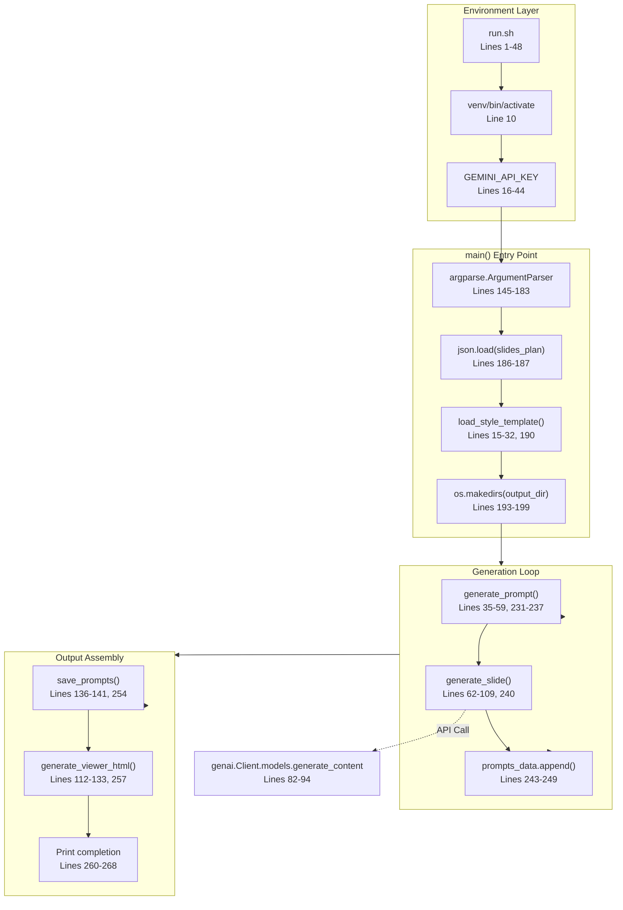
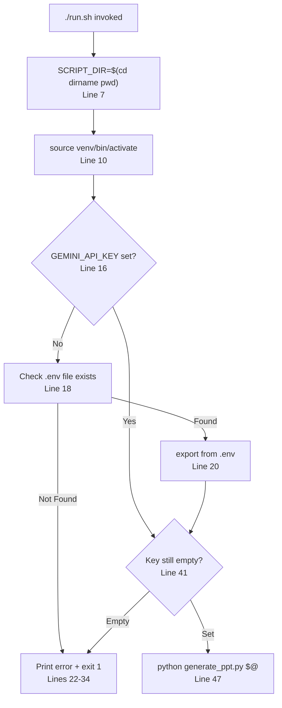
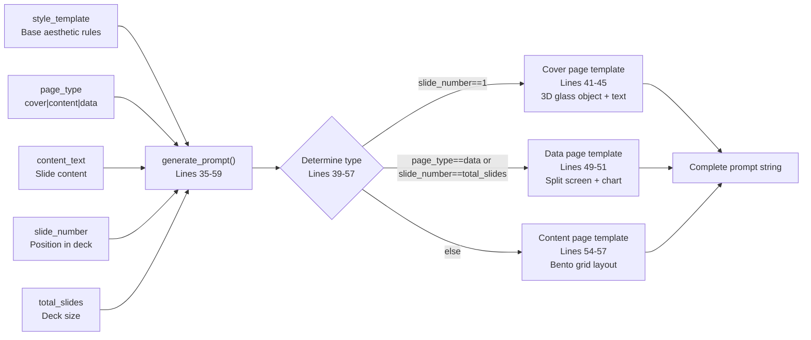
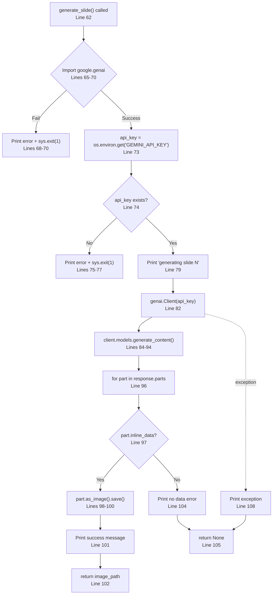
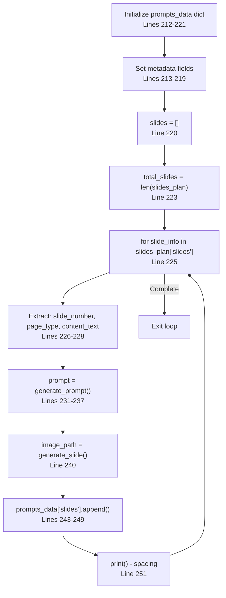
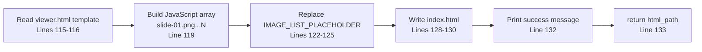

<!-- source: DeepWiki mcp.deepwiki.com · repo op7418/NanoBanana-PPT-Skills · page 5 Generation Pipeline · fetched 2026-10-26 -->

# Generation Pipeline

<details>
<summary>Relevant source files</summary>

The following files were used as context for generating this wiki page:

- [generate_ppt.py](generate_ppt.py)
- [ppt-generator.md](ppt-generator.md)
- [run.sh](run.sh)

</details>


## Purpose and Scope

This document provides a technical deep-dive into the four-stage generation pipeline that transforms input documents into presentation slide images. The pipeline consists of: input collection, document analysis and planning, prompt engineering with style application, and image generation through the Gemini API.

For information about the security layer that gates pipeline execution, see [Security & Configuration](#3). For details about the style system architecture, see [Style System](#6). For the HTML viewer that displays generated outputs, see [Output & Viewing](#7).

---

## Pipeline Architecture

The generation pipeline is implemented as a linear, sequential process in [`generate_ppt.py`](generate_ppt.py:1-273)() with orchestration handled by [`run.sh`](run.sh:1-48)(). Each stage produces intermediate artifacts that feed into subsequent stages.

### Complete Pipeline Flow



**Sources:** [generate_ppt.py:1-273](), [run.sh:1-48]()

---

## Stage 1: Environment Setup and Orchestration

The pipeline begins with environment preparation handled by the [`run.sh`](run.sh:1-48)() bash script. This script performs critical initialization before Python execution begins.

### Orchestration Script Flow



**Sources:** [run.sh:1-48]()

### Priority System

The API key loading follows a two-tier priority system implemented in [run.sh:12-38]():

| Priority | Source | Check Location | Notes |
|----------|--------|---------------|-------|
| 1 (Highest) | System environment variable | Line 16 | `$GEMINI_API_KEY` from shell |
| 2 (Fallback) | `.env` file | Lines 18-20 | Loaded via `export $(cat .env)` |

**Sources:** [run.sh:12-38]()

---

## Stage 2: Argument Parsing and Configuration

The Python script entry point in [`main()`](generate_ppt.py:144-272)() establishes the execution context by parsing arguments and loading configuration files.

### Command-Line Interface

The argument parser is configured in [generate_ppt.py:145-183]():

| Argument | Type | Required | Default | Description |
|----------|------|----------|---------|-------------|
| `--plan` | string | Yes | - | Path to `slides_plan.json` |
| `--style` | string | Yes | - | Path to style template `.md` file |
| `--resolution` | choice | No | `2K` | Image size: `2K` or `4K` |
| `--output` | string | No | `outputs/TIMESTAMP` | Output directory path |
| `--template` | string | No | `templates/viewer.html` | HTML template path |

**Sources:** [generate_ppt.py:145-183]()

### Configuration Loading

After argument parsing, the script loads two critical configuration files:

1. **Slides Plan JSON** ([generate_ppt.py:186-187]()):
   ```python
   with open(args.plan, 'r', encoding='utf-8') as f:
       slides_plan = json.load(f)
   ```

2. **Style Template** ([generate_ppt.py:190]()):
   ```python
   style_template = load_style_template(args.style)
   ```

The `load_style_template()` function ([generate_ppt.py:15-32]()) extracts the base prompt template section from the style markdown file by locating text between markers:
- Start: `"## 基础提示词模板"`
- End: `"## 页面类型模板"`

**Sources:** [generate_ppt.py:144-199]()

---

## Stage 3: Prompt Generation

The prompt generation stage combines style templates, page type specifications, and content text into complete prompts for the AI model. This occurs within the main generation loop.

### Prompt Construction Function

The `generate_prompt()` function ([generate_ppt.py:35-59]()) implements a template-based prompt assembly system:



**Sources:** [generate_ppt.py:35-59]()

### Page Type Templates

Each page type has a distinct prompt structure:

**Cover Page** ([generate_ppt.py:41-45]()):
- Triggers when `page_type == "cover"` or `slide_number == 1`
- Template: Center-placed complex 3D glass object with bold text overlay
- Background: Extended aurora wave patterns

**Data Page** ([generate_ppt.py:49-51]()):
- Triggers when `page_type == "data"` or `slide_number == total_slides`
- Template: Split-screen design with text on left, glowing 3D data visualization on right

**Content Page** ([generate_ppt.py:54-57]()):
- Default for all other slides
- Template: Bento grid layout with rounded rectangle containers
- Material: Frosted glass with blur effect

**Sources:** [generate_ppt.py:35-59]()

---

## Stage 4: Image Generation

The image generation stage executes API calls to Google Gemini and saves resulting images. This is the most time-intensive stage of the pipeline.

### API Client Configuration

The `generate_slide()` function ([generate_ppt.py:62-109]()) handles the complete API interaction lifecycle:



**Sources:** [generate_ppt.py:62-109]()

### API Request Parameters

The API call configuration ([generate_ppt.py:84-94]()):

```python
response = client.models.generate_content(
    model="gemini-3-pro-image-preview",
    contents=prompt,
    config=types.GenerateContentConfig(
        response_modalities=['IMAGE'],
        image_config=types.ImageConfig(
            aspect_ratio="16:9",
            image_size=resolution  # "2K" or "4K"
        )
    )
)
```

| Parameter | Value | Source |
|-----------|-------|--------|
| `model` | `gemini-3-pro-image-preview` | Hardcoded at line 85 |
| `response_modalities` | `['IMAGE']` | Hardcoded at line 88 |
| `aspect_ratio` | `16:9` | Hardcoded at line 90 |
| `image_size` | `2K` or `4K` | User-selected via `--resolution` |

**Sources:** [generate_ppt.py:84-94]()

### Image Saving

Generated images are saved using the PIL Image interface ([generate_ppt.py:98-100]()):

```python
image = part.as_image()
image_path = os.path.join(output_dir, "images", f"slide-{slide_number:02d}.png")
image.save(image_path)
```

Filename pattern: `slide-{NN}.png` where NN is zero-padded to 2 digits.

**Sources:** [generate_ppt.py:96-102]()

---

## Stage 5: Generation Loop and Data Recording

The main generation loop ([generate_ppt.py:223-251]()) iterates through the slides plan and maintains an audit trail.

### Loop Structure



**Sources:** [generate_ppt.py:212-251]()

### Audit Data Structure

The `prompts_data` dictionary structure ([generate_ppt.py:212-249]()):

```json
{
  "metadata": {
    "title": "从 slides_plan 提取",
    "total_slides": "Integer",
    "resolution": "2K or 4K",
    "style": "Style file path",
    "generated_at": "ISO 8601 timestamp"
  },
  "slides": [
    {
      "slide_number": "Integer",
      "page_type": "cover|content|data",
      "content": "Original content text",
      "prompt": "Complete generated prompt",
      "image_path": "Path to saved PNG or null"
    }
  ]
}
```

This structure is saved via `save_prompts()` ([generate_ppt.py:136-141]()) to `prompts.json` in the output directory.

**Sources:** [generate_ppt.py:212-249](), [generate_ppt.py:136-141]()

---

## Stage 6: Output Assembly

After all slides are generated, the pipeline assembles the final deliverables.

### HTML Viewer Generation

The `generate_viewer_html()` function ([generate_ppt.py:112-133]()) creates an interactive presentation viewer:



**Sources:** [generate_ppt.py:112-133]()

The template injection point is the comment `/* IMAGE_LIST_PLACEHOLDER */` in the HTML template, which gets replaced with a comma-separated list of image paths.

### Completion Output

The pipeline prints a comprehensive completion report ([generate_ppt.py:260-268]()):

```
==============================================================
生成完成！
==============================================================
输出目录: outputs/TIMESTAMP
播放网页: outputs/TIMESTAMP/index.html

打开播放网页查看PPT:
  open outputs/TIMESTAMP/index.html
```

**Sources:** [generate_ppt.py:259-268]()

---

## Data Artifacts

The pipeline produces three categories of output files:

### Directory Structure

```
outputs/TIMESTAMP/
├── images/
│   ├── slide-01.png
│   ├── slide-02.png
│   └── slide-NN.png
├── index.html
└── prompts.json
```

Created by [generate_ppt.py:199]():
```python
os.makedirs(os.path.join(output_dir, "images"), exist_ok=True)
```

**Sources:** [generate_ppt.py:193-199]()

### Artifact Specifications

| File | Creator Function | Purpose | Format |
|------|-----------------|---------|--------|
| `slide-{NN}.png` | `generate_slide()` (line 100) | Rendered slide images | PNG, 16:9, 2K/4K |
| `prompts.json` | `save_prompts()` (line 138-140) | Audit trail of all prompts | JSON, UTF-8, indented |
| `index.html` | `generate_viewer_html()` (line 128-130) | Interactive viewer | HTML5 with embedded JS |

**Sources:** [generate_ppt.py:100](), [generate_ppt.py:138-140](), [generate_ppt.py:128-130]()

---

## Error Handling

The pipeline implements multi-level error detection and graceful degradation.

### Dependency Validation

Import error handling ([generate_ppt.py:65-70]()):
```python
try:
    from google import genai
    from google.genai import types
except ImportError:
    print("错误: 未安装 google-genai 库")
    print("请运行: pip install google-genai")
    sys.exit(1)
```

### API Key Validation

Two-stage validation:
1. Shell script check ([run.sh:16-44]()) - fails before Python execution
2. Python script check ([generate_ppt.py:73-77]()) - runtime validation

Both exit with code `1` on failure.

**Sources:** [generate_ppt.py:65-77](), [run.sh:16-44]()

### Generation Failures

Individual slide generation failures are handled gracefully ([generate_ppt.py:107-109]()):
- Exception caught in `except` block
- Error printed to console
- Returns `None` instead of path
- Pipeline continues to next slide
- Failed slides recorded with `null` image_path in `prompts.json`

**Sources:** [generate_ppt.py:107-109]()

---

## Performance Characteristics

### Timing Breakdown

Based on documentation analysis from [ppt-generator.md:168]():

| Stage | Approximate Duration | Bottleneck |
|-------|---------------------|------------|
| Environment setup | < 1 second | Virtual environment activation |
| Argument parsing | < 0.1 seconds | File I/O for config loading |
| Prompt generation | < 0.1 seconds per slide | String concatenation |
| Image generation | ~30 seconds per slide @ 2K | Gemini API network + processing |
| HTML assembly | < 1 second | Template rendering |

For a 5-slide presentation at 2K resolution:
- Total time: ~2.5 minutes (mostly API calls)
- At 4K resolution: timing increases proportionally

**Sources:** [ppt-generator.md:168]()

### Sequential Execution

The generation loop processes slides sequentially without parallelization ([generate_ppt.py:225-251]()). This design choice likely manages:
- API rate limits
- Memory consumption (one image in memory at a time)
- Deterministic progress reporting

**Sources:** [generate_ppt.py:225-251]()

---

