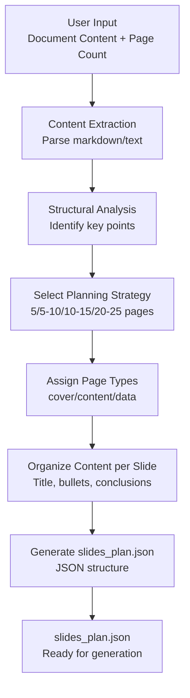
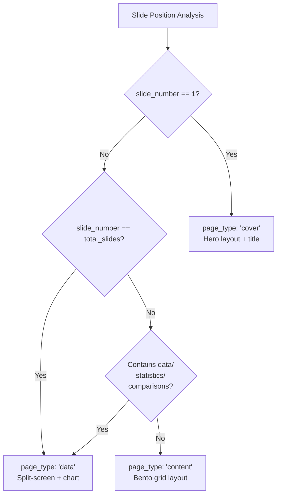
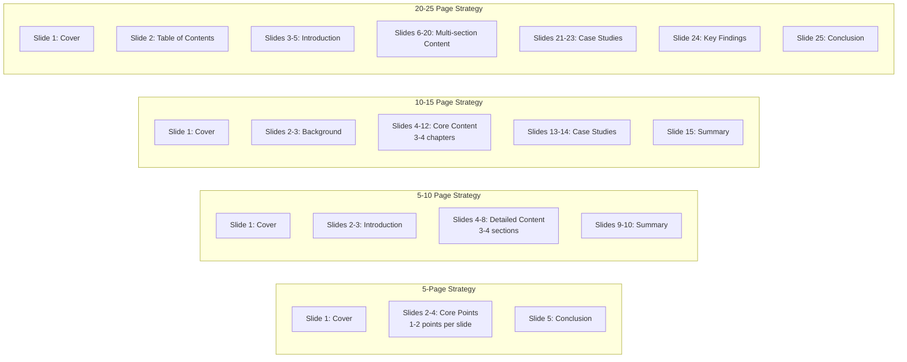
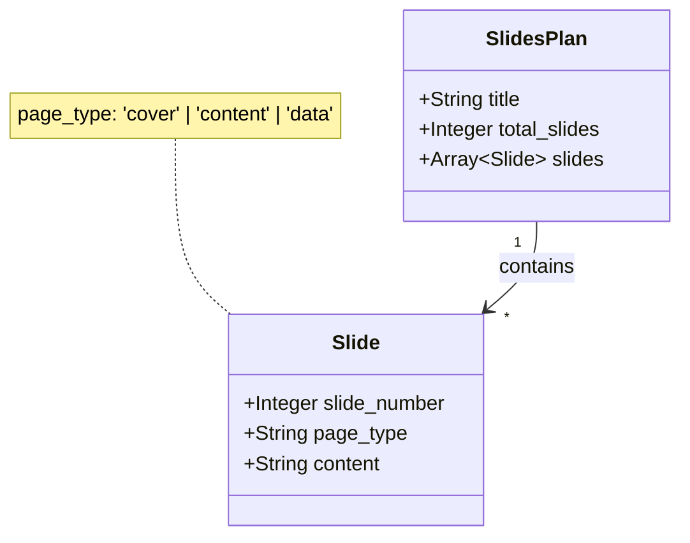

<!-- source: DeepWiki mcp.deepwiki.com · repo op7418/NanoBanana-PPT-Skills · page 5.1 Document Analysis & Planning · fetched 2026-10-26 -->

# Document Analysis & Planning

<details>
<summary>Relevant source files</summary>

The following files were used as context for generating this wiki page:

- [ANTIGRAVITY_WORKFLOW.md](ANTIGRAVITY_WORKFLOW.md)
- [generate_ppt.py](generate_ppt.py)
- [ppt-generator.md](ppt-generator.md)

</details>


## Purpose and Scope

This page documents the first stage of the Generation Pipeline: analyzing input documents and creating structured slide plans. The Document Analysis & Planning stage transforms unstructured text content into a JSON specification (`slides_plan.json`) that defines each slide's content, type, and position. This planning artifact drives all downstream processes.

For information about how these plans are converted into prompts, see [Prompt Engineering](#5.2). For the overall pipeline architecture, see [Generation Pipeline](#5).

---

## Planning Process Overview

The planning process is a three-phase transformation: content extraction, structural analysis, and JSON serialization. The system adapts its planning strategy based on user-specified page count ranges.

### High-Level Planning Flow



**Sources:** [ANTIGRAVITY_WORKFLOW.md:69-136](), [ppt-generator.md:72-151]()

---

## Content Structure Rules

The planning system follows strict rules for organizing content across different page counts. Each page count range has a predefined structure that balances content density with visual clarity.

### Planning Strategy Matrix

| Page Count | Cover | Introduction | Core Content | Case Studies/Data | Conclusion | Structure Type |
|------------|-------|--------------|--------------|-------------------|------------|----------------|
| **5 pages** | 1 | 0 | 3 pages (1-2 points each) | 0 | 1 | Minimal |
| **5-10 pages** | 1 | 1-2 | 3-4 pages (detailed) | 1-2 | 1-2 | Standard |
| **10-15 pages** | 1 | 2-3 | 6-9 pages (3-4 sections) | 1-2 | 1 | Detailed |
| **20-25 pages** | 1 | 3-4 | 11-16 pages (multi-section) | 3 | 2-3 | Comprehensive |

**Sources:** [ANTIGRAVITY_WORKFLOW.md:74-100](), [ppt-generator.md:76-111]()

---

## Page Type Classification

Every slide in the plan is assigned one of three types that determine its visual treatment and layout during prompt generation.

### Page Type Decision Tree



**Sources:** [ANTIGRAVITY_WORKFLOW.md:102-108](), [ppt-generator.md:236-242](), [generate_ppt.py:38-57]()

### Type Definitions

- **`cover`**: First slide only. Contains title, subtitle, and hero visual element. Logic: `slide_number == 1` or `page_type == "cover"`
- **`content`**: Middle slides. Contains bullet points, icons, modular content blocks. Default type for most slides.
- **`data`**: Final slides or data-heavy content. Contains charts, visualizations, summary statistics. Logic: `slide_number == total_slides` or explicit data markers

**Sources:** [generate_ppt.py:38-57]()

---

## Planning Strategies by Page Count

The system implements four distinct planning strategies, each optimized for different presentation lengths and complexity levels.

### Strategy Implementation Details



**Sources:** [ANTIGRAVITY_WORKFLOW.md:74-100](), [ppt-generator.md:78-111]()

### 5-Page Structure (Quick Presentation)

**Use Case:** 5-minute presentations, executive summaries, quick pitches

**Implementation:**
- Slide 1: `page_type: "cover"`, Title + subtitle
- Slides 2-4: `page_type: "content"`, Single core point per slide with 1-2 supporting bullets
- Slide 5: `page_type: "data"`, Summary or call-to-action

**Content Density:** 1-2 points per slide, minimal text

**Sources:** [ANTIGRAVITY_WORKFLOW.md:75-78]()

### 5-10 Page Structure (Standard Presentation)

**Use Case:** 15-minute presentations, team meetings, standard briefings

**Implementation:**
- Slide 1: `page_type: "cover"`
- Slides 2-3: `page_type: "content"`, Introduction or context-setting
- Slides 4-8: `page_type: "content"`, 3-4 detailed sections with expanded arguments
- Slides 9-10: `page_type: "data"`, Conclusion + next steps

**Content Density:** 2-3 points per content slide

**Sources:** [ANTIGRAVITY_WORKFLOW.md:80-84]()

### 10-15 Page Structure (Detailed Presentation)

**Use Case:** 30-minute presentations, training sessions, in-depth analysis

**Implementation:**
- Slide 1: `page_type: "cover"`
- Slides 2-3: `page_type: "content"`, Introduction + table of contents
- Slides 4-12: `page_type: "content"`, Multi-chapter content (typically 3-4 chapters of 3 slides each)
- Slides 13-14: `page_type: "data"`, Case studies or data analysis
- Slide 15: `page_type: "data"`, Summary

**Content Density:** 3-4 points per content slide, with chapter divisions

**Sources:** [ANTIGRAVITY_WORKFLOW.md:86-91](), [ppt-generator.md:92-99]()

### 20-25 Page Structure (Comprehensive Presentation)

**Use Case:** 60-minute presentations, workshops, complete training modules

**Implementation:**
- Slide 1: `page_type: "cover"`
- Slide 2: `page_type: "content"`, Table of contents
- Slides 3-5: `page_type: "content"`, Introduction and background
- Slides 6-20: `page_type: "content"`, Multiple sections with deep dives
- Slides 21-23: `page_type: "data"`, Case studies and examples
- Slide 24: `page_type: "data"`, Key findings
- Slide 25: `page_type: "data"`, Conclusion and acknowledgments

**Content Density:** 3-5 points per content slide, multiple topic sections

**Sources:** [ANTIGRAVITY_WORKFLOW.md:93-100](), [ppt-generator.md:101-111]()

---

## Output Format: slides_plan.json

The planning stage produces a JSON file that serves as the contract between the analysis stage and the prompt generation stage.

### JSON Schema Definition



**Sources:** [ppt-generator.md:115-149](), [generate_ppt.py:185-187]()

### Complete Example Structure

```json
{
  "title": "AI Product Design Principles",
  "total_slides": 5,
  "slides": [
    {
      "slide_number": 1,
      "page_type": "cover",
      "content": "标题：AI产品设计原则\n副标题：打造用户喜爱的智能产品"
    },
    {
      "slide_number": 2,
      "page_type": "content",
      "content": "什么是好的AI产品\n- 解决真实问题\n- 易于使用\n- 持续进化"
    },
    {
      "slide_number": 3,
      "page_type": "content",
      "content": "核心原则\n- 用户需求优先\n- 简单胜过复杂\n- 数据驱动决策"
    },
    {
      "slide_number": 4,
      "page_type": "content",
      "content": "实践方法\n- A/B测试\n- 用户行为分析\n- 指标监控"
    },
    {
      "slide_number": 5,
      "page_type": "data",
      "content": "持续迭代优化\n- 快速试错\n- 用户反馈循环\n- 版本演进路线图"
    }
  ]
}
```

**Sources:** [ppt-generator.md:117-149]()

### Field Specifications

| Field | Type | Required | Description | Validation |
|-------|------|----------|-------------|------------|
| `title` | String | Yes | Presentation title extracted from document | Non-empty |
| `total_slides` | Integer | Yes | Total number of slides | Must match `slides.length` |
| `slides` | Array | Yes | Ordered list of slide specifications | Length ≥ 1 |
| `slide_number` | Integer | Yes | 1-indexed position | Sequential, 1 to N |
| `page_type` | String | Yes | Visual template type | `"cover"` \| `"content"` \| `"data"` |
| `content` | String | Yes | Text content for the slide | Supports markdown formatting |

**Sources:** [ppt-generator.md:117-149](), [generate_ppt.py:185-250]()

---

## Code Implementation

The planning logic is implemented in two primary locations depending on the execution context.

### Workflow Implementation (Antigravity)

In Antigravity workflows, the planning logic is embedded in the markdown workflow definition. The AI agent executes the planning algorithm based on natural language instructions.

**Planning Algorithm Location:** [ANTIGRAVITY_WORKFLOW.md:69-136]()

**Key Implementation Points:**
- User input collection via prompts
- Page count selection from predefined ranges
- Document content analysis via LLM
- JSON structure generation conforming to schema
- File write to temporary `slides_plan.json`

### Skill Implementation (Claude Code)

In Claude Code, the planning logic is defined in the skill specification file.

**Planning Algorithm Location:** [ppt-generator.md:72-151]()

**Key Implementation Points:**
- Document reading via Read tool
- Interactive user questions via AskUserQuestion
- Content analysis and structuring
- JSON generation with Write tool
- Handoff to Python script via Bash execution

### Python Script Consumption

The Python script consumes the planning JSON without modification.

**JSON Consumption Location:** [generate_ppt.py:185-250]()

**Code Flow:**
1. Load JSON: `json.load(f)` at [generate_ppt.py:187]()
2. Extract metadata: `slides_plan.get("title")`, `len(slides_plan['slides'])` at [generate_ppt.py:214-218]()
3. Iterate slides: `for slide_info in slides_plan['slides']` at [generate_ppt.py:225]()
4. Extract per-slide data: `slide_number`, `page_type`, `content_text` at [generate_ppt.py:226-228]()
5. Pass to prompt generator: `generate_prompt()` at [generate_ppt.py:231-237]()

**Sources:** [generate_ppt.py:185-250]()

---

## Planning Quality Metrics

The planning stage aims to optimize for:

- **Balanced Content Distribution:** Each slide contains 1-5 bullet points, avoiding information overload
- **Logical Flow:** Content progresses from introduction → details → conclusion
- **Type Appropriateness:** Page types match content purpose (data slides for statistics, content slides for narrative)
- **Consistent Depth:** All content slides at similar detail levels within a presentation
- **Clear Structure:** Multi-page presentations use chapter divisions or sectioning

These metrics are enforced through the structured planning strategies but not automatically validated.

**Sources:** [ANTIGRAVITY_WORKFLOW.md:74-136](), [ppt-generator.md:299-305]()

---

## Integration Points

The planning stage interfaces with:

- **Upstream:** User input (document content, page count selection, style preferences)
- **Downstream:** Prompt Engineering stage via `slides_plan.json` file
- **Error Handling:** Invalid plans are caught by Python script during JSON parsing

For prompt generation details, see [Prompt Engineering](#5.2). For the script that orchestrates the planning-to-generation flow, see [Execution Scripts](#5.4).

**Sources:** [generate_ppt.py:1-273](), [ppt-generator.md:44-198]()

---

