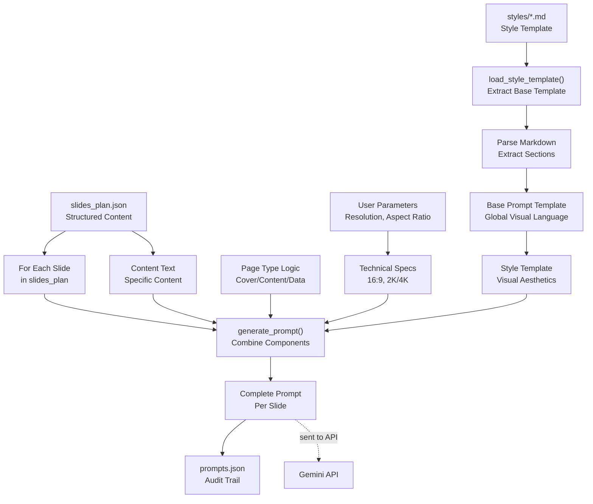
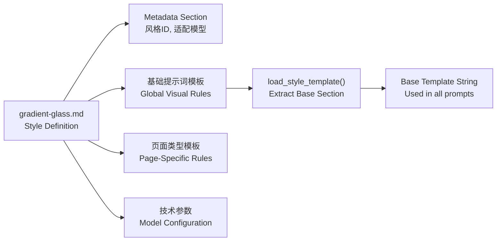
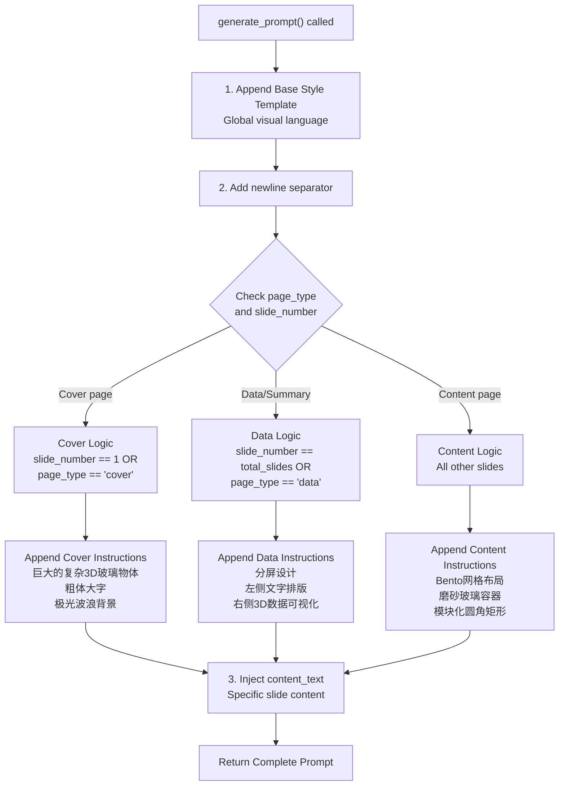
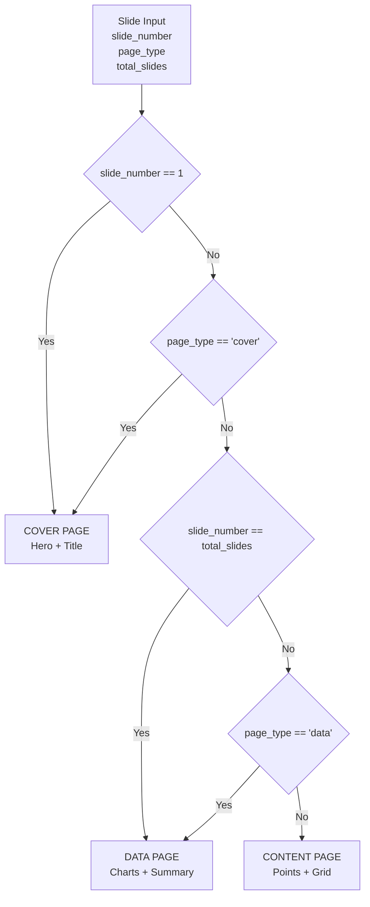
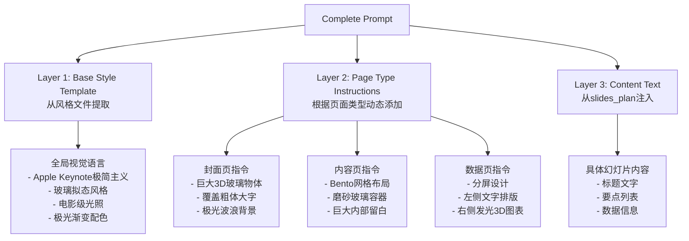
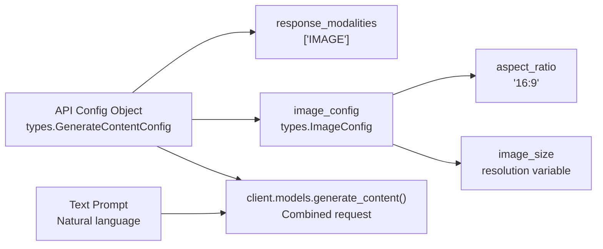
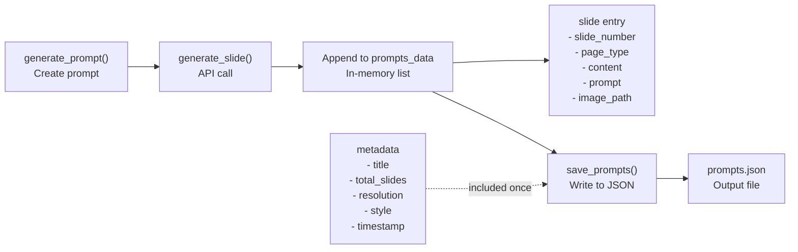
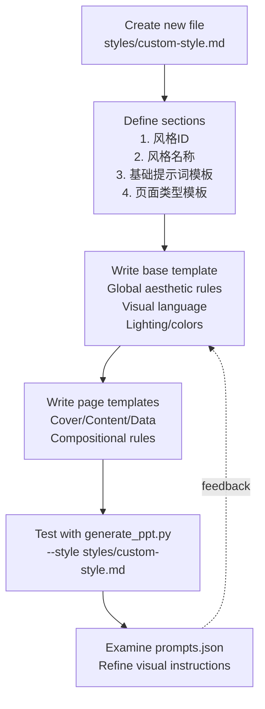

<!-- source: DeepWiki mcp.deepwiki.com · repo op7418/NanoBanana-PPT-Skills · page 5.2 Prompt Engineering · fetched 2026-10-26 -->

# Prompt Engineering

<details>
<summary>Relevant source files</summary>

The following files were used as context for generating this wiki page:

- [generate_ppt.py](generate_ppt.py)
- [ppt-generator.md](ppt-generator.md)
- [styles/gradient-glass.md](styles/gradient-glass.md)

</details>


## Purpose and Scope

This document explains how the PPT Generator constructs prompts for the Gemini API by combining style templates, page type specifications, content text, and technical parameters. It covers the prompt assembly logic, template inheritance system, and how visual aesthetics are encoded into natural language instructions.

For information about how content is analyzed and structured before prompts are created, see [Document Analysis & Planning](#5.1). For information about how these prompts are sent to the Gemini API, see [Image Generation](#5.3).

---

## Prompt Construction Pipeline

The prompt engineering process transforms structured slide plans into complete natural language instructions for the image generation model. This process follows a deterministic assembly pattern.



**Sources:** [generate_ppt.py:15-59](), [generate_ppt.py:211-250](), [ppt-generator.md:269-279]()

---

## Style Template Loading

Style templates are Markdown files that define the visual language and aesthetic rules for generated slides. The system extracts the base prompt template section from these files.

### Template Structure



### Extraction Logic

The `load_style_template()` function parses the Markdown file to extract only the base template section:

| Step | Marker | Action |
|------|--------|--------|
| 1 | `## 基础提示词模板` | Start marker - begin extraction |
| 2 | `## 页面类型模板` | End marker - stop extraction |
| 3 | Substring | Extract content between markers |
| 4 | Strip | Remove leading/trailing whitespace |

**Implementation:** The function reads the entire file, locates the section markers, and extracts the substring containing the base prompt template [generate_ppt.py:15-32](). If markers are not found, it falls back to using the entire file content.

**Sources:** [generate_ppt.py:15-32](), [styles/gradient-glass.md:16-30]()

---

## Prompt Generation Logic

The `generate_prompt()` function assembles complete prompts by combining the base style template with page-specific instructions and content.

### Function Signature

```
generate_prompt(style_template, page_type, content_text, slide_number, total_slides)
```

### Component Assembly Order



**Sources:** [generate_ppt.py:35-59]()

---

## Page Type Specialization

The system provides three distinct page type templates that add specific compositional instructions to the base style template.

### Page Type Decision Logic



### Page Type Templates

| Type | Trigger Condition | Visual Instructions | Use Case |
|------|------------------|---------------------|----------|
| **Cover** | `slide_number == 1` OR `page_type == "cover"` | 中心巨大3D玻璃物体 + 粗体大字 + 极光波浪背景 | First slide, title page |
| **Data** | `slide_number == total_slides` OR `page_type == "data"` | 分屏设计 + 左侧文字 + 右侧发光3D图表 | Data visualization, summary |
| **Content** | All other conditions | Bento网格布局 + 磨砂玻璃容器 + 圆角矩形 | Main content, bullet points |

**Sources:** [generate_ppt.py:39-57](), [styles/gradient-glass.md:32-47]()

---

## Complete Prompt Structure

A fully assembled prompt follows this hierarchical structure:

### Prompt Composition Hierarchy



### Example Prompt Assembly

For a cover page with content "AI驱动的信息架构\n面向未来的设计实践":

```
[Base Style Template - 180 words of global visual rules]

请根据视觉平衡美学，生成封面页。在中心放置一个巨大的复杂3D玻璃物体，并覆盖粗体大字：

AI驱动的信息架构
面向未来的设计实践

背景有延伸的极光波浪。
```

**Sources:** [generate_ppt.py:35-59](), [styles/gradient-glass.md:16-30]()

---

## Technical Parameters Integration

Technical specifications are not included in the text prompt but are passed as separate API configuration parameters during image generation.

### Parameter Mapping

| Parameter | Source | Configuration Location | Value Options |
|-----------|--------|----------------------|---------------|
| **Aspect Ratio** | Hardcoded | `types.ImageConfig(aspect_ratio=...)` | `"16:9"` (standard presentation) |
| **Resolution** | CLI argument | `types.ImageConfig(image_size=...)` | `"2K"` (2752x1536) or `"4K"` (5504x3072) |
| **Response Mode** | Hardcoded | `GenerateContentConfig(response_modalities=...)` | `['IMAGE']` (PNG output only) |
| **Model** | Hardcoded | `client.models.generate_content(model=...)` | `"gemini-3-pro-image-preview"` |

### Configuration Code Structure



**Technical parameters are separate from prompt text** to maintain clean separation between natural language instructions and machine-readable configuration.

**Sources:** [generate_ppt.py:84-94](), [styles/gradient-glass.md:80-90]()

---

## Prompt Audit Trail

All generated prompts are saved to `prompts.json` in the output directory for debugging, iteration, and regeneration purposes.

### Audit File Structure

```json
{
  "metadata": {
    "title": "文档标题",
    "total_slides": 5,
    "resolution": "2K",
    "style": "styles/gradient-glass.md",
    "generated_at": "2026-01-09T14:30:22.123456"
  },
  "slides": [
    {
      "slide_number": 1,
      "page_type": "cover",
      "content": "AI驱动的信息架构\n面向未来的设计实践",
      "prompt": "[Complete assembled prompt text]",
      "image_path": "outputs/20260109_143022/images/slide-01.png"
    }
  ]
}
```

### Audit Trail Workflow



**Usage:** Users can examine `prompts.json` to understand exactly what instructions were sent to the API, modify prompts manually, and regenerate specific slides with adjusted parameters.

**Sources:** [generate_ppt.py:136-142](), [generate_ppt.py:212-254]()

---

## Style Template Extensibility

The prompt engineering system supports custom style templates by following the same Markdown structure as built-in styles.

### Required Template Sections

| Section Header | Purpose | Extraction Method |
|---------------|---------|------------------|
| `## 基础提示词模板` | Global visual language (START marker) | Extracted by `load_style_template()` |
| `## 页面类型模板` | Page type specifications (END marker) | Used as boundary, not extracted |
| Cover/Content/Data subsections | Reference documentation | Not programmatically used |

### Custom Style Creation Workflow



**Key requirement:** The base template section must be enclosed between `## 基础提示词模板` and `## 页面类型模板` markers for proper extraction.

**Sources:** [generate_ppt.py:15-32](), [styles/gradient-glass.md:1-91](), [ppt-generator.md:229-234]()

---

## Prompt Engineering Best Practices

### Design Principles

| Principle | Implementation | Rationale |
|-----------|---------------|-----------|
| **Hierarchical Composition** | Base template + page type + content | Enables consistent aesthetics with varied layouts |
| **Deterministic Assembly** | Fixed order, no randomization | Ensures reproducible results |
| **Separation of Concerns** | Visual rules (prompt) vs technical specs (config) | Clean API, easier debugging |
| **Audit Trail** | Save all prompts to JSON | Enables iteration and regeneration |
| **Template Inheritance** | Base template used by all page types | DRY principle, consistent brand |

### Common Pitfall: Template Markers

If style template files do not contain the exact markers `## 基础提示词模板` and `## 页面类型模板`, the fallback behavior uses the entire file content, which may include metadata and examples not intended for the AI model.

**Fallback warning:** [generate_ppt.py:28-29]()

```python
if start_idx == -1 or end_idx == -1:
    print("警告: 无法解析风格模板，使用完整文件内容")
    return content
```

**Sources:** [generate_ppt.py:15-32](), [generate_ppt.py:225-254]()

---

