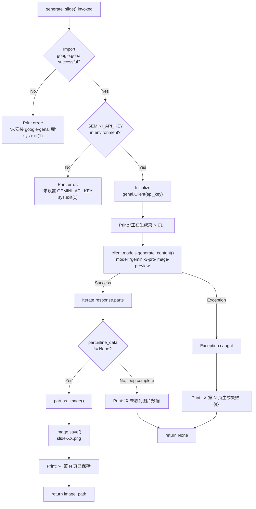
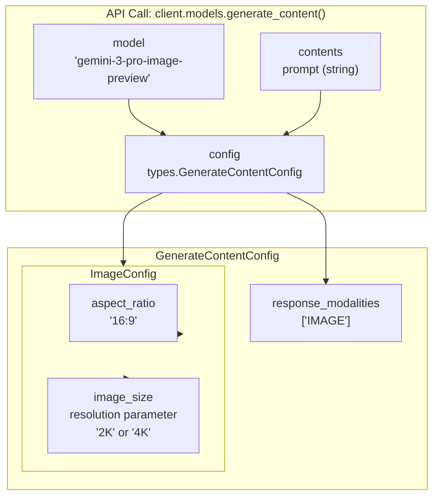
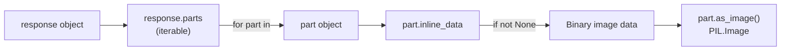
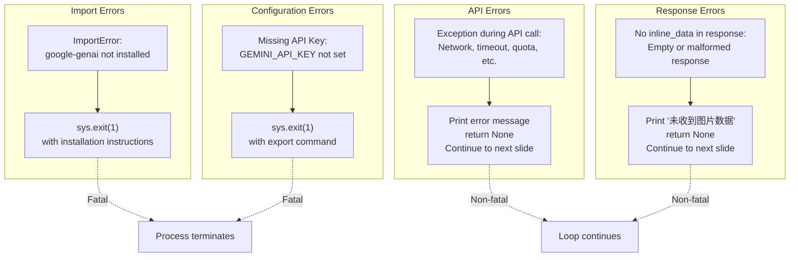
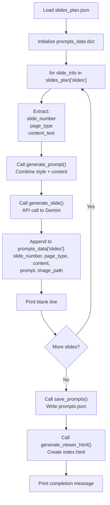
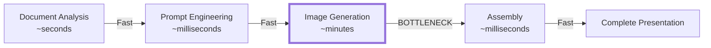
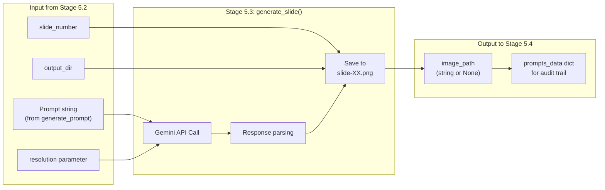

<!-- source: DeepWiki mcp.deepwiki.com · repo op7418/NanoBanana-PPT-Skills · page 5.3 Image Generation · fetched 2026-10-26 -->

# Image Generation

<details>
<summary>Relevant source files</summary>

The following files were used as context for generating this wiki page:

- [generate_ppt.py](generate_ppt.py)
- [ppt-generator.md](ppt-generator.md)

</details>


This document details the API call process to Google Gemini's image generation model, including client initialization, API configuration, response handling, error management, and output persistence. For information about how prompts are constructed before generation, see [Prompt Engineering](#5.2). For information about the orchestration script that invokes the generation process, see [Execution Scripts](#5.4).

---

## Overview

The image generation stage is the core execution phase where crafted prompts are transformed into PNG slide images via the Google Gemini API. This stage operates as a **sequential loop** that processes one slide at a time, making API calls to the `gemini-3-pro-image-preview` model and saving the resulting images to disk with standardized filenames.

**Sources:** [generate_ppt.py:62-109](), [ppt-generator.md:280-286]()

---

## Generation Process Flow



**Sources:** [generate_ppt.py:62-109]()

---

## API Client Initialization

### Import Validation

The function first validates that the `google-genai` SDK is available:

```python
try:
    from google import genai
    from google.genai import types
except ImportError:
    print("错误: 未安装 google-genai 库")
    print("请运行: pip install google-genai")
    sys.exit(1)
```

This validation ensures early failure with actionable error messages if dependencies are missing.

**Sources:** [generate_ppt.py:65-70]()

### API Key Retrieval

The API key is retrieved from the environment variable `GEMINI_API_KEY`:

```python
api_key = os.environ.get("GEMINI_API_KEY")
if not api_key:
    print("错误: 未设置 GEMINI_API_KEY 环境变量")
    print("请设置: export GEMINI_API_KEY='your-api-key'")
    sys.exit(1)
```

This acts as a **security gate** preventing execution without valid credentials. For detailed information about API key configuration, see [API Key Setup](#3.1).

**Sources:** [generate_ppt.py:72-77]()

### Client Creation

Once validated, the client is initialized:

```python
client = genai.Client(api_key=api_key)
```

This client object is used for all subsequent API calls within the function scope. Each invocation of `generate_slide()` creates a new client instance.

**Sources:** [generate_ppt.py:82]()

---

## API Call Configuration

### Model and Response Configuration

The API call uses a highly specific configuration tailored for presentation image generation:



**Sources:** [generate_ppt.py:84-94]()

### Configuration Parameters

| Parameter | Value | Purpose |
|-----------|-------|---------|
| `model` | `gemini-3-pro-image-preview` | Specifies the Gemini model optimized for image generation |
| `contents` | `prompt` (string) | The complete prompt text from [Prompt Engineering](#5.2) |
| `response_modalities` | `['IMAGE']` | Restricts response to image data only (no text) |
| `aspect_ratio` | `16:9` | Standard presentation aspect ratio |
| `image_size` | `2K` or `4K` | User-selected resolution (2752x1536 or 5504x3072) |

**Sources:** [generate_ppt.py:84-94](), [ppt-generator.md:282-285]()

---

## Response Handling

### Response Structure

The API returns a response object with a `parts` collection. Each part may contain inline image data:



**Sources:** [generate_ppt.py:96-102]()

### Image Extraction

The function iterates through response parts to find and extract image data:

```python
for part in response.parts:
    if part.inline_data is not None:
        image = part.as_image()
        image_path = os.path.join(output_dir, "images", f"slide-{slide_number:02d}.png")
        image.save(image_path)
        print(f"✓ 第 {slide_number} 页已保存: {image_path}")
        return image_path
```

The `part.as_image()` method converts inline binary data to a PIL `Image` object, which is then saved as PNG.

**Sources:** [generate_ppt.py:96-102]()

### Filename Convention

Images are saved with zero-padded slide numbers: `slide-01.png`, `slide-02.png`, etc. This ensures correct alphabetical sorting in file explorers and simplifies sequential loading in the HTML viewer.

**Sources:** [generate_ppt.py:99](), [generate_ppt.py:119]()

---

## Error Handling

### Error Scenarios



**Sources:** [generate_ppt.py:65-109]()

### Fatal vs. Non-Fatal Errors

**Fatal Errors** (cause immediate exit):
- Missing `google-genai` library: prevents any API communication
- Missing `GEMINI_API_KEY`: prevents authentication

**Non-Fatal Errors** (logged but allow continuation):
- API call exceptions: network issues, quota limits, service errors
- Missing image data in response: API returned success but no image

The distinction allows the system to proceed with partial generation if individual slides fail.

**Sources:** [generate_ppt.py:67-77](), [generate_ppt.py:107-109]()

---

## Sequential Generation Loop

### Main Loop Structure

The generation loop in `main()` processes slides sequentially:



**Sources:** [generate_ppt.py:211-257]()

### No Parallelization

The system processes slides **one at a time** in a synchronous loop. This design choice:
- Simplifies error handling and progress tracking
- Avoids API rate limit complications
- Reduces memory footprint (one image in memory at a time)
- Provides clear linear progress feedback to users

**Sources:** [generate_ppt.py:225-252]()

---

## Progress Feedback

### Console Output Pattern

Each slide generation produces structured console output:

```
正在生成第 1 页...
✓ 第 1 页已保存: outputs/20260109_143022/images/slide-01.png

正在生成第 2 页...
✓ 第 2 页已保存: outputs/20260109_143022/images/slide-02.png

正在生成第 3 页...
✗ 第 3 页生成失败: API quota exceeded
```

This provides:
- **Pre-generation notification**: "正在生成第 N 页..."
- **Success confirmation**: "✓ 第 N 页已保存: {path}"
- **Failure notification**: "✗ 第 N 页生成失败: {error}"
- **Visual separation**: blank line after each slide

**Sources:** [generate_ppt.py:79](), [generate_ppt.py:101](), [generate_ppt.py:104](), [generate_ppt.py:108](), [generate_ppt.py:251]()

---

## Performance Characteristics

### Timing Expectations

| Resolution | Approximate Time per Slide | Total Time (5 slides) | Total Time (25 slides) |
|------------|----------------------------|----------------------|------------------------|
| 2K (2752x1536) | ~30 seconds | ~2.5 minutes | ~12.5 minutes |
| 4K (5504x3072) | ~60-90 seconds | ~5-7.5 minutes | ~25-37.5 minutes |

These timings are network-dependent and may vary based on:
- API server load
- Network latency
- Prompt complexity
- Current API quotas

**Sources:** Based on diagram annotations from context

### Bottleneck Analysis

The generation stage is the **primary bottleneck** in the pipeline:



**Sources:** Based on timing annotations in provided diagrams

---

## Output Persistence

### Directory Structure

Generated images are saved in a timestamped output directory:

```
outputs/20260109_143022/
├── images/
│   ├── slide-01.png
│   ├── slide-02.png
│   ├── slide-03.png
│   └── ...
├── prompts.json
└── index.html
```

The `images/` subdirectory is created automatically if it doesn't exist.

**Sources:** [generate_ppt.py:199](), [ppt-generator.md:290-297]()

### Image Format Specifications

All generated images are saved as **PNG files** with the following characteristics:

| Property | Value | Reason |
|----------|-------|--------|
| Format | PNG | Lossless compression, transparency support |
| Aspect Ratio | 16:9 | Standard presentation format |
| 2K Resolution | 2752 x 1536 pixels | Recommended for quality/speed balance |
| 4K Resolution | 5504 x 3072 pixels | High-quality for large displays |
| Color Mode | RGB | Full color support from Gemini API |

**Sources:** [generate_ppt.py:90-92](), [ppt-generator.md:18]()

---

## Integration with Pipeline Stages

### Data Flow Through Generation



**Sources:** [generate_ppt.py:35-59](), [generate_ppt.py:62-109](), [generate_ppt.py:225-252]()

### Code Entity Mapping

| System Concept | Code Entity | Location |
|----------------|-------------|----------|
| Generation function | `generate_slide()` | [generate_ppt.py:62-109]() |
| Client initialization | `genai.Client(api_key)` | [generate_ppt.py:82]() |
| API call | `client.models.generate_content()` | [generate_ppt.py:84-94]() |
| Configuration | `types.GenerateContentConfig` | [generate_ppt.py:87-93]() |
| Image extraction | `part.as_image()` | [generate_ppt.py:98]() |
| Image saving | `image.save(image_path)` | [generate_ppt.py:100]() |
| Main loop | `for slide_info in slides_plan['slides']` | [generate_ppt.py:225]() |
| Audit recording | `prompts_data['slides'].append()` | [generate_ppt.py:243-249]() |

**Sources:** [generate_ppt.py:62-252]()

---

## Audit Trail Generation

Each successful or failed generation attempt is recorded in `prompts_data` for later persistence to `prompts.json`:

```python
prompts_data['slides'].append({
    "slide_number": slide_number,
    "page_type": page_type,
    "content": content_text,
    "prompt": prompt,
    "image_path": image_path
})
```

This creates a complete audit trail showing:
- What content was planned for each slide
- What prompt was sent to the API
- Whether generation succeeded (image_path is a string) or failed (image_path is None)

For details on how this audit trail is persisted, see [Generated Outputs](#7.1).

**Sources:** [generate_ppt.py:243-249](), [generate_ppt.py:136-141]()

---

