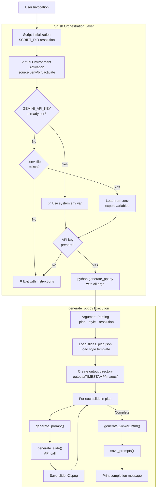
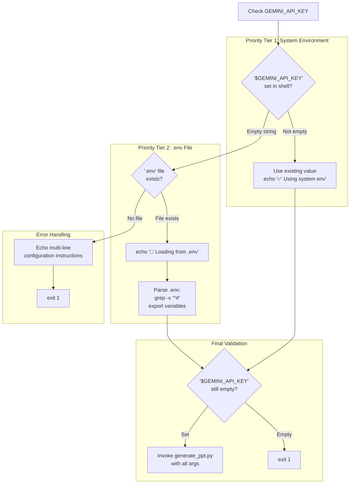
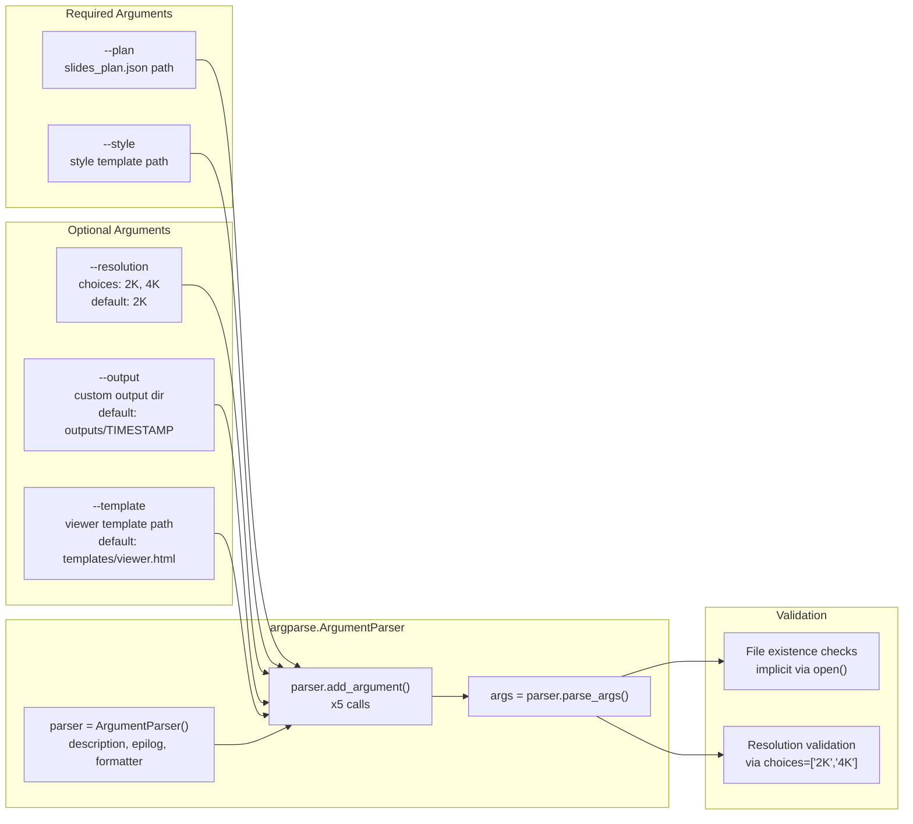
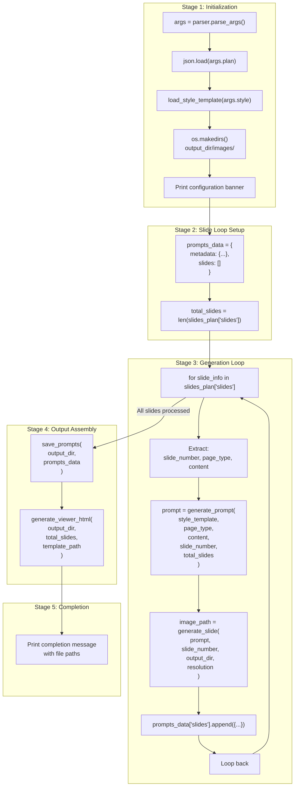
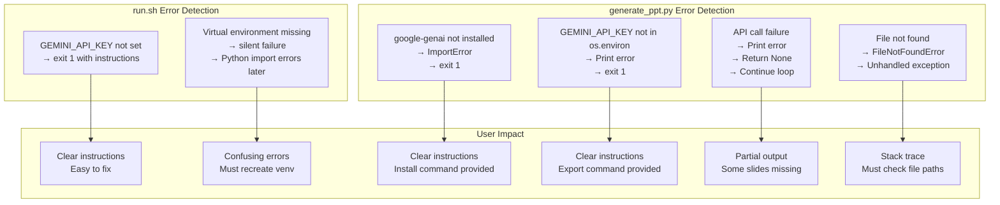
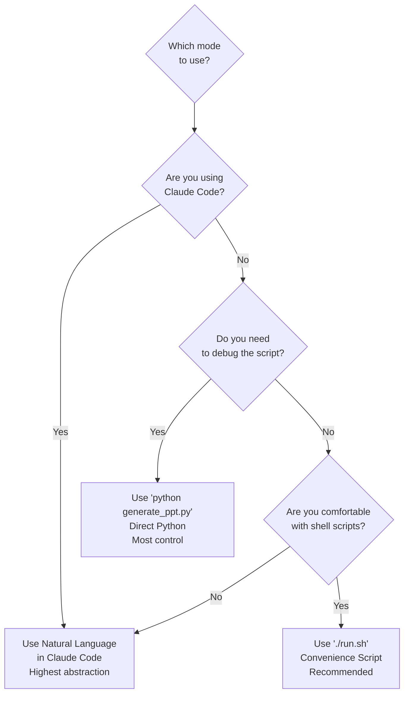
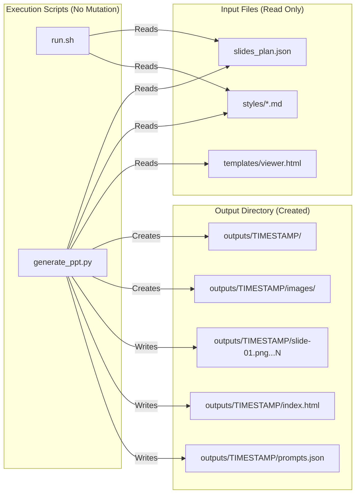

<!-- source: DeepWiki mcp.deepwiki.com · repo op7418/NanoBanana-PPT-Skills · page 5.4 Execution Scripts · fetched 2026-10-26 -->

# Execution Scripts

<details>
<summary>Relevant source files</summary>

The following files were used as context for generating this wiki page:

- [SETUP_COMPLETE.md](SETUP_COMPLETE.md)
- [generate_ppt.py](generate_ppt.py)
- [run.sh](run.sh)

</details>


## Purpose and Scope

This page documents the execution layer of the PPT Generator, specifically the `run.sh` orchestration script and its interaction with `generate_ppt.py`. This layer handles virtual environment activation, API key loading, parameter validation, and script invocation.

For information about the command-line interface and available arguments, see [Command Line Usage](#4.2). For details on the API key configuration system, see [Environment Variables](#3.2). For the generation logic that executes after these scripts complete their setup, see [Image Generation](#5.3).

---

## Execution Flow Overview

The execution layer consists of two scripts working in sequence:

| Script | Role | Language | Lines of Code |
|--------|------|----------|---------------|
| `run.sh` | Orchestration, environment setup, security gate | Bash | 48 |
| `generate_ppt.py` | Core generation logic, API calls, output assembly | Python | 273 |

**Diagram: Complete Execution Flow**



Sources: [run.sh:1-48](), [generate_ppt.py:144-272]()

---

## run.sh Orchestration Script

The `run.sh` script serves as the primary entry point for the PPT Generator, providing a convenient wrapper that handles environment setup and security validation before invoking the Python core.

### Script Initialization

The script begins by resolving its own directory path to ensure all subsequent paths are absolute:

```bash
SCRIPT_DIR="$(cd "$(dirname "${BASH_SOURCE[0]}")" && pwd)"
```

This pattern uses `BASH_SOURCE[0]` to get the script's path, resolves it to an absolute directory, and stores it in `SCRIPT_DIR`. All subsequent file references use this variable as the base path.

**Purpose**: Allows the script to be invoked from any working directory without breaking relative path references.

Sources: [run.sh:7]()

### Virtual Environment Activation

The script activates the Python virtual environment unconditionally:

```bash
source "$SCRIPT_DIR/venv/bin/activate"
```

This command:
- Sources the `activate` script from the `venv/bin/` directory
- Modifies `PATH` to prioritize virtual environment executables
- Sets `VIRTUAL_ENV` environment variable
- Updates shell prompt (in interactive mode)

**Critical Note**: If the virtual environment does not exist, this command fails silently in non-interactive mode, leading to dependency import errors later. Users are expected to have run the installation process first (see [Installation](#2.2)).

Sources: [run.sh:10]()

### API Key Loading System

The API key loading system implements a **two-tier priority system** with comprehensive error handling:

**Diagram: API Key Loading Priority Flow in run.sh**



Sources: [run.sh:16-44]()

#### Priority Tier 1: System Environment Variable

The script first checks if `GEMINI_API_KEY` is already set in the shell environment using Bash's `[ -z "$VARIABLE" ]` test (true if string is zero length):

```bash
if [ -z "$GEMINI_API_KEY" ]; then
    # Not set, try .env file
else
    echo "✅ 使用系统环境变量中的API密钥"
fi
```

If the variable is already set (e.g., via `~/.zshrc`, `~/.bashrc`, or manual `export`), the script uses it directly and skips the `.env` file loading.

**Rationale**: System environment variables take precedence because they are:
- More secure (not stored in project directory)
- Shared across all projects
- Persistent across terminal sessions
- Recommended in [Security Best Practices](#3.3)

Sources: [run.sh:16-38]()

#### Priority Tier 2: .env File Fallback

If the system environment variable is not set, the script attempts to load from `.env`:

```bash
if [ -f "$SCRIPT_DIR/.env" ]; then
    echo "📌 从 .env 文件加载API密钥"
    export $(cat "$SCRIPT_DIR/.env" | grep -v '^#' | xargs)
fi
```

This command chain:
1. `cat "$SCRIPT_DIR/.env"` - Reads the file
2. `grep -v '^#'` - Filters out comment lines (lines starting with `#`)
3. `xargs` - Converts input to space-separated arguments
4. `export $(...)` - Exports all key-value pairs as environment variables

**Example .env file**:
```
# Comments are ignored
GEMINI_API_KEY=AIzaSyD...
OTHER_VAR=value
```

This pattern loads **all** variables from `.env`, not just `GEMINI_API_KEY`.

Sources: [run.sh:18-20]()

#### Error Handling

If neither source provides an API key, the script outputs detailed configuration instructions and exits:

```bash
echo "❌ 错误: API密钥未配置"
echo ""
echo "请选择以下任一方式配置API密钥："
echo ""
echo "方式1（推荐）: 系统环境变量"
echo "  echo 'export GEMINI_API_KEY=\"your-key\"' >> ~/.zshrc"
echo "  source ~/.zshrc"
echo ""
echo "方式2: .env 文件"
echo "  cp .env.example .env"
echo "  编辑 .env 文件并填入您的API密钥"
echo ""
exit 1
```

The error message provides:
- Clear diagnosis of the problem
- Two configuration methods with exact commands
- Shell-specific instructions (`.zshrc` for zsh, `.bashrc` for bash)
- Reference to `.env.example` template

Sources: [run.sh:22-34]()

#### Final Validation

After attempting both loading methods, the script performs a final check:

```bash
if [ -z "$GEMINI_API_KEY" ]; then
    echo "❌ 错误: GEMINI_API_KEY 仍未设置"
    exit 1
fi
```

This guard catches edge cases where:
- `.env` file exists but is empty
- `.env` file exists but doesn't contain `GEMINI_API_KEY`
- Environment variable is explicitly set to empty string

Sources: [run.sh:41-44]()

### Parameter Forwarding

The script forwards all command-line arguments to `generate_ppt.py` using `"$@"`:

```bash
python "$SCRIPT_DIR/generate_ppt.py" "$@"
```

The `"$@"` variable expands to all positional parameters as separate quoted strings, preserving:
- Argument order
- Spaces within arguments
- Special characters
- Empty strings

**Example invocation**:
```bash
./run.sh --plan ../test_slides_plan.json --style styles/gradient-glass.md --resolution 2K
```

Becomes:
```bash
python /path/to/generate_ppt.py --plan ../test_slides_plan.json --style styles/gradient-glass.md --resolution 2K
```

Sources: [run.sh:47]()

---

## generate_ppt.py Invocation

Once `run.sh` completes environment setup, `generate_ppt.py` takes control of the generation pipeline.

### Command-Line Argument Parsing

The script uses Python's `argparse` module to define and parse command-line arguments:

**Diagram: Argument Processing in generate_ppt.py**



Sources: [generate_ppt.py:144-183]()

#### Argument Definitions

| Argument | Required | Type | Default | Description |
|----------|----------|------|---------|-------------|
| `--plan` | Yes | File path | N/A | Path to `slides_plan.json` (generated by planning stage) |
| `--style` | Yes | File path | N/A | Path to style template `.md` file |
| `--resolution` | No | Choice | `'2K'` | Image resolution: `'2K'` (2752×1536) or `'4K'` (5504×3072) |
| `--output` | No | Directory path | `outputs/TIMESTAMP` | Custom output directory path |
| `--template` | No | File path | `templates/viewer.html` | HTML template for viewer generation |

The parser also includes formatted help text with usage examples:

```python
epilog="""
示例用法:
  python generate_ppt.py --plan slides_plan.json --style styles/gradient-glass.md --resolution 2K

环境变量:
  GEMINI_API_KEY: Google AI API密钥（必需）
"""
```

Sources: [generate_ppt.py:145-181]()

### Execution Flow

After argument parsing, the script follows a linear five-stage process:

**Diagram: generate_ppt.py Execution Stages**



Sources: [generate_ppt.py:185-268]()

#### Stage 1: Initialization

The script loads input files and creates the output directory structure:

```python
# Read slides planning
with open(args.plan, 'r', encoding='utf-8') as f:
    slides_plan = json.load(f)

# Load style template
style_template = load_style_template(args.style)

# Create output directory
if args.output:
    output_dir = args.output
else:
    timestamp = datetime.now().strftime("%Y%m%d_%H%M%S")
    output_dir = f"outputs/{timestamp}"

os.makedirs(os.path.join(output_dir, "images"), exist_ok=True)
```

The timestamp format `%Y%m%d_%H%M%S` produces directory names like `outputs/20240115_143022/`, ensuring unique output directories for each generation run.

Sources: [generate_ppt.py:186-199]()

#### Stage 2: Slide Loop Setup

Before entering the generation loop, the script initializes the prompts data structure:

```python
prompts_data = {
    "metadata": {
        "title": slides_plan.get("title", "未命名演示"),
        "total_slides": len(slides_plan['slides']),
        "resolution": args.resolution,
        "style": args.style,
        "generated_at": datetime.now().isoformat()
    },
    "slides": []
}

total_slides = len(slides_plan['slides'])
```

This structure will be serialized to `prompts.json` for audit trail purposes.

Sources: [generate_ppt.py:212-223]()

#### Stage 3: Generation Loop

The script processes each slide sequentially (no parallelization):

```python
for slide_info in slides_plan['slides']:
    slide_number = slide_info['slide_number']
    page_type = slide_info.get('page_type', 'content')
    content_text = slide_info['content']
    
    # Generate prompt
    prompt = generate_prompt(
        style_template,
        page_type,
        content_text,
        slide_number,
        total_slides
    )
    
    # Generate image
    image_path = generate_slide(prompt, slide_number, output_dir, args.resolution)
    
    # Record prompt
    prompts_data['slides'].append({
        "slide_number": slide_number,
        "page_type": page_type,
        "content": content_text,
        "prompt": prompt,
        "image_path": image_path
    })
```

**Why Sequential Processing?**
- API rate limiting considerations
- Simplified error handling
- Resource management (memory for 4K images)
- Progress feedback clarity

Sources: [generate_ppt.py:225-251]()

#### Stage 4: Output Assembly

After all slides are generated, the script creates supporting files:

```python
# Save prompts
save_prompts(output_dir, prompts_data)

# Generate viewer HTML
generate_viewer_html(output_dir, total_slides, args.template)
```

The `save_prompts()` function writes JSON with `ensure_ascii=False` and `indent=2` for human-readable output. The `generate_viewer_html()` function injects slide paths into the HTML template.

Sources: [generate_ppt.py:254-257]()

#### Stage 5: Completion

The script prints a completion banner with file paths:

```python
print("=" * 60)
print("生成完成！")
print("=" * 60)
print(f"输出目录: {output_dir}")
print(f"播放网页: {os.path.join(output_dir, 'index.html')}")
print()
print("打开播放网页查看PPT:")
print(f"  open {os.path.join(output_dir, 'index.html')}")
```

The `open` command works on macOS. On Linux, users would use `xdg-open`, and on Windows, `start`.

Sources: [generate_ppt.py:260-268]()

---

## Error Handling and Validation

The execution layer implements error handling at multiple checkpoints:

**Diagram: Error Detection Points**



Sources: [run.sh:16-44](), [generate_ppt.py:64-109]()

### run.sh Error Handling

The script validates API key presence but does **not** validate virtual environment existence:

| Error Condition | Detection | Handler | Exit Code |
|----------------|-----------|---------|-----------|
| API key not set (tier 1 & 2 fail) | `[ -z "$GEMINI_API_KEY" ]` | Multi-line instructions → `exit 1` | 1 |
| API key empty after loading | `[ -z "$GEMINI_API_KEY" ]` | Error message → `exit 1` | 1 |
| `venv/bin/activate` not found | None | Silent failure → Python errors later | 0 (then varies) |

**Known Issue**: If the virtual environment doesn't exist, `source venv/bin/activate` fails silently in non-interactive shells, and the script continues with the system Python interpreter. This can lead to:
- `ModuleNotFoundError: No module named 'google'`
- Different Python version execution
- Global environment pollution

**Mitigation**: Users are expected to follow [Installation](#2.2) procedures.

Sources: [run.sh:10](), [run.sh:41-44]()

### generate_ppt.py Error Handling

The Python script implements more granular error handling:

#### Import-Time Validation

```python
try:
    from google import genai
    from google.genai import types
except ImportError:
    print("错误: 未安装 google-genai 库")
    print("请运行: pip install google-genai")
    sys.exit(1)
```

This try-except block is inside the `generate_slide()` function, meaning the import error is only detected when the first slide is being generated (not at script startup).

Sources: [generate_ppt.py:65-70]()

#### Runtime API Key Validation

```python
api_key = os.environ.get("GEMINI_API_KEY")
if not api_key:
    print("错误: 未设置 GEMINI_API_KEY 环境变量")
    print("请设置: export GEMINI_API_KEY='your-api-key'")
    sys.exit(1)
```

This is a **redundant check** with `run.sh`, providing defense-in-depth. If users invoke `generate_ppt.py` directly without `run.sh`, this catches the missing key.

Sources: [generate_ppt.py:73-77]()

#### API Call Error Handling

```python
try:
    client = genai.Client(api_key=api_key)
    response = client.models.generate_content(...)
    
    for part in response.parts:
        if part.inline_data is not None:
            image = part.as_image()
            image.save(image_path)
            print(f"✓ 第 {slide_number} 页已保存: {image_path}")
            return image_path
    
    print(f"✗ 第 {slide_number} 页生成失败: 未收到图片数据")
    return None

except Exception as e:
    print(f"✗ 第 {slide_number} 页生成失败: {e}")
    return None
```

**Error Recovery Strategy**: If a slide fails to generate, the script:
1. Prints an error message
2. Returns `None` for the image path
3. **Continues to the next slide** (does not abort)

This allows partial generation success. The `prompts.json` file will contain `"image_path": null` for failed slides.

Sources: [generate_ppt.py:81-109]()

---

## Execution Modes Comparison

The system supports three execution modes with different tradeoffs:

**Table: Execution Mode Comparison**

| Mode | Entry Point | Environment Setup | API Key Handling | Use Case |
|------|-------------|-------------------|------------------|----------|
| **Convenience Script** | `./run.sh` | Automatic (`source venv/bin/activate`) | Automatic (priority system) | Recommended for all users |
| **Direct Python** | `python generate_ppt.py` | Manual (`source venv/bin/activate`) | Manual (`export GEMINI_API_KEY`) | Advanced users, debugging |
| **Claude Code** | Natural language | Automated by AI | Automated by AI | Non-technical users |

**Diagram: Execution Mode Selection Decision Tree**



Sources: [SETUP_COMPLETE.md:20-48]()

### Mode 1: Convenience Script (./run.sh)

**Advantages**:
- No manual environment setup
- Automatic API key loading
- Single command execution
- Clear error messages

**Disadvantages**:
- Requires executable permissions (`chmod +x run.sh`)
- Shell-specific (Bash)
- Less control over environment

**Typical Usage**:
```bash
./run.sh --plan slides_plan.json --style styles/gradient-glass.md --resolution 2K
```

Sources: [run.sh:1-48](), [SETUP_COMPLETE.md:20-25]()

### Mode 2: Direct Python

**Advantages**:
- Full control over Python environment
- Easier to integrate into other Python scripts
- Can use different Python interpreters
- Better for debugging (add breakpoints)

**Disadvantages**:
- Must manually activate virtual environment
- Must manually export API key
- More steps required

**Typical Usage**:
```bash
source venv/bin/activate
export GEMINI_API_KEY="AIzaSyD..."
python generate_ppt.py --plan slides_plan.json --style styles/gradient-glass.md --resolution 2K
```

Sources: [SETUP_COMPLETE.md:27-38]()

### Mode 3: Claude Code Integration

**Advantages**:
- Natural language interface
- Automatic document analysis
- No technical knowledge required
- Handles all setup steps

**Disadvantages**:
- Less control over parameters
- Requires Claude Code environment
- May not support all advanced features

**Typical Usage**:
```
我想基于"莫伊兰箭.md"文档生成一个5页的PPT
```

Claude Code then automatically:
1. Analyzes the document
2. Generates `slides_plan.json`
3. Invokes `run.sh` with appropriate parameters
4. Opens the viewer

Sources: [SETUP_COMPLETE.md:40-48]()

---

## Performance Characteristics

The execution layer has predictable performance characteristics:

| Operation | Time Complexity | Typical Duration | Notes |
|-----------|----------------|------------------|-------|
| `run.sh` initialization | O(1) | <100ms | SCRIPT_DIR resolution, venv activation |
| API key loading from .env | O(n) | <10ms | n = file size (typically <100 bytes) |
| Argument parsing | O(1) | <50ms | Fixed number of arguments |
| File loading (plan, style) | O(n) | <100ms | n = file size (typically <10KB) |
| Single slide generation (2K) | O(1) | ~30s | Dominated by API latency |
| Single slide generation (4K) | O(1) | ~45-60s | Higher resolution = longer processing |
| HTML viewer generation | O(n) | <100ms | n = slide count |
| Total execution time | O(n) | n × 30s | n = slide count, sequential processing |

**Bottleneck**: The API call to `gemini-3-pro-image-preview` dominates execution time. For a typical 10-slide presentation:
- 2K resolution: ~5 minutes
- 4K resolution: ~7-10 minutes

Sources: [generate_ppt.py:62-109](), [SETUP_COMPLETE.md:62-64]()

---

## File System Side Effects

The execution layer creates and modifies files in predictable locations:

**Diagram: File System Mutations**



**Key Properties**:
- **Idempotent Inputs**: Input files are never modified
- **Unique Outputs**: Timestamp-based directories prevent collisions
- **Self-Contained**: Each generation run is isolated in its own directory
- **Safe to Delete**: Output directories can be deleted without affecting the system

The `outputs/` directory grows over time. Users may want to periodically clean old generations or implement a retention policy.

Sources: [generate_ppt.py:193-199]()

---

