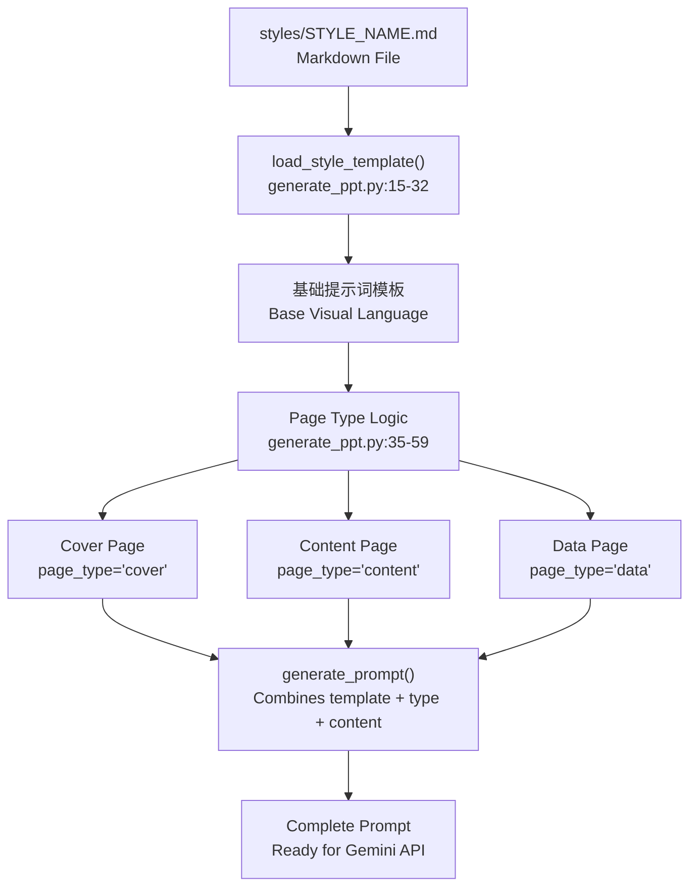
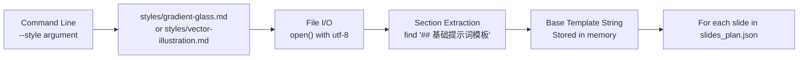
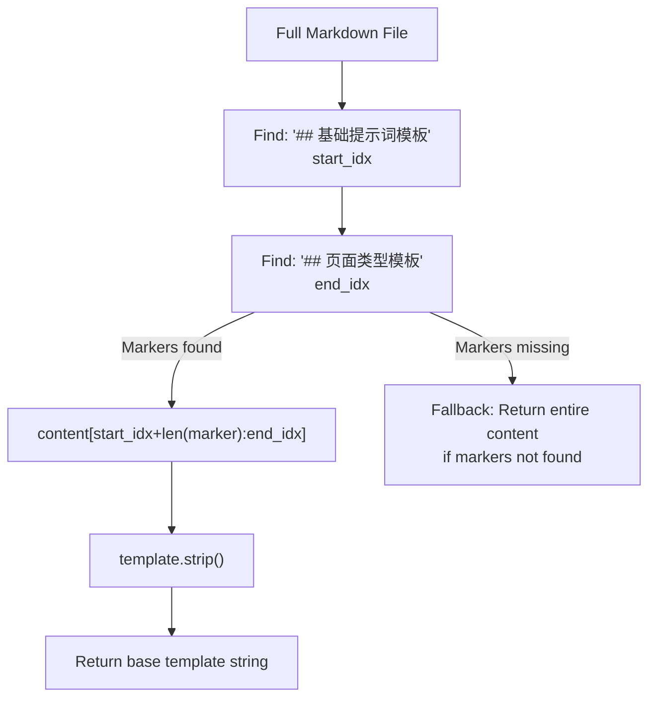
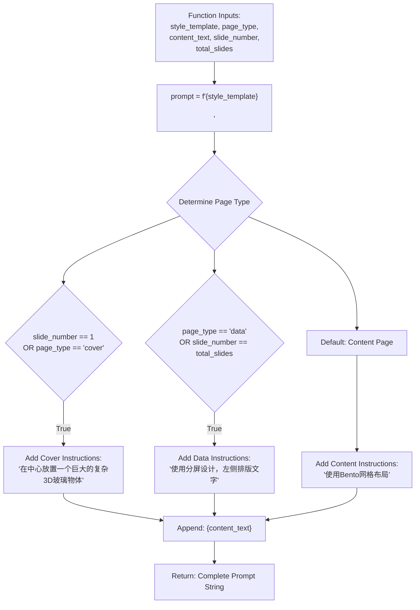
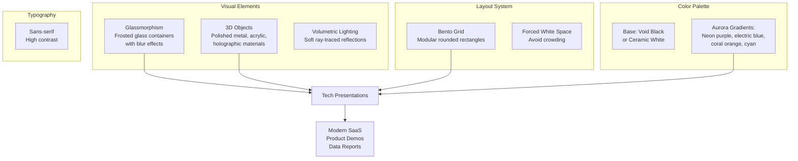
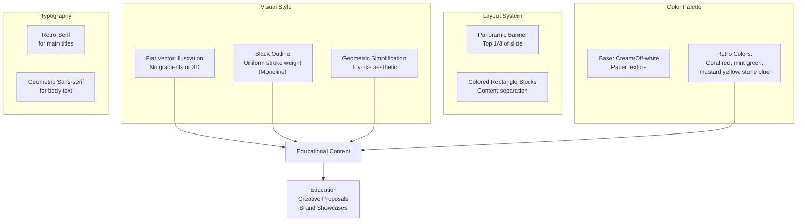
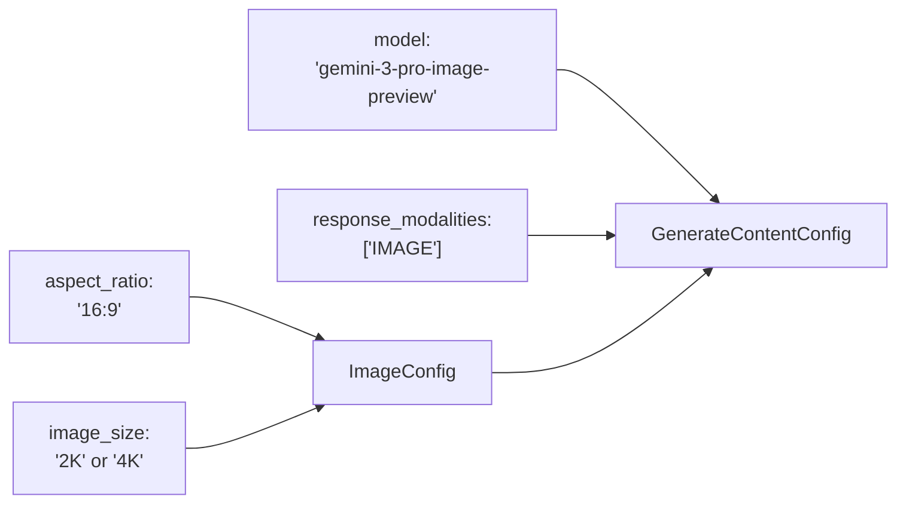
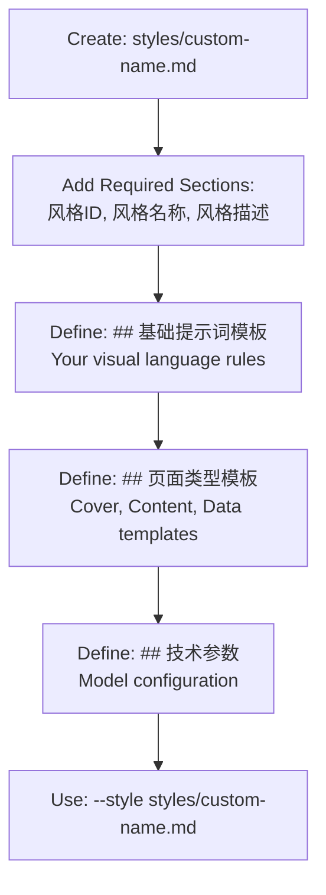
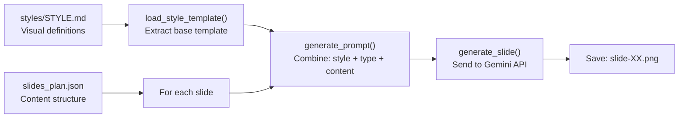

<!-- source: DeepWiki mcp.deepwiki.com · repo op7418/NanoBanana-PPT-Skills · page 6 Style System · fetched 2026-10-26 -->

# Style System

<details>
<summary>Relevant source files</summary>

The following files were used as context for generating this wiki page:

- [generate_ppt.py](generate_ppt.py)
- [styles/gradient-glass.md](styles/gradient-glass.md)
- [styles/vector-illustration.md](styles/vector-illustration.md)

</details>


## Purpose and Scope

This document describes the style system architecture, which defines visual aesthetics for generated presentations. The style system implements a template-based prompt engineering framework that separates visual design from content generation logic.

For information about using styles in practice, see [Command Line Usage](#4.2). For details on the generation pipeline that consumes these styles, see [Prompt Engineering](#5.2).

---

## Architecture Overview

The style system is a hierarchical template inheritance system where base visual definitions are combined with page-type-specific templates and content to generate complete AI prompts.

### Style System Flow



**Sources:** [generate_ppt.py:15-59]()

### Style Selection and Loading



**Sources:** [generate_ppt.py:15-32](), [generate_ppt.py:189-190]()

---

## Style File Structure

Each style file is a Markdown document with standardized sections that define visual language and page-specific templates.

### Required Sections

| Section Header | Purpose | Used By |
|----------------|---------|---------|
| `## 风格ID` | Unique identifier | File naming, documentation |
| `## 风格名称` | Human-readable name | Documentation, user selection |
| `## 适配模型` | Compatible AI models | Compatibility checking |
| `## 风格描述` | Visual aesthetic summary | User guidance |
| `## 基础提示词模板` | Base prompt template | `load_style_template()` extracts this |
| `## 页面类型模板` | Page type variations | Documentation reference |
| `## 技术参数` | Model configuration | Documentation reference |

**Sources:** [styles/gradient-glass.md:1-91](), [styles/vector-illustration.md:1-132]()

### Template Extraction Logic

The `load_style_template()` function extracts only the base prompt template section between two marker strings:



**Sources:** [generate_ppt.py:15-32]()

**Implementation:**

```
start_marker = "## 基础提示词模板"
end_marker = "## 页面类型模板"
start_idx = content.find(start_marker)
end_idx = content.find(end_marker)
template = content[start_idx + len(start_marker):end_idx].strip()
```

This extraction ensures only the base visual language definition is used, leaving page-specific logic to the code.

---

## Prompt Generation Process

The `generate_prompt()` function combines the base style template with page-type-specific instructions and slide content.

### Prompt Assembly Flow



**Sources:** [generate_ppt.py:35-59]()

### Page Type Decision Logic

The system automatically determines page type using position-based heuristics:

| Condition | Page Type | Template Applied |
|-----------|-----------|------------------|
| `slide_number == 1` OR `page_type == "cover"` | Cover | Hero layout with 3D glass object |
| `slide_number == total_slides` OR `page_type == "data"` | Data/Summary | Split-screen with visualization |
| All other slides | Content | Bento grid layout |

**Sources:** [generate_ppt.py:39-57]()

---

## Built-In Styles Comparison

The system includes two production-ready styles with distinct visual languages.

### Gradient Glass Style



**Key Characteristics:**
- **Style ID:** `gradient-glass`
- **File:** [styles/gradient-glass.md]()
- **Aesthetic:** Apple Keynote minimalism + glassmorphism
- **Rendering Quality:** Unreal Engine 5, 8K textures
- **Typical Use Cases:** Product demonstrations, technical sharing, creative proposals

**Sources:** [styles/gradient-glass.md:1-91]()

### Vector Illustration Style



**Key Characteristics:**
- **Style ID:** `vector-illustration`
- **File:** [styles/vector-illustration.md]()
- **Aesthetic:** Flat design + retro coloring + black outlines
- **Visual Feel:** Warm, cute, nostalgic
- **Typical Use Cases:** Educational presentations, creative proposals, children's content, brand showcases

**Sources:** [styles/vector-illustration.md:1-132]()

### Side-by-Side Comparison

| Aspect | Gradient Glass | Vector Illustration |
|--------|----------------|---------------------|
| **Visual Language** | 3D, glassmorphism, futuristic | Flat, geometric, retro |
| **Materials** | Glass, metal, holographic | Vector shapes with outlines |
| **Colors** | Neon gradients, high contrast | Vintage pastels, muted tones |
| **Layout System** | Bento grid, modular containers | Panoramic banner + blocks |
| **Typography** | Sans-serif, high contrast | Retro serif + geometric sans |
| **Rendering Complexity** | High (Unreal Engine 5 quality) | Low (simple vector graphics) |
| **Best For** | Tech/Business/SaaS | Education/Creative/Branding |

**Sources:** [styles/gradient-glass.md:13-30](), [styles/vector-illustration.md:17-50]()

---

## Technical Specifications

### API Configuration

Both styles use identical technical parameters for the Gemini API:



**Sources:** [generate_ppt.py:84-94]()

### Resolution Options

| Resolution | Dimensions | Use Case | Generation Time |
|------------|------------|----------|-----------------|
| **2K** (Recommended) | 2752 x 1536 pixels | Standard presentations, balanced quality | ~30s per slide |
| **4K** | 5504 x 3072 pixels | High-quality exports, print materials | ~60s+ per slide |

The resolution is specified via the `--resolution` command-line argument and passed to the `generate_slide()` function.

**Sources:** [generate_ppt.py:62](), [generate_ppt.py:167-172](), [styles/gradient-glass.md:82-90]()

### Model Configuration Code

The API call configuration in `generate_slide()`:

```python
response = client.models.generate_content(
    model="gemini-3-pro-image-preview",
    contents=prompt,
    config=types.GenerateContentConfig(
        response_modalities=['IMAGE'],
        image_config=types.ImageConfig(
            aspect_ratio="16:9",
            image_size=resolution  # "2K" or "4K"
        )
    )
)
```

**Sources:** [generate_ppt.py:84-94]()

---

## Extension Points

The style system is designed for extensibility through custom style files.

### Creating a Custom Style



**Requirements:**
1. **File Location:** Place in `styles/` directory
2. **Encoding:** UTF-8
3. **Marker Strings:** Must include `## 基础提示词模板` and `## 页面类型模板` sections
4. **Content:** Base template must define complete visual language (materials, colors, typography, layout rules)

**Sources:** [generate_ppt.py:15-32](), [generate_ppt.py:163-166]()

### Style Template Anatomy

A minimal custom style structure:

```
# Custom Style Name

## 风格ID
custom-name

## 风格名称
My Custom Style

## 适配模型
- Nano Banana Pro (gemini-3-pro-image-preview)

## 风格描述
Brief description of visual aesthetic.

## 基础提示词模板

[Your complete visual language definition here]
- Visual style rules
- Color palette
- Typography specifications
- Material definitions
- Layout principles
- Rendering quality requirements

## 页面类型模板

### 封面页模板
[Cover page composition rules]

### 内容页模板
[Content page composition rules]

### 数据页模板
[Data page composition rules]

## 技术参数
[Same as built-in styles]
```

The `load_style_template()` function will extract only the text between `## 基础提示词模板` and `## 页面类型模板`, ensuring consistent behavior.

**Sources:** [styles/gradient-glass.md:1-91](), [styles/vector-illustration.md:1-132]()

---

## Integration with Generation Pipeline

The style system integrates with the generation pipeline at the prompt engineering stage:



**Pipeline Stages:**
1. **Pre-generation:** Style template loaded once at startup
2. **Per-slide:** `generate_prompt()` combines template with content
3. **Generation:** Complete prompt sent to Gemini API
4. **Post-processing:** Images saved with consistent naming

**Sources:** [generate_ppt.py:185-257]()

---

## Prompt Audit Trail

All generated prompts are logged to `prompts.json` for debugging and iteration:

```json
{
  "metadata": {
    "title": "Presentation Title",
    "total_slides": 10,
    "resolution": "2K",
    "style": "styles/gradient-glass.md",
    "generated_at": "2024-01-15T10:30:00"
  },
  "slides": [
    {
      "slide_number": 1,
      "page_type": "cover",
      "content": "Slide content text",
      "prompt": "Complete generated prompt...",
      "image_path": "outputs/TIMESTAMP/images/slide-01.png"
    }
  ]
}
```

This audit trail enables:
- **Debugging:** Inspect exact prompts sent to API
- **Iteration:** Identify prompts needing refinement
- **Documentation:** Understand what visual instructions produced which outputs

**Sources:** [generate_ppt.py:136-142](), [generate_ppt.py:243-249]()

---

