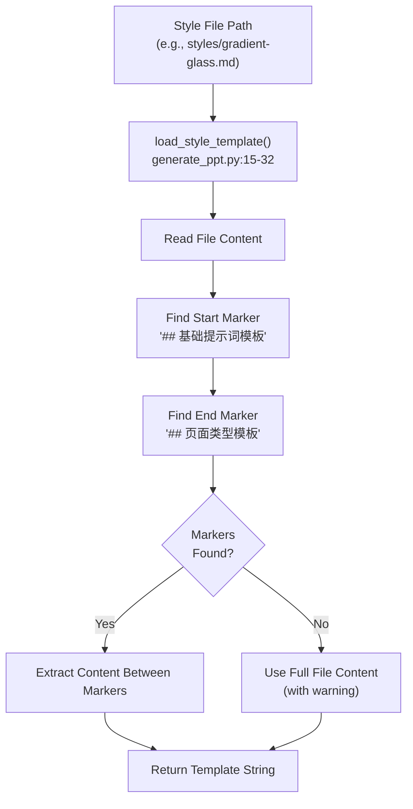
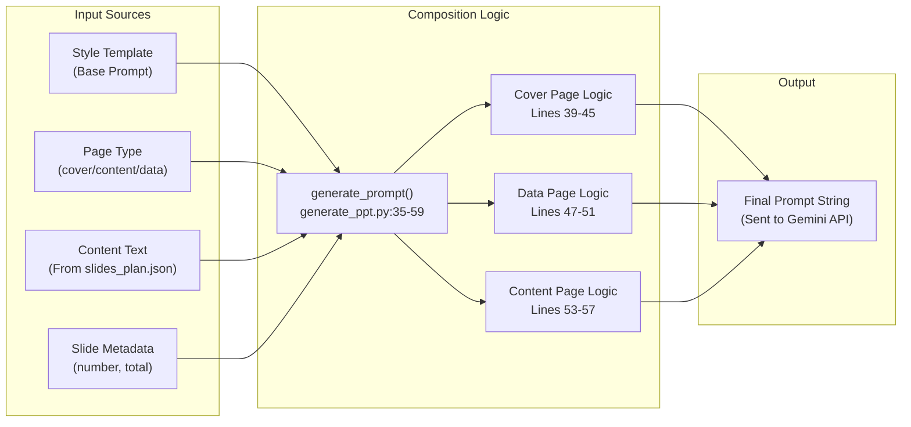
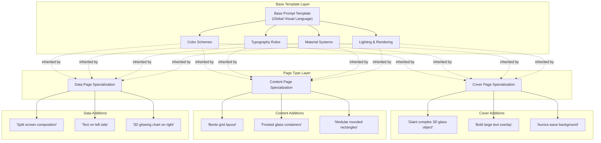
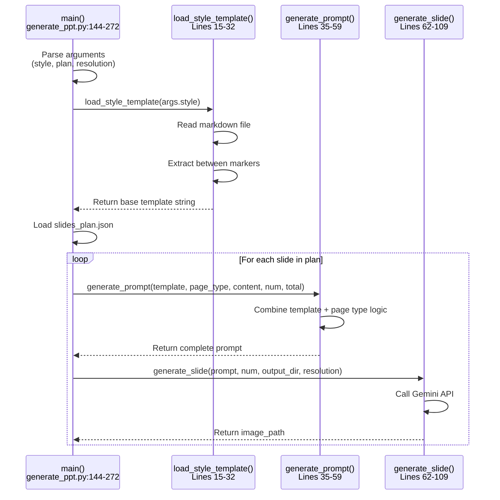
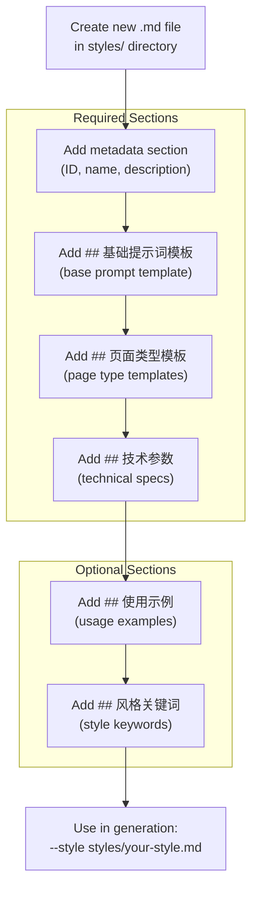
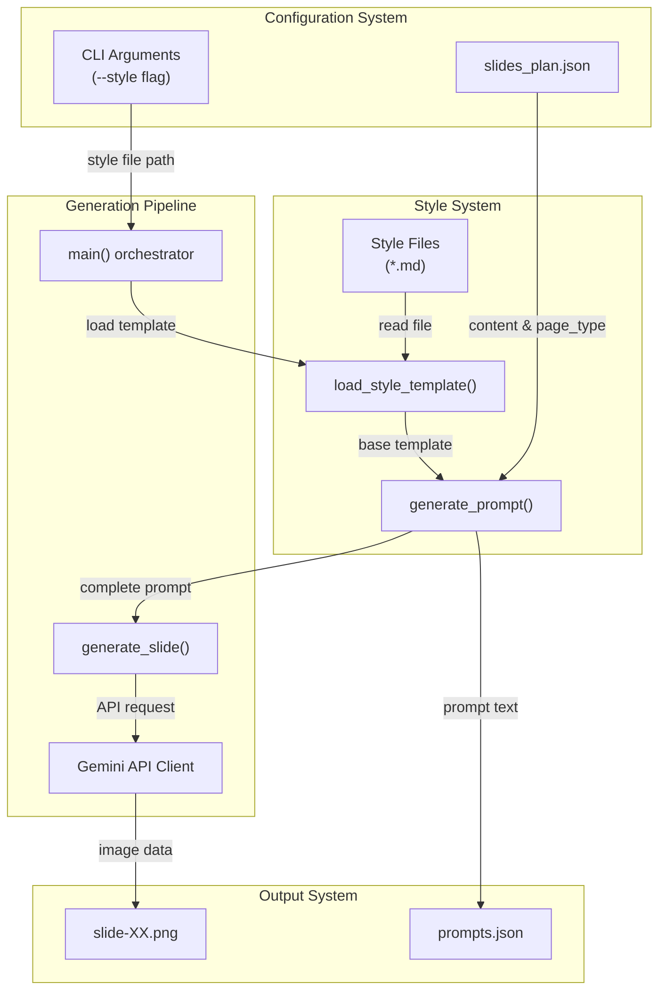

<!-- source: DeepWiki mcp.deepwiki.com · repo op7418/NanoBanana-PPT-Skills · page 6.1 Style System Overview · fetched 2026-10-26 -->

# Style System Overview

<details>
<summary>Relevant source files</summary>

The following files were used as context for generating this wiki page:

- [generate_ppt.py](generate_ppt.py)
- [styles/gradient-glass.md](styles/gradient-glass.md)
- [styles/vector-illustration.md](styles/vector-illustration.md)

</details>


## Purpose and Scope

This document explains the architecture and mechanics of the NanoBanana PPT Generator's style system. It covers how style templates are structured, how the base prompt template system works, how page types specialize these templates, and how the generation script combines them to create AI prompts.

For details on specific built-in styles, see [Gradient Glass Style](#6.2) and [Vector Illustration Style](#6.3). For instructions on creating your own styles, see [Creating Custom Styles](#6.4). For how styles integrate into the generation pipeline, see [Prompt Engineering](#5.2).

---

## Style File Structure

Each style is defined as a self-contained Markdown file in the `styles/` directory. The file structure follows a standardized format that enables automated parsing and template extraction.

### Standard Style Components

| Component | Section Marker | Purpose |
|-----------|---------------|---------|
| **Metadata** | Top of file | Style ID, name, compatible models, description |
| **Base Prompt Template** | `## 基础提示词模板` | Global visual language and aesthetic rules |
| **Page Type Templates** | `## 页面类型模板` | Specialized layouts for different slide types |
| **Usage Examples** | `## 使用示例` | Example prompt compositions |
| **Technical Parameters** | `## 技术参数` | Model configuration, resolution, aspect ratio |

### Style File Anatomy

```mermaid
graph TB
    StyleFile["Style Markdown File<br/>(*.md)"]
    
    subgraph "Metadata Section"
        M1["style_id"]
        M2["style_name"]
        M3["compatible_models"]
        M4["description"]
    end
    
    subgraph "Base Prompt Template Section"
        B1["Global Visual Language"]
        B2["Aesthetic Rules"]
        B3["Color Schemes"]
        B4["Typography Guidelines"]
        B5["Layout Systems"]
    end
    
    subgraph "Page Type Templates Section"
        P1["Cover Page Template"]
        P2["Content Page Template"]
        P3["Data Page Template"]
    end
    
    subgraph "Technical Specifications"
        T1["Model: gemini-3-pro-image-preview"]
        T2["Aspect Ratio: 16:9"]
        T3["Resolution: 2K / 4K"]
        T4["Response Mode: IMAGE"]
    end
    
    StyleFile --> M1 & M2 & M3 & M4
    StyleFile --> B1 & B2 & B3 & B4 & B5
    StyleFile --> P1 & P2 & P3
    StyleFile --> T1 & T2 & T3 & T4
```



**Diagram: Style file components and their organization**

**Sources:** [styles/gradient-glass.md:1-91](), [styles/vector-illustration.md:1-132]()

---

## Template Extraction System

The style system uses section marker-based extraction to isolate the base prompt template from style definition files. This approach enables runtime template loading without manual parsing.

### Extraction Algorithm



**Diagram: Template extraction flow in `load_style_template()`**

### Code Implementation

The `load_style_template()` function implements a marker-based extraction algorithm:

1. **Read file content** - Load entire style file as UTF-8 text
2. **Locate markers** - Find `"## 基础提示词模板"` (start) and `"## 页面类型模板"` (end)
3. **Extract substring** - Content between markers becomes the template
4. **Fallback handling** - If markers not found, use entire file with warning

**Sources:** [generate_ppt.py:15-32]()

---

## Prompt Generation Architecture

The style system employs a composition-based architecture where final prompts are assembled from multiple sources at generation time. This enables flexible customization without modifying core templates.

### Prompt Composition Pipeline



**Diagram: Prompt composition pipeline showing function flow**

### Composition Logic by Page Type

| Page Type | Trigger Condition | Template Addition | Visual Focus |
|-----------|------------------|-------------------|--------------|
| **Cover** | `page_type == "cover"` OR `slide_number == 1` | Giant 3D glass object + aurora waves | Hero title display |
| **Data** | `page_type == "data"` OR `slide_number == total_slides` | Split screen: text left, 3D chart right | Data visualization |
| **Content** | All other slides | Bento grid layout with frosted glass containers | Modular content display |

The `generate_prompt()` function implements conditional branching to select the appropriate template addition based on page type and position:

```
Final Prompt = Base Style Template + "\n\n" + Page Type Specific Instructions + "\n\n" + Content Text
```

**Sources:** [generate_ppt.py:35-59]()

---

## Page Type Specialization

Page types inherit the global visual language from the base template and add layout-specific instructions. This enables consistent aesthetics across different slide purposes.

### Template Inheritance Pattern



**Diagram: Template inheritance showing how page types extend base templates**

### Gradient Glass Style Example

For the `gradient-glass` style, each page type inherits the base template's glassmorphism aesthetic:

**Base Template Defines:**
- Glass material with blur effects
- Neon gradient colors (purple, blue, coral, cyan)
- Cinema-quality volumetric lighting
- Bento grid layout system
- 3D gift-textured objects

**Cover Page Adds:**
- Central placement instruction for 3D object
- Title overlay positioning
- Aurora wave background directive

**Content Page Adds:**
- Bento grid application instructions
- Glass container specifications
- Whitespace preservation rules

**Data Page Adds:**
- Split-screen layout directive
- Left/right positioning for text and charts
- 3D data visualization styling

**Sources:** [styles/gradient-glass.md:16-47](), [generate_ppt.py:39-57]()

---

## Runtime Template Assembly

The generation script orchestrates template loading and prompt composition at runtime, enabling dynamic style selection without code changes.

### Assembly Sequence Diagram



**Diagram: Runtime sequence showing template loading and prompt assembly**

### Key Functions and Their Roles

| Function | Location | Role | Inputs | Outputs |
|----------|----------|------|--------|---------|
| `load_style_template()` | [generate_ppt.py:15-32]() | Extract base prompt from style file | `style_path` (string) | Base template text |
| `generate_prompt()` | [generate_ppt.py:35-59]() | Compose final prompt | `style_template`, `page_type`, `content_text`, `slide_number`, `total_slides` | Complete prompt string |
| `generate_slide()` | [generate_ppt.py:62-109]() | Execute API call | `prompt`, `slide_number`, `output_dir`, `resolution` | Image file path |
| `main()` | [generate_ppt.py:144-272]() | Orchestrate pipeline | CLI arguments | Output directory |

**Sources:** [generate_ppt.py:15-272]()

---

## Extensibility Model

The style system is designed for extensibility through a plugin-like architecture. New styles can be added without modifying generation code.

### Adding a New Style



**Diagram: Steps to create a custom style file**

### Style System Requirements

For a style file to be compatible with the generation system:

1. **Must contain section marker** `## 基础提示词模板` - otherwise fallback to full file
2. **Must be UTF-8 encoded** - for international character support
3. **Should follow 16:9 aspect ratio** - for standard PPT compatibility
4. **Should specify compatible models** - for user guidance

### Built-in Styles Comparison

| Style | File | Visual Language | Use Cases | Key Characteristics |
|-------|------|-----------------|-----------|---------------------|
| **Gradient Glass** | `gradient-glass.md` | Glassmorphism + 3D + Neon | Tech presentations, SaaS products | High-end, immersive, futuristic |
| **Vector Illustration** | `vector-illustration.md` | Flat design + Black outlines + Retro | Education, creative proposals, branding | Warm, cute, nostalgic |

Both styles support:
- **Model:** `gemini-3-pro-image-preview`
- **Aspect Ratio:** 16:9
- **Resolution:** 2K (2752×1536) or 4K (5504×3072)
- **Page Types:** Cover, Content, Data

**Sources:** [styles/gradient-glass.md:1-91](), [styles/vector-illustration.md:1-132]()

---

## Technical Integration Points

The style system interfaces with other system components through well-defined integration points.

### System Interface Map



**Diagram: Style system integration with other components**

### Configuration Flow

1. **CLI Input:** User specifies `--style styles/gradient-glass.md`
2. **Template Loading:** `main()` calls `load_style_template()` at startup
3. **Content Planning:** `slides_plan.json` provides content and page types
4. **Prompt Generation:** For each slide, `generate_prompt()` combines template + content
5. **API Execution:** Complete prompt sent to Gemini API
6. **Audit Trail:** Final prompts saved to `prompts.json` for debugging

**Sources:** [generate_ppt.py:144-272](), [generate_ppt.py:185-190](), [generate_ppt.py:225-249]()

---

## Style Template Format Specification

### Base Prompt Template Structure

The base prompt template (between section markers) should contain:

**Global Visual Language:**
- Overall aesthetic philosophy (e.g., "glassmorphism", "flat vector illustration")
- Design principles (e.g., "Apple Keynote minimalism", "geometric simplification")
- Atmospheric qualities (e.g., "high-end, immersive, clean")

**Visual Elements:**
- Color schemes and palettes
- Typography systems
- Lighting and rendering specifications
- Material systems (glass, metal, paper textures)
- Composition rules (grid systems, spacing)

**Rendering Quality:**
- Target rendering engine (e.g., "Unreal Engine 5")
- Resolution specifications
- Detail level requirements

### Page Type Template Structure

Each page type template should specify:

**Composition Logic:**
- Layout structure (grid, split-screen, centered)
- Element placement rules
- Spatial relationships

**Use Cases:**
- When to use this page type
- Content types it's optimized for

**Example:**
```markdown
### 封面页模板
构图逻辑：在中心放置一个巨大的复杂3D玻璃物体，并覆盖粗体大字，背景有延伸的极光波浪。
使用场景：PPT的第一页，展示标题和主题。
```

**Sources:** [styles/gradient-glass.md:32-47](), [styles/vector-illustration.md:51-67]()

---

## Performance Considerations

### Template Loading

- **Load Once:** Templates are loaded once at startup, not per-slide
- **Memory Footprint:** Templates are plain text, typically 2-5KB per style
- **Parsing Overhead:** Marker-based extraction is O(n) where n is file size

### Prompt Assembly

- **Assembly Time:** Negligible (<1ms per prompt)
- **Prompt Size:** Typical prompts are 500-1500 characters
- **API Impact:** Longer prompts do not significantly affect API latency

The style system is not a bottleneck in the generation pipeline. API calls to Gemini (~30 seconds per slide at 2K resolution) dominate total execution time.

**Sources:** Based on architectural analysis of [generate_ppt.py:15-272]()

---

