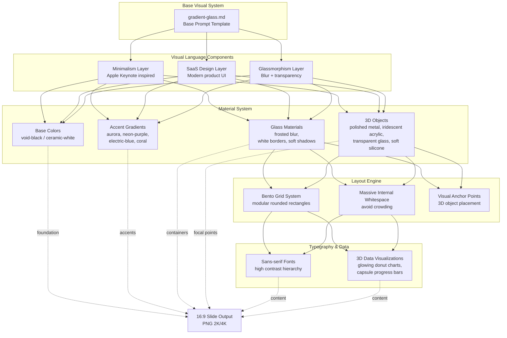
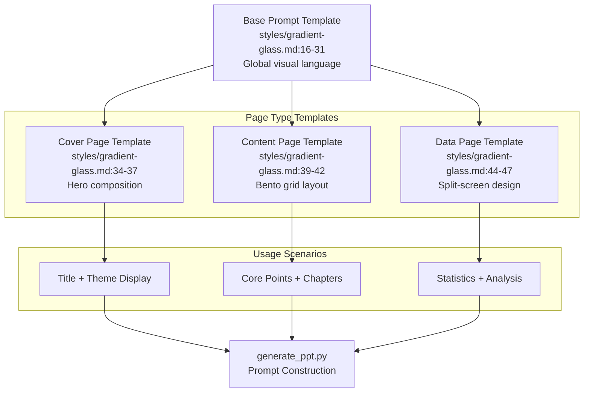
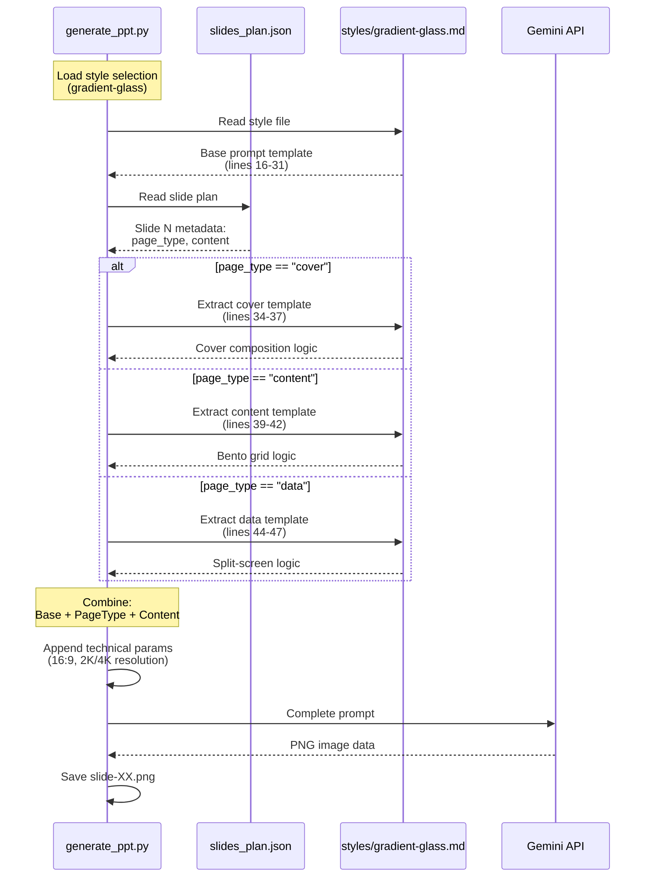
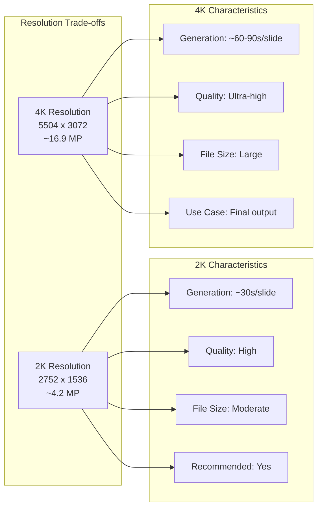

<!-- source: DeepWiki mcp.deepwiki.com · repo op7418/NanoBanana-PPT-Skills · page 6.2 Gradient Glass Style · fetched 2026-10-26 -->

# Gradient Glass Style

<details>
<summary>Relevant source files</summary>

The following files were used as context for generating this wiki page:

- [styles/gradient-glass.md](styles/gradient-glass.md)

</details>


## Purpose and Scope

This page provides a complete technical reference for the **gradient-glass** style, one of two built-in visual themes in the NanoBanana PPT Generator. This style implements a glassmorphism aesthetic combining Apple Keynote minimalism, modern SaaS product design, and glass morphology effects.

**Scope:**
- Visual language and aesthetic principles
- Prompt template structure and components
- Page type specialization (cover, content, data)
- Technical generation parameters
- Integration with the generation pipeline

**Related Pages:**
- For general style system architecture, see [Style System Overview](#6.1)
- For the alternative flat design style, see [Vector Illustration Style](#6.3)
- For creating your own styles, see [Creating Custom Styles](#6.4)
- For how prompts are constructed, see [Prompt Engineering](#5.2)

---

## Style Identity

The gradient-glass style is identified by the style ID `gradient-glass` and is stored in the style definition file at [styles/gradient-glass.md:1-91](). The system loads this file during prompt generation to construct complete AI prompts.

| Property | Value |
|----------|-------|
| **Style ID** | `gradient-glass` |
| **File Path** | `styles/gradient-glass.md` |
| **Display Name** | 渐变拟物玻璃卡片风格 (Gradient Glass Card Style) |
| **Compatible Models** | gemini-3-pro-image-preview, Seedream |
| **Primary Use Cases** | Tech presentations, product demos, business proposals, data reports |

**Sources:** [styles/gradient-glass.md:1-14]()

---

## Visual Language Architecture

### Style Composition Diagram



**Sources:** [styles/gradient-glass.md:16-31]()

### Aesthetic Components

The style's visual language is defined in the base prompt template [styles/gradient-glass.md:16-31]() and consists of three merged design philosophies:

#### 1. **Apple Keynote Minimalism**
- Clean, uncluttered layouts
- Strategic use of whitespace
- High-end, breathable atmosphere

#### 2. **Modern SaaS Product Design**
- Modular component system
- Professional, contemporary aesthetic
- Product-forward visual hierarchy

#### 3. **Glass Morphology (Glassmorphism)**
- Frosted glass blur effects
- Translucent containers with white borders
- Soft shadows for depth perception
- Light transmission and refraction simulation

**Sources:** [styles/gradient-glass.md:18-20]()

---

## Base Prompt Template Structure

### Template Component Breakdown

```mermaid
graph LR
    subgraph "Base Template Structure"
        INTRO["Designer Role Definition<br/>'expert UI/UX presentation designer'"]
        TASK["Generation Task<br/>'16:9 high-fidelity futuristic slide'"]
        COMP["Composition Logic<br/>'auto-select: cover/grid/data viz'"]
    end
    
    subgraph "Global Visual Parameters"
        STYLE["Style Fusion<br/>Keynote + SaaS + Glass"]
        LIGHT["Lighting System<br/>volumetric light,<br/>ray-traced reflections,<br/>ambient occlusion"]
        COLOR["Color Scheme<br/>base: void-black/ceramic-white<br/>accents: aurora gradients"]
    end
    
    subgraph "Content Module Rules"
        LAYOUT["Bento Grid Layout<br/>modular rounded rectangles"]
        CONTAINER["Container Material<br/>frosted glass + blur effect<br/>white borders + soft shadows"]
        OBJECTS["3D Visual Anchors<br/>gift-quality abstract 3D objects<br/>expensive collectible appearance"]
        TYPO["Typography System<br/>clean sans-serif<br/>high contrast hierarchy"]
        DATA["Data Visualization<br/>glowing 3D donuts<br/>capsule progress bars<br/>floating numbers"]
    end
    
    subgraph "Rendering Quality"
        ENGINE["Unreal Engine 5 rendering"]
        RES["8K resolution"]
        DETAIL["ultra-detailed textures"]
        TREND["Dribbble trending,<br/>award-winning design"]
    end
    
    INTRO --> TASK --> COMP
    COMP --> STYLE --> LIGHT --> COLOR
    COLOR --> LAYOUT --> CONTAINER --> OBJECTS --> TYPO --> DATA
    DATA --> ENGINE --> RES --> DETAIL --> TREND
    
    TREND --> FINAL["Complete Base Prompt"]
```



**Sources:** [styles/gradient-glass.md:16-31]()

### Detailed Component Specifications

#### Lighting System [styles/gradient-glass.md:20]()
```
- Cinematic volumetric light (体积光)
- Soft ray-traced reflections (光线追踪反射)
- Ambient occlusion (环境光遮蔽)
```

#### Color Palette [styles/gradient-glass.md:20]()
| Color Category | Specification |
|----------------|---------------|
| **Base Colors** | Deep void-black (虚空黑) or pure ceramic-white (陶瓷白) |
| **Aurora Gradients** | Flowing background and UI highlights |
| **Accent Colors** | Neon purple (霓虹紫), electric blue (电光蓝), soft coral orange (珊瑚橙), cyan (青色) |

#### 3D Object Materials [styles/gradient-glass.md:26]()
| Material Type | Description | Visual Effect |
|---------------|-------------|---------------|
| **Polished Metal** | 抛光金属 | Reflective, premium appearance |
| **Iridescent Acrylic** | 幻彩亚克力 | Rainbow light refraction |
| **Transparent Glass** | 透明玻璃 | Clear with light transmission |
| **Soft Silicone** | 软硅胶 | Matte, organic texture |

#### 3D Object Shapes [styles/gradient-glass.md:26]()
- Floating capsules (悬浮胶囊)
- Spheres (球体)
- Shields (盾牌)
- Möbius strips (莫比乌斯环)
- Fluid waves (流体波浪)

**Sources:** [styles/gradient-glass.md:20-30]()

---

## Page Type Specialization

The gradient-glass style defines three specialized page templates that inherit from the base prompt template. Each page type is optimized for different content structures.

### Page Type Hierarchy Diagram



**Sources:** [styles/gradient-glass.md:32-48]()

### Cover Page Template

**Composition Logic:** [styles/gradient-glass.md:35]()
```
Center: Giant complex 3D glass object
Text: Bold typography overlay
Background: Extending aurora waves
```

**Use Case:** First slide displaying presentation title and theme.

**Example Prompt Construction Pattern:** [styles/gradient-glass.md:52-60]()
```
{Base Prompt Template}

Generate a cover page following visual balance aesthetics. 
Place a giant complex 3D glass object in the center, 
overlay with bold text:

[Title Text]

Background features extending aurora waves.
```

**Sources:** [styles/gradient-glass.md:34-60]()

### Content Page Template

**Composition Logic:** [styles/gradient-glass.md:40]()
```
Layout: Bento grid system
Small Cards: 3D icons
Large Cards: Text content
Container Material: Frosted glass with blur
Borders: Delicate white edges
Shadows: Soft drop shadows
Internal Spacing: Massive whitespace (avoid crowding)
```

**Use Case:** Displaying core viewpoints, bullet points, content chapters.

**Example Prompt Construction Pattern:** [styles/gradient-glass.md:62-69]()
```
{Base Prompt Template}

Generate a content page using Bento grid layout.
Organize the following content in modular rounded 
rectangle containers with frosted glass material:

[Content Text]
```

**Sources:** [styles/gradient-glass.md:39-69]()

### Data Page Template

**Composition Logic:** [styles/gradient-glass.md:45]()
```
Layout: Split-screen design
Left Side: Text typography
Right Side: Floating giant glowing 3D data visualization
Chart Style: Glowing 3D donuts, capsule progress bars, floating numbers
Appearance: Like glowing neon toys
```

**Use Case:** Displaying data, statistics, comparative analysis, summaries.

**Example Prompt Construction Pattern:** [styles/gradient-glass.md:71-78]()
```
{Base Prompt Template}

Generate a data page or summary page using split-screen design.
Left side: Typography for the following text
Right side: Floating giant glowing 3D data visualization chart

[Content Text]
```

**Sources:** [styles/gradient-glass.md:44-78]()

---

## Integration with Generation Pipeline

### Prompt Construction Flow



**Sources:** [styles/gradient-glass.md:1-91]()

### Code Integration Points

The style file is loaded and processed by the generation script. Key integration points:

| Stage | Code Location | Operation |
|-------|---------------|-----------|
| **Style Loading** | `generate_ppt.py` | Reads `styles/gradient-glass.md` file content |
| **Base Template Extraction** | `generate_ppt.py` | Parses lines 16-31 as base prompt |
| **Page Type Selection** | `generate_ppt.py` | Matches slide metadata to templates (lines 34-47) |
| **Prompt Assembly** | `generate_ppt.py` | Concatenates base + page type + content + technical params |
| **API Submission** | `generate_ppt.py` | Sends complete prompt to Gemini API |

**Sources:** [styles/gradient-glass.md:1-91]()

---

## Technical Specifications

### Model Configuration

The gradient-glass style is optimized for specific AI models and generation parameters defined in [styles/gradient-glass.md:80-91]().

#### Nano Banana Pro Configuration [styles/gradient-glass.md:82-86]()

| Parameter | Value |
|-----------|-------|
| **Model** | `gemini-3-pro-image-preview` |
| **Aspect Ratio** | `16:9` (standard presentation format) |
| **Resolution Options** | 2K (2752×1536) or 4K (5504×3072) |
| **Response Mode** | `IMAGE` (PNG output) |

#### Recommended Settings [styles/gradient-glass.md:88-90]()

| Setting | Recommendation | Rationale |
|---------|----------------|-----------|
| **Resolution** | 2K (2752×1536) | Balances quality and generation speed |
| **Generation Time** | ~30 seconds per slide @ 2K | See system benchmarks |
| **Use Cases** | Product demos, tech sharing, creative proposals, data reports | Professional business contexts |

**Sources:** [styles/gradient-glass.md:80-91]()

### Resolution Comparison



**Sources:** [styles/gradient-glass.md:88-90]()

---

## Use Case Guidelines

### Optimal Application Scenarios

The gradient-glass style is specifically designed for contexts requiring a high-end, immersive, modern aesthetic. Based on the style definition [styles/gradient-glass.md:14]() and recommended settings [styles/gradient-glass.md:90](), the style excels in:

| Use Case Category | Specific Scenarios | Why It Works |
|-------------------|-------------------|--------------|
| **Product Presentations** | SaaS product launches, feature announcements | Modern tech aesthetic aligns with digital products |
| **Technical Sharing** | Architecture presentations, technical workshops | Clean data visualization with 3D charts |
| **Creative Proposals** | Design pitches, agency presentations | Glassmorphism conveys creativity and innovation |
| **Data Reports** | Business analytics, quarterly reviews | 3D glowing charts make data engaging |
| **Corporate Events** | Conferences, keynotes, executive presentations | High-end aesthetic projects professionalism |

### Style Selection Criteria

Choose gradient-glass when:
- ✅ Target audience is tech-savvy or design-conscious
- ✅ Content includes data or metrics requiring visualization
- ✅ Brand positioning is modern, innovative, or premium
- ✅ Presentation context is professional/corporate

Consider [Vector Illustration Style](#6.3) instead when:
- ❌ Audience prefers traditional or playful aesthetics
- ❌ Content is educational or creative/artistic
- ❌ Brand positioning is approachable or friendly
- ❌ Presentation context is informal or community-focused

**Sources:** [styles/gradient-glass.md:14, 90]()

---

## Comparison with Vector Illustration Style

The system provides two built-in styles with contrasting aesthetics. Understanding their differences helps users select the appropriate style for their context.

### Style Comparison Matrix

| Dimension | Gradient Glass | Vector Illustration |
|-----------|----------------|---------------------|
| **Aesthetic Philosophy** | Glassmorphism + 3D realism | Flat design + 2D illustration |
| **Visual Complexity** | High (depth, lighting, materials) | Low (simplified, geometric) |
| **Color Approach** | Aurora gradients, neon accents | Retro flat colors, black outlines |
| **Typography Style** | Modern sans-serif, high contrast | Bold, outlined text |
| **Data Visualization** | 3D glowing charts (donuts, capsules) | Flat geometric charts |
| **Target Audience** | Business, tech, corporate | Education, creative, community |
| **Emotional Tone** | Premium, immersive, futuristic | Friendly, approachable, playful |
| **Rendering Complexity** | High (Unreal Engine 5 quality) | Moderate (vector graphics) |
| **Generation Time** | ~30s/slide @ 2K | Similar (~30s/slide @ 2K) |

### Cross-Reference

For complete documentation of the alternative style, see [Vector Illustration Style](#6.3).

**Sources:** [styles/gradient-glass.md:1-91]()

---

## Advanced Customization

While this page documents the built-in gradient-glass style, users can create modified versions or entirely custom styles based on this template.

### Modification Approaches

1. **Color Palette Adjustment**: Modify [styles/gradient-glass.md:20]() to change base and accent colors
2. **Material System**: Alter 3D object materials in [styles/gradient-glass.md:26]()
3. **Layout Engine**: Adjust Bento grid spacing rules in [styles/gradient-glass.md:24]()
4. **Page Type Specialization**: Redefine composition logic for cover/content/data pages

### Creating Custom Variants

To create a custom style based on gradient-glass:

1. Copy `styles/gradient-glass.md` to `styles/custom-style.md`
2. Modify the base prompt template (lines 16-31)
3. Adjust page type templates (lines 34-47) as needed
4. Update technical parameters (lines 82-86) if targeting different models
5. Reference your custom style when running generation

For detailed instructions, see [Creating Custom Styles](#6.4).

**Sources:** [styles/gradient-glass.md:1-91]()

---

## File Structure Reference

The gradient-glass style is entirely contained in a single Markdown file with the following structure:

```
styles/gradient-glass.md
├── Lines 1-14:   Metadata (ID, name, compatible models, description)
├── Lines 16-31:  Base prompt template (global visual language)
├── Lines 34-37:  Cover page template
├── Lines 39-42:  Content page template
├── Lines 44-47:  Data page template
├── Lines 49-78:  Usage examples (cover, content, data generation)
└── Lines 80-91:  Technical parameters (model config, recommendations)
```

This modular structure enables:
- **Base Template Reuse**: Global visual language applies to all page types
- **Page Type Inheritance**: Each page type extends the base template
- **Easy Maintenance**: Style updates propagate automatically
- **Template Inspection**: Users can examine exact prompts sent to AI

**Sources:** [styles/gradient-glass.md:1-91]()

---

