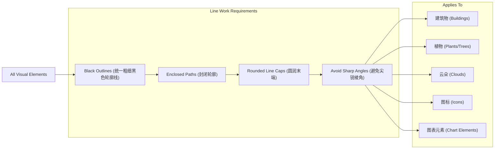
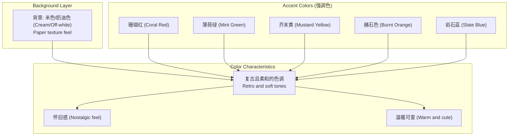
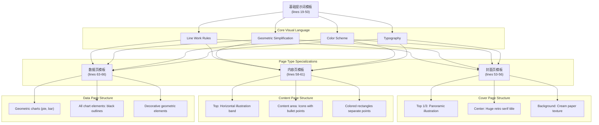
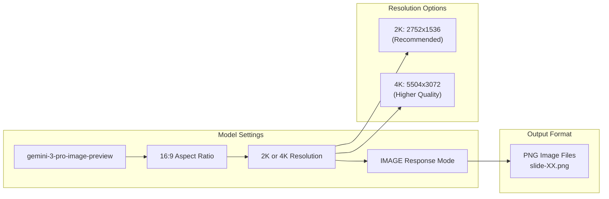
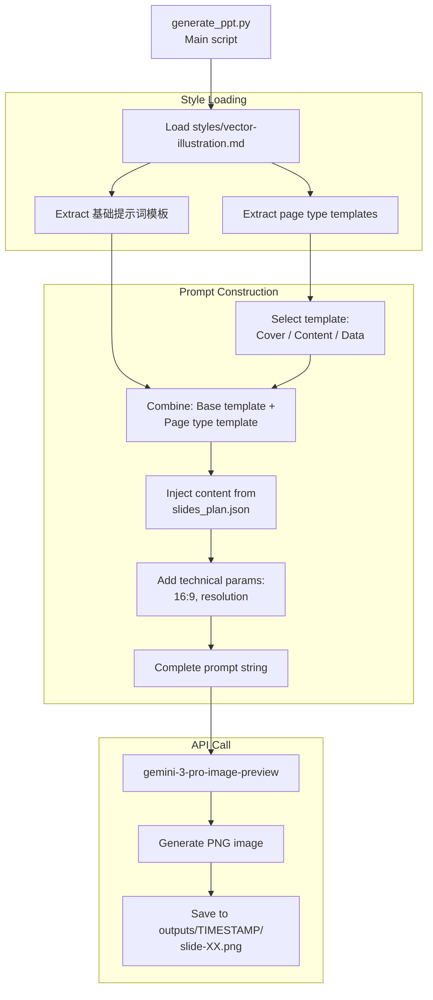
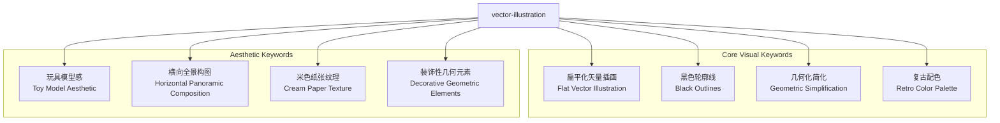

<!-- source: DeepWiki mcp.deepwiki.com · repo op7418/NanoBanana-PPT-Skills · page 6.3 Vector Illustration Style · fetched 2026-10-26 -->

# Vector Illustration Style

Relevant source files

The following files were used as context for generating this wiki page:

- [styles/vector-illustration.md](styles/vector-illustration.md)

## Purpose and Scope

This document provides a complete technical reference for the **vector-illustration** style template used in the NanoBanana PPT Generator. This style implements a flat vector illustration aesthetic with uniform black outlines, retro color palettes, and geometric simplification, optimized for educational content, creative presentations, and brand storytelling.

For information about the alternative glassmorphism style, see [Gradient Glass Style](#6.2). For creating your own style templates, see [Creating Custom Styles](#6.4). For understanding the overall style system architecture, see [Style System Overview](#6.1).

**Sources:** [styles/vector-illustration.md:1-17]()

---

## Style Overview

The `vector-illustration.md` style file defines a flat vector illustration aesthetic characterized by:

| Characteristic | Implementation |
|----------------|----------------|
| **Visual Style** | Flat Vector Illustration with no gradients or 3D rendering |
| **Line Work** | Uniform-thickness black outlines (monoline) on all elements |
| **Geometry** | Simplified geometric shapes (toy-like aesthetic) |
| **Layout** | Panoramic horizontal composition in top 1/3 of slide |
| **Color Palette** | Retro soft tones: coral red, mint green, mustard yellow, burnt orange, slate blue |
| **Background** | Cream/off-white paper texture |
| **Typography** | Retro serif for titles, geometric sans-serif for body text |

This style is optimized for use with the `gemini-3-pro-image-preview` model and supports both 2K (2752x1536) and 4K (5504x3072) resolutions at 16:9 aspect ratio.

**Sources:** [styles/vector-illustration.md:4-17](), [styles/vector-illustration.md:109-120]()

---

## File Structure and Template System

### Template Architecture Diagram

```mermaid
graph TB
    StyleFile["styles/vector-illustration.md"]
    
    subgraph "Metadata Section"
        StyleID["风格ID: vector-illustration"]
        ModelCompat["适配模型: gemini-3-pro-image-preview"]
        Description["风格描述: Flat vector with black outlines"]
    end
    
    subgraph "Base Template Section"
        BasePrompt["基础提示词模板 (lines 19-50)"]
        VisualStyle["视觉风格与美术指导"]
        ColorScheme["配色方案"]
        Typography["字体排版"]
    end
    
    subgraph "Page Type Templates"
        CoverTemplate["封面页模板 (lines 53-56)"]
        ContentTemplate["内容页模板 (lines 58-61)"]
        DataTemplate["数据页模板 (lines 63-66)"]
    end
    
    subgraph "Usage Examples"
        CoverExample["生成封面页 (lines 71-83)"]
        ContentExample["生成内容页 (lines 86-96)"]
        DataExample["生成数据页 (lines 99-107)"]
    end
    
    subgraph "Technical Specs"
        TechParams["技术参数 (lines 109-120)"]
        Keywords["风格关键词 (lines 122-132)"]
    end
    
    StyleFile --> StyleID
    StyleFile --> ModelCompat
    StyleFile --> Description
    
    StyleFile --> BasePrompt
    BasePrompt --> VisualStyle
    BasePrompt --> ColorScheme
    BasePrompt --> Typography
    
    StyleFile --> CoverTemplate
    StyleFile --> ContentTemplate
    StyleFile --> DataTemplate
    
    CoverTemplate --> CoverExample
    ContentTemplate --> ContentExample
    DataTemplate --> DataExample
    
    StyleFile --> TechParams
    StyleFile --> Keywords
```

The `vector-illustration.md` file follows a hierarchical structure where the **基础提示词模板** (Base Prompt Template) defines core visual language, which is then specialized by page type templates. During generation, the system combines these sections to create complete prompts.

**Sources:** [styles/vector-illustration.md:1-132]()

---

## Visual Design Language

### Line Work System

The style enforces a **uniform-thickness black outline system** (monoline) as a fundamental design principle:

This creates a **"coloring book"** aesthetic where every object has a clear boundary, similar to line art meant for coloring.

**Sources:** [styles/vector-illustration.md:29-29]()

### Geometric Simplification

Complex objects are reduced to basic geometric primitives:

| Object Type | Simplified Form | Example Description |
|-------------|-----------------|---------------------|
| Trees | Lollipop shapes or triangles | 棒棒糖形状或三角形 |
| Buildings | Simple rectangular blocks | 简单的矩形块面 |
| Windows | Neat grid of small squares | 整齐的小方格网格 |
| Overall Aesthetic | Toy model cuteness | "玩具模型"般的可爱感 |

The goal is **not photorealism**, but a charming, approachable toy-like quality (玩具模型般的可爱感).

**Sources:** [styles/vector-illustration.md:31-31]()

### Spatial Composition

The style uses a **2.5D perspective system**:

| Aspect | Implementation |
|--------|----------------|
| Viewing Angle | Flat or slight top-down view (平视或稍微俯视) |
| Depth Representation | Layer overlap (图层的前后遮挡) |
| Atmospheric Perspective | **Prohibited** - all layers have consistent clarity |
| Spatial Type | Isometric-like but more flexible (类似等轴测，但更自由) |

This ensures all visual elements remain crisp and clear, regardless of perceived distance from the viewer.

**Sources:** [styles/vector-illustration.md:33-33]()

### Decorative Elements

The style mandates **geometric decorative elements** to balance visual density:

- **Radial lines** (放射状的线条): Represent sunlight or energy
- **Pill-shaped clouds** (药丸形状的云朵): Stylized cloud forms
- **Small dots and stars** (小圆点和星星): Fill negative space
- **Purpose**: Balance visual density in empty areas

**Sources:** [styles/vector-illustration.md:35-35]()

---

## Color Scheme

### Color Palette Definition

The color palette explicitly avoids:
- Gradients (严禁使用渐变色)
- 3D rendering effects (3D渲染效果)
- High-saturation neon colors
- Dark or dramatic tones

**Sources:** [styles/vector-illustration.md:37-41]()

---

## Typography System

The style defines a three-tier typographic hierarchy:

| Typography Level | Chinese Name | Style | Use Case |
|------------------|--------------|-------|----------|
| **Main Title** | 主标题 | Huge bold retro serif (巨大的、加粗的复古衬线体) | Conveys authority and elegance (权威感与优雅感) |
| **Subtitle** | 副标题 | All-caps sans-serif in colored rectangle blocks (矩形色块内的全大写无衬线体) | Section headers |
| **Body Text** | 正文 | Clean geometric sans-serif (几何感无衬线体) | Content, bullet points |

The typographic choices reinforce the retro aesthetic while maintaining clear readability (清晰易读).

**Sources:** [styles/vector-illustration.md:43-49]()

---

## Page Type Templates

### Template Inheritance System

**Sources:** [styles/vector-illustration.md:51-66]()

### Cover Page Template (封面页模板)

**Composition Logic (构图逻辑):**
- **Top 1/3 area**: Horizontal panoramic vector illustration scene with simplified geometric buildings, toy-like trees, and decorative elements
- **Center**: Main title in huge retro serif font
- **Background**: Cream/off-white paper texture

**Use Case (使用场景):** First slide of presentation, displaying title and theme

**Sources:** [styles/vector-illustration.md:53-56]()

### Content Page Template (内容页模板)

**Composition Logic (构图逻辑):**
- **Top area**: Horizontal illustration decoration band (retained from cover style)
- **Content area**: Geometric icons and small vector illustrations accompanying text, all with uniform black outlines
- **Separators**: Colored rectangle blocks separate different bullet points

**Use Case (使用场景):** Displaying core points, key messages, content sections

**Sources:** [styles/vector-illustration.md:58-61]()

### Data Page Template (数据页模板)

**Composition Logic (构图逻辑):**
- **Chart style**: Geometric charts and infographics (simplified pie charts, bar charts)
- **Outlines**: All chart elements have clear black outlines
- **Colors**: Retro soft color palette
- **Balance**: Decorative geometric elements added to balance composition

**Use Case (使用场景):** Displaying data, statistics, comparative analysis, summaries

**Sources:** [styles/vector-illustration.md:63-66]()

---

## Technical Specifications

### Model Configuration

| Parameter | Value | Notes |
|-----------|-------|-------|
| Model | `gemini-3-pro-image-preview` | Nano Banana Pro compatible |
| Aspect Ratio | `16:9` | Standard presentation format |
| Resolution (2K) | `2752x1536` | **Recommended** - balances quality and speed |
| Resolution (4K) | `5504x3072` | Higher quality, slower generation |
| Response Mode | `IMAGE` | Direct PNG output |

**Sources:** [styles/vector-illustration.md:109-119]()

### Recommended Use Cases

The style is optimized for:

| Use Case | Chinese | Why This Style Works |
|----------|---------|----------------------|
| Educational presentations | 教育演示 | Friendly, approachable aesthetic aids comprehension |
| Creative proposals | 创意提案 | Retro style conveys artistic sensibility |
| Children's content | 儿童内容 | Toy-like quality appeals to younger audiences |
| Brand presentations | 品牌展示 | Nostalgic warmth builds emotional connection |

**Key Characteristics (风格特点):**
- Warm and cute (温暖可爱)
- Easy to understand (易于理解)
- Retro nostalgic (复古怀旧)

**Sources:** [styles/vector-illustration.md:118-120]()

---

## Usage Examples and Prompt Construction

### Code Integration Flow

**Sources:** [styles/vector-illustration.md:68-107]()

### Template Variable Substitution

The style file provides three usage examples that demonstrate the template variable substitution pattern:

1. **Cover Page Generation (lines 71-83)**:
   - Substitutes `{基础提示词模板}` with base prompt
   - Replaces `[根据主题选择场景元素]` with theme-specific scene elements
   - Replaces `[标题文本]` and `[副标题文本]` with actual slide content

2. **Content Page Generation (lines 86-96)**:
   - Inherits base template
   - Replaces `[内容文本]` with bullet points
   - Specifies color block usage (coral red, mint green, mustard yellow)

3. **Data Page Generation (lines 99-107)**:
   - Inherits base template
   - Replaces `[内容文本]` with data/statistics
   - Emphasizes decorative element usage

**Sources:** [styles/vector-illustration.md:68-107]()

---

## Style Keywords Reference

The style file concludes with a keyword list (风格关键词) used for classification and search:

These keywords can be used when:
- Searching for the appropriate style for a project
- Documenting style choices in `prompts.json`
- Filtering or categorizing presentations by visual style
- Creating custom styles based on similar principles

**Sources:** [styles/vector-illustration.md:122-132]()

---

## Comparison with Other Styles

| Aspect | vector-illustration | gradient-glass (6.2) |
|--------|---------------------|----------------------|
| **Visual Paradigm** | Flat 2D with outlines | 3D with glassmorphism |
| **Line Work** | Uniform black outlines required | No outlines, blur/transparency |
| **Color Treatment** | Flat fills, no gradients | Extensive gradient use |
| **Aesthetic** | Retro, nostalgic, toy-like | Modern, futuristic, tech |
| **Composition** | Horizontal panoramic band | Bento grid system |
| **Target Use Case** | Education, children, creative | Tech, business, data-heavy |
| **Emotional Tone** | Warm, approachable, friendly | Cool, professional, sophisticated |

Both styles share the same technical specifications (16:9, 2K/4K, gemini-3-pro-image-preview) but produce dramatically different visual outputs suited to different presentation contexts.

For creating styles that blend characteristics from both, see [Creating Custom Styles](#6.4).

---

