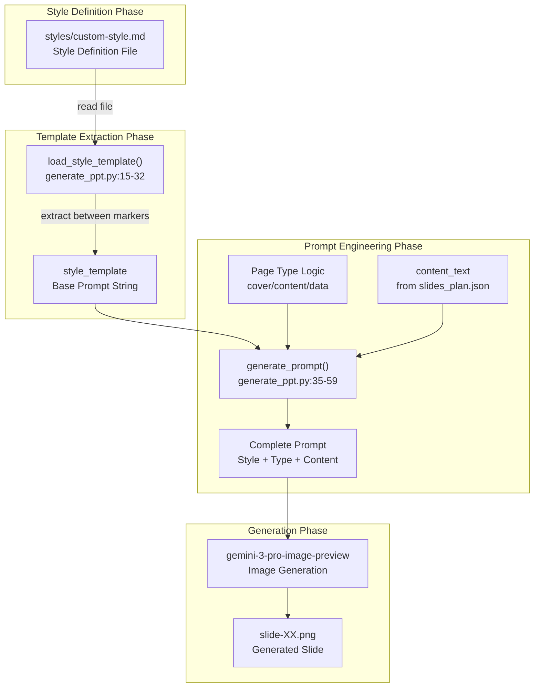
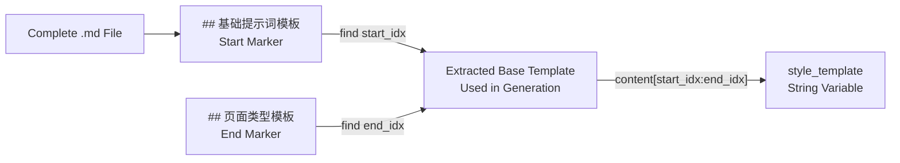
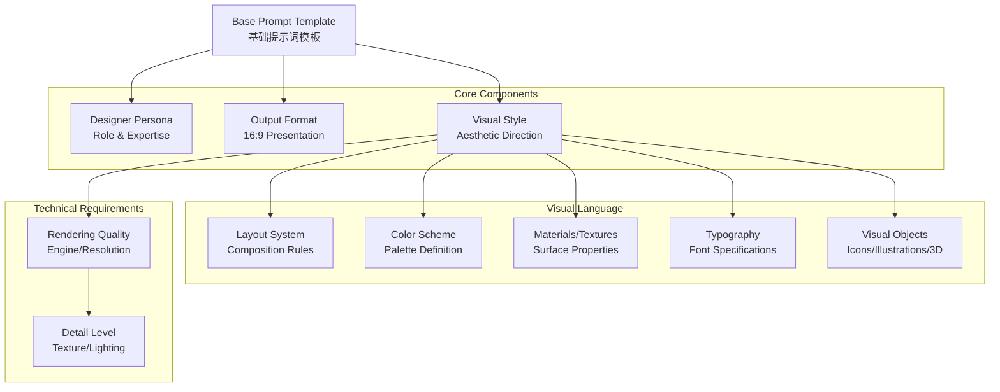
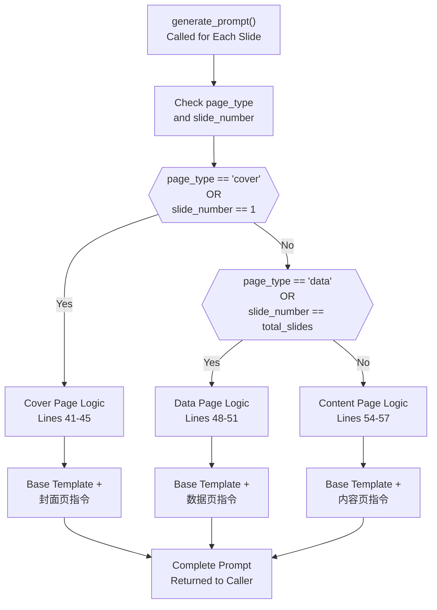
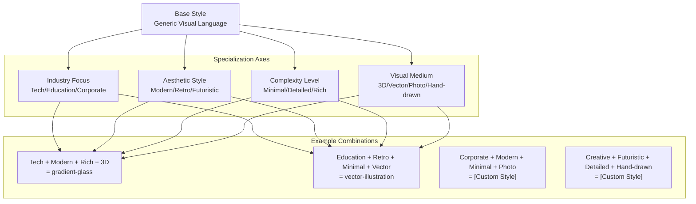
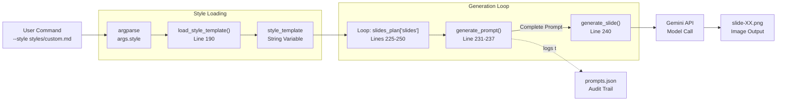

<!-- source: DeepWiki mcp.deepwiki.com · repo op7418/NanoBanana-PPT-Skills · page 6.4 Creating Custom Styles · fetched 2026-10-26 -->

# Creating Custom Styles

<details>
<summary>Relevant source files</summary>

The following files were used as context for generating this wiki page:

- [generate_ppt.py](generate_ppt.py)
- [styles/gradient-glass.md](styles/gradient-glass.md)
- [styles/vector-illustration.md](styles/vector-illustration.md)

</details>


**Purpose**: This guide explains how to create custom style files for the PPT generator. Custom styles allow you to define unique visual aesthetics, layout systems, and design languages beyond the built-in `gradient-glass` and `vector-illustration` styles. For information about using existing styles, see [Style System Overview](#6.1). For complete references to built-in styles, see [Gradient Glass Style](#6.2) and [Vector Illustration Style](#6.3).

---

## Style System Architecture

The style system uses a hierarchical template inheritance pattern where base prompt templates define core aesthetics, which are then specialized by page type logic during prompt generation.

### Style Loading and Application Flow



**Sources**: [generate_ppt.py:15-59]()

---

## Style File Structure

All style files follow a standard Markdown format with specific sections. The parser looks for section markers to extract the base prompt template.

### Required Sections Table

| Section | Purpose | Required | Used By |
|---------|---------|----------|---------|
| `## 风格ID` | Unique identifier for the style | Yes | Documentation only |
| `## 风格名称` | Display name | Yes | Documentation only |
| `## 适配模型` | Compatible AI models | Recommended | Documentation only |
| `## 风格描述` | High-level description | Recommended | Documentation only |
| `## 基础提示词模板` | Core prompt template extracted by code | **CRITICAL** | `load_style_template()` |
| `## 页面类型模板` | Page type documentation | Recommended | Documentation only |
| `## 使用示例` | Usage examples | Recommended | Documentation only |
| `## 技术参数` | Technical specifications | Recommended | Documentation only |

### Critical Section Markers

The `load_style_template()` function uses specific markers to extract the base prompt:



**Code Reference**: [generate_ppt.py:20-32]()

```
start_marker = "## 基础提示词模板"
end_marker = "## 页面类型模板"
```

**Important**: The text between these markers is the only part of the style file that is sent to the AI model. All other sections are for human documentation.

**Sources**: [generate_ppt.py:15-32](), [styles/gradient-glass.md:16-31](), [styles/vector-illustration.md:19-50]()

---

## Base Prompt Template Design

The base prompt template defines the visual language, aesthetic rules, and rendering instructions that apply to all slides in the presentation.

### Template Components

| Component | Description | Example (gradient-glass) | Example (vector-illustration) |
|-----------|-------------|--------------------------|-------------------------------|
| **Designer Persona** | AI role definition | "你是一位专家级UI UX演示设计师" | "你是一位专家级插画设计师" |
| **Visual Style** | Core aesthetic direction | "玻璃拟态风格、Apple Keynote极简主义" | "扁平化矢量插画、黑色轮廓线" |
| **Layout System** | Composition framework | "Bento便当盒网格系统" | "横向全景式构图" |
| **Color Scheme** | Palette specification | "霓虹紫、电光蓝、柔和珊瑚橙" | "珊瑚红、薄荷绿、芥末黄" |
| **Material/Texture** | Surface properties | "磨砂玻璃、抛光金属、幻彩亚克力" | "米色纸张纹理、黑色单线描边" |
| **Typography** | Font specifications | "干净的无衬线字体、高对比度" | "复古衬线体、几何感无衬线体" |
| **Rendering Quality** | Technical requirements | "虚幻引擎5渲染、8k分辨率" | "矢量清晰度、统一线条粗细" |

### Anatomy of a Base Template



**Sources**: [styles/gradient-glass.md:16-31](), [styles/vector-illustration.md:19-50]()

---

## Page Type Logic Integration

The `generate_prompt()` function combines the base template with page-specific instructions based on the slide's position and type.

### Page Type Decision Tree



**Sources**: [generate_ppt.py:35-59]()

### Page Type Prompt Additions

The code appends specific instructions after the base template for each page type:

**Cover Page** [generate_ppt.py:41-45]():
```
请根据视觉平衡美学，生成封面页。在中心放置一个巨大的复杂3D玻璃物体，并覆盖粗体大字：

{content_text}

背景有延伸的极光波浪。
```

**Data Page** [generate_ppt.py:48-51]():
```
请生成数据页或总结页。使用分屏设计，左侧排版以下文字，右侧悬浮巨大的发光3D数据可视化图表：

{content_text}
```

**Content Page** [generate_ppt.py:54-57]():
```
请生成内容页。使用Bento网格布局，将以下内容组织在模块化的圆角矩形容器中，容器材质必须是带有模糊效果的磨砂玻璃：

{content_text}
```

**Note**: These hardcoded instructions are part of `generate_ppt.py`, not the style file. Custom styles inherit this page type logic but can document alternative approaches in their "页面类型模板" section.

**Sources**: [generate_ppt.py:35-59]()

---

## Creating Your First Custom Style

Follow this step-by-step process to create a working custom style.

### Step 1: Create the Style File

Create a new Markdown file in the `styles/` directory:

```bash
styles/my-custom-style.md
```

### Step 2: Define Basic Metadata

```markdown
# 我的自定义风格

## 风格ID
my-custom-style

## 风格名称
My Custom Style

## 适配模型
- Nano Banana Pro (gemini-3-pro-image-preview)

## 风格描述
[Describe your visual style, target use cases, and key characteristics]
```

### Step 3: Write the Base Prompt Template

**This is the critical section**. The text here will be extracted by `load_style_template()` and prepended to all prompts.

```markdown
## 基础提示词模板

你是一位专家级[设计师类型]，请生成高保真的16比9演示文稿幻灯片。

**视觉风格**
[Define your core aesthetic: minimalist, futuristic, hand-drawn, corporate, etc.]

**配色方案**
[Specify your color palette with specific color names or hex values]

**排版系统**
[Describe your layout approach: grid, asymmetric, centered, etc.]

**材质与纹理**
[Define surface properties: flat, glossy, textured, gradient, etc.]

**字体规范**
[Specify font styles: serif, sans-serif, monospace, decorative]

**渲染质量**
[Technical requirements: resolution, detail level, rendering style]
```

### Step 4: Add Page Type Documentation

Document how your style adapts to different page types (for human reference):

```markdown
## 页面类型模板

### 封面页模板
构图逻辑：[Describe layout approach for covers]
使用场景：PPT的第一页，展示标题和主题。

### 内容页模板
构图逻辑：[Describe layout approach for content]
使用场景：展示核心观点、要点、内容章节等。

### 数据页模板
构图逻辑：[Describe layout approach for data visualization]
使用场景：展示数据、统计信息、对比分析、总结等。
```

### Step 5: Add Technical Parameters

```markdown
## 技术参数

### Nano Banana Pro配置
- 模型：gemini-3-pro-image-preview
- 比例：16:9
- 分辨率：2K (2752x1536) 或 4K (5504x3072)
- 响应模式：IMAGE

### 建议设置
- 推荐分辨率：2K（平衡质量和生成速度）
- 适用于：[list your target use cases]
```

**Sources**: [styles/gradient-glass.md:1-91](), [styles/vector-illustration.md:1-132]()

---

## Style File Template Reference

### Complete Minimal Template

```markdown
# [风格名称]

## 风格ID
[unique-identifier]

## 风格名称
[Display Name]

## 适配模型
- Nano Banana Pro (gemini-3-pro-image-preview)

## 风格描述
[Brief description of visual style and use cases]

## 基础提示词模板

你是一位专家级[角色]，请生成高保真的16比9演示文稿幻灯片。

[Your complete base prompt that defines:
- Visual style and aesthetic direction
- Color scheme
- Layout system
- Materials/textures
- Typography
- Rendering quality requirements]

## 页面类型模板

### 封面页模板
构图逻辑：[Cover page approach]
使用场景：PPT的第一页，展示标题和主题。

### 内容页模板
构图逻辑：[Content page approach]
使用场景：展示核心观点、要点、内容章节等。

### 数据页模板
构图逻辑：[Data page approach]
使用场景：展示数据、统计信息、对比分析、总结等。

## 技术参数

### Nano Banana Pro配置
- 模型：gemini-3-pro-image-preview
- 比例：16:9
- 分辨率：2K (2752x1536) 或 4K (5504x3072)
- 响应模式：IMAGE

### 建议设置
- 推荐分辨率：2K
- 适用于：[use cases]
```

**Sources**: [styles/gradient-glass.md](), [styles/vector-illustration.md]()

---

## Testing Custom Styles

### Test Generation Command

Use the `--style` argument to test your custom style:

```bash
python generate_ppt.py \
  --plan slides_plan.json \
  --style styles/my-custom-style.md \
  --resolution 2K \
  --output outputs/test_custom_style
```

**Source**: [generate_ppt.py:157-181]()

### Validation Checklist

| Check | How to Verify | Expected Result |
|-------|---------------|-----------------|
| **File exists** | `ls styles/my-custom-style.md` | File is present |
| **Section markers present** | `grep "## 基础提示词模板" styles/my-custom-style.md` | Line found |
| **Template extraction** | Run with verbose logging | No "无法解析风格模板" warning |
| **Visual consistency** | Generate 5-10 slides | All slides follow same aesthetic |
| **Cover page** | Check slide-01.png | Follows cover layout approach |
| **Content pages** | Check slide-02 to N-1 | Follows content layout approach |
| **Data/Summary page** | Check last slide | Follows data layout approach |
| **Prompt audit** | Check `outputs/*/prompts.json` | Style template appears in all prompts |

### Debugging Template Extraction

If the parser fails to extract your template, you'll see this warning [generate_ppt.py:28]():

```
警告: 无法解析风格模板，使用完整文件内容
```

**Common causes**:
1. Missing `## 基础提示词模板` marker
2. Missing `## 页面类型模板` marker
3. Incorrect Chinese characters (encoding issues)
4. Extra spaces in section markers

**Debug verification**:
```bash
# Check marker presence
grep -n "## 基础提示词模板" styles/my-custom-style.md
grep -n "## 页面类型模板" styles/my-custom-style.md

# Check file encoding
file -I styles/my-custom-style.md
# Should show: charset=utf-8
```

**Sources**: [generate_ppt.py:15-32]()

---

## Advanced Customization

### Prompt Engineering Best Practices

Based on analysis of existing styles:

| Technique | Purpose | Example (gradient-glass) | Example (vector-illustration) |
|-----------|---------|--------------------------|-------------------------------|
| **Role Assignment** | Set AI expectations | "专家级UI UX演示设计师" | "专家级插画设计师" |
| **Constraint Specification** | Limit creative freedom | "容器材质必须是...磨砂玻璃" | "必须包含清晰...黑色轮廓线" |
| **Negative Instructions** | Prevent unwanted elements | "避免拥挤" | "严禁使用渐变色或3D渲染效果" |
| **Metaphorical Language** | Convey aesthetic feel | "看起来像发光的霓虹灯玩具" | "玩具模型般的可爱感" |
| **Technical Anchors** | Ensure quality | "虚幻引擎5渲染，8k分辨率" | "所有图层清晰度一致" |

### Style Specialization Patterns



**Sources**: [styles/gradient-glass.md:13-31](), [styles/vector-illustration.md:16-50]()

### Model-Specific Optimization

The style file's "适配模型" section documents compatible models. Current implementation uses:

```python
model="gemini-3-pro-image-preview"
```
[generate_ppt.py:85]()

If targeting different models:
- **Nano Banana Pro**: Current target, good at complex 3D and glassmorphism
- **Seedream**: (Mentioned in gradient-glass.md) May have different strengths
- **Other models**: Adjust prompt complexity and technical terminology

**Sources**: [generate_ppt.py:84-94](), [styles/gradient-glass.md:10-11]()

---

## Integration with Generation Pipeline

### How Custom Styles Flow Through the System



**Sources**: [generate_ppt.py:144-272]()

### Style Variable Scope

| Variable | Scope | Type | Source | Destination |
|----------|-------|------|--------|-------------|
| `args.style` | `main()` | str | CLI argument | `load_style_template()` |
| `style_template` | `main()` | str | `load_style_template()` | `generate_prompt()` |
| `prompt` | Loop iteration | str | `generate_prompt()` | `generate_slide()` |
| `prompts_data` | `main()` | dict | Accumulated in loop | `save_prompts()` |

**Sources**: [generate_ppt.py:163-254]()

---

## Common Customization Scenarios

### Scenario 1: Corporate Minimalist Style

**Target**: Clean, professional presentations for business contexts

**Key Elements**:
- Neutral color palette (grays, blues, minimal accent colors)
- Abundant whitespace
- Simple geometric shapes
- Professional sans-serif typography
- Photographic imagery or subtle illustrations

**Base Template Approach**:
```markdown
## 基础提示词模板

你是一位专家级企业演示设计师，请生成专业、简洁的16比9演示文稿幻灯片。

**视觉风格**：企业极简主义，强调清晰传达和专业感。避免过度装饰。

**配色方案**：深蓝色(#1a365d)、中灰色(#718096)、浅灰色(#e2e8f0)作为主色，青色(#0891b2)作为强调色。

**排版系统**：左对齐的主标题，使用大量留白分隔内容区块，单栏或两栏布局。

**视觉元素**：使用简单的线条、矩形和圆形，或高质量的企业摄影图片。避免复杂的3D元素。

**字体规范**：现代无衬线字体，如Helvetica或Arial风格，标题加粗，正文字号适中。

**渲染质量**：高清渲染，专业摄影风格，避免卡通或插画风格。
```

### Scenario 2: Hand-Drawn Sketchnote Style

**Target**: Creative, approachable presentations with organic feel

**Key Elements**:
- Hand-drawn lines and shapes
- Sketch-style icons and illustrations
- Handwriting-style fonts
- Organic, imperfect layouts
- Playful annotations (arrows, circles, underlines)

**Base Template Approach**:
```markdown
## 基础提示词模板

你是一位专家级sketchnote艺术家，请生成手绘风格的16比9演示文稿幻灯片。

**视觉风格**：手绘笔记本风格，所有元素看起来像用马克笔和铅笔画在纸上的。线条应该有轻微的不规则和手绘感。

**配色方案**：黑色和深灰色作为主要线条颜色，配合少量高亮色（黄色、粉色、蓝色）用于强调。

**排版系统**：非严格对齐的自由布局，使用手写字体，配合箭头、圆圈、星号等手绘注释元素。

**视觉元素**：简化的图标、人物简笔画、思维气泡、连接线、手绘框架等。所有元素应该有手绘的不完美感。

**材质与纹理**：白色或米色纸张纹理背景，可见轻微的纸张纹理。

**字体规范**：手写体风格，大小写混用，略微倾斜，不完全规整。

**渲染质量**：模拟马克笔和铅笔的真实绘画效果，保持手工感。
```

### Scenario 3: Data-Driven Infographic Style

**Target**: Heavy data presentations with emphasis on charts and visualizations

**Key Elements**:
- Large, clear data visualizations
- Color-coded categories
- Minimal text, maximum visual information
- Grid-based layouts for comparison
- Icon systems for categories

**Base Template Approach**:
```markdown
## 基础提示词模板

你是一位专家级信息图表设计师，请生成数据驱动的16比9演示文稿幻灯片。

**视觉风格**：现代信息图表风格，强调数据可视化的清晰度和美观性。

**配色方案**：使用5色系统进行分类：主蓝色(#3b82f6)、绿色(#10b981)、橙色(#f59e0b)、紫色(#8b5cf6)、红色(#ef4444)。背景使用浅灰色(#f3f4f6)。

**排版系统**：网格化布局，为图表预留最大空间。文字简洁，使用标签和数字而非长段落。

**图表类型**：柱状图、饼图、折线图、热力图、流程图等，所有图表使用圆角设计和柔和阴影。

**视觉元素**：数据点使用清晰的圆形标记，图例明确，坐标轴标签清晰。使用简化的图标表示类别。

**字体规范**：现代无衬线字体，数字使用等宽字体确保对齐，标签使用较小字号。

**渲染质量**：高清渲染，确保小字号文字清晰可读，图表线条锐利。
```

**Sources**: [styles/gradient-glass.md](), [styles/vector-illustration.md]()

---

## Style File Maintenance

### Version Control Best Practices

Custom style files should be committed to the repository:

```bash
git add styles/my-custom-style.md
git commit -m "Add custom style for [use case]"
```

**Recommended file naming**:
- Use lowercase and hyphens: `corporate-minimal.md`
- Avoid spaces and special characters
- Be descriptive: `tech-presentation-dark.md` vs `style1.md`

### Documentation Standards

Each custom style should include:

1. **Clear use case description** - When to use this style
2. **Example scenarios** - Specific presentation types
3. **Compatibility notes** - Any model-specific considerations
4. **Version history** (optional) - Track significant changes

### Sharing Custom Styles

To share a custom style:

1. Ensure the style file is self-contained
2. Test with multiple content types
3. Document any unusual requirements
4. Provide example outputs (screenshots)
5. Include recommended resolution settings

**Sources**: [styles/gradient-glass.md](), [styles/vector-illustration.md]()

---

## Troubleshooting Custom Styles

### Issue: Style Not Being Applied

**Symptoms**: Generated slides don't match expected aesthetic

**Diagnosis**:
1. Check `outputs/*/prompts.json` to see actual prompts sent to API
2. Verify base template was extracted correctly
3. Confirm no parser warnings in console output

**Solutions**:
- Verify section markers are exact: `## 基础提示词模板` and `## 页面类型模板`
- Check file encoding is UTF-8: `file -I styles/my-style.md`
- Ensure sufficient detail in base template (AI needs clear direction)

### Issue: Inconsistent Results Across Slides

**Symptoms**: Slides have different visual styles

**Diagnosis**:
- Base template may be too vague or allow too much creative freedom
- Page type logic may be overriding style in unexpected ways

**Solutions**:
- Add more constraints and "must" statements to base template
- Use negative instructions: "避免...", "严禁..."
- Reference specific examples: "类似于..." or "看起来像..."

### Issue: Poor Generation Quality

**Symptoms**: Images are low quality, blurry, or don't match prompt

**Diagnosis**:
- Resolution setting may be too high for API limitations
- Prompt may be too complex for model to execute
- Technical requirements may conflict with style description

**Solutions**:
- Test at 2K resolution first before trying 4K [generate_ppt.py:169-172]()
- Simplify base template - remove conflicting requirements
- Align technical specifications with model capabilities

**Sources**: [generate_ppt.py:15-32](), [generate_ppt.py:62-109]()

---

## Reference: Style File Checklist

Use this checklist when creating or reviewing custom styles:

- [ ] File created in `styles/` directory with `.md` extension
- [ ] File name uses lowercase and hyphens (e.g., `my-custom-style.md`)
- [ ] File encoding is UTF-8
- [ ] Includes `## 风格ID` section with unique identifier
- [ ] Includes `## 风格名称` section with display name
- [ ] Includes `## 基础提示词模板` section (CRITICAL)
- [ ] Includes `## 页面类型模板` section (to close extraction)
- [ ] Base template defines: role, visual style, colors, layout, materials, typography
- [ ] Base template includes rendering quality requirements
- [ ] Includes `## 技术参数` section with model configuration
- [ ] Tested with sample content at 2K resolution
- [ ] Visual consistency verified across multiple slides
- [ ] Prompts audited in `prompts.json` output
- [ ] Documentation includes use cases and examples

**Sources**: [styles/gradient-glass.md](), [styles/vector-illustration.md](), [generate_ppt.py:15-32]()

---

