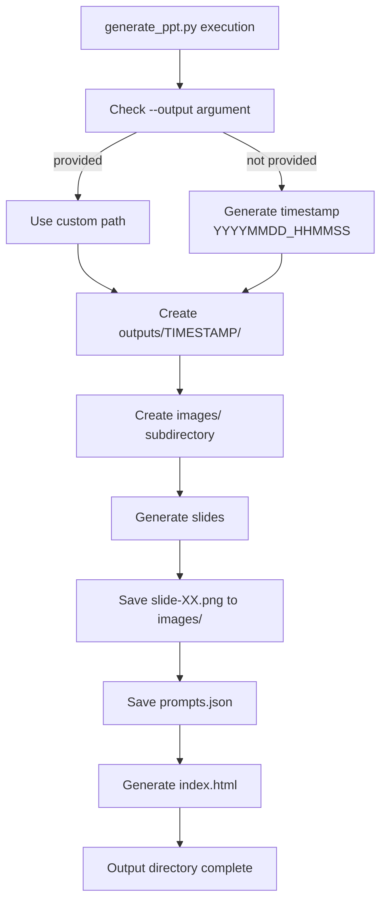
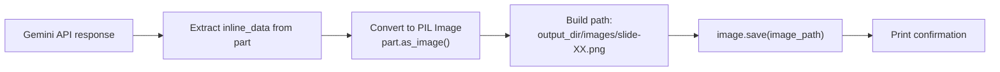
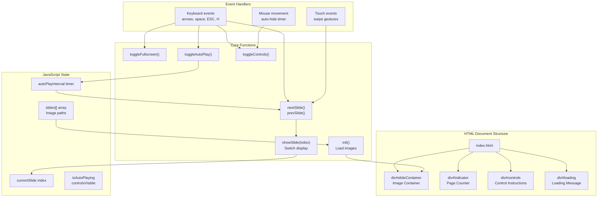
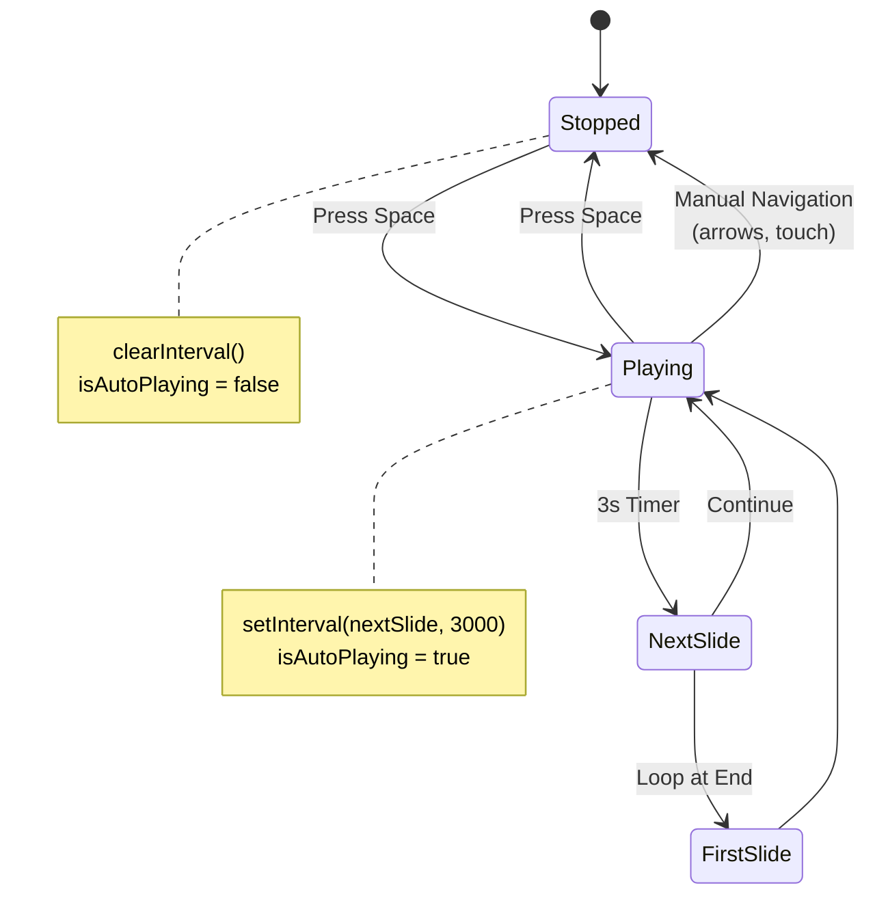
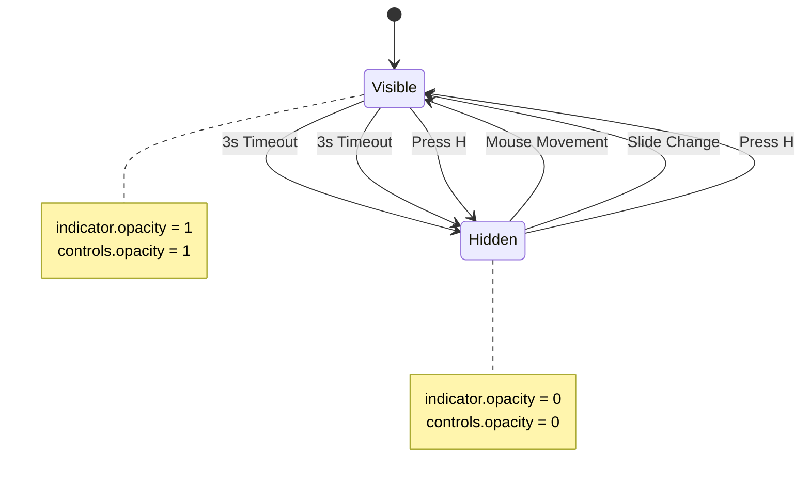
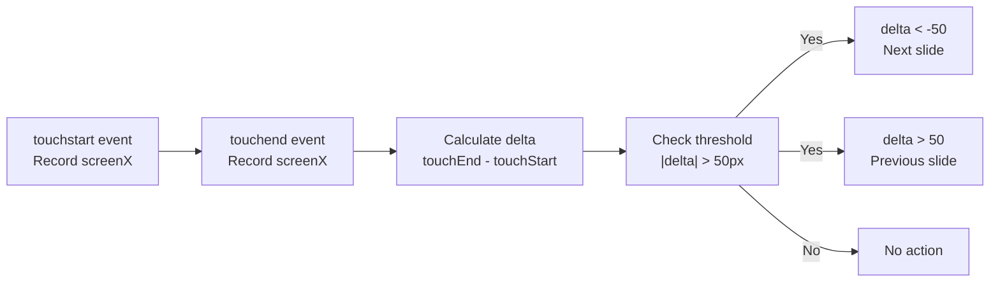
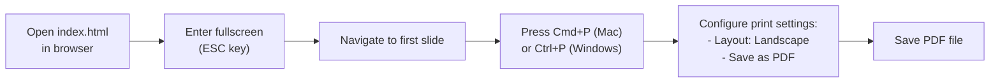

<!-- source: DeepWiki mcp.deepwiki.com · repo op7418/NanoBanana-PPT-Skills · page 7 Output & Viewing · fetched 2026-10-26 -->

# Output & Viewing

<details>
<summary>Relevant source files</summary>

The following files were used as context for generating this wiki page:

- [QUICKSTART.md](QUICKSTART.md)
- [generate_ppt.py](generate_ppt.py)
- [templates/viewer.html](templates/viewer.html)

</details>


This document covers the output phase of the PPT generation system: the files that are generated, how they are organized, the interactive HTML viewer system, and options for exporting and sharing presentations.

For information about the generation pipeline that produces these outputs, see [Generation Pipeline](#5). For details on the style system that defines visual appearance, see [Style System](#6).

---

## Purpose and Scope

After the generation pipeline completes, the system produces a timestamped output directory containing PNG slide images, an interactive HTML viewer, and audit trail metadata. This document explains:

- The structure and contents of generated output directories
- How the HTML viewer system works (keyboard controls, autoplay, fullscreen)
- Methods for exporting presentations to PDF or other formats
- File organization and naming conventions

---

## Output Directory Structure

### Directory Organization

When the generation process completes, all outputs are organized in a timestamped directory under `outputs/`:

```
outputs/
└── TIMESTAMP/
    ├── images/
    │   ├── slide-01.png
    │   ├── slide-02.png
    │   ├── slide-03.png
    │   └── ...
    ├── index.html
    └── prompts.json
```

**Output Directory Creation Flow**



Sources: [generate_ppt.py:192-199]()

### Timestamp Format

The default output directory uses the format `YYYYMMDD_HHMMSS` (e.g., `20240115_143027`), ensuring unique directory names for each generation run. This prevents accidental overwrites and maintains a history of all generated presentations.

Sources: [generate_ppt.py:196]()

### Custom Output Paths

Users can specify a custom output directory using the `--output` argument:

```bash
python generate_ppt.py --plan plan.json --style style.md --output outputs/my-presentation
```

Sources: [generate_ppt.py:173-176](), [generate_ppt.py:193-197]()

---

## Generated Files

### Slide Images (slide-XX.png)

**File Naming Convention**: `slide-01.png`, `slide-02.png`, ..., `slide-N.png`

Each slide is saved as a PNG image with zero-padded numbering (two digits minimum). Images are stored in the `images/` subdirectory.

**Image Specifications**:
- **Format**: PNG with transparency support
- **Aspect Ratio**: 16:9 (standard presentation format)
- **Resolution Options**:
  - 2K: ~2560×1440 pixels (~2MB per file)
  - 4K: ~3840×2160 pixels (~8MB per file)

**Image Saving Logic**:



Sources: [generate_ppt.py:96-102]()

### Interactive Viewer (index.html)

The `index.html` file is a standalone, self-contained HTML viewer that provides an interactive presentation experience. It requires no external dependencies or internet connection.

**Generation Process**:

The viewer is generated by:
1. Reading the template from `templates/viewer.html`
2. Generating a JavaScript array of image paths
3. Replacing the `/* IMAGE_LIST_PLACEHOLDER */` in the template
4. Writing the complete HTML to `index.html`

Sources: [generate_ppt.py:112-133](), [templates/viewer.html:105]()

### Audit Trail (prompts.json)

The `prompts.json` file contains a complete audit trail of the generation process, including all prompts sent to the API and metadata about each slide.

**Structure**:

```json
{
  "metadata": {
    "title": "Presentation Title",
    "total_slides": 5,
    "resolution": "2K",
    "style": "styles/gradient-glass.md",
    "generated_at": "2024-01-15T14:30:27.123456"
  },
  "slides": [
    {
      "slide_number": 1,
      "page_type": "cover",
      "content": "Main Title and Content",
      "prompt": "Full prompt sent to API...",
      "image_path": "outputs/20240115_143027/images/slide-01.png"
    }
  ]
}
```

This file is useful for:
- **Debugging**: Review exact prompts that generated each slide
- **Iteration**: Copy and modify prompts for regeneration
- **Auditing**: Track what was generated and when
- **Documentation**: Understand the content structure

Sources: [generate_ppt.py:136-142](), [generate_ppt.py:212-249]()

---

## HTML Viewer System

### Viewer Architecture

**Component Structure**



Sources: [templates/viewer.html:1-336]()

### Keyboard Controls

The viewer provides comprehensive keyboard navigation:

| Key | Function | Code Reference |
|-----|----------|----------------|
| `←` (Left Arrow) | Previous slide, stops autoplay | [templates/viewer.html:255-258]() |
| `→` (Right Arrow) | Next slide, stops autoplay | [templates/viewer.html:259-262]() |
| `↑` (Up Arrow) / `Home` | Jump to first slide | [templates/viewer.html:263-267]() |
| `↓` (Down Arrow) / `End` | Jump to last slide | [templates/viewer.html:268-272]() |
| `ESC` (Escape) | Toggle fullscreen mode | [templates/viewer.html:273-275]() |
| `Space` | Toggle autoplay (pause/resume) | [templates/viewer.html:276-279]() |
| `H` | Toggle control visibility | [templates/viewer.html:280-283]() |

Sources: [templates/viewer.html:253-285](), [templates/viewer.html:98]()

### Autoplay Functionality

**Autoplay State Machine**



**Implementation Details**:
- Autoplay advances slides every 3 seconds
- Loops back to first slide when reaching the end
- Automatically stops when user manually navigates
- Toggle state persists until changed

Sources: [templates/viewer.html:194-220](), [templates/viewer.html:206-208]()

### Control Visibility

The viewer implements auto-hiding controls to provide a distraction-free viewing experience:

**Control Visibility State Machine**



**Auto-Hide Behavior**:
- Controls show initially for 3 seconds on page load
- Controls appear when slides change
- Controls appear on mouse movement
- Controls hide after 3 seconds of inactivity
- Manual toggle available with `H` key

Sources: [templates/viewer.html:137-140](), [templates/viewer.html:228-250](), [templates/viewer.html:287-301]()

### Mobile Touch Support

The viewer includes gesture support for mobile devices:

**Swipe Detection Logic**



**Gesture Mapping**:
- Swipe left (→): Next slide
- Swipe right (←): Previous slide
- Minimum swipe distance: 50 pixels

Sources: [templates/viewer.html:303-330]()

### Fullscreen Mode

The viewer uses the standard Fullscreen API for immersive presentation:

```javascript
// Toggle logic
if (document.fullscreenElement) {
    document.exitFullscreen();
} else {
    document.documentElement.requestFullscreen();
}
```

Activated by pressing `ESC` key. Works across all modern browsers.

Sources: [templates/viewer.html:186-192]()

---

## Viewing Generated Presentations

### Opening the Viewer

After generation completes, the system prints instructions:

```
生成完成！
输出目录: outputs/20240115_143027
播放网页: outputs/20240115_143027/index.html

打开播放网页查看PPT:
  open outputs/20240115_143027/index.html
```

**Methods to Open**:

1. **Command Line** (macOS):
   ```bash
   open outputs/20240115_143027/index.html
   ```

2. **Command Line** (Linux):
   ```bash
   xdg-open outputs/20240115_143027/index.html
   ```

3. **Command Line** (Windows):
   ```bash
   start outputs/20240115_143027/index.html
   ```

4. **File Browser**: Double-click `index.html` to open in default browser

Sources: [generate_ppt.py:260-268](), [QUICKSTART.md:52-62]()

### Browser Compatibility

The viewer is built with standard web technologies and works in all modern browsers:

- **Chrome/Edge**: Full support (recommended)
- **Firefox**: Full support
- **Safari**: Full support
- **Mobile Browsers**: Touch gestures supported

No external dependencies, JavaScript libraries, or internet connection required.

Sources: [templates/viewer.html:1-6]()

---

## Exporting and Sharing

### PDF Export

The most common export method is converting the HTML viewer to PDF using the browser's print function:

**Export Process**:



**Print Settings**:
- **Destination**: Save as PDF
- **Layout**: Landscape
- **Margins**: None
- **Background Graphics**: Enabled (to preserve styling)

Sources: [QUICKSTART.md:202-208]()

### Sharing Individual Slides

Individual slide images can be shared directly from the `images/` directory:

```
outputs/20240115_143027/images/
├── slide-01.png  ← Share as standalone image
├── slide-02.png  ← Embed in documents
└── slide-03.png  ← Post on social media
```

**Use Cases**:
- Social media posts
- Email attachments
- Document embedding
- Website graphics

### Importing to PowerPoint/Keynote

To use generated slides in traditional presentation software:

1. **PowerPoint**:
   - Create new presentation with 16:9 aspect ratio
   - Insert → Pictures → select slide-XX.png files
   - Position images to fill the slide

2. **Keynote**:
   - Create new presentation with 16:9 aspect ratio
   - Drag slide-XX.png files into slide thumbnails
   - Images automatically fill slides

3. **Google Slides**:
   - Create new presentation
   - Insert → Image → Upload from computer
   - Select slide-XX.png files

### Directory Archiving

The self-contained nature of output directories makes them easy to archive and share:

```bash
# Create archive
tar -czf presentation-20240115.tar.gz outputs/20240115_143027/

# Or ZIP format
zip -r presentation-20240115.zip outputs/20240115_143027/
```

Recipients can extract and open `index.html` directly without any setup.

---

## Output File Reference

### Complete Output Manifest

**File Structure and Purpose Table**

| File Path | Type | Purpose | Size Range |
|-----------|------|---------|------------|
| `index.html` | HTML | Interactive viewer | ~10KB |
| `prompts.json` | JSON | Audit trail and metadata | ~2-50KB |
| `images/slide-01.png` | PNG | Cover slide image | 2-8MB |
| `images/slide-02.png` | PNG | Content slide image | 2-8MB |
| `images/slide-NN.png` | PNG | Additional slide images | 2-8MB |

### File Size Estimates

**Size by Resolution and Page Count**

| Pages | 2K Resolution | 4K Resolution |
|-------|---------------|---------------|
| 5 | ~10-15 MB | ~40-50 MB |
| 10 | ~20-30 MB | ~80-100 MB |
| 15 | ~30-45 MB | ~120-150 MB |
| 25 | ~50-75 MB | ~200-250 MB |

Sources: [QUICKSTART.md:98-103]()

### Metadata in prompts.json

The `prompts.json` file includes generation metadata:

**Metadata Fields**:
- `title`: Presentation title from slides_plan.json
- `total_slides`: Number of generated slides
- `resolution`: "2K" or "4K"
- `style`: Path to style template used
- `generated_at`: ISO 8601 timestamp

**Per-Slide Fields**:
- `slide_number`: Sequential slide number
- `page_type`: "cover", "content", or "data"
- `content`: Text content for the slide
- `prompt`: Complete prompt sent to API
- `image_path`: Absolute path to saved image

Sources: [generate_ppt.py:212-249]()

---

## Summary

The output system produces three key artifacts:

1. **PNG Images**: High-resolution slide images in 16:9 format (2K or 4K)
2. **HTML Viewer**: Self-contained interactive presentation with keyboard/touch controls
3. **Audit Trail**: Complete record of prompts and generation metadata

The HTML viewer provides a modern presentation experience with autoplay, fullscreen mode, and mobile gesture support. Presentations can be exported to PDF via browser print function or individual slides can be used in traditional presentation software.

All outputs are organized in timestamped directories under `outputs/`, making them easy to archive, share, and version control.

---

