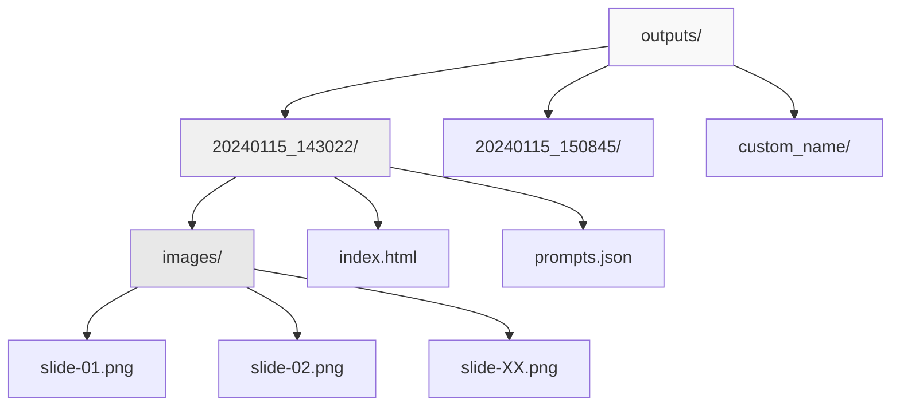
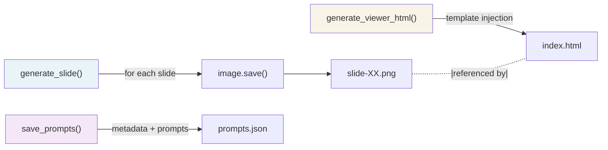
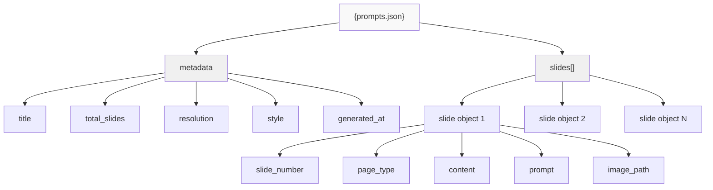
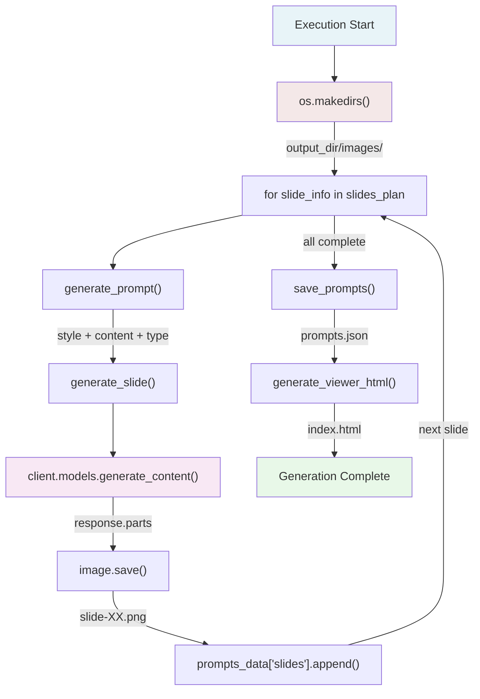

<!-- source: DeepWiki mcp.deepwiki.com · repo op7418/NanoBanana-PPT-Skills · page 7.1 Generated Outputs · fetched 2026-10-26 -->

# Generated Outputs

<details>
<summary>Relevant source files</summary>

The following files were used as context for generating this wiki page:

- [QUICKSTART.md](QUICKSTART.md)
- [SETUP_COMPLETE.md](SETUP_COMPLETE.md)
- [generate_ppt.py](generate_ppt.py)

</details>


## Purpose and Scope

This page documents the files and directory structure generated by the PPT Generator system. It covers the output artifacts created during the generation process, their formats, organization, and specifications.

For information about how outputs are displayed and interacted with, see [HTML Viewer](#7.2). For exporting and sharing generated presentations, see [Exporting & Sharing](#7.3).

**Sources:** Table of contents analysis, high-level system diagrams

---

## Output Directory Structure

The system creates a timestamped directory under `outputs/` for each generation run. This organization ensures that multiple generations never overwrite each other and provides a clear audit trail.

### Directory Creation Pattern

```
outputs/
└── YYYYMMDD_HHMMSS/
    ├── images/
    │   ├── slide-01.png
    │   ├── slide-02.png
    │   └── slide-XX.png
    ├── index.html
    └── prompts.json
```

The timestamp format is `YYYYMMDD_HHMMSS` (year, month, day, hour, minute, second), generated at [generate_ppt.py:196]().

### Directory Structure Diagram



**Sources:** [generate_ppt.py:193-199](), [QUICKSTART.md:56]()

---

## Generated Files

Each generation run produces exactly three types of outputs: image files, an HTML viewer, and a JSON audit log.

### File Generation Flow



**Sources:** [generate_ppt.py:62-110](), [generate_ppt.py:112-133](), [generate_ppt.py:136-141]()

---

## File Specifications

### Slide Images (`slide-XX.png`)

Individual PNG image files for each slide in the presentation.

| Property | Specification | Code Reference |
|----------|--------------|----------------|
| **Naming Pattern** | `slide-{number:02d}.png` | [generate_ppt.py:99]() |
| **Location** | `{output_dir}/images/` | [generate_ppt.py:99]() |
| **Numbering** | 01, 02, 03, ... (zero-padded) | [generate_ppt.py:99]() |
| **Format** | PNG | [generate_ppt.py:98]() |
| **Aspect Ratio** | 16:9 | [generate_ppt.py:90]() |
| **Resolution (2K)** | 2752×1536 pixels (~2MB/file) | [QUICKSTART.md:100]() |
| **Resolution (4K)** | 5504×3072 pixels (~8MB/file) | [QUICKSTART.md:102]() |

#### Generation Process

Images are generated via the Gemini API and saved using PIL's `Image.save()` method:

```python
# From generate_ppt.py:85-101
response = client.models.generate_content(
    model="gemini-3-pro-image-preview",
    contents=prompt,
    config=types.GenerateContentConfig(
        response_modalities=['IMAGE'],
        image_config=types.ImageConfig(
            aspect_ratio="16:9",
            image_size=resolution  # "2K" or "4K"
        )
    )
)

for part in response.parts:
    if part.inline_data is not None:
        image = part.as_image()
        image_path = os.path.join(output_dir, "images", f"slide-{slide_number:02d}.png")
        image.save(image_path)
```

**Sources:** [generate_ppt.py:62-110](), [QUICKSTART.md:98-103]()

---

### HTML Viewer (`index.html`)

An interactive web-based presentation viewer generated from a template.

| Property | Specification | Code Reference |
|----------|--------------|----------------|
| **Filename** | `index.html` | [generate_ppt.py:128]() |
| **Location** | `{output_dir}/` | [generate_ppt.py:128]() |
| **Template Source** | `templates/viewer.html` | [generate_ppt.py:179]() |
| **Image References** | Relative paths to `images/slide-XX.png` | [generate_ppt.py:119]() |

#### Template Injection Mechanism

The viewer is generated by reading a template and replacing a placeholder with slide paths:

```python
# From generate_ppt.py:112-133
def generate_viewer_html(output_dir, slide_count, template_path):
    # Read template
    with open(template_path, 'r', encoding='utf-8') as f:
        html_template = f.read()
    
    # Generate image list
    slides_list = [f"'images/slide-{i:02d}.png'" for i in range(1, slide_count + 1)]
    
    # Replace placeholder
    html_content = html_template.replace(
        "/* IMAGE_LIST_PLACEHOLDER */",
        ",\n            ".join(slides_list)
    )
    
    # Save HTML
    html_path = os.path.join(output_dir, "index.html")
    with open(html_path, 'w', encoding='utf-8') as f:
        f.write(html_content)
```

The template contains a placeholder `/* IMAGE_LIST_PLACEHOLDER */` that is replaced with a JavaScript array of image paths.

**Sources:** [generate_ppt.py:112-133](), [generate_ppt.py:177-180]()

---

### Audit Log (`prompts.json`)

A JSON file containing complete metadata, prompts, and generation details for debugging and iteration.

| Property | Specification | Code Reference |
|----------|--------------|----------------|
| **Filename** | `prompts.json` | [generate_ppt.py:138]() |
| **Location** | `{output_dir}/` | [generate_ppt.py:138]() |
| **Encoding** | UTF-8, no ASCII escaping | [generate_ppt.py:140]() |
| **Formatting** | Indented (2 spaces) | [generate_ppt.py:140]() |

#### JSON Structure



#### Complete Structure Specification

The `prompts.json` file contains two top-level keys:

**Metadata Object:**
```json
{
  "metadata": {
    "title": "Presentation Title",
    "total_slides": 5,
    "resolution": "2K",
    "style": "styles/gradient-glass.md",
    "generated_at": "2024-01-15T14:30:22.123456"
  }
}
```

Generated at [generate_ppt.py:212-220]().

**Slides Array:**
```json
{
  "slides": [
    {
      "slide_number": 1,
      "page_type": "cover",
      "content": "Slide text content...",
      "prompt": "Complete prompt sent to API...",
      "image_path": "outputs/20240115_143022/images/slide-01.png"
    }
  ]
}
```

Each slide entry is appended at [generate_ppt.py:243-249]().

**Sources:** [generate_ppt.py:136-141](), [generate_ppt.py:212-249]()

---

## Output Creation Code Flow

The following diagram maps the natural language workflow to specific code functions:



**Sources:** [generate_ppt.py:144-269]()

---

## Storage Considerations

### Disk Usage Estimation

| Presentation Size | Resolution | Total Disk Usage |
|------------------|------------|------------------|
| 5 slides | 2K | ~10 MB |
| 10 slides | 2K | ~20 MB |
| 15 slides | 2K | ~30 MB |
| 25 slides | 2K | ~50 MB |
| 5 slides | 4K | ~40 MB |
| 10 slides | 4K | ~80 MB |
| 15 slides | 4K | ~120 MB |
| 25 slides | 4K | ~200 MB |

*Note: `index.html` (~50KB) and `prompts.json` (~10-50KB) are negligible.*

### File Size Breakdown

Each output directory contains:

1. **Images**: `N × file_size_per_resolution`
   - 2K: ~2 MB per slide
   - 4K: ~8 MB per slide

2. **HTML Viewer**: ~50 KB (includes embedded CSS/JS)

3. **Prompts JSON**: ~2-10 KB per slide (depends on prompt length)

**Sources:** [QUICKSTART.md:98-103]()

---

## Custom Output Locations

While the default behavior creates timestamped directories, users can specify custom output paths:

```bash
# Default: outputs/YYYYMMDD_HHMMSS/
python generate_ppt.py --plan plan.json --style style.md

# Custom: outputs/my-presentation/
python generate_ppt.py --plan plan.json --style style.md --output outputs/my-presentation
```

The `--output` argument is processed at [generate_ppt.py:193-197]():

```python
if args.output:
    output_dir = args.output
else:
    timestamp = datetime.now().strftime("%Y%m%d_%H%M%S")
    output_dir = f"outputs/{timestamp}"
```

**Sources:** [generate_ppt.py:173-176](), [generate_ppt.py:193-197]()

---

## Output Verification

### Success Indicators

After generation completes, verify outputs by checking:

1. **Image count matches**: `ls outputs/TIMESTAMP/images/*.png | wc -l` should equal slide count
2. **HTML exists**: `outputs/TIMESTAMP/index.html` is present
3. **JSON exists**: `outputs/TIMESTAMP/prompts.json` is present
4. **No error slides**: Confirm all `image_path` values in `prompts.json` are non-null

### Console Output

The generation script prints detailed progress at [generate_ppt.py:201-268]():

```
============================================================
PPT生成器启动
============================================================
风格: styles/gradient-glass.md
分辨率: 2K
页数: 5
输出目录: outputs/20240115_143022
============================================================

正在生成第 1 页...
✓ 第 1 页已保存: outputs/20240115_143022/images/slide-01.png

...

✓ 提示词已保存: outputs/20240115_143022/prompts.json
✓ 播放网页已生成: outputs/20240115_143022/index.html

============================================================
生成完成！
============================================================
输出目录: outputs/20240115_143022
播放网页: outputs/20240115_143022/index.html
```

**Sources:** [generate_ppt.py:201-268]()

---

## Related Pages

- For viewing generated outputs interactively, see [HTML Viewer](#7.2)
- For exporting to PDF or other formats, see [Exporting & Sharing](#7.3)
- For understanding the generation process that creates these outputs, see [Image Generation](#5.3)
- For troubleshooting output issues, see [Troubleshooting](#8.3)

---

