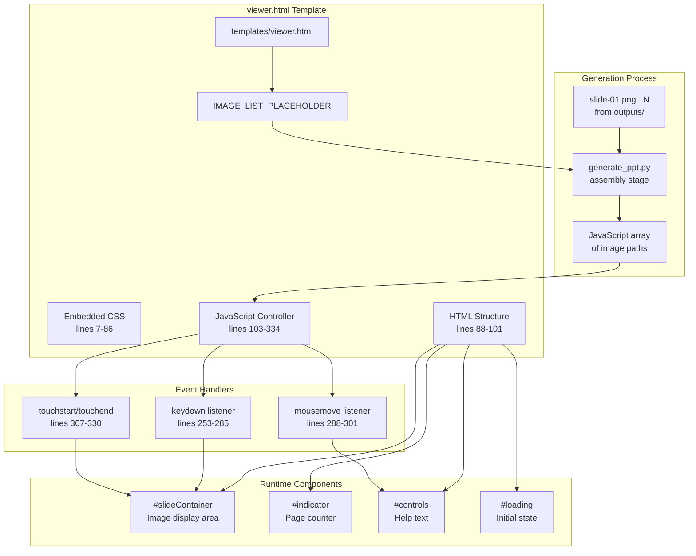
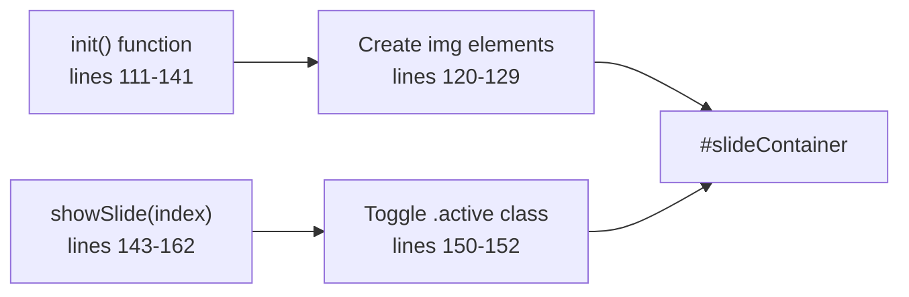
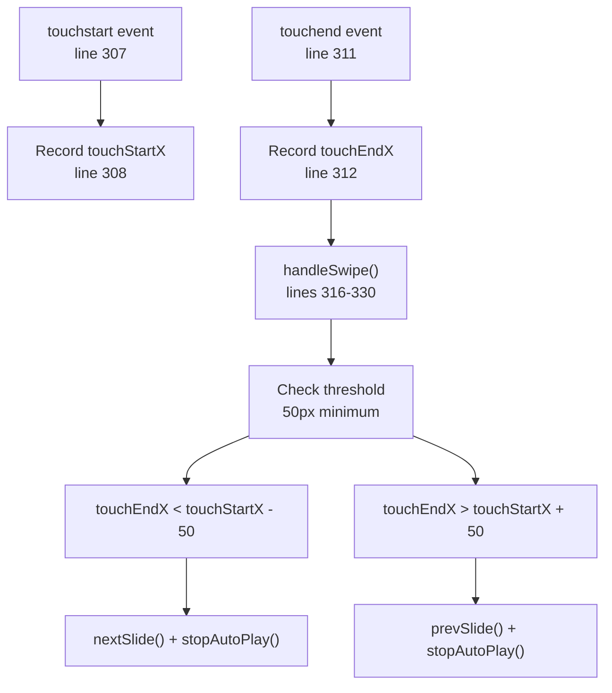
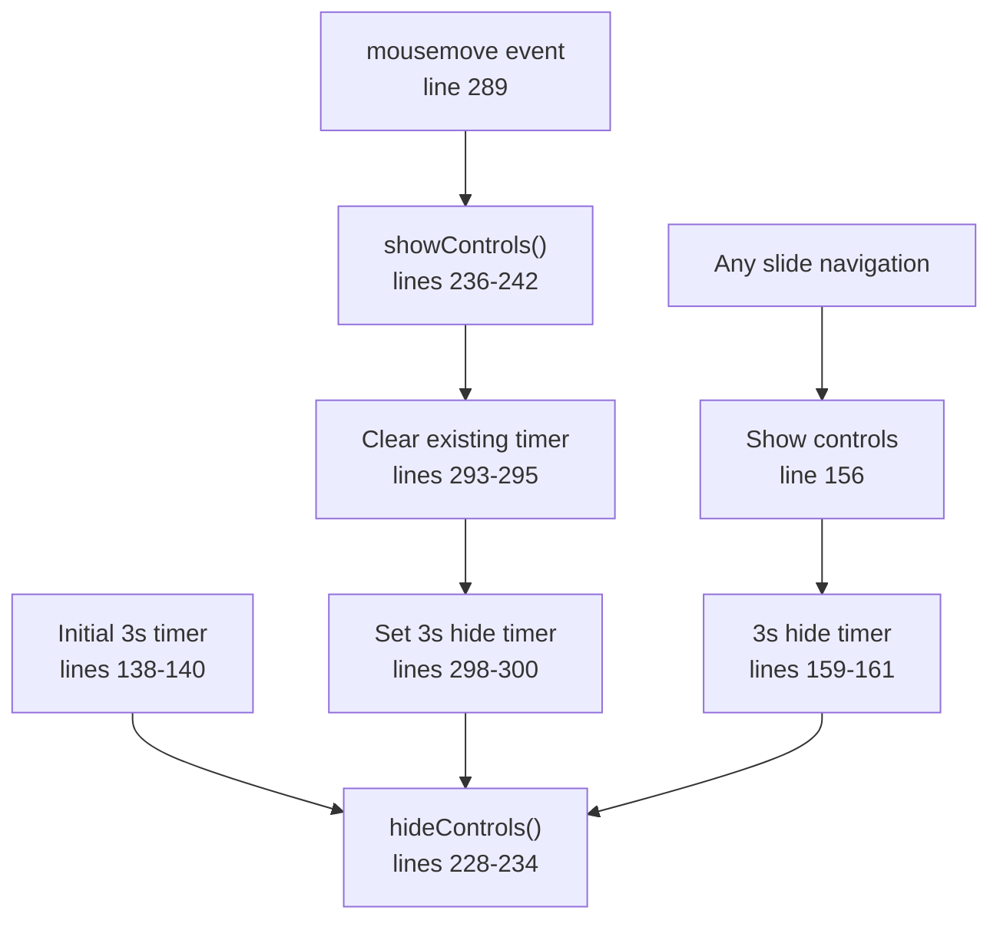
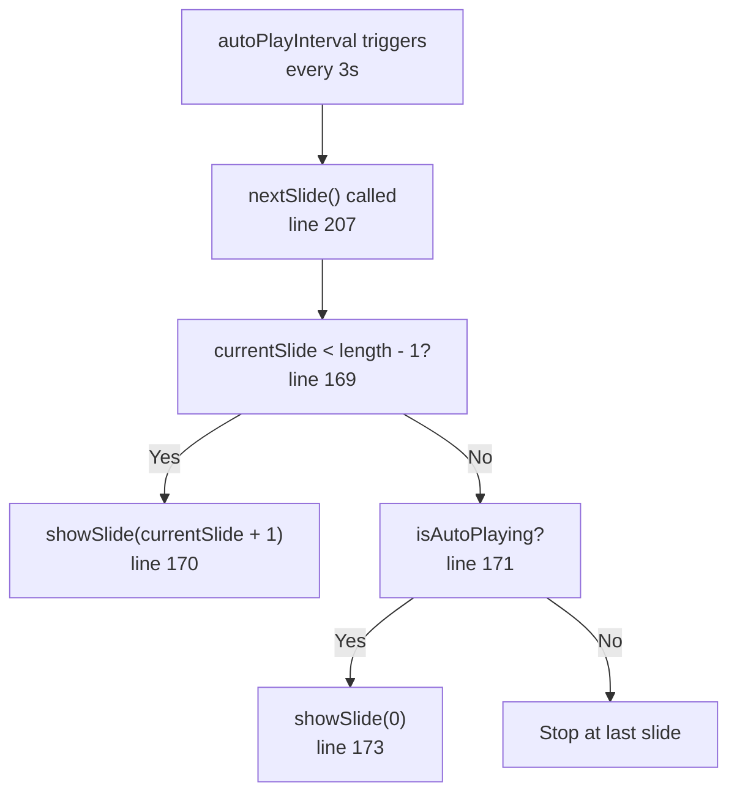
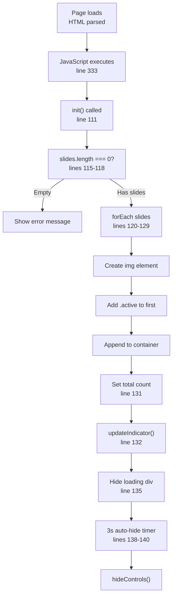
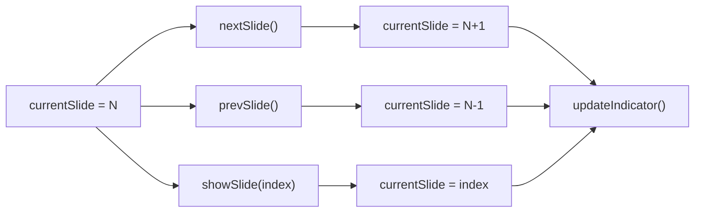
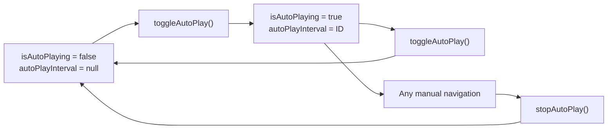

<!-- source: DeepWiki mcp.deepwiki.com · repo op7418/NanoBanana-PPT-Skills · page 7.2 HTML Viewer · fetched 2026-10-26 -->

# HTML Viewer

<details>
<summary>Relevant source files</summary>

The following files were used as context for generating this wiki page:

- [QUICKSTART.md](QUICKSTART.md)
- [README.md](README.md)
- [templates/viewer.html](templates/viewer.html)

</details>


This page documents the interactive HTML viewer system that displays generated presentation slides. The viewer is a single-file HTML application that provides keyboard navigation, autoplay, fullscreen mode, and touch gesture support.

For information about the files generated alongside the viewer, see [Generated Outputs](#7.1). For exporting presentations to other formats, see [Exporting & Sharing](#7.3).

---

## Overview

The HTML viewer is generated from the template at [templates/viewer.html:1-336]() and written to `outputs/TIMESTAMP/index.html` during the output assembly stage. It embeds all slide images as inline references and provides a presentation interface with zero external dependencies.

**Core Capabilities:**
- Full keyboard navigation with arrow keys, Home, End, Escape
- Touch gesture support for mobile devices (swipe left/right)
- Autoplay mode with 3-second intervals
- Auto-hiding controls after 3 seconds of inactivity
- Fullscreen toggle
- Page indicator (current/total)
- Looping behavior during autoplay

The viewer is a self-contained static HTML file that can be opened directly in any modern web browser without requiring a web server.

**Sources:** [templates/viewer.html:1-336](), [README.md:322-333](), [QUICKSTART.md:58-61]()

---

## Architecture

### HTML Viewer Component Structure



**Sources:** [templates/viewer.html:1-336]()

---

## Template Injection System

The viewer template uses a placeholder-based injection system to embed slide images.

### Placeholder Replacement

The template contains a JavaScript placeholder at [templates/viewer.html:105]():

```javascript
const slides = [/* IMAGE_LIST_PLACEHOLDER */];
```

During the assembly stage, `generate_ppt.py` replaces `/* IMAGE_LIST_PLACEHOLDER */` with a JavaScript array of relative image paths:

```javascript
const slides = ["slide-01.png", "slide-02.png", "slide-03.png", ...];
```

This approach keeps the viewer as a single self-contained HTML file without requiring external JavaScript files or server-side processing.

**Sources:** [templates/viewer.html:105]()

---

## Display System

### Slide Container Structure

The viewer uses a container-based display system where all slides are loaded as `` elements, but only one is visible at a time.

**Container Definition:**
[templates/viewer.html:20-27]() - Fixed viewport container with flexbox centering
[templates/viewer.html:29-38]() - Slide image styling with `object-fit: contain`

**Active Slide Management:**
- All slides have class `slide` (hidden by default via `display: none`)
- Active slide additionally has class `active` (displayed via `display: block`)
- Switching slides toggles the `active` class between elements



**Image Creation Logic:**
[templates/viewer.html:120-129]() iterates over the `slides` array, creating an `` element for each with:
- `src` set to the image path
- `className` set to `'slide'` (plus `' active'` for index 0)
- Error handler logging failed image loads

**Sources:** [templates/viewer.html:20-38](), [templates/viewer.html:111-141](), [templates/viewer.html:143-162]()

---

## Control Systems

### Keyboard Navigation

The viewer implements comprehensive keyboard controls through a single `keydown` event listener at [templates/viewer.html:253-285]().

| Key | Handler Function | Behavior | Auto-stop | Line Reference |
|-----|-----------------|----------|-----------|----------------|
| `←` (ArrowLeft) | `prevSlide()` | Previous slide | Yes | [255-258]() |
| `→` (ArrowRight) | `nextSlide()` | Next slide | Yes | [259-262]() |
| `↑` (ArrowUp) | `showSlide(0)` | Jump to first | Yes | [263-267]() |
| `↓` (ArrowDown) | `showSlide(length-1)` | Jump to last | Yes | [268-272]() |
| `Home` | `showSlide(0)` | Jump to first | Yes | [263-267]() |
| `End` | `showSlide(length-1)` | Jump to last | Yes | [268-272]() |
| `Escape` | `toggleFullscreen()` | Toggle fullscreen | No | [273-275]() |
| `Space` | `toggleAutoPlay()` | Pause/resume autoplay | No | [276-279]() |
| `H`/`h` | `toggleControls()` | Hide/show controls | No | [280-283]() |

**Navigation Functions:**
- [templates/viewer.html:168-175]() - `nextSlide()`: Advances or loops in autoplay mode
- [templates/viewer.html:177-184]() - `prevSlide()`: Goes back or loops in autoplay mode
- [templates/viewer.html:143-162]() - `showSlide(index)`: Core display switcher with bounds checking

All manual navigation actions (arrow keys, Home, End) call `stopAutoPlay()` to prevent conflicting automated movement.

**Sources:** [templates/viewer.html:253-285](), [templates/viewer.html:168-184](), [templates/viewer.html:143-162]()

---

### Touch Gesture Support

Mobile device support is implemented through touch event handlers at [templates/viewer.html:303-330]().

**Swipe Detection System:**



**Swipe Threshold:**
The minimum swipe distance is 50 pixels ([templates/viewer.html:317]()), preventing accidental navigation from taps or small movements.

**Sources:** [templates/viewer.html:303-330]()

---

### Auto-Hide Behavior

The viewer implements intelligent control visibility that automatically hides UI elements after periods of inactivity.

**Control Elements:**
- [templates/viewer.html:59-75]() - `.indicator`: Page counter (top-right)
- [templates/viewer.html:41-57]() - `.controls`: Help text (bottom-center)

Both elements have an `.hidden` class that sets `opacity: 0` while maintaining layout space.

**Auto-Hide Logic:**



**Trigger Conditions:**
1. **Initial Load:** Controls shown for 3 seconds ([templates/viewer.html:138-140]())
2. **Mouse Movement:** Controls shown, reset 3-second timer ([templates/viewer.html:288-301]())
3. **Slide Navigation:** Controls shown for 3 seconds ([templates/viewer.html:156-161]())
4. **Manual Toggle:** Press `H` to toggle visibility state ([templates/viewer.html:280-283]())

**Sources:** [templates/viewer.html:41-75](), [templates/viewer.html:138-140](), [templates/viewer.html:156-161](), [templates/viewer.html:228-242](), [templates/viewer.html:288-301]()

---

## Autoplay System

The autoplay feature automatically advances slides at fixed intervals with looping behavior.

### Autoplay State Management

**State Variables:**
- `isAutoPlaying` (boolean): Current autoplay state ([templates/viewer.html:108]())
- `autoPlayInterval` (timer ID): Interval handle for cleanup ([templates/viewer.html:107]())

**Control Functions:**

| Function | Purpose | Line Reference |
|----------|---------|----------------|
| `toggleAutoPlay()` | Toggle between playing/paused | [194-200]() |
| `startAutoPlay()` | Begin 3-second intervals | [202-211]() |
| `stopAutoPlay()` | Clear interval and reset state | [213-220]() |
| `updateControlsText()` | Update help text to show state | [222-226]() |

**Interval Timing:**
The autoplay interval is set to 3000ms (3 seconds) at [templates/viewer.html:208]().

### Looping Behavior



**Looping Logic:**
- Manual navigation stops at bounds ([templates/viewer.html:177-184]())
- Autoplay mode loops: last slide → first slide ([templates/viewer.html:171-173]())

**UI Feedback:**
The controls text updates to show "暂停" (pause) or "继续" (continue) based on state ([templates/viewer.html:222-226]()).

**Sources:** [templates/viewer.html:107-108](), [templates/viewer.html:194-220](), [templates/viewer.html:168-175](), [templates/viewer.html:222-226]()

---

## Fullscreen Mode

Fullscreen functionality uses the browser's native Fullscreen API.

**Toggle Function:**
[templates/viewer.html:186-192]() - `toggleFullscreen()`

**Implementation:**
```javascript
if (document.fullscreenElement) {
    document.exitFullscreen();
} else {
    document.documentElement.requestFullscreen();
}
```

**Trigger:**
- Press `Escape` key ([templates/viewer.html:273-275]())

The Fullscreen API applies to `document.documentElement` (the entire page), providing an immersive presentation experience without browser chrome.

**Browser Support:**
The API is supported in all modern browsers (Chrome, Firefox, Safari, Edge). No fallback is provided as the viewer remains functional in windowed mode.

**Sources:** [templates/viewer.html:186-192](), [templates/viewer.html:273-275]()

---

## Styling System

The viewer uses embedded CSS for zero-dependency styling.

### Layout Architecture

**Container System:**
[templates/viewer.html:20-27]() - Full viewport container with flexbox centering:
- `width: 100vw; height: 100vh` - Fill entire viewport
- `display: flex; justify-content: center; align-items: center` - Center content
- `position: relative` - Establish positioning context

**Image Fitting:**
[templates/viewer.html:29-38]() - Slides use `object-fit: contain` to:
- Preserve aspect ratio (16:9)
- Fit within viewport without cropping
- Maintain image quality

### Visual Design

**Background:**
[templates/viewer.html:14-18]() - Solid black background (`#000`) with `overflow: hidden` to prevent scrollbars

**Control Styling:**
- Glassmorphic effect: `rgba(0, 0, 0, 0.7)` background with `backdrop-filter: blur(10px)` ([templates/viewer.html:45-46](), [templates/viewer.html:63-64]())
- Rounded corners: `border-radius: 25px` (controls) and `20px` (indicator)
- White text on dark background for maximum contrast
- Smooth opacity transitions: `transition: opacity 0.3s ease` ([templates/viewer.html:52](), [templates/viewer.html:70]())

**Font System:**
[templates/viewer.html:17]() - System font stack for native appearance:
```css
-apple-system, BlinkMacSystemFont, "Segoe UI", Roboto, "Helvetica Neue", Arial, sans-serif
```

**Sources:** [templates/viewer.html:7-86]()

---

## Initialization Flow

### Startup Sequence



**Error Handling:**
[templates/viewer.html:115-118]() - If no slides are injected, displays "未找到幻灯片图片" (No slide images found)

[templates/viewer.html:125-127]() - Each image has an `onerror` handler that logs failed loads to console

**Sources:** [templates/viewer.html:111-141](), [templates/viewer.html:333]()

---

## State Management

The viewer maintains minimal global state for UI coordination.

### State Variables

| Variable | Type | Purpose | Initial Value | Line Reference |
|----------|------|---------|---------------|----------------|
| `slides` | Array<string> | Image file paths | Injected | [105]() |
| `currentSlide` | number | Active slide index | 0 | [106]() |
| `autoPlayInterval` | timer/null | Autoplay interval ID | null | [107]() |
| `isAutoPlaying` | boolean | Autoplay active flag | false | [108]() |
| `controlsVisible` | boolean | Control visibility flag | true | [109]() |
| `touchStartX` | number | Touch start X coordinate | 0 | [304]() |
| `touchEndX` | number | Touch end X coordinate | 0 | [305]() |
| `mouseTimer` | timer/null | Mouse hide timer ID | null | [288]() |

### State Transitions

**Navigation State:**


**Autoplay State:**


**Sources:** [templates/viewer.html:105-109](), [templates/viewer.html:288](), [templates/viewer.html:304-305]()

---

## Usage in Generated Output

### Output Assembly Process

When `generate_ppt.py` completes image generation, it:

1. Reads the template from [templates/viewer.html:1-336]()
2. Builds a JavaScript array of slide filenames: `["slide-01.png", "slide-02.png", ...]`
3. Replaces `/* IMAGE_LIST_PLACEHOLDER */` with the array
4. Writes the modified HTML to `outputs/TIMESTAMP/index.html`

**File Organization:**
```
outputs/TIMESTAMP/
├── index.html           # Generated viewer with injected slides
├── slide-01.png         # Relative path referenced in viewer
├── slide-02.png
├── slide-03.png
└── ...
```

All image paths in the viewer are relative, allowing the entire output directory to be moved or shared without breaking references.

**Sources:** [templates/viewer.html:105](), [README.md:269-274]()

---

## Browser Compatibility

The viewer uses standard web APIs supported by all modern browsers:

| Feature | API | Browser Support |
|---------|-----|-----------------|
| Display | Flexbox, object-fit | Chrome 29+, Firefox 22+, Safari 9+ |
| Events | KeyboardEvent, TouchEvent | All modern browsers |
| Fullscreen | Fullscreen API | Chrome 15+, Firefox 10+, Safari 5.1+ |
| Visual Effects | backdrop-filter | Chrome 76+, Firefox 103+, Safari 9+ |

**Graceful Degradation:**
- `backdrop-filter` is a visual enhancement; the viewer remains functional without it
- Touch events are additive; keyboard/mouse work on all devices
- Fullscreen API failure is silent; presentation continues in windowed mode

**Testing Recommendation:**
The viewer has been tested on:
- macOS: Safari, Chrome, Firefox
- Windows: Chrome, Edge, Firefox
- iOS: Safari
- Android: Chrome

**Sources:** [templates/viewer.html:14-86]()

---

## Keyboard Reference

Complete keyboard shortcut reference for users:

### Navigation Keys

| Key(s) | Function | Description |
|--------|----------|-------------|
| `→` `↓` | Next | Advance to next slide, stop autoplay |
| `←` `↑` | Previous | Return to previous slide, stop autoplay |
| `Home` | First | Jump to first slide, stop autoplay |
| `End` | Last | Jump to last slide, stop autoplay |

### Control Keys

| Key | Function | Description |
|-----|----------|-------------|
| `Escape` | Fullscreen | Toggle fullscreen mode |
| `Space` | Autoplay | Start/stop automatic slideshow (3s intervals) |
| `H` | Toggle UI | Hide/show controls and page indicator |

**Conflict Handling:**
Manual navigation (arrow keys, Home, End) always stops autoplay to prevent jarring automated movements during user control.

**Sources:** [templates/viewer.html:253-285](), [README.md:322-333](), [QUICKSTART.md:58-61]()

---

## Mobile Gestures

Touch gesture support for mobile and tablet devices:

### Swipe Gestures

| Gesture | Function | Threshold |
|---------|----------|-----------|
| Swipe Left | Next slide | 50px minimum |
| Swipe Right | Previous slide | 50px minimum |

**Implementation Details:**
- Swipes automatically stop autoplay (same as keyboard navigation)
- Threshold prevents accidental navigation from taps
- Works on any touch-enabled device (phones, tablets, touch laptops)

**Touch Event Flow:**
1. `touchstart` - Record starting X coordinate
2. `touchend` - Record ending X coordinate
3. Calculate delta and compare to threshold
4. Trigger navigation if threshold exceeded

**Sources:** [templates/viewer.html:303-330]()

---

## Performance Characteristics

### Image Loading

**Preloading Strategy:**
All images are loaded immediately on page load ([templates/viewer.html:120-129]()), not lazily. This ensures:
- Smooth transitions (no loading delays between slides)
- Predictable memory usage
- No network requests during presentation

**Memory Footprint:**
For a typical 10-slide presentation at 2K resolution:
- ~2.5MB per slide = ~25MB total
- Images remain in browser cache
- DOM contains 10 `` elements (minimal overhead)

### Rendering Performance

**CSS Optimizations:**
- `display` toggle (not `visibility` or position changes) for instant switching
- `object-fit: contain` leverages GPU acceleration
- Fixed container dimensions prevent layout recalculation

**Event Handler Efficiency:**
- Single keyboard listener for all keys
- Debounced mouse movement with timer cleanup
- Touch event listeners only fire on actual touches

**Sources:** [templates/viewer.html:120-129](), [templates/viewer.html:29-38]()

---

## Accessibility Considerations

### Current Implementation

**Supported:**
- Keyboard-only navigation (no mouse required)
- Alt text on images: `"幻灯片 N"` ([templates/viewer.html:124]())
- Semantic HTML structure
- High contrast text (white on dark background)

**Not Implemented:**
- Screen reader announcements (no ARIA live regions)
- Focus indicators on controls
- Keyboard focus management
- Skip navigation links

The viewer prioritizes visual presentation over comprehensive accessibility. For accessibility-compliant presentations, consider exporting to PDF and providing alternative text descriptions separately.

**Sources:** [templates/viewer.html:124]()

---

## Debugging and Troubleshooting

### Common Issues

**Slides Not Appearing:**
1. Check browser console for image load errors ([templates/viewer.html:125-127]())
2. Verify `slides` array is populated (check Network tab)
3. Ensure image paths are correct relative to `index.html`

**Controls Not Responding:**
1. Verify keyboard events are not captured by browser extensions
2. Check if page has focus (click on page first)
3. Test in incognito mode to rule out extension conflicts

**Autoplay Not Working:**
1. Press Space to toggle (may be in stopped state)
2. Check console for JavaScript errors
3. Verify browser allows autoplay (some browsers restrict it)

**Performance Issues:**
1. Large 4K presentations may slow older devices
2. Close other browser tabs to free memory
3. Consider regenerating at 2K resolution

**Sources:** [templates/viewer.html:125-127]()

---

