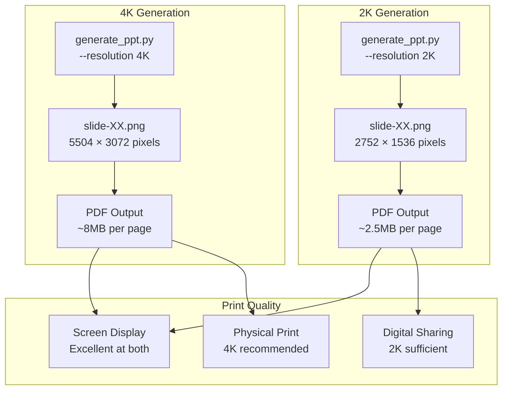
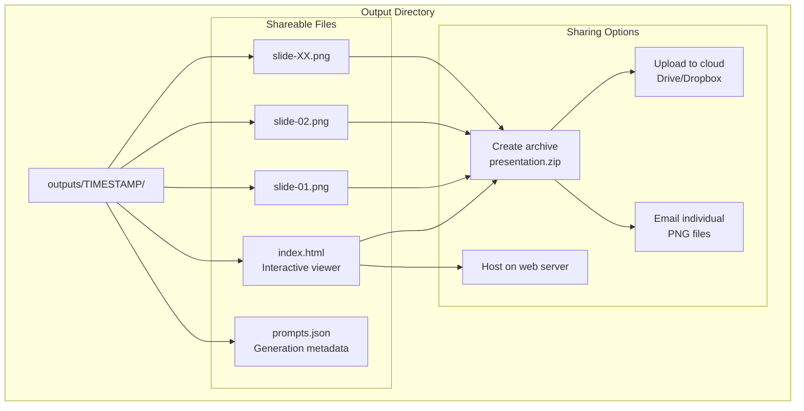
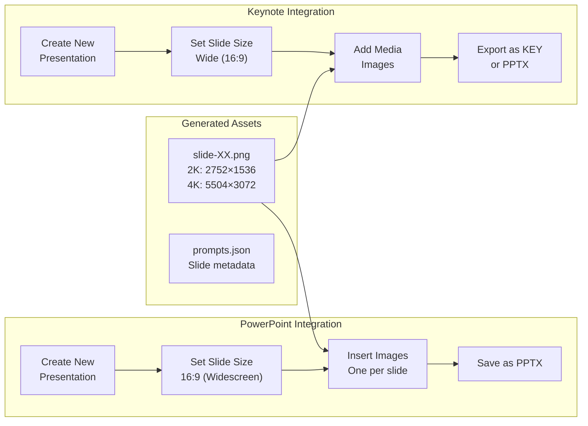

<!-- source: DeepWiki mcp.deepwiki.com · repo op7418/NanoBanana-PPT-Skills · page 7.3 Exporting & Sharing · fetched 2026-10-26 -->

# Exporting & Sharing

<details>
<summary>Relevant source files</summary>

The following files were used as context for generating this wiki page:

- [QUICKSTART.md](QUICKSTART.md)
- [README.md](README.md)
- [templates/viewer.html](templates/viewer.html)

</details>


## Purpose and Scope

This page covers methods for exporting generated presentations to different formats and sharing them with others. Topics include browser-based PDF export, direct file sharing, and integration with PowerPoint/Keynote applications.

For information about the generated output files and their structure, see [Generated Outputs](#7.1). For details on using the interactive HTML viewer before export, see [HTML Viewer](#7.2).

---

## Export Methods Overview

The system generates presentations in a browser-viewable HTML format with embedded PNG images. From this base format, multiple export and sharing paths are available.

### Export Methods Comparison

| Method | Output Format | Use Case | Quality | Portability |
|--------|---------------|----------|---------|-------------|
| Browser Print-to-PDF | PDF | Document sharing, archival | Vector text + raster images | Universal |
| Direct PNG sharing | PNG files | Individual slides, social media | 2K: 2752×1536<br/>4K: 5504×3072 | High compatibility |
| HTML bundle | HTML + PNG | Interactive presentations | Full resolution | Requires browser |
| PowerPoint/Keynote import | PPTX/KEY | Traditional editing workflow | Original resolution | Office software |

**Sources:** [README.md:463-468](), [QUICKSTART.md:202-207]()

---

## Browser-Based PDF Export

The primary export method uses the browser's built-in print-to-PDF functionality. This converts the HTML viewer into a multi-page PDF document while preserving image quality.

### PDF Export Workflow

```mermaid
graph LR
    subgraph "Generated Output"
        HTML["index.html<br/>(viewer.html template)"]
        PNG["slide-XX.png<br/>(2K or 4K)"]
    end
    
    subgraph "Browser Process"
        OPEN["Open in Browser"]
        PRINT["Print Dialog<br/>Cmd+P / Ctrl+P"]
        CONFIG["Configure Settings"]
    end
    
    subgraph "PDF Generation"
        RENDER["Browser Rendering<br/>Each slide as page"]
        COMPOSE["PDF Composition"]
        SAVE["Save as PDF"]
    end
    
    subgraph "Output File"
        PDF["presentation.pdf<br/>Multi-page document"]
    end
    
    HTML --> OPEN
    PNG -.embedded.-> HTML
    OPEN --> PRINT
    PRINT --> CONFIG
    CONFIG --> RENDER
    RENDER --> COMPOSE
    COMPOSE --> SAVE
    SAVE --> PDF
```



### Step-by-Step Export Process

#### 1. Open Generated Viewer

Navigate to the output directory and open the HTML viewer:

```bash
# Location of generated presentation
cd outputs/TIMESTAMP/

# Open in default browser
open index.html          # macOS
xdg-open index.html      # Linux
start index.html         # Windows
```

The viewer structure is based on [templates/viewer.html:1-336]() which includes:
- Slide container with image elements [templates/viewer.html:89-91]()
- Image loading via JavaScript [templates/viewer.html:103-141]()
- Full-screen layout for print optimization [templates/viewer.html:20-38]()

#### 2. Initiate Print Dialog

| Platform | Keyboard Shortcut | Menu Path |
|----------|------------------|-----------|
| macOS | `Cmd + P` | File → Print |
| Windows | `Ctrl + P` | File → Print |
| Linux | `Ctrl + P` | File → Print |

#### 3. Configure Print Settings

**Recommended PDF Export Settings:**

| Setting | Recommended Value | Reason |
|---------|------------------|---------|
| Destination | Save as PDF | Export instead of printing |
| Layout | Landscape | Matches 16:9 aspect ratio |
| Margins | None / Minimum | Maximizes slide area |
| Scale | 100% / Fit to page | Maintains aspect ratio |
| Background graphics | ✓ Enabled | Preserves slide backgrounds |
| Headers and footers | ✗ Disabled | Removes browser chrome |

#### 4. Save PDF File

Choose destination and filename:

```bash
# Suggested naming convention
presentation-[title]-[YYYYMMDD].pdf

# Examples
presentation-product-roadmap-20260109.pdf
presentation-q1-review-2k.pdf
```

**Sources:** [templates/viewer.html:1-336](), [README.md:463-468](), [QUICKSTART.md:202-207]()

---

## Print Quality Optimization

### Resolution Impact on PDF Export

The resolution selected during generation affects the final PDF quality:



### Quality Guidelines

| Output Medium | Minimum Resolution | Recommended | File Size Impact |
|---------------|-------------------|-------------|------------------|
| Email sharing | 2K | 2K | ~2.5MB/page |
| Screen presentation | 2K | 2K | ~2.5MB/page |
| Physical printing (A4/Letter) | 2K | 4K | ~8MB/page |
| Large format printing | 4K | 4K | ~8MB/page |
| Web embedding | 2K | 2K | ~2.5MB/page |

**Sources:** [QUICKSTART.md:96-103](), [README.md:362-367]()

---

## Direct File Sharing Methods

### Output Directory Structure for Sharing



### Method 1: Archive for Distribution

Create a self-contained archive with all presentation files:

```bash
# Navigate to outputs directory
cd outputs/

# Create ZIP archive
zip -r presentation-20260109.zip 20260109_143022/

# Archive includes:
# - index.html (viewer)
# - slide-01.png through slide-N.png
# - prompts.json (optional, for reference)

# Verify archive contents
unzip -l presentation-20260109.zip
```

Recipients can extract and open `index.html` in any modern browser to view the presentation with full interactivity.

### Method 2: Cloud Storage Sharing

Upload the output directory to cloud storage platforms:

```bash
# Google Drive (using gdrive CLI)
gdrive upload -r outputs/20260109_143022/

# Dropbox (using Dropbox CLI)
dropbox upload outputs/20260109_143022/

# AWS S3 (for public hosting)
aws s3 cp outputs/20260109_143022/ \
    s3://my-bucket/presentations/2026-q1/ \
    --recursive \
    --acl public-read
```

Share the resulting URL or folder link with collaborators.

### Method 3: Individual Slide Sharing

Extract and share specific slides as PNG files:

```bash
# Share single slide
cp outputs/20260109_143022/slide-03.png ~/Desktop/

# Share subset of slides
mkdir key-slides/
cp outputs/20260109_143022/slide-{01,05,10}.png key-slides/

# Batch rename for clarity
cd key-slides/
rename 's/slide-/presentation-page-/' *.png
```

**Sources:** File system structure implied from [README.md:338-356]()

---

## PowerPoint and Keynote Integration

Generated PNG slides can be imported into traditional presentation software for further editing or distribution in native formats.

### Integration Workflow



### PowerPoint Import Process

#### Step 1: Create Presentation Template

```vbscript
# PowerPoint slide size configuration
# Width: 13.333 inches (16:9 standard)
# Height: 7.5 inches
```

1. Open PowerPoint
2. Navigate to **Design** → **Slide Size** → **Widescreen (16:9)**
3. Create blank slides matching your presentation count

#### Step 2: Import Images

```bash
# PowerPoint import methods:

# Method 1: Insert → Pictures → This Device
# - Navigate to outputs/TIMESTAMP/
# - Select slide-01.png through slide-N.png
# - Insert one per slide

# Method 2: Drag and drop
# - Open outputs folder in file manager
# - Drag PNG files onto PowerPoint slides
```

#### Step 3: Fit Images to Slides

For each imported image:
1. Right-click image → **Format Picture**
2. Set **Width** to match slide width
3. Set **Height** to match slide height
4. Position at (0, 0) to eliminate margins
5. Send to back if adding annotations

#### Step 4: Save Native Format

```bash
# Save as PowerPoint format
File → Save As → [filename].pptx

# Or export to PDF from PowerPoint
File → Export → Create PDF/XPS Document
```

### Keynote Import Process

#### Step 1: Configure Presentation

1. Open Keynote
2. Create new presentation
3. Select theme or choose **Blank**
4. Set slide size: **Document** → **Slide Size** → **Wide (16:9)**

#### Step 2: Import Media

```bash
# Keynote import workflow:

# Per-slide import:
# 1. Select slide
# 2. Insert → Choose... (Cmd+Shift+V)
# 3. Select slide-XX.png
# 4. Scale to fill slide

# Bulk import:
# 1. Media Browser → Photos
# 2. Navigate to outputs folder
# 3. Drag all PNGs to slide navigator
```

#### Step 3: Export Options

```bash
# Export to PowerPoint
File → Export To → PowerPoint...

# Export to PDF
File → Export To → PDF...

# Export to QuickTime (for video presentations)
File → Export To → QuickTime...
```

**Sources:** [QUICKSTART.md:96-103]() for resolution specifications

---

## Batch Export and Archiving

### Automated Export Pipeline

Create a script to automate PDF generation for multiple presentations:

```bash
#!/bin/bash
# batch_export.sh - Automated PDF export using headless browser

OUTPUT_DIR="outputs/"
EXPORT_DIR="exported-pdfs/"

mkdir -p "$EXPORT_DIR"

# Find all generated presentations
for presentation in "$OUTPUT_DIR"*/index.html; do
    timestamp=$(dirname "$presentation" | xargs basename)
    
    # Use headless Chrome for PDF generation
    chrome \
        --headless \
        --disable-gpu \
        --print-to-pdf="$EXPORT_DIR/${timestamp}.pdf" \
        --no-margins \
        "$presentation"
    
    echo "Exported: ${timestamp}.pdf"
done
```

### Archival Structure

Organize multiple presentations for long-term storage:

```bash
archive/
├── 2026-q1/
│   ├── product-launch/
│   │   ├── generated/          # Original outputs
│   │   │   └── 20260109_143022/
│   │   ├── presentation.pdf
│   │   └── metadata.json
│   └── team-review/
│       ├── generated/
│       ├── presentation.pdf
│       └── metadata.json
└── 2026-q2/
    └── ...
```

Create metadata file for each presentation:

```json
{
  "title": "Q1 Product Launch",
  "generated": "2026-01-09T14:30:22Z",
  "style": "gradient-glass",
  "resolution": "2K",
  "slide_count": 15,
  "source_document": "product-roadmap-q1.md",
  "exports": {
    "pdf": "presentation.pdf",
    "pptx": "presentation.pptx",
    "archive": "presentation-20260109.zip"
  }
}
```

**Sources:** Output directory structure from [README.md:338-356]()

---

## Web Hosting and Embedding

### Static Site Deployment

Host the HTML viewer on a web server for URL-based sharing:

```bash
# Deploy to static hosting
# The viewer.html template is self-contained

# Option 1: GitHub Pages
cd outputs/20260109_143022/
git init
git add .
git commit -m "Add presentation"
git remote add origin https://github.com/user/presentation.git
git push -u origin main

# Access at: https://user.github.io/presentation/

# Option 2: Netlify
netlify deploy --dir=outputs/20260109_143022/ --prod

# Option 3: Simple HTTP server (for local network)
cd outputs/20260109_143022/
python -m http.server 8000
# Access at: http://localhost:8000/
```

### Embedding in Web Pages

Embed the presentation viewer in an iframe:

```html
<iframe 
    src="https://example.com/presentation/index.html"
    width="1280"
    height="720"
    frameborder="0"
    allowfullscreen>
</iframe>
```

The viewer includes responsive design and touch support from [templates/viewer.html:303-330](), making it suitable for embedded contexts.

**Sources:** [templates/viewer.html:1-336]()

---

## Quality Assurance Checklist

Before distributing exported presentations, verify:

### Pre-Export Verification

| Check | Method | Expected Result |
|-------|--------|-----------------|
| All slides generated | `ls outputs/TIMESTAMP/slide-*.png | wc -l` | Matches `slides_plan.json` count |
| No generation errors | Check `prompts.json` | All slides have valid image data |
| Viewer loads correctly | Open `index.html` in browser | All slides display, navigation works |
| Resolution matches intent | Check PNG dimensions | 2K: 2752×1536, 4K: 5504×3072 |

### Post-Export Verification

| Check | Method | Expected Result |
|-------|--------|-----------------|
| PDF page count | PDF viewer properties | Matches slide count |
| PDF file size reasonable | `ls -lh presentation.pdf` | 2K: ~2.5MB/page, 4K: ~8MB/page |
| PowerPoint import successful | Open in PowerPoint | All slides imported, aspect ratio preserved |
| Archive completeness | `unzip -l archive.zip` | Contains HTML + all PNGs |
| Web hosting accessibility | Test URL | Loads in multiple browsers |

**Sources:** [QUICKSTART.md:96-103](), [README.md:362-367]()

---

## Troubleshooting Export Issues

### Common Export Problems

| Issue | Cause | Solution |
|-------|-------|----------|
| PDF missing slides | Print dialog truncation | Use "Print All Pages" setting |
| Low quality in PDF | Browser downscaling | Disable "Shrink to fit" option |
| PowerPoint aspect ratio wrong | Template size mismatch | Set slide size to 16:9 before import |
| Large file sizes | 4K resolution | Use 2K for digital-only distribution |
| Viewer not loading images | Relative path issues | Keep HTML and PNGs in same directory |

### Browser-Specific PDF Export Notes

**Chrome/Edge:**
- Best PDF rendering quality
- Use `Ctrl+P` → "Save as PDF" destination
- Enable "Background graphics"

**Firefox:**
- May require "Print to File" extension
- Use "Simplify page" OFF for full fidelity

**Safari:**
- Use `Cmd+P` → PDF → "Save as PDF"
- Ensure "Print backgrounds" is checked

**Sources:** General web standards and [templates/viewer.html:1-336]()

---

