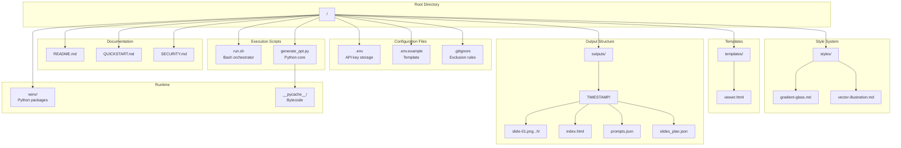
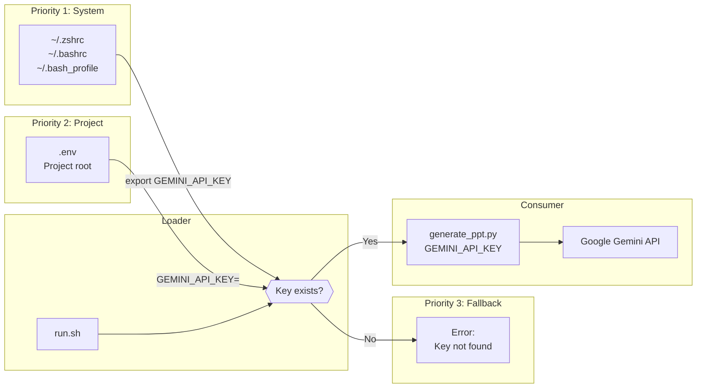
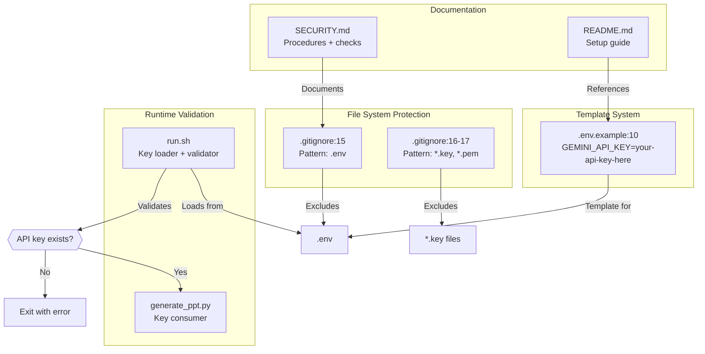

<!-- source: DeepWiki mcp.deepwiki.com · repo op7418/NanoBanana-PPT-Skills · page 8 Reference · fetched 2026-10-26 -->

# Reference

<details>
<summary>Relevant source files</summary>

The following files were used as context for generating this wiki page:

- [.env.example](.env.example)
- [.gitignore](.gitignore)
- [QUICKSTART.md](QUICKSTART.md)
- [SECURITY.md](SECURITY.md)

</details>


This page provides technical reference documentation for the NanoBanana PPT Generator, including configuration file formats, API specifications, performance benchmarks, and system constants. Use this page for quick lookups of technical details and file structures.

For detailed information on specific topics, see:
- Configuration file formats and schemas: [Configuration Files](#8.1)
- API parameters and model specifications: [Technical Specifications](#8.2)
- Debugging and error resolution: [Troubleshooting](#8.3)

## System File Structure

The following diagram maps conceptual system components to their actual file locations in the codebase.

**File System Architecture**



**Sources:** [.env.example:1-11](), [.gitignore:1-35](), [QUICKSTART.md:1-240]()

## Environment Variable Reference

The system uses environment variables for configuration, with a priority-based loading system.

**Environment Variable Priority Order**



### Required Variables

| Variable | Format | Source | Description |
|----------|--------|--------|-------------|
| `GEMINI_API_KEY` | `AIzaSy...` (39 chars) | Google AI Studio | Authentication token for Gemini API access |

### Configuration File Format

The `.env` file follows standard shell variable syntax:

```bash
# .env format
GEMINI_API_KEY=your-api-key-here
```

**Sources:** [.env.example:1-11](), [SECURITY.md:19-28]()

## Git Exclusion Rules

The `.gitignore` file prevents sensitive and generated files from being committed to version control.

| Pattern | Type | Reason | Examples |
|---------|------|--------|----------|
| `.env` | Security | Contains API keys | `.env` |
| `*.key`, `*.pem` | Security | Certificate files | `private.key`, `cert.pem` |
| `venv/` | Runtime | Python dependencies | `venv/lib/`, `venv/bin/` |
| `__pycache__/` | Runtime | Bytecode cache | `__pycache__/*.pyc` |
| `outputs/` | Generated | Large binary files | `outputs/20240115_143022/` |
| `*.png`, `*.jpg` | Generated | Image files | `slide-01.png` |
| `test_*.json` | Testing | Test artifacts | `test_plan.json` |

**Sources:** [.gitignore:1-35](), [SECURITY.md:5-17]()

## Resolution and Timing Specifications

The system supports two resolution modes with different performance characteristics.

### Resolution Options

| Resolution | Dimensions | Use Case | Generation Time | File Size |
|------------|------------|----------|----------------|-----------|
| **2K** | 2048×1152 | Daily presentations, web viewing | ~30s per slide | ~2MB per slide |
| **4K** | 3840×2160 | Print output, large displays | ~60s per slide | ~8MB per slide |

### Aspect Ratio

All slides are generated at **16:9 aspect ratio** (widescreen presentation format).

**Calculation:**
- 2K: 2048 ÷ 1152 = 1.778 (16:9)
- 4K: 3840 ÷ 2160 = 1.778 (16:9)

### Time Estimates by Page Count

| Pages | 2K Total Time | 4K Total Time |
|-------|---------------|---------------|
| 5 | 2.5 minutes | 5 minutes |
| 10 | 5 minutes | 10 minutes |
| 15 | 7.5 minutes | 15 minutes |
| 25 | 12.5 minutes | 25 minutes |

**Sources:** [QUICKSTART.md:96-103](), [QUICKSTART.md:196-200]()

## API Model Specification

The system uses Google's Gemini API with specific model configuration.

### Model Parameters

| Parameter | Value | Purpose |
|-----------|-------|---------|
| **Model ID** | `gemini-3-pro-image-preview` | Image generation model |
| **Response Mode** | `IMAGE` | Output format |
| **Output Format** | PNG | Image encoding |
| **API Endpoint** | Google AI API | Service provider |
| **SDK** | `google-genai` v1.57.0 | Python client library |

### Rate Limits

The system processes slides **sequentially** (not in parallel) to manage API rate limits. Each slide requires one API call.

**Sources:** [QUICKSTART.md:196-200](), High-Level System Architecture (Diagram 1)

## Security Configuration Matrix

The system implements multiple security layers with different protection mechanisms.

**Security Layer Mapping**



### Pre-Commit Security Checks

The following commands validate security before committing code:

```bash
# Verify .env is ignored
git check-ignore -v .env

# Simulate add to see what would be staged
git add -n .

# Search for exposed API keys
grep -r "AIzaSy" --exclude-dir=.git --exclude-dir=venv --exclude-dir=outputs .

# Check if .env was ever committed
git log --all --full-history --source -- .env
```

**Expected results:**
- `.env` should appear in `git check-ignore` output
- `.env` should NOT appear in `git add -n` output
- `grep` should only find keys in `.env` file
- `git log` should return empty (no commits)

**Sources:** [SECURITY.md:49-78](), [SECURITY.md:61-69]()

## Style File Format

Style files are Markdown documents located in `styles/` directory.

### Available Styles

| Filename | Style ID | Visual Language | Use Case |
|----------|----------|----------------|----------|
| `gradient-glass.md` | `gradient-glass` | Glassmorphism, 3D, neon gradients | Tech presentations, business |
| `vector-illustration.md` | `vector-illustration` | Flat design, black outlines, retro | Education, creative content |

### Custom Style Template

To create a custom style, create a new `.md` file in `styles/`:

```markdown
# My Custom Style

## 风格ID
my-custom-style

## 基础提示词模板
[Base prompt template with visual language definitions...]

## 封面页
[Cover page specific instructions...]

## 内容页
[Content page specific instructions...]

## 数据页
[Data page specific instructions...]
```

**Sources:** [QUICKSTART.md:117-140]()

## Output Directory Structure

Each generation creates a timestamped output directory with the following structure:

```
outputs/
└── 20240115_143022/           # Timestamp: YYYYMMDD_HHMMSS
    ├── slide-01.png           # First slide image
    ├── slide-02.png           # Second slide image
    ├── slide-N.png            # Final slide image
    ├── index.html             # Interactive viewer
    ├── prompts.json           # Audit trail of prompts
    └── slides_plan.json       # Content structure plan
```

### File Purposes

| File | Format | Purpose | Generated By |
|------|--------|---------|--------------|
| `slide-*.png` | PNG image | Rendered slide visuals | Gemini API |
| `index.html` | HTML | Interactive presentation viewer | `generate_ppt.py` |
| `prompts.json` | JSON | Complete prompts sent to API | `generate_ppt.py` |
| `slides_plan.json` | JSON | Content structure and planning | Document analysis stage |

**Sources:** [.gitignore:19-23](), High-Level System Architecture (Diagram 3)

## Command Line Reference

### Primary Execution Script

**Script:** `run.sh`

**Purpose:** Orchestrates environment loading, validation, and Python script execution.

**Flow:**
1. Loads `GEMINI_API_KEY` from environment or `.env`
2. Validates key existence
3. Activates Python virtual environment (if exists)
4. Executes `generate_ppt.py` with passed arguments
5. Returns exit code

### Python Generation Script

**Script:** `generate_ppt.py`

**Dependencies:**
- `google-genai` == 1.57.0
- `pillow` == 12.1.0
- Standard library: `json`, `os`, `sys`, `datetime`

**Arguments:**
```bash
python generate_ppt.py \
  --plan <path-to-slides_plan.json> \
  --style <path-to-style.md> \
  --resolution <2K|4K> \
  --output <output-directory>
```

**Sources:** [QUICKSTART.md:109-114](), [QUICKSTART.md:137-140]()

## HTML Viewer Keyboard Controls

The generated `index.html` viewer supports keyboard navigation and control.

| Key | Action |
|-----|--------|
| `→` or `→` | Next slide |
| `←` or `←` | Previous slide |
| `Space` | Toggle autoplay |
| `Esc` | Toggle fullscreen |
| `Home` | First slide |
| `End` | Last slide |

### Export to PDF

To export the presentation:
1. Open `index.html` in a web browser
2. Press `Cmd+P` (macOS) or `Ctrl+P` (Windows/Linux)
3. Select "Save as PDF" as the printer
4. Configure page settings (landscape, fit to page)
5. Save the PDF

**Sources:** [QUICKSTART.md:58-61](), [QUICKSTART.md:203-208]()

## Page Count Guidelines

Recommended page counts based on presentation duration:

| Duration | Pages | Use Case |
|----------|-------|----------|
| 5 minutes | 5 | Elevator pitch |
| 10-15 minutes | 5-10 | Standard presentation |
| 20-30 minutes | 10-15 | Deep dive |
| 45-60 minutes | 20-25 | Training session |

**Rule of thumb:** Allocate approximately 1 minute per slide for paced delivery.

**Sources:** [QUICKSTART.md:63-71]()

## Detailed Documentation

For comprehensive coverage of specific topics, see the following pages:

- **[Configuration Files](#8.1)**: Detailed schemas for `.env`, `.gitignore`, `slides_plan.json`, and `prompts.json`
- **[Technical Specifications](#8.2)**: Complete API reference, model parameters, and system constraints
- **[Troubleshooting](#8.3)**: Common errors, debugging strategies, and solution procedures

---

