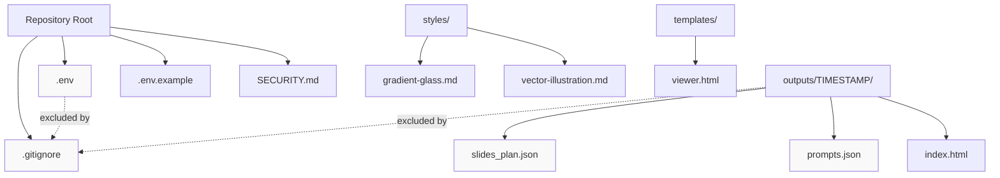
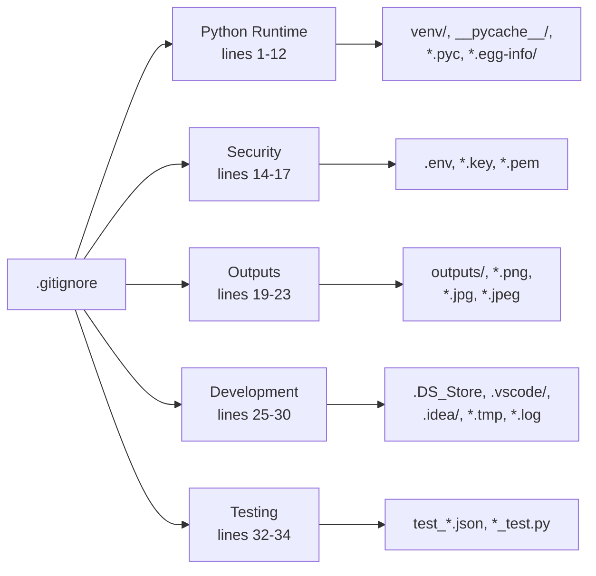
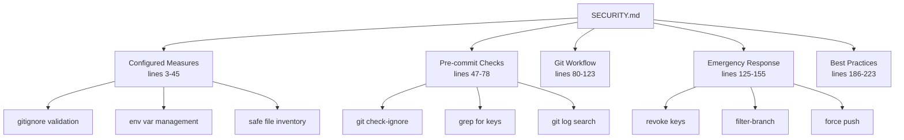
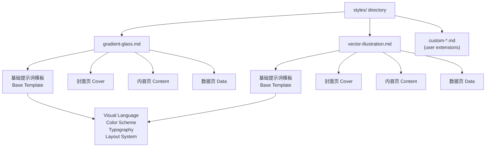
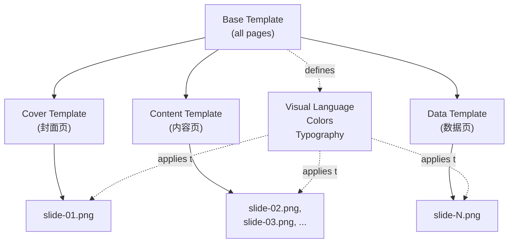
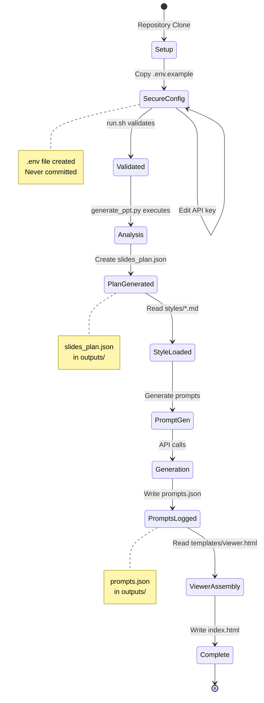
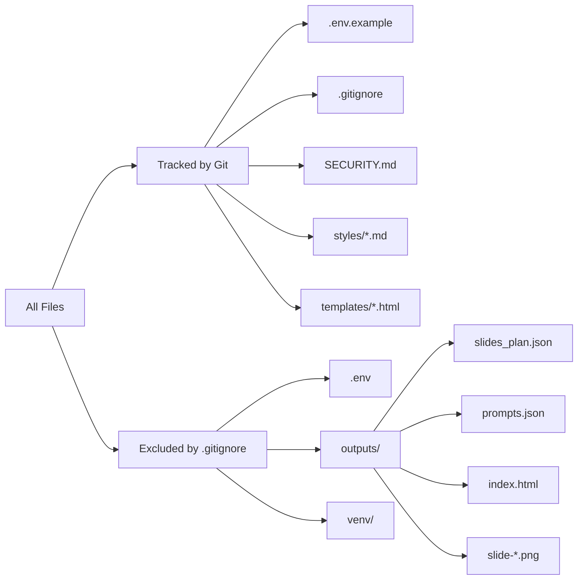
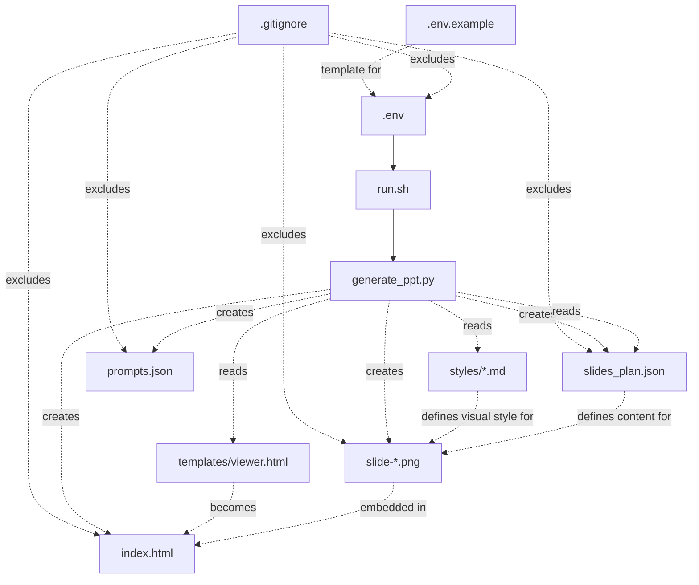

<!-- source: DeepWiki mcp.deepwiki.com · repo op7418/NanoBanana-PPT-Skills · page 8.1 Configuration Files · fetched 2026-10-26 -->

# Configuration Files

<details>
<summary>Relevant source files</summary>

The following files were used as context for generating this wiki page:

- [.env.example](.env.example)
- [.gitignore](.gitignore)
- [SECURITY.md](SECURITY.md)

</details>


This page provides technical reference documentation for all configuration files used by the NanoBanana PPT Generator. It covers file formats, content structure, and the role each file plays in the system.

For information about setting up API keys and environment variables, see [API Key Setup](#3.1) and [Environment Variables](#3.2). For security best practices, see [Security Best Practices](#3.3) and [Git Safety](#3.4).

---

## Overview

The system uses configuration files for three distinct purposes:

1. **Security Configuration**: API credential management and Git safety rules
2. **Generation Artifacts**: Intermediate files created during the generation pipeline
3. **Asset Definitions**: Style templates and HTML viewer templates

Configuration files are distributed across multiple directories with different access patterns and lifecycle characteristics.

**Configuration File Locations**



Sources: [.env.example:1-11](), [.gitignore:1-35](), [SECURITY.md:1-227]()

---

## Security Configuration Files

### .env File

The `.env` file stores sensitive API credentials. It is **never committed to version control**.

**Location**: `<repository_root>/.env`

**Format**: Key-value pairs in shell variable syntax

```
# Comments are supported
GEMINI_API_KEY=your-actual-api-key-here
```

**Content Structure**:

| Key | Required | Purpose | Example Value |
|-----|----------|---------|---------------|
| `GEMINI_API_KEY` | Yes | Google Gemini API authentication token | `AIzaSy...` (43 characters) |

**Creation Method**:

The file is created manually by copying `.env.example`:

```bash
cp .env.example .env
# Edit .env to add actual API key
```

**Access Pattern**:

The file is loaded by [run.sh]() at script startup. The key is exported as an environment variable before invoking [generate_ppt.py]().

**Security Controls**:

- Excluded from Git via [.gitignore:15]()
- Protected by filesystem permissions (user-only read/write)
- Validated at runtime by [run.sh]()

Sources: [.env.example:1-11](), [.gitignore:14-17]()

---

### .env.example File

The `.env.example` file is a template committed to version control that demonstrates the required format without exposing credentials.

**Location**: `<repository_root>/.env.example`

**Format**: Same as `.env`, but with placeholder values

**Content**:

[.env.example:1-11]() contains:

1. **Header Comment Block** (lines 1-6): Instructions in Chinese explaining the usage pattern
2. **API Key Section** (lines 8-10): Template definition with acquisition URL
3. **Placeholder Value** (line 10): `GEMINI_API_KEY=your-api-key-here`

**Key Characteristics**:

- Contains `your-api-key-here` instead of real credentials
- Includes acquisition URL: `https://makersuite.google.com/app/apikey`
- Safe to commit to public repositories
- Serves as documentation for required environment variables

**Usage in Onboarding**:

New users copy this file to `.env` and replace the placeholder with their actual key. This pattern ensures:

1. The `.env` format is always correct
2. The acquisition process is documented
3. No real credentials are ever in version control

Sources: [.env.example:1-11]()

---

### .gitignore File

The `.gitignore` file defines patterns for files that Git should never track.

**Location**: `<repository_root>/.gitignore`

**Format**: Line-based pattern list with optional comments

**Content Categories**:



**Security-Critical Patterns**:

| Pattern | Line | Protected Content | Risk if Exposed |
|---------|------|-------------------|-----------------|
| `.env` | 15 | API credentials | High - Direct API access |
| `*.key` | 16 | Private keys | Critical - Authentication bypass |
| `*.pem` | 17 | Certificates | Critical - Infrastructure access |

**Output Exclusion Patterns**:

[.gitignore:19-23]() excludes:
- `outputs/` - Prevents committing generated presentations
- `*.png`, `*.jpg`, `*.jpeg` - Excludes individual image files

This prevents repository bloat from generated content.

**Verification Command**:

```bash
git check-ignore -v .env
# Output: .gitignore:15:.env	.env
```

This confirms the pattern is active and identifies the matching line number.

Sources: [.gitignore:1-35](), [SECURITY.md:49-59]()

---

### SECURITY.md File

The `SECURITY.md` file is a comprehensive security guide and checklist for safe Git operations.

**Location**: `<repository_root>/SECURITY.md`

**Format**: Markdown documentation

**Content Structure**:



**Pre-commit Verification Commands**:

| Command | Line Range | Purpose |
|---------|------------|---------|
| `git check-ignore -v .env` | 52-54 | Verify `.env` is excluded |
| `git add -n .` | 57-58 | Simulate staging to check files |
| `grep -r "AIzaSy" .` | 64-68 | Search for API key patterns |
| `git log --all --full-history --source -- .env` | 74-77 | Check if `.env` was ever committed |

**Emergency Response Protocol**:

[SECURITY.md:125-155]() defines a three-step procedure if credentials are leaked:

1. **Immediate Revocation**: Visit Google AI Studio and delete/regenerate the key
2. **History Rewrite**: Use `git filter-branch` to remove sensitive files from all commits
3. **Force Push**: Overwrite remote history (destructive operation)

**Best Practices Summary**:

The file defines DO/DON'T lists:
- **DO**: [SECURITY.md:187-194]() - Use `.env`, provide `.env.example`, rotate keys
- **DON'T**: [SECURITY.md:196-203]() - Hardcode keys, commit `.env`, share via email

**Production Environment Recommendations**:

[SECURITY.md:219-222]() suggests key management services for production:
- AWS Secrets Manager
- HashiCorp Vault
- Azure Key Vault

Sources: [SECURITY.md:1-227]()

---

## Generation Artifact Files

### slides_plan.json

The `slides_plan.json` file is generated during the document analysis phase and defines the content structure of the presentation.

**Location**: `outputs/<timestamp>/slides_plan.json`

**Format**: JSON array of slide objects

**Schema**:

```json
{
  "slides": [
    {
      "slide_number": 1,
      "page_type": "cover",
      "title": "Presentation Title",
      "content": "Subtitle or description",
      "key_points": []
    },
    {
      "slide_number": 2,
      "page_type": "content",
      "title": "Section Title",
      "content": "Main content text",
      "key_points": ["Point 1", "Point 2", "Point 3"]
    }
  ]
}
```

**Field Definitions**:

| Field | Type | Required | Purpose |
|-------|------|----------|---------|
| `slide_number` | Integer | Yes | Sequential identifier (1-indexed) |
| `page_type` | String | Yes | Template selector: `"cover"`, `"content"`, or `"data"` |
| `title` | String | Yes | Primary heading text |
| `content` | String | Yes | Main body text or subtitle |
| `key_points` | Array[String] | Yes | Bullet points (empty for cover slides) |

**Generation Process**:

This file is created by the document analysis stage of [generate_ppt.py]() based on:
1. Input document content
2. User-specified page count parameter
3. Automatic section extraction algorithm

**Consumption**:

The prompt engineering stage reads this file to construct per-slide prompts by combining:
- `page_type` → determines which style template section to use
- `title`, `content`, `key_points` → inserted into the prompt text

**Lifecycle**:

- **Created**: During document analysis phase
- **Read**: During prompt generation phase
- **Persisted**: Saved in output directory for audit/debugging
- **Excluded from Git**: Via [.gitignore:20]() pattern `outputs/`

Sources: [.gitignore:19-23]()

---

### prompts.json

The `prompts.json` file records all prompts sent to the Gemini API during image generation.

**Location**: `outputs/<timestamp>/prompts.json`

**Format**: JSON array of prompt records

**Schema**:

```json
{
  "prompts": [
    {
      "slide_number": 1,
      "timestamp": "2024-01-15T10:30:45",
      "prompt_text": "Complete prompt sent to API...",
      "model": "gemini-3-pro-image-preview",
      "resolution": "2K",
      "aspect_ratio": "16:9",
      "status": "success",
      "generation_time_seconds": 28.5
    }
  ]
}
```

**Field Definitions**:

| Field | Type | Purpose |
|-------|------|---------|
| `slide_number` | Integer | Links to corresponding slide in `slides_plan.json` |
| `timestamp` | ISO 8601 String | When the API call was made |
| `prompt_text` | String | Complete prompt including style, content, and technical params |
| `model` | String | Gemini model identifier used |
| `resolution` | String | User-selected resolution (`"2K"` or `"4K"`) |
| `aspect_ratio` | String | Always `"16:9"` for presentation format |
| `status` | String | `"success"` or error code |
| `generation_time_seconds` | Float | API response time for performance monitoring |

**Use Cases**:

1. **Debugging**: Inspect exact prompts when results are unexpected
2. **Audit Trail**: Verify which model and parameters were used
3. **Performance Analysis**: Identify slow API calls
4. **Prompt Refinement**: Copy and modify prompts for regeneration

**Regeneration Workflow**:

Users can manually edit this file to adjust prompts, then re-run generation for specific slides without re-analyzing the document.

Sources: [.gitignore:19-23]()

---

## Style Definition Files

Style files are Markdown documents that define visual aesthetics for generated slides. They are located in `styles/` directory.

**File Structure Diagram**:



**Format**: Markdown with Chinese section headers

**Required Sections**:

Each style file must contain these four sections:

1. **基础提示词模板** (Base Prompt Template)
   - Visual language definition
   - Color palette specification
   - Typography rules
   - Layout system description

2. **封面页** (Cover Page Template)
   - Inherits base template
   - Adds cover-specific composition rules
   - Placeholder syntax: `{title}`, `{subtitle}`

3. **内容页** (Content Page Template)
   - Inherits base template
   - Layout for `{title}` and `{key_points}`
   - Icon/illustration guidelines

4. **数据页** (Data Page Template)
   - Inherits base template
   - Chart and visualization specifications
   - Data display patterns

**Loading Mechanism**:

Style files are loaded by [generate_ppt.py]() based on user selection:

```python
style_file_path = f"styles/{selected_style}.md"
with open(style_file_path, 'r', encoding='utf-8') as f:
    style_content = f.read()
```

**Template Inheritance Pattern**:



**Extension Mechanism**:

Users can create custom styles by:
1. Copying an existing style file
2. Modifying the section content
3. Saving with a new filename (e.g., `custom-corporate.md`)
4. Selecting it via command-line parameter

For detailed style specifications, see [Gradient Glass Style](#6.2), [Vector Illustration Style](#6.3), and [Creating Custom Styles](#6.4).

Sources: [.gitignore:1-35]()

---

## Template Files

### viewer.html

The `viewer.html` file is an HTML template for the interactive presentation viewer.

**Location**: `templates/viewer.html`

**Format**: HTML5 with embedded CSS and JavaScript

**Template Placeholders**:

The file contains placeholder strings that are replaced during output assembly:

| Placeholder | Replaced With | Purpose |
|-------------|---------------|---------|
| `{{SLIDE_IMAGES}}` | JSON array of image paths | Defines slide sequence |
| `{{TIMESTAMP}}` | Generation timestamp | Display in viewer footer |

**Replacement Logic**:

[generate_ppt.py]() performs string replacement:

```python
with open('templates/viewer.html', 'r', encoding='utf-8') as f:
    template = f.read()

slide_images = ['slide-01.png', 'slide-02.png', ...]
html_content = template.replace('{{SLIDE_IMAGES}}', json.dumps(slide_images))
html_content = html_content.replace('{{TIMESTAMP}}', timestamp)
```

**Generated Output**:

The processed template is written to `outputs/<timestamp>/index.html`, creating a self-contained viewer.

**Viewer Features**:

The template includes:
- **Navigation**: Arrow keys, click navigation
- **Fullscreen**: F11 or fullscreen button
- **Autoplay**: Configurable slide timing
- **Mobile Support**: Touch gestures
- **Keyboard Shortcuts**: Documented in UI

For usage details, see [HTML Viewer](#7.2).

Sources: [.gitignore:1-35]()

---

## Configuration File Lifecycle



**Phase-by-Phase File Access**:

| Phase | Files Read | Files Written | Git Status |
|-------|------------|---------------|------------|
| Setup | `.env.example` | `.env` | `.env` excluded |
| Validation | `.env` | - | - |
| Analysis | User input document | `slides_plan.json` | Output excluded |
| Prompt Generation | `slides_plan.json`, `styles/*.md` | - | - |
| Generation | - | `slide-*.png`, `prompts.json` | Outputs excluded |
| Assembly | `templates/viewer.html` | `index.html` | Output excluded |

**Configuration vs. Artifact Files**:

| Type | Location | Committed to Git | Created By | Lifecycle |
|------|----------|------------------|------------|-----------|
| **Configuration** | `.env`, `styles/*.md`, `templates/*.html` | No (`.env`), Yes (others) | User/Developer | Persistent |
| **Artifact** | `outputs/*/` | No | [generate_ppt.py]() | Per-generation |

**Git Tracking Status**:



Sources: [.gitignore:1-35](), [SECURITY.md:30-45]()

---

## Configuration File Relationships



**Dependency Chain**:

1. `.env.example` → `.env` (user copies and edits)
2. `.env` → `run.sh` (loads API key)
3. `run.sh` → `generate_ppt.py` (executes with environment)
4. `generate_ppt.py` + `styles/*.md` → `slides_plan.json` (planning)
5. `slides_plan.json` + `styles/*.md` → `prompts.json` (prompt engineering)
6. `prompts.json` → API → `slide-*.png` (generation)
7. `templates/viewer.html` + `slide-*.png` → `index.html` (assembly)

**Critical Path**:

The absence of `.env` blocks execution at `run.sh`. All other files are either:
- Provided by the repository (`styles/`, `templates/`)
- Generated automatically (`slides_plan.json`, `prompts.json`, `index.html`)

Sources: [.env.example:1-11](), [.gitignore:1-35](), [SECURITY.md:1-227]()

---

## Validation and Debugging

### Configuration Validation Commands

**Check .env existence**:
```bash
test -f .env && echo "✓ .env exists" || echo "✗ .env missing"
```

**Verify API key format**:
```bash
grep -q "^GEMINI_API_KEY=AIzaSy" .env && echo "✓ Key format valid" || echo "✗ Invalid format"
```

**Confirm .gitignore is working**:
```bash
git check-ignore -v .env outputs/
# Expected: .gitignore:15:.env	.env
#          .gitignore:20:outputs/	outputs/
```

**Inspect generated artifacts**:
```bash
# Check if slides_plan.json is valid JSON
jq . outputs/*/slides_plan.json

# Count generated slides
ls -1 outputs/*/slide-*.png | wc -l

# Verify prompts.json structure
jq '.prompts[0]' outputs/*/prompts.json
```

### Common Configuration Issues

| Issue | Symptom | Solution |
|-------|---------|----------|
| Missing `.env` | `run.sh` exits with error | Copy `.env.example` to `.env` and add key |
| Invalid API key format | API authentication failure | Verify key starts with `AIzaSy` (43 chars) |
| Wrong style file | File not found error | Check `styles/` directory for available styles |
| Corrupted `slides_plan.json` | Prompt generation fails | Regenerate by deleting outputs and re-running |

### Debugging with Artifact Files

**Inspect planned content**:
```bash
# View all slide titles
jq '.slides[].title' outputs/*/slides_plan.json

# Check slide type distribution
jq '.slides[].page_type' outputs/*/slides_plan.json | sort | uniq -c
```

**Analyze prompt history**:
```bash
# Find slow API calls
jq '.prompts[] | select(.generation_time_seconds > 30)' outputs/*/prompts.json

# Check for failures
jq '.prompts[] | select(.status != "success")' outputs/*/prompts.json

# Extract specific prompt
jq '.prompts[] | select(.slide_number == 5) | .prompt_text' outputs/*/prompts.json
```

For additional troubleshooting guidance, see [Troubleshooting](#8.3).

Sources: [.env.example:1-11](), [.gitignore:1-35](), [SECURITY.md:49-78]()

---

