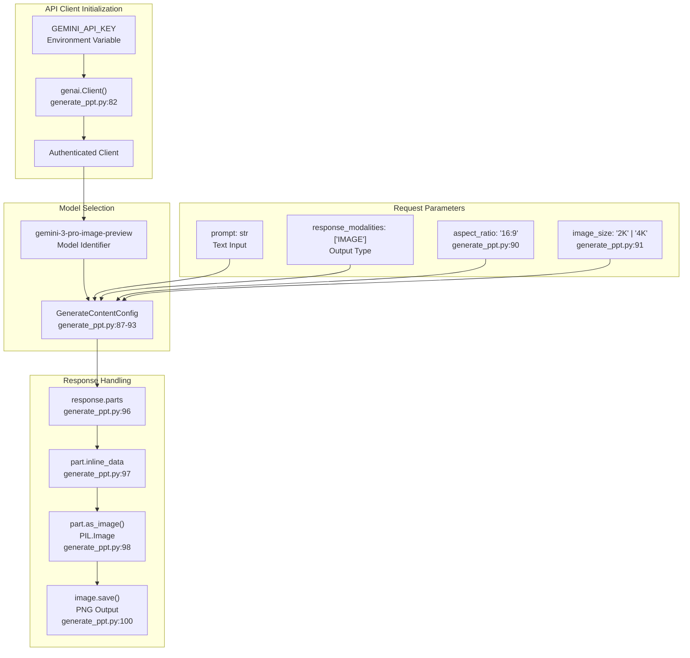
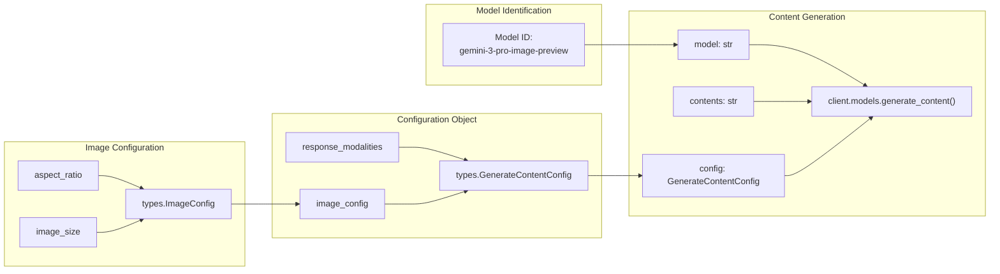
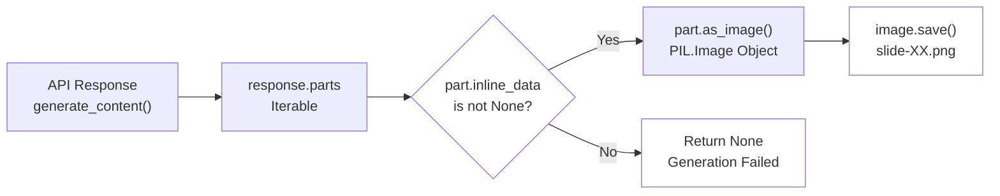
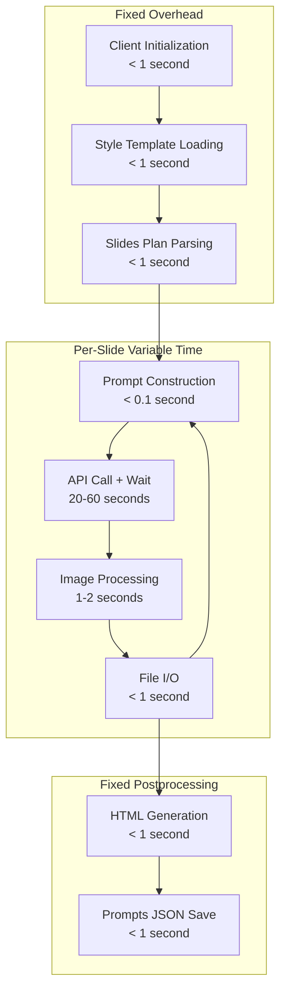
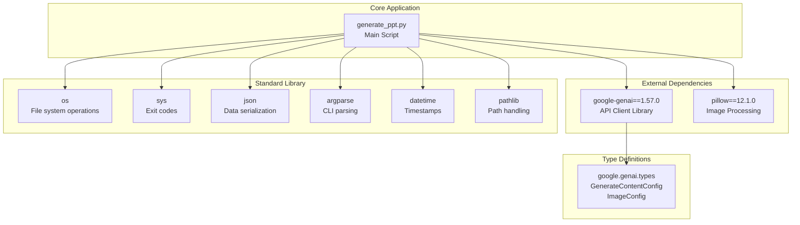
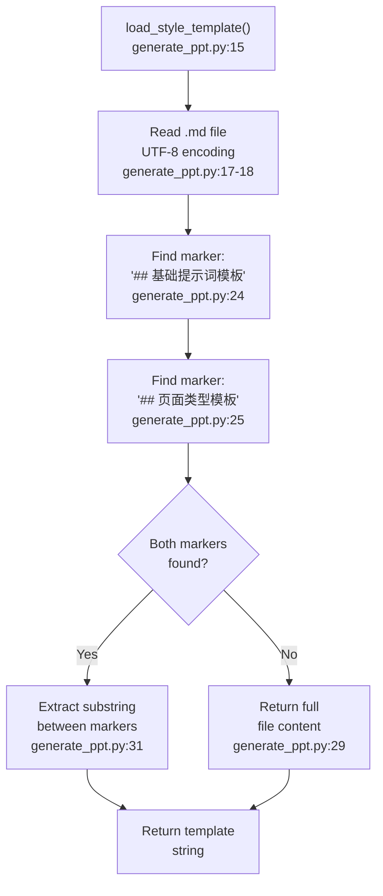
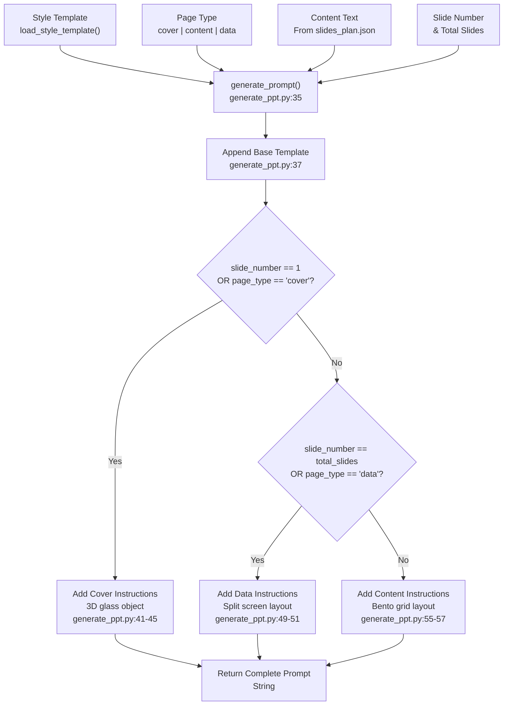
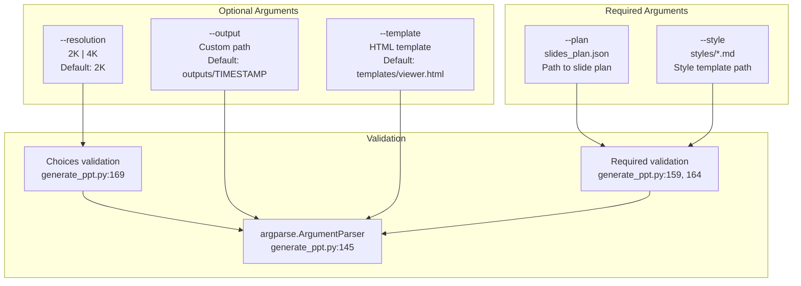

<!-- source: DeepWiki mcp.deepwiki.com · repo op7418/NanoBanana-PPT-Skills · page 8.2 Technical Specifications · fetched 2026-10-26 -->

# Technical Specifications

<details>
<summary>Relevant source files</summary>

The following files were used as context for generating this wiki page:

- [generate_ppt.py](generate_ppt.py)
- [ppt-generator.md](ppt-generator.md)
- [styles/gradient-glass.md](styles/gradient-glass.md)
- [styles/vector-illustration.md](styles/vector-illustration.md)

</details>


## Purpose and Scope

This document provides comprehensive technical specifications for the NanoBanana PPT Generator system, including API configuration, model parameters, resolution options, performance benchmarks, and runtime constraints. This reference is intended for developers implementing custom workflows, debugging generation issues, or integrating the system into production environments.

For configuration file formats and structure, see [Configuration Files](#8.1). For operational issues and error resolution, see [Troubleshooting](#8.3).

---

## API Specifications

### Gemini API Configuration

The system uses Google's Gemini API to generate slide images. The API client is instantiated and configured through the `google.genai` SDK.



**API Client Initialization**

| Component | Value | Location |
|-----------|-------|----------|
| SDK Package | `google.genai` | [generate_ppt.py:65-66]() |
| Client Class | `genai.Client` | [generate_ppt.py:82]() |
| Authentication | `GEMINI_API_KEY` environment variable | [generate_ppt.py:73]() |
| Error Handling | Exit with code 1 if key missing | [generate_ppt.py:74-77]() |

**Sources:** [generate_ppt.py:62-110]()

---

### Model Parameters



**Configuration Object Structure**

| Parameter | Type | Allowed Values | Default | Location |
|-----------|------|----------------|---------|----------|
| `model` | `str` | `"gemini-3-pro-image-preview"` | Required | [generate_ppt.py:85]() |
| `contents` | `str` | Text prompt (no max specified) | Required | [generate_ppt.py:86]() |
| `response_modalities` | `List[str]` | `['IMAGE']` | Required | [generate_ppt.py:88]() |
| `aspect_ratio` | `str` | `"16:9"` | `"16:9"` | [generate_ppt.py:90]() |
| `image_size` | `str` | `"2K"`, `"4K"` | `"2K"` | [generate_ppt.py:91]() |

**Sources:** [generate_ppt.py:84-94](), [styles/gradient-glass.md:82-86](), [styles/vector-illustration.md:111-115]()

---

## Image Generation Parameters

### Resolution Options

The system supports two resolution presets for different quality/performance tradeoffs.

| Resolution | Pixel Dimensions | File Size (est.) | Generation Time | Use Case |
|------------|------------------|------------------|-----------------|----------|
| 2K | 2752 × 1536 | 800 KB - 2 MB | ~30 seconds/slide | Standard presentations, daily use |
| 4K | 5504 × 3072 | 2 MB - 6 MB | ~60-90 seconds/slide | High-quality prints, large displays |

**Resolution Selection**

The resolution parameter is passed through the command-line interface:

```bash
python generate_ppt.py --resolution 2K  # or 4K
```

The argument is validated through `argparse.choices`:

| Code Location | Function |
|---------------|----------|
| [generate_ppt.py:168-172]() | Argument definition with choices constraint |
| [generate_ppt.py:91]() | Parameter passed to `ImageConfig` |
| [generate_ppt.py:205]() | Displayed in startup banner |
| [generate_ppt.py:216]() | Recorded in metadata JSON |

**Sources:** [generate_ppt.py:168-172](), [ppt-generator.md:68-70](), [styles/gradient-glass.md:85-90]()

---

### Aspect Ratio

The system enforces a fixed 16:9 aspect ratio for all generated slides to match standard presentation formats.

| Specification | Value | Rationale |
|---------------|-------|-----------|
| Aspect Ratio | `16:9` | Standard PowerPoint/Keynote format |
| Width Ratio | 16 units | Industry standard for modern displays |
| Height Ratio | 9 units | Optimized for 1080p/4K screens |
| Configuration | Hard-coded | [generate_ppt.py:90]() |

**Aspect Ratio Enforcement**

The aspect ratio is not user-configurable and is directly specified in the API call:

```python
image_config=types.ImageConfig(
    aspect_ratio="16:9",  # Hard-coded, not parameterized
    image_size=resolution
)
```

**Sources:** [generate_ppt.py:90](), [ppt-generator.md:283](), [styles/gradient-glass.md:84](), [styles/vector-illustration.md:113]()

---

### Response Mode

The API is configured to return only image data, excluding text or other modalities.

| Parameter | Value | Effect |
|-----------|-------|--------|
| `response_modalities` | `['IMAGE']` | Only PNG image data returned |
| Output Format | PNG | Lossless compression |
| Data Delivery | `inline_data` field in response | [generate_ppt.py:97]() |
| Image Extraction | `part.as_image()` | Returns `PIL.Image` object |

**Response Processing Pipeline**



**Sources:** [generate_ppt.py:96-105]()

---

## Performance Benchmarks

### Generation Timing

Performance varies based on resolution and network conditions.

| Metric | 2K Resolution | 4K Resolution | Notes |
|--------|---------------|---------------|-------|
| Single Slide | ~30 seconds | ~60-90 seconds | Network dependent |
| 5-Slide Deck | ~2.5 minutes | ~5-7.5 minutes | Sequential processing |
| 10-Slide Deck | ~5 minutes | ~10-15 minutes | No parallelization |
| 25-Slide Deck | ~12.5 minutes | ~25-37.5 minutes | Maximum recommended |

**Timing Factors**



**Performance Optimization**

The system processes slides sequentially (no parallel API calls) to:
- Manage API rate limits
- Prevent quota exhaustion
- Ensure deterministic output ordering
- Simplify error handling

**Sources:** [generate_ppt.py:224-251](), [ppt-generator.md:68-70]()

---

### Resource Usage

| Resource | Typical Usage | Peak Usage | Location |
|----------|---------------|------------|----------|
| Memory | 50-100 MB | 200 MB (4K images in buffer) | Python process |
| Disk Space | 5-10 MB per slide (2K) | 15-25 MB per slide (4K) | `outputs/` directory |
| Network Bandwidth | 2-5 MB per request | 10-15 MB per request (4K) | API calls |
| API Quota | 1 request per slide | 25 requests max per run | Gemini API limits |

**Sources:** [generate_ppt.py:99-100](), inferred from system architecture

---

## Python Dependencies

### Required Packages



**Package Specifications**

| Package | Version | Purpose | Import Location |
|---------|---------|---------|-----------------|
| `google-genai` | 1.57.0 | Gemini API client | [generate_ppt.py:65-66]() |
| `pillow` | 12.1.0 | Image object handling | [generate_ppt.py:98]() |
| `os` | stdlib | File path operations | [generate_ppt.py:7]() |
| `sys` | stdlib | Exit code management | [generate_ppt.py:8]() |
| `json` | stdlib | JSON parsing/serialization | [generate_ppt.py:9]() |
| `argparse` | stdlib | Command-line interface | [generate_ppt.py:10]() |
| `datetime` | stdlib | Timestamp generation | [generate_ppt.py:11]() |
| `pathlib` | stdlib | Path object handling | [generate_ppt.py:12]() |

**Dependency Management**

Installation command:
```bash
pip install google-genai==1.57.0 pillow==12.1.0
```

The system validates dependencies at runtime:
- Missing `google-genai`: Exit with installation instructions ([generate_ppt.py:67-70]())
- Missing API key: Exit with configuration instructions ([generate_ppt.py:74-77]())

**Sources:** [generate_ppt.py:7-12](), [generate_ppt.py:65-70](), [ppt-generator.md:40-42]()

---

## Style System Specifications

### Style File Format

Style templates define visual parameters through Markdown-formatted prompt templates.

| Component | Format | Location in Style File |
|-----------|--------|------------------------|
| Style ID | Plain text identifier | First line after header |
| Base Template | Markdown section | `## 基础提示词模板` section |
| Page Templates | Markdown subsections | `## 页面类型模板` section |
| Technical Params | Table format | `## 技术参数` section |

**Template Extraction Logic**



**Sources:** [generate_ppt.py:15-32](), [styles/gradient-glass.md:16-30](), [styles/vector-illustration.md:19-50]()

---

### Supported Styles

| Style ID | Model Support | Primary Use Cases | Key Visual Features |
|----------|---------------|-------------------|---------------------|
| `gradient-glass` | gemini-3-pro-image-preview, Seedream | Tech presentations, SaaS demos, business decks | Glassmorphism, 3D objects, neon gradients, Bento grid |
| `vector-illustration` | gemini-3-pro-image-preview, Notebookml, Youmind, Listenhub, Lovart | Education, creative projects, children's content | Flat design, black outlines, retro colors, geometric shapes |

**Style Template Structure**

| Section | Purpose | Example Content |
|---------|---------|-----------------|
| 基础提示词模板 | Global visual language | Typography, lighting, material definitions |
| 页面类型模板 | Page-specific layouts | Cover, content, data page compositions |
| 技术参数 | API configuration | Model name, aspect ratio, resolution options |

**Sources:** [styles/gradient-glass.md](), [styles/vector-illustration.md]()

---

## Prompt Engineering Specifications

### Prompt Construction Pipeline

The system constructs prompts by combining style templates with content and page-type-specific instructions.



**Page Type Determination Logic**

| Condition | Page Type Assignment | Template Used | Location |
|-----------|---------------------|---------------|----------|
| `slide_number == 1` | Cover | Cover page template | [generate_ppt.py:39]() |
| `page_type == "cover"` | Cover | Cover page template | [generate_ppt.py:39]() |
| `slide_number == total_slides` | Data/Summary | Data page template | [generate_ppt.py:47]() |
| `page_type == "data"` | Data | Data page template | [generate_ppt.py:47]() |
| All other cases | Content | Content page template | [generate_ppt.py:54]() |

**Sources:** [generate_ppt.py:35-59]()

---

### Prompt Structure

Each generated prompt follows this structure:

```
[Base Style Template]
(Visual language, materials, lighting, typography)

[Page Type Specific Instructions]
(Layout composition, element placement)

[Content Injection]
(User-provided text content)
```

**Example Prompt Components**

| Component | Source | Length (chars) | Location |
|-----------|--------|----------------|----------|
| Base Template | Style file `基础提示词模板` section | 500-1500 | [styles/gradient-glass.md:18-30]() |
| Cover Instructions | Hard-coded in `generate_prompt()` | 100-200 | [generate_ppt.py:41-45]() |
| Content Instructions | Hard-coded in `generate_prompt()` | 100-200 | [generate_ppt.py:55-57]() |
| Data Instructions | Hard-coded in `generate_prompt()` | 80-150 | [generate_ppt.py:49-51]() |
| User Content | From `slides_plan.json` | Variable | [generate_ppt.py:228]() |

**Sources:** [generate_ppt.py:35-59](), [ppt-generator.md:271-279]()

---

## Output Specifications

### File Structure

Generated outputs follow a timestamped directory structure:

```
outputs/
└── YYYYMMDD_HHMMSS/          # e.g., 20260109_143022
    ├── images/
    │   ├── slide-01.png
    │   ├── slide-02.png
    │   └── slide-NN.png
    ├── index.html            # Interactive viewer
    └── prompts.json          # Audit trail
```

**Directory Creation Logic**

| Parameter | Value | Location |
|-----------|-------|----------|
| Base directory | `outputs/` | [generate_ppt.py:197]() |
| Timestamp format | `%Y%m%d_%H%M%S` | [generate_ppt.py:196]() |
| Images subdirectory | `images/` | [generate_ppt.py:199]() |
| Override option | `--output` argument | [generate_ppt.py:174-176]() |

**Sources:** [generate_ppt.py:192-199](), [ppt-generator.md:289-297]()

---

### Image File Naming

| Pattern | Example | Format String |
|---------|---------|---------------|
| Slide images | `slide-01.png` | `f"slide-{slide_number:02d}.png"` |
| Zero-padding | `01`, `02`, ..., `99` | `:02d` format specifier |
| File location | `images/slide-XX.png` | [generate_ppt.py:99]() |

**Sources:** [generate_ppt.py:99](), [generate_ppt.py:119]()

---

### Metadata Output (prompts.json)

The system generates a complete audit trail in JSON format.

**Schema Specification**

```json
{
  "metadata": {
    "title": "string",
    "total_slides": "integer",
    "resolution": "string (2K|4K)",
    "style": "string (file path)",
    "generated_at": "string (ISO 8601)"
  },
  "slides": [
    {
      "slide_number": "integer",
      "page_type": "string (cover|content|data)",
      "content": "string (user content)",
      "prompt": "string (complete prompt sent to API)",
      "image_path": "string (path to generated PNG)"
    }
  ]
}
```

**Generation Logic**

| Field | Source | Location |
|-------|--------|----------|
| `metadata.title` | `slides_plan.json` | [generate_ppt.py:214]() |
| `metadata.total_slides` | Length of slides array | [generate_ppt.py:215]() |
| `metadata.resolution` | Command-line argument | [generate_ppt.py:216]() |
| `metadata.style` | Command-line argument | [generate_ppt.py:217]() |
| `metadata.generated_at` | `datetime.now().isoformat()` | [generate_ppt.py:218]() |
| `slides[].prompt` | Output of `generate_prompt()` | [generate_ppt.py:247]() |
| `slides[].image_path` | Return value of `generate_slide()` | [generate_ppt.py:248]() |

**File Writing**

| Function | Location | Encoding | Formatting |
|----------|----------|----------|------------|
| `save_prompts()` | [generate_ppt.py:136-141]() | UTF-8 | 2-space indent, non-ASCII preserved |

**Sources:** [generate_ppt.py:136-141](), [generate_ppt.py:212-221](), [generate_ppt.py:242-249]()

---

## Command-Line Interface

### Argument Specification



**Argument Definitions**

| Argument | Type | Required | Default | Validation | Location |
|----------|------|----------|---------|------------|----------|
| `--plan` | `str` | Yes | None | File must exist (implicit) | [generate_ppt.py:158-161]() |
| `--style` | `str` | Yes | None | File must exist (implicit) | [generate_ppt.py:163-166]() |
| `--resolution` | `str` | No | `"2K"` | Must be `"2K"` or `"4K"` | [generate_ppt.py:168-172]() |
| `--output` | `str` | No | `outputs/TIMESTAMP` | None | [generate_ppt.py:174-176]() |
| `--template` | `str` | No | `templates/viewer.html` | File must exist (implicit) | [generate_ppt.py:178-181]() |

**Usage Example**

```bash
python generate_ppt.py \
  --plan slides_plan.json \
  --style styles/gradient-glass.md \
  --resolution 2K \
  --output outputs/custom_name \
  --template templates/viewer.html
```

**Sources:** [generate_ppt.py:144-182](), [ppt-generator.md:148-164]()

---

## Technical Constraints

### API Limitations

| Constraint | Value | Impact | Mitigation |
|------------|-------|--------|------------|
| Rate Limit | Not specified by API | May throttle consecutive requests | Sequential processing implemented |
| Quota | Varies by API key tier | May exhaust on large decks | Monitor usage in Google AI Studio |
| Timeout | ~60 seconds per request | May fail on slow connections | Retry logic not implemented |
| Max Prompt Length | Not documented | Very long prompts may fail | Keep prompts under 2000 chars |

**Sources:** [generate_ppt.py:62-110](), inferred from system design

---

### File System Requirements

| Requirement | Specification | Validation |
|-------------|---------------|------------|
| Output Directory | Must be writable | `os.makedirs(..., exist_ok=True)` |
| Available Space | 50 MB minimum (5-slide deck @ 2K) | Not validated |
| Path Length | OS-dependent (255 chars on most systems) | Not validated |
| File Permissions | Read/write for Python process | Implicit |

**Sources:** [generate_ppt.py:199]()

---

### Runtime Environment

| Component | Requirement | Version Specification |
|-----------|-------------|----------------------|
| Python Interpreter | 3.8+ | Shebang: `#!/usr/bin/env python3` |
| Operating System | Unix-like (macOS, Linux) or Windows | Cross-platform code used |
| Network | Internet connectivity required | For API calls |
| Environment Variables | `GEMINI_API_KEY` must be set | Validated at runtime |

**Sources:** [generate_ppt.py:1](), [generate_ppt.py:73-77]()

---

