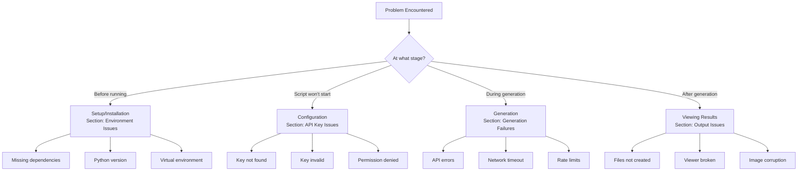
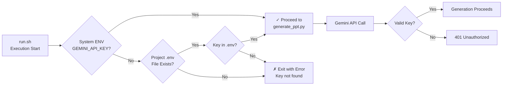
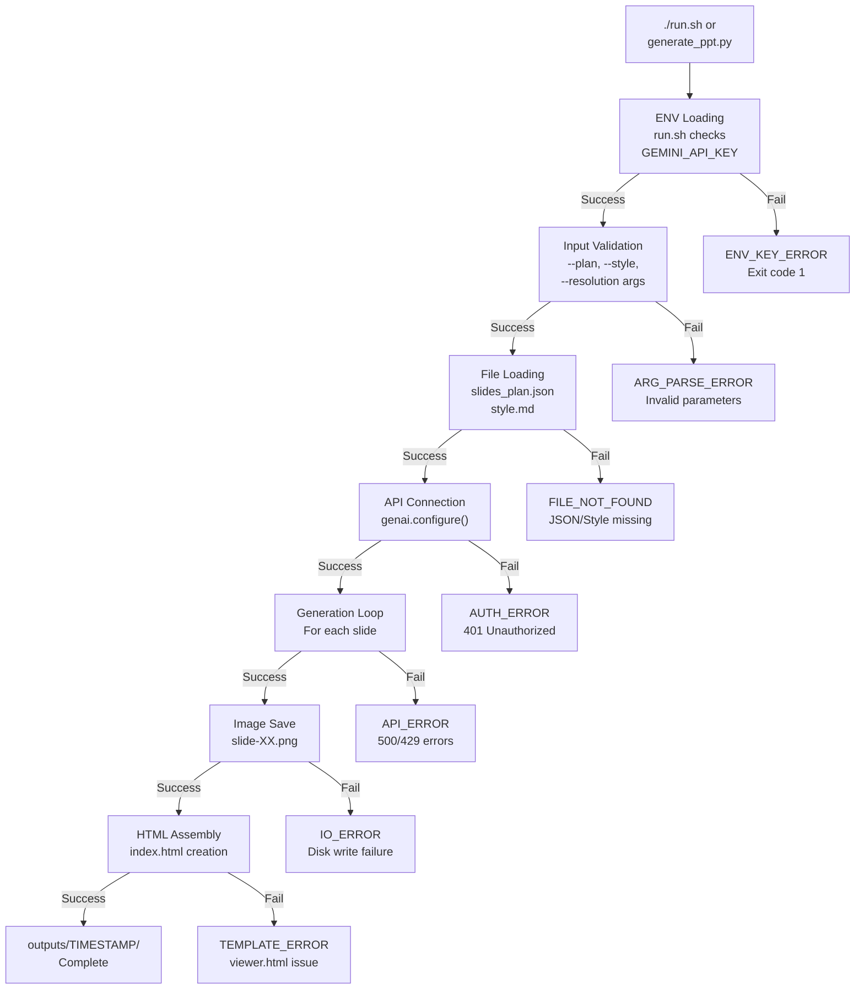

<!-- source: DeepWiki mcp.deepwiki.com · repo op7418/NanoBanana-PPT-Skills · page 8.3 Troubleshooting · fetched 2026-10-26 -->

# Troubleshooting

<details>
<summary>Relevant source files</summary>

The following files were used as context for generating this wiki page:

- [ENV_SETUP.md](ENV_SETUP.md)
- [QUICKSTART.md](QUICKSTART.md)
- [SECURITY.md](SECURITY.md)
- [SETUP_COMPLETE.md](SETUP_COMPLETE.md)

</details>


This document provides diagnostic procedures and solutions for common issues encountered when using the NanoBanana PPT Generator. It covers problems across the entire lifecycle: API key configuration, environment setup, generation pipeline execution, and output viewing.

For information about initial setup procedures, see [Installation](#2.2). For security best practices, see [Security Best Practices](#3.3). For usage instructions, see [Usage Guide](#4).

---

## Problem Categories

The troubleshooting process is organized by the stage at which the problem occurs. Use this decision tree to identify the relevant section:



**Sources:** [ENV_SETUP.md:1-246](), [QUICKSTART.md:183-219](), [SECURITY.md:1-227]()

---

## API Key Issues

API key problems are the most common failure mode. The system checks for `GEMINI_API_KEY` in multiple locations with a specific priority order.

### Key Resolution Priority



**Sources:** [ENV_SETUP.md:32-48](), [run.sh]()

### Error: "GEMINI_API_KEY not found"

**Symptom:** Script exits immediately with message indicating API key is missing.

**Diagnosis:**
```bash
# Check if key is in system environment
echo $GEMINI_API_KEY

# Check if .env file exists
ls -la .env

# Check .env file contents (if it exists)
cat .env | grep GEMINI_API_KEY
```

**Solution 1: Configure System Environment Variable (Recommended)**

For zsh:
```bash
echo 'export GEMINI_API_KEY="your-api-key-here"' >> ~/.zshrc
source ~/.zshrc
```

For bash:
```bash
echo 'export GEMINI_API_KEY="your-api-key-here"' >> ~/.bashrc
source ~/.bashrc
```

For fish:
```bash
set -Ux GEMINI_API_KEY "your-api-key-here"
```

**Solution 2: Create .env File**

```bash
# Copy template
cp .env.example .env

# Edit with your key
nano .env
# Add: GEMINI_API_KEY=your-actual-key-here
```

**Verification:**
```bash
# Test environment
echo $GEMINI_API_KEY

# Test script recognition
./run.sh --help
# Should show: "✅ 使用系统环境变量中的API密钥"
```

**Sources:** [ENV_SETUP.md:17-48](), [ENV_SETUP.md:101-126]()

### Error: "401 Unauthorized" or "Invalid API Key"

**Symptom:** Script starts but fails when calling Gemini API with authentication error.

**Diagnosis:**
```bash
# Verify key format (should start with "AIzaSy")
echo $GEMINI_API_KEY | cut -c1-6
# Expected output: AIzaSy

# Check key length (should be 39 characters)
echo $GEMINI_API_KEY | wc -c
# Expected output: 40 (39 + newline)
```

**Common Causes:**

| Cause | Symptom | Solution |
|-------|---------|----------|
| Expired key | 401 error | Regenerate in Google AI Studio |
| Wrong key format | Invalid format error | Verify key starts with `AIzaSy` |
| Trailing spaces | Authentication fails | Remove whitespace: `export GEMINI_API_KEY="${GEMINI_API_KEY// /}"` |
| Quote issues | Key includes quotes | Remove quotes from key value |

**Solution:**
1. Visit [Google AI Studio](https://makersuite.google.com/app/apikey)
2. Verify or regenerate API key
3. Update configuration:
   ```bash
   # Update system environment
   nano ~/.zshrc
   # Update the GEMINI_API_KEY line
   source ~/.zshrc
   ```
4. Verify:
   ```bash
   # Test API connectivity
   curl -H "x-goog-api-key: $GEMINI_API_KEY" \
     "https://generativelanguage.googleapis.com/v1beta/models"
   ```

**Sources:** [ENV_SETUP.md:130-166](), [QUICKSTART.md:5-11]()

### Error: Key Visible in Git Repository

**Symptom:** API key found in committed files or `git status` shows `.env` file.

**Immediate Action:**
```bash
# 1. Revoke the exposed key IMMEDIATELY
# Visit: https://makersuite.google.com/app/apikey
# Delete the compromised key

# 2. Generate new key

# 3. Verify .gitignore is working
git check-ignore -v .env
# Should output: .gitignore:15:.env    .env

# 4. Remove from staging if present
git rm --cached .env

# 5. Search for hardcoded keys
grep -r "AIzaSy" --exclude-dir=.git --exclude-dir=venv .
```

**Remove from History:**
```bash
# WARNING: This rewrites Git history
git filter-branch --force --index-filter \
  "git rm --cached --ignore-unmatch .env" \
  --prune-empty --tag-name-filter cat -- --all

# Force push (coordinate with team first)
git push origin --force --all
```

**Prevention Checklist:**
```bash
# Before each commit:
git status                    # Verify .env not listed
grep -r "AIzaSy" .           # Search for exposed keys
git check-ignore -v .env     # Confirm .gitignore works
```

**Sources:** [SECURITY.md:49-78](), [SECURITY.md:129-156](), [ENV_SETUP.md:50-75]()

---

## Environment Issues

### Error: "ModuleNotFoundError: No module named 'google.generativeai'"

**Symptom:** Python import fails when running `generate_ppt.py`.

**Diagnosis:**
```bash
# Check if virtual environment is activated
which python
# Should show: /path/to/project/venv/bin/python

# Check installed packages
pip list | grep -E "google-genai|pillow"
```

**Solution:**
```bash
# Activate virtual environment
source venv/bin/activate

# Verify activation (prompt should show (venv))
# Install dependencies
pip install google-genai==1.57.0 pillow==12.1.0

# Verify installation
python -c "import google.generativeai as genai; print('Success')"
```

**Sources:** [SETUP_COMPLETE.md:3-9](), [QUICKSTART.md:14-17]()

### Error: Virtual Environment Missing

**Symptom:** `source venv/bin/activate` fails with "No such file or directory".

**Solution:**
```bash
# Create virtual environment
python3 -m venv venv

# Activate
source venv/bin/activate

# Install dependencies
pip install --upgrade pip
pip install google-genai==1.57.0 pillow==12.1.0

# Verify
pip list
```

**Sources:** [QUICKSTART.md:120-126]()

### Error: Python Version Incompatibility

**Symptom:** Installation fails with syntax or compatibility errors.

**Requirements:**
- Python 3.8 or higher
- pip 20.0 or higher

**Diagnosis:**
```bash
# Check Python version
python3 --version

# Check pip version
pip --version
```

**Solution:**
```bash
# Install/upgrade Python (macOS)
brew install python@3.11

# Install/upgrade Python (Ubuntu)
sudo apt update
sudo apt install python3.11

# Use specific version
python3.11 -m venv venv
```

**Sources:** [SETUP_COMPLETE.md:3-9]()

---

## Generation Failures

### Generation Pipeline Failure Points



**Sources:** [QUICKSTART.md:183-219]()

### Error: "429 Too Many Requests"

**Symptom:** Generation fails after several slides with rate limit error.

**Cause:** Gemini API enforces rate limits:
- Requests per minute: ~60
- Requests per day: ~1,500
- Image generation is resource-intensive

**Diagnosis:**
```bash
# Check recent API usage
# View prompts.json to see timestamp gaps
cat outputs/*/prompts.json | jq '.[] | .timestamp'

# Calculate request frequency
# If requests are < 1 second apart, rate limit likely
```

**Solutions:**

**Option 1: Reduce Resolution**
```bash
# Use 2K instead of 4K (faster, lower quota usage)
./run.sh --plan plan.json --style styles/gradient-glass.md --resolution 2K
```

**Option 2: Add Delays (Manual Edit Required)**

Edit [generate_ppt.py]() to add delays between requests:
```python
import time

# After each API call, add:
time.sleep(2)  # 2-second delay between slides
```

**Option 3: Split Generation**
```bash
# Generate in batches
# Create plan_batch1.json (slides 1-5)
# Create plan_batch2.json (slides 6-10)

./run.sh --plan plan_batch1.json --resolution 2K
# Wait 5 minutes
./run.sh --plan plan_batch2.json --resolution 2K
```

**Sources:** [QUICKSTART.md:96-103](), [QUICKSTART.md:195-201]()

### Error: Network Timeout

**Symptom:** "Connection timeout" or "Request failed" during generation.

**Diagnosis:**
```bash
# Test basic connectivity
ping -c 3 generativelanguage.googleapis.com

# Test HTTPS access
curl -I https://generativelanguage.googleapis.com

# Check proxy settings
env | grep -i proxy
```

**Solutions:**

| Issue | Solution |
|-------|----------|
| Firewall blocking | Add exception for `*.googleapis.com` |
| Proxy configuration | Set `HTTP_PROXY` and `HTTPS_PROXY` env vars |
| DNS resolution | Use Google DNS: `8.8.8.8`, `8.8.4.4` |
| Timeout too short | Increase timeout in API client config |

**Sources:** [QUICKSTART.md:183-190]()

### Error: "Invalid JSON" in slides_plan.json

**Symptom:** Script fails with JSON parse error.

**Diagnosis:**
```bash
# Validate JSON syntax
python3 -m json.tool slides_plan.json

# Or use jq
jq . slides_plan.json
```

**Common JSON Errors:**

| Error | Symptom | Fix |
|-------|---------|-----|
| Trailing comma | `Expecting property name` | Remove comma after last element |
| Unescaped quotes | `Unterminated string` | Escape quotes: `\"` |
| Missing bracket | `Expecting '}' delimiter` | Add closing bracket |
| Unicode issues | `Invalid control character` | Use `\uXXXX` escapes |

**Valid Format Example:**
```json
{
  "slides": [
    {
      "page_type": "cover",
      "content": "Title text"
    },
    {
      "page_type": "content",
      "content": "Content text"
    }
  ]
}
```

**Sources:** [QUICKSTART.md:159-168]()

### Error: Image Generation Returns Black/Corrupted Images

**Symptom:** `slide-XX.png` files created but appear black or corrupted.

**Diagnosis:**
```bash
# Check file size (should be > 100KB for 2K, > 500KB for 4K)
ls -lh outputs/*/slide-*.png

# Verify image format
file outputs/*/slide-01.png

# Check if pillow can open
python3 -c "from PIL import Image; Image.open('outputs/*/slide-01.png').show()"
```

**Common Causes:**

1. **API returned error instead of image**
   - Check `prompts.json` for error messages
   - Verify prompt content is appropriate

2. **Style prompt conflicts**
   - Test with default gradient-glass style
   - Verify custom style syntax

3. **Resolution mismatch**
   - Confirm `--resolution` matches model capabilities
   - Try 2K instead of 4K

**Solution:**
```bash
# Regenerate single slide for testing
# Edit slides_plan.json to contain only 1 slide
./run.sh --plan test_single.json --style styles/gradient-glass.md --resolution 2K

# Check prompts.json for API response
cat outputs/*/prompts.json | jq '.[] | .response_status'
```

**Sources:** [QUICKSTART.md:96-103]()

---

## Output & Viewer Issues

### Error: index.html Shows No Images

**Symptom:** HTML viewer opens but slides don't appear.

**Diagnosis:**
```bash
# Check if images exist
ls outputs/TIMESTAMP/slide-*.png

# Check index.html references
grep "slide-" outputs/TIMESTAMP/index.html

# Verify file paths are relative
cat outputs/TIMESTAMP/index.html | grep -o 'src="[^"]*"'
```

**Common Issues:**

| Problem | Symptom | Fix |
|---------|---------|-----|
| Wrong directory | Images in different folder | Move HTML to image directory |
| Absolute paths | Paths like `/Users/...` | Regenerate with relative paths |
| Missing images | Some slides missing | Re-run generation for failed slides |
| Browser cache | Old version displayed | Hard refresh: Cmd+Shift+R |

**Solution:**
```bash
# Verify output structure
tree outputs/TIMESTAMP/
# Should show:
# ├── index.html
# ├── slide-01.png
# ├── slide-02.png
# └── prompts.json

# If structure is wrong, check templates/viewer.html
cat templates/viewer.html | grep -A5 "img src"
```

**Sources:** [SETUP_COMPLETE.md:66-75]()

### Error: Keyboard Controls Not Working

**Symptom:** Arrow keys don't navigate slides.

**Diagnosis:**
```bash
# Open browser console (F12)
# Look for JavaScript errors

# Check if viewer.html loaded correctly
curl file://$(pwd)/outputs/TIMESTAMP/index.html | grep "addEventListener"
```

**Solution:**
- Ensure JavaScript is enabled in browser
- Test in different browser (Chrome, Firefox, Safari)
- Check if focus is on page (click page first)
- Verify [templates/viewer.html]() is complete

**Control Reference:**

| Key | Function |
|-----|----------|
| `←` / `→` | Previous/Next slide |
| `↑` / `Home` | First slide |
| `↓` / `End` | Last slide |
| `Space` | Toggle autoplay |
| `Esc` | Toggle fullscreen |
| `H` | Hide/show controls |

**Sources:** [SETUP_COMPLETE.md:132-139]()

---

## Diagnostic Commands Reference

### Complete Environment Verification

```bash
#!/bin/bash
# Run this script to check entire environment

echo "=== System Check ==="
python3 --version
pip --version
echo ""

echo "=== Virtual Environment ==="
which python
source venv/bin/activate
pip list | grep -E "google-genai|pillow"
echo ""

echo "=== API Key Configuration ==="
if [ -z "$GEMINI_API_KEY" ]; then
    echo "❌ GEMINI_API_KEY not found in environment"
else
    echo "✅ GEMINI_API_KEY present"
    echo "Length: $(echo $GEMINI_API_KEY | wc -c)"
fi

if [ -f .env ]; then
    echo "✅ .env file exists"
    grep -q "GEMINI_API_KEY" .env && echo "✅ Key in .env"
else
    echo "⚠️  .env file not found"
fi
echo ""

echo "=== Git Safety ==="
git check-ignore -v .env
grep -r "AIzaSy" --exclude-dir=.git --exclude-dir=venv . || echo "✅ No hardcoded keys found"
echo ""

echo "=== File Structure ==="
ls -la | grep -E "generate_ppt.py|run.sh|styles|templates"
ls styles/*.md
ls templates/*.html
echo ""

echo "=== Recent Outputs ==="
ls -lt outputs/ | head -5
```

**Sources:** [ENV_SETUP.md:67-75](), [SECURITY.md:49-78](), [SETUP_COMPLETE.md:142-165]()

### Test Generation Pipeline

```bash
# Minimal test with single slide
cat > test_minimal.json << 'EOF'
{
  "slides": [
    {
      "page_type": "cover",
      "content": "Test Slide - Verification"
    }
  ]
}
EOF

# Run test
./run.sh --plan test_minimal.json --style styles/gradient-glass.md --resolution 2K

# Verify output
ls -lh outputs/*/slide-01.png
file outputs/*/slide-01.png
open outputs/*/index.html
```

**Sources:** [SETUP_COMPLETE.md:50-71]()

---

## Emergency Recovery Procedures

### Procedure 1: Complete Environment Reset

```bash
# 1. Backup existing outputs
mv outputs outputs_backup_$(date +%Y%m%d_%H%M%S)

# 2. Remove virtual environment
rm -rf venv

# 3. Recreate virtual environment
python3 -m venv venv
source venv/bin/activate

# 4. Reinstall dependencies
pip install --upgrade pip
pip install google-genai==1.57.0 pillow==12.1.0

# 5. Verify API key
echo $GEMINI_API_KEY

# 6. Test minimal generation
./run.sh --plan test_minimal.json --style styles/gradient-glass.md --resolution 2K
```

**Sources:** [SETUP_COMPLETE.md:26-39]()

### Procedure 2: API Key Compromise Response

```bash
# IMMEDIATE ACTIONS (within 5 minutes)
# 1. Revoke key at https://makersuite.google.com/app/apikey
# 2. Generate new key
# 3. Update environment:
export GEMINI_API_KEY="new-key-here"
echo 'export GEMINI_API_KEY="new-key-here"' >> ~/.zshrc

# CLEANUP (within 1 hour)
# 4. Remove from Git history (if exposed)
git filter-branch --force --index-filter \
  "git rm --cached --ignore-unmatch .env" \
  --prune-empty --tag-name-filter cat -- --all

# 5. Verify removal
grep -r "AIzaSy" --exclude-dir=.git --exclude-dir=venv .

# 6. Force push (coordinate with team)
git push origin --force --all

# MONITORING (ongoing)
# 7. Check API usage for abnormal patterns
# 8. Review access logs
# 9. Rotate key after 3-6 months
```

**Sources:** [SECURITY.md:129-156](), [ENV_SETUP.md:167-200]()

### Procedure 3: Generation Pipeline Hang

```bash
# If script hangs during generation:

# 1. Identify process
ps aux | grep generate_ppt.py

# 2. Check if API is responding
tail -f outputs/*/prompts.json  # Watch for progress

# 3. Graceful termination (wait 30s)
kill -TERM <pid>

# 4. Force kill if needed
kill -9 <pid>

# 5. Check partial outputs
ls outputs/TIMESTAMP/slide-*.png

# 6. Resume from last successful slide
# Edit slides_plan.json to remove completed slides
# Re-run generation
```

**Sources:** [QUICKSTART.md:195-201]()

---

## Common Error Messages

| Error Message | Cause | Solution Section |
|--------------|-------|------------------|
| `GEMINI_API_KEY not found` | Missing environment variable | [API Key Issues](#api-key-issues) |
| `401 Unauthorized` | Invalid or expired API key | [Error: 401 Unauthorized](#error-401-unauthorized-or-invalid-api-key) |
| `429 Too Many Requests` | Rate limit exceeded | [Error: 429 Too Many Requests](#error-429-too-many-requests) |
| `ModuleNotFoundError` | Missing Python dependencies | [Error: ModuleNotFoundError](#error-modulenotfounderror-no-module-named-googlegenerativeai) |
| `FileNotFoundError: slides_plan.json` | Missing or wrong path to plan file | [Error: Invalid JSON](#error-invalid-json-in-slides_planjson) |
| `json.decoder.JSONDecodeError` | Malformed JSON in plan file | [Error: Invalid JSON](#error-invalid-json-in-slides_planjson) |
| `Connection timeout` | Network connectivity issue | [Error: Network Timeout](#error-network-timeout) |
| `No such file or directory: venv` | Virtual environment not created | [Error: Virtual Environment Missing](#error-virtual-environment-missing) |
| Images appear black/corrupted | API error or prompt issue | [Error: Image Generation Returns Black/Corrupted Images](#error-image-generation-returns-blackcorrupted-images) |
| HTML viewer shows no images | File path or structure issue | [Error: index.html Shows No Images](#error-indexhtml-shows-no-images) |

**Sources:** [QUICKSTART.md:183-219](), [ENV_SETUP.md:1-246](), [SECURITY.md:1-227]()

---

## Performance Troubleshooting

### Slow Generation Times

**Expected Performance:**
- 2K resolution: ~30 seconds per slide
- 4K resolution: ~60 seconds per slide

**Diagnosis:**
```bash
# Time a single slide
time ./run.sh --plan test_minimal.json --style styles/gradient-glass.md --resolution 2K

# Check network latency
ping -c 10 generativelanguage.googleapis.com

# Monitor system resources
top -l 1 | grep -E "CPU|PhysMem"
```

**If Slower Than Expected:**

| Issue | Symptom | Solution |
|-------|---------|----------|
| Poor network | Ping > 100ms | Use wired connection or better WiFi |
| High system load | CPU > 80% | Close other applications |
| Disk I/O bottleneck | Slow writes | Use SSD for outputs directory |
| API congestion | Varies by time | Retry during off-peak hours |

**Sources:** [QUICKSTART.md:96-103](), [QUICKSTART.md:195-201]()

---

## Getting Additional Help

If problems persist after following this guide:

1. **Collect Diagnostic Information:**
   ```bash
   # Save system info
   python3 --version > debug_info.txt
   pip list >> debug_info.txt
   echo $GEMINI_API_KEY | wc -c >> debug_info.txt
   ls -la >> debug_info.txt
   
   # Save last error
   cat outputs/*/prompts.json | jq '.[-1]' >> debug_info.txt
   ```

2. **Review Documentation:**
   - [Installation](#2.2) for setup issues
   - [API Key Setup](#3.1) for authentication
   - [Security Best Practices](#3.3) for safety
   - [Technical Specifications](#8.2) for API details

3. **Check Configuration Files:**
   - [ENV_SETUP.md:1-246]() for environment setup
   - [SECURITY.md:1-227]() for Git safety
   - [QUICKSTART.md:1-240]() for usage examples

**Sources:** [QUICKSTART.md:220-227](), [SETUP_COMPLETE.md:142-165]()