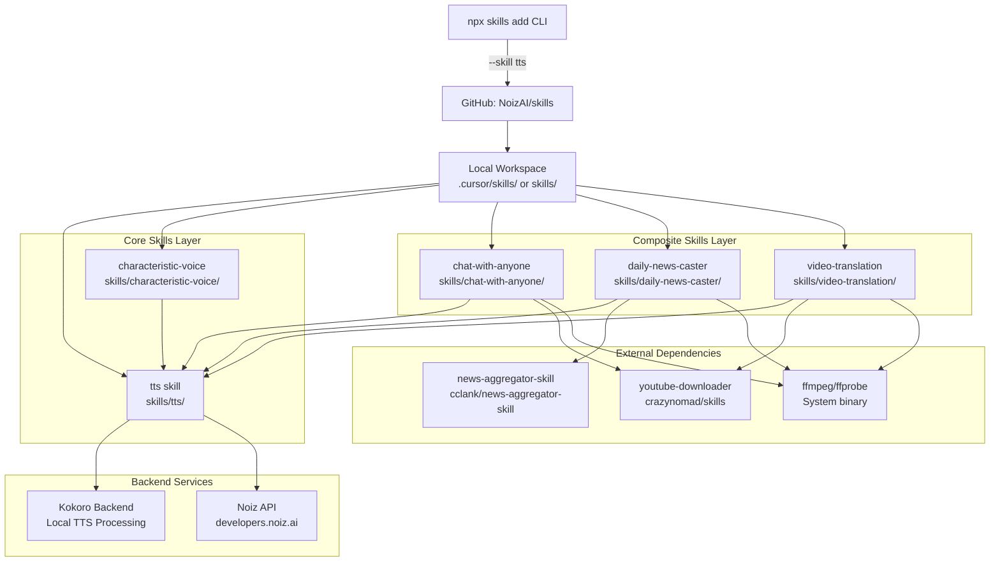
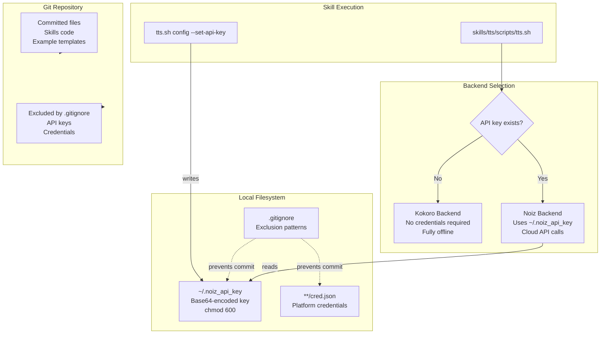
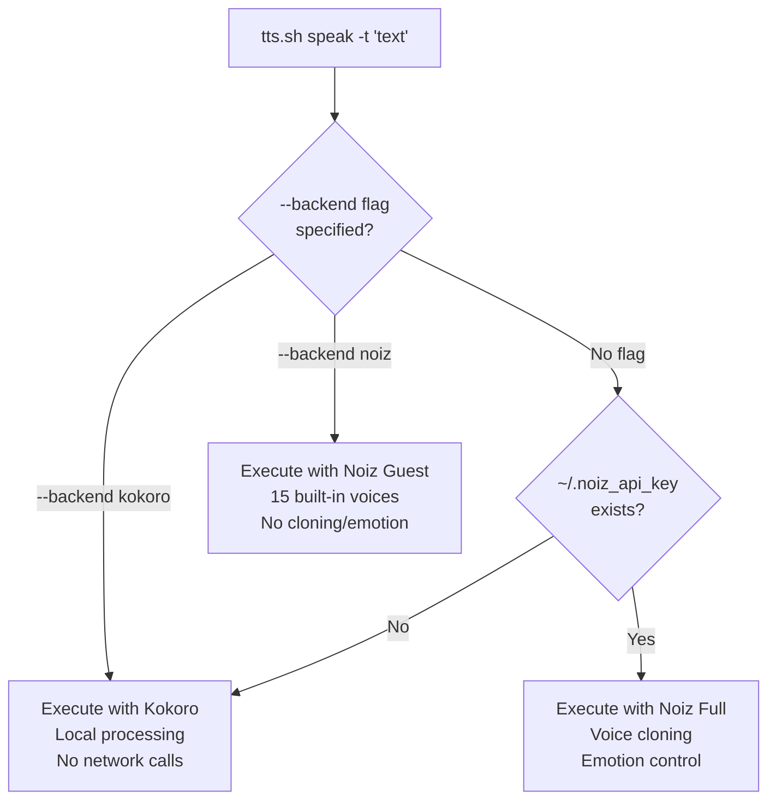

<!-- source: DeepWiki mcp.deepwiki.com · repo NoizAI/skills · page 1 Introduction · fetched 2026-10-26 -->

# Introduction

<details>
<summary>Relevant source files</summary>

The following files were used as context for generating this wiki page:

- [README.md](README.md)
- [README.zh-CN.md](README.zh-CN.md)
- [skills/chat-with-anyone/SKILL.md](skills/chat-with-anyone/SKILL.md)
- [skills/daily-news-caster/SKILL.md](skills/daily-news-caster/SKILL.md)

</details>


This document introduces the NoizAI/skills repository, its architecture, and core concepts. It covers the modular skills system, installation workflow, security model, and backend infrastructure. For specific skill documentation, see their respective pages: [TTS Skill](#3), [Characteristic Voice](#4), [Chat With Anyone](#5.1), [Daily News Caster](#5.2), and [Video Translation](#5.3).

## What is NoizAI/skills?

NoizAI/skills is a GitHub repository that serves as a central catalog of modular AI skills for human-like text-to-speech generation and voice-based workflows. The repository implements a **local-first architecture** where skills run on the user's machine, keeping sensitive text and audio assets localized rather than requiring cloud processing.

The system is designed around a hierarchical structure:

- **Core Skills**: Foundational capabilities like `tts` (text-to-speech) and `characteristic-voice` (expressive speech)
- **Composite Skills**: Complex workflows like `chat-with-anyone`, `daily-news-caster`, and `video-translation` that combine core skills with external dependencies

Sources: [README.md:1-40]()

## Skills Installation System

### npx skills add CLI

Skills are installed using the `npx skills add` command-line interface, which fetches skill code directly from GitHub repositories. The CLI supports:

| Command | Purpose |
|---------|---------|
| `npx skills add NoizAI/skills --list --full-depth` | List all available skills from the repository |
| `npx skills add NoizAI/skills --full-depth --skill tts -y` | Install a specific skill by name |
| `npx skills add NoizAI/skills` | Install skills interactively |
| `npx skills add . --list --full-depth` | Local development mode (run from repository directory) |

The `--full-depth` flag ensures all dependencies and subdirectories are fetched. The `-y` flag skips confirmation prompts.

**Installation Location**: Skills are installed to either `.cursor/skills/` or `skills/` directory in the workspace, depending on the environment.

Sources: [README.md:8-22]()

### Skills Ecosystem Architecture

The following diagram shows the complete skills ecosystem, installation flow, and dependency relationships:



Sources: [README.md:31-39](), High-Level System Architecture Diagrams (Diagram 1)

## Available Skills Catalog

The repository currently provides five skills:

| Skill Name | Type | Purpose | Entry Point |
|------------|------|---------|-------------|
| `tts` | Core | Text-to-speech conversion with Kokoro/Noiz backends, timeline rendering, voice cloning | `skills/tts/scripts/tts.sh` |
| `characteristic-voice` | Core | Expressive speech with fillers, emotional presets, companion-like output | `skills/characteristic-voice/scripts/speak.sh` |
| `chat-with-anyone` | Composite | Voice cloning from online sources for character roleplay | `skills/chat-with-anyone/SKILL.md` |
| `daily-news-caster` | Composite | Dual-host podcast generation from real-time news | `skills/daily-news-caster/SKILL.md` |
| `video-translation` | Composite | Video dubbing with subtitle translation and audio replacement | `skills/video-translation/SKILL.md` |

**SKILL.md Format**: Each skill includes a `SKILL.md` file with front matter (name, description) and workflow instructions. See [Skill Definition Format](#7.2) for details.

Sources: [README.md:31-39]()

## Local-First Security Model

The architecture implements a **local-first security** design with the following principles:

### Execution Model

All skill scripts execute on the user's local machine. Text input, generated audio, and intermediate files remain in the local filesystem unless explicitly uploaded by the user.

### Credential Management

Sensitive credentials are stored locally and excluded from version control:

- **API Keys**: Stored in `~/.noiz_api_key` (chmod 600)
- **Chat Platform Credentials**: Stored in `**/cred.json` files
- **Version Control**: `.gitignore` excludes both patterns to prevent accidental commits



**Configuration Command**: The `tts.sh config --set-api-key` subcommand provides a controlled interface for API key setup, validating base64 encoding and setting proper file permissions.

Sources: [README.md:24-29](), [README.md:84-92](), High-Level System Architecture Diagrams (Diagram 6)

## Dual Backend Architecture

The TTS system supports two backends with different trade-offs:

### Kokoro Backend (Local)

- **Execution**: Fully local, zero network calls
- **Privacy**: Maximum privacy, no data leaves machine
- **Features**: Voice blending, EPUB/PDF support, speed control
- **Duration Control**: Uses ffmpeg atempo filter for time-stretching
- **Activation**: Automatic when no API key configured, or via `--backend kokoro`

### Noiz Backend (Cloud)

- **Execution**: Cloud API at `developers.noiz.ai`
- **Authentication**: Two-tier (guest mode without key, full mode with key)
- **Features**: Voice cloning via `--ref-audio`, emotion control, precise duration, auto-emotion detection
- **Duration Control**: Server-side processing with padding/trimming
- **Activation**: Automatic when `~/.noiz_api_key` exists

### Backend Selection Flow



For detailed backend comparison and feature matrices, see [Backend System](#2).

Sources: [README.md:84-92](), High-Level System Architecture Diagrams (Diagram 2, Diagram 4)

## Core vs Composite Skills

### Core Skills

Core skills are **self-contained** and have no dependencies on other skills in the repository. They provide foundational capabilities:

- **tts**: Text-to-speech synthesis with backend abstraction
- **characteristic-voice**: Extends TTS with expressive features (fillers, emotional presets)

### Composite Skills

Composite skills **orchestrate workflows** by combining core skills with external dependencies:

- **chat-with-anyone**: Uses `youtube-downloader` (external) + `ffmpeg` (system) + `tts` (core)
- **daily-news-caster**: Uses `news-aggregator-skill` (external) + `ffmpeg` (system) + `tts` (core)
- **video-translation**: Uses `youtube-downloader` (external) + `ffmpeg` (system) + `tts` (core)

### Dependency Pattern

All composite skills converge on the `tts` skill as the universal audio generation endpoint. The line-by-line generation pattern (demonstrated in daily-news-caster) is architecturally significant: instead of synthesizing entire scripts at once, composite skills call TTS once per dialogue line or subtitle segment, enabling per-line voice control and avoiding large API payloads.

Sources: [skills/daily-news-caster/SKILL.md:58-82](), [skills/chat-with-anyone/SKILL.md:48-54](), High-Level System Architecture Diagrams (Diagram 3, Diagram 5)

## Quick Start Example

After installation, verify the system with a characteristic-voice command:

```bash
bash skills/characteristic-voice/scripts/speak.sh \
  --preset comfort -t "Hmm... I'm right here." -o comfort.wav
```

This command:
1. Uses the `characteristic-voice` skill
2. Applies the "comfort" emotional preset
3. Synthesizes the text with appropriate fillers and tone
4. Outputs to `comfort.wav`

For comprehensive installation and usage instructions, see [Quick Start Guide](#1.1). For CLI reference, see [Command-Line Reference](#9).

Sources: [README.md:41-47]()

---

