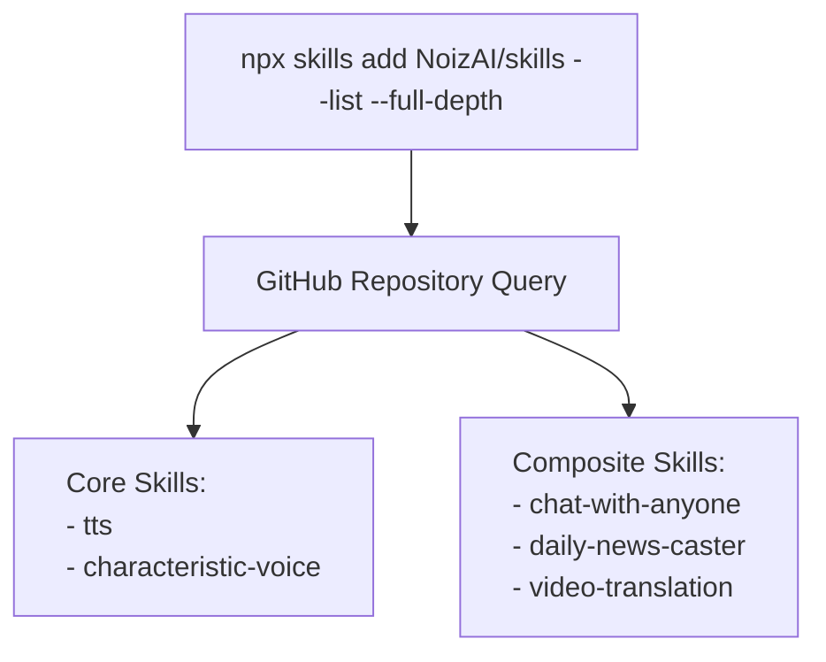
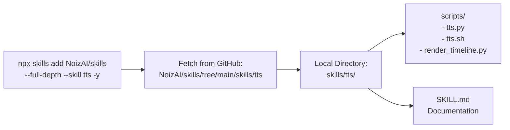
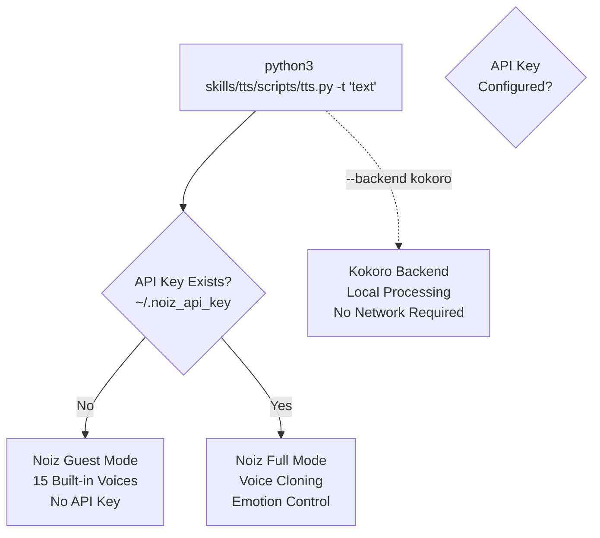
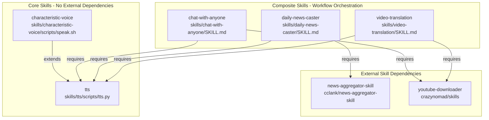
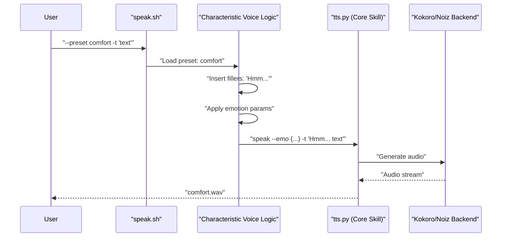
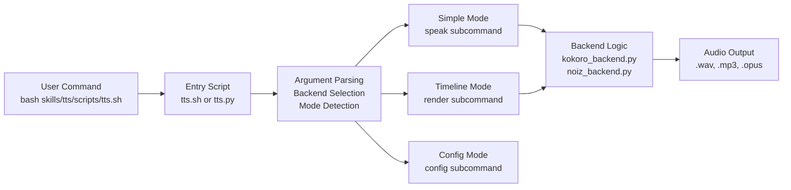

<!-- source: DeepWiki mcp.deepwiki.com · repo NoizAI/skills · page 1.1 Quick Start Guide · fetched 2026-10-26 -->

# Quick Start Guide

<details>
<summary>Relevant source files</summary>

The following files were used as context for generating this wiki page:

- [README.md](README.md)
- [skills/chat-with-anyone/SKILL.md](skills/chat-with-anyone/SKILL.md)
- [skills/daily-news-caster/SKILL.md](skills/daily-news-caster/SKILL.md)
- [skills/tts/SKILL.md](skills/tts/SKILL.md)

</details>


This guide walks you through installing your first skill, running basic text-to-speech commands, and understanding the available skill catalog. You will use the `npx skills add` CLI to fetch skills from the NoizAI/skills repository and execute them locally.

For architectural details about core vs composite skills and backend systems, see [System Architecture Overview](#1.2). For comprehensive TTS documentation, see [TTS (Text-to-Speech) Skill](#3).

---

## Prerequisites

Before starting, ensure you have:

| Requirement | Purpose | Verification Command |
|-------------|---------|---------------------|
| Node.js (>=14) | To run `npx skills add` | `node --version` |
| Python 3 | To execute skill scripts | `python3 --version` |
| ffmpeg | For audio processing (timeline mode, composite skills) | `ffmpeg -version` |

**Sources:** [README.md:8-22]()

---

## Step 1: List Available Skills

The `npx skills add` command can fetch skills directly from GitHub. Start by listing all available skills to see what's in the repository:

```bash
npx skills add NoizAI/skills --list --full-depth
```

This command queries the repository and displays all skills organized by type (core skills and composite skills).

**Expected Output Structure:**



**Diagram: npx skills add List Command Flow**

**Sources:** [README.md:10-22]()

---

## Step 2: Install the TTS Skill

The `tts` skill is the foundational core skill for text-to-speech conversion. Install it with:

```bash
npx skills add NoizAI/skills --full-depth --skill tts -y
```

**What This Does:**



**Diagram: TTS Skill Installation Process**

After installation, the skill is available at `skills/tts/` in your workspace.

**Sources:** [README.md:14-15](), [skills/tts/SKILL.md:1-6]()

---

## Step 3: Run Your First TTS Command

The TTS skill operates in **Simple Mode** by default, converting text directly to audio. The main entry point is `skills/tts/scripts/tts.py`.

### Basic Text-to-Speech

Generate speech from a text string:

```bash
python3 skills/tts/scripts/tts.py -t "Hello world" -o hello.wav
```

Or use the shell wrapper (identical functionality):

```bash
bash skills/tts/scripts/tts.sh -t "Hello world" -o hello.wav
```

### Backend Selection

The TTS skill automatically selects a backend based on API key configuration:



**Diagram: TTS Backend Auto-Detection Flow**

**Sources:** [skills/tts/SKILL.md:109-119](), [skills/tts/SKILL.md:141-145]()

---

## Step 4: Try Guest Mode (No API Key)

Without configuring an API key, the TTS skill uses **Noiz Guest Mode** with 15 built-in voices:

```bash
# Use a specific guest voice (English male mentor)
python3 skills/tts/scripts/tts.py -t "Hello world" --voice-id 883b6b7c -o hello.wav

# Use a Japanese female voice
python3 skills/tts/scripts/tts.py -t "こんにちは" --voice-id 063a4491 -o hello_ja.wav

# Use a Chinese male voice
python3 skills/tts/scripts/tts.py -t "你好世界" --voice-id 87cb2405 -o hello_zh.wav
```

### Available Guest Voices

| voice_id | Name | Language | Gender |
|----------|------|----------|--------|
| `883b6b7c` | The Mentor (Alex) | en | M |
| `5a68d66b` | The Healer (Serena) | en | F |
| `87cb2405` | 建国｜知识科普 | zh | M |
| `b4775100` | 悦悦｜社交分享 | zh | F |
| `063a4491` | 販売員（なおみ） | ja | F |

See [skills/tts/SKILL.md:121-139]() for the complete list of 15 voices.

**Sources:** [skills/tts/SKILL.md:109-140]()

---

## Step 5: Configure Noiz API Key (Optional)

For advanced features like voice cloning and emotion control, configure a Noiz API key:

```bash
# Obtain key from https://developers.noiz.ai/api-keys
bash skills/tts/scripts/tts.sh config --set-api-key YOUR_BASE64_KEY
```

This command writes the key to `~/.noiz_api_key` (chmod 600 for security). After configuration:

```bash
# Voice cloning from reference audio
python3 skills/tts/scripts/tts.py -t "Hello in my voice" \
  --ref-audio ./my_voice.wav -o cloned.wav

# Convert a text file to audio
python3 skills/tts/scripts/tts.py -f article.txt -o article.mp3
```

**Sources:** [README.md:84-92](), [skills/tts/SKILL.md:141-149]()

---

## Step 6: Explore the Skills Catalog

The repository contains two types of skills:

### Core Skills

Core skills provide foundational capabilities and have no external skill dependencies:

| Skill | Command | Purpose |
|-------|---------|---------|
| `tts` | `npx skills add NoizAI/skills --skill tts -y` | Text-to-speech with dual backends |
| `characteristic-voice` | `npx skills add NoizAI/skills --skill characteristic-voice -y` | Expressive speech with fillers and emotion presets |

### Composite Skills

Composite skills orchestrate complex workflows by combining core skills with external dependencies:

| Skill | Command | Purpose |
|-------|---------|---------|
| `chat-with-anyone` | `npx skills add NoizAI/skills --skill chat-with-anyone -y` | Chat in any character's voice via auto voice extraction |
| `daily-news-caster` | `npx skills add NoizAI/skills --skill daily-news-caster -y` | Generate dual-host news podcasts from real-time feeds |
| `video-translation` | `npx skills add NoizAI/skills --skill video-translation -y` | Translate and dub videos with voice cloning |

**Skill Dependency Map:**



**Diagram: Skill Dependencies and Execution Paths**

**Sources:** [README.md:31-39](), [skills/chat-with-anyone/SKILL.md:72-75](), [skills/daily-news-caster/SKILL.md:14-19]()

---

## Step 7: Try a Composite Skill

Install and run the `characteristic-voice` skill to generate expressive speech:

```bash
# Install the skill
npx skills add NoizAI/skills --full-depth --skill characteristic-voice -y

# Generate comfort-style speech
bash skills/characteristic-voice/scripts/speak.sh \
  --preset comfort -t "Hmm... I'm right here." -o comfort.wav
```

This skill extends the TTS skill by adding:
- **Non-lexical fillers** (um, hmm, ah) for natural pauses
- **Emotional presets** (goodnight, morning, comfort, celebrate, chat)
- **Personality tuning** via JSON configuration

**Execution Flow:**



**Diagram: Characteristic Voice Execution Sequence**

**Sources:** [README.md:41-47](), [skills/characteristic-voice/SKILL.md:1-6]()

---

## Understanding Skill Execution Paths

When you run a skill command, the execution follows this pattern:



**Diagram: TTS Skill Execution Flow with File Paths**

**Sources:** [skills/tts/SKILL.md:18-34](), [skills/tts/SKILL.md:38-95]()

---

## Local Development Mode

If you're developing skills locally, you can install from your working directory:

```bash
# From within the NoizAI/skills repository clone
npx skills add . --list --full-depth

# Install a skill from local directory
npx skills add . --skill tts -y
```

This is useful for testing changes before publishing to GitHub.

**Sources:** [README.md:20-22]()

---

## Next Steps

Now that you have the basics working, explore these areas:

| Topic | Description | Documentation |
|-------|-------------|---------------|
| Timeline Mode | SRT-based dubbing with per-segment voice control | [Timeline Mode - SRT to Audio](#3.2) |
| Voice Cloning | Clone voices from reference audio | [Simple Mode - Text to Audio](#3.1) |
| Backend Configuration | Choose between Kokoro (local) and Noiz (cloud) | [Backend System](#2) |
| Composite Skills | Build complex workflows | [Composite Skills](#5) |
| Chat Platform Integration | Send voice messages to Feishu/Telegram/Discord | [Integration with Chat Platforms](#6) |

**Sources:** [README.md:24-29](), [skills/tts/SKILL.md:1-152]()

---

## Common Installation Commands Reference

```bash
# List all available skills
npx skills add NoizAI/skills --list --full-depth

# Install specific skills
npx skills add NoizAI/skills --skill tts -y
npx skills add NoizAI/skills --skill characteristic-voice -y
npx skills add NoizAI/skills --skill chat-with-anyone -y
npx skills add NoizAI/skills --skill daily-news-caster -y
npx skills add NoizAI/skills --skill video-translation -y

# Install all skills from the repository
npx skills add NoizAI/skills --full-depth

# Local development
npx skills add . --list --full-depth
```

**Sources:** [README.md:8-22](), [README.md:31-39]()

---

