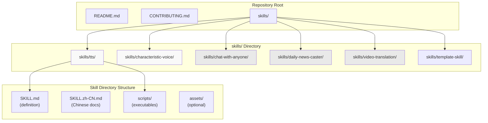
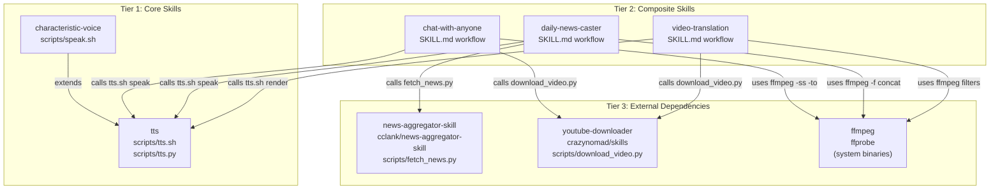
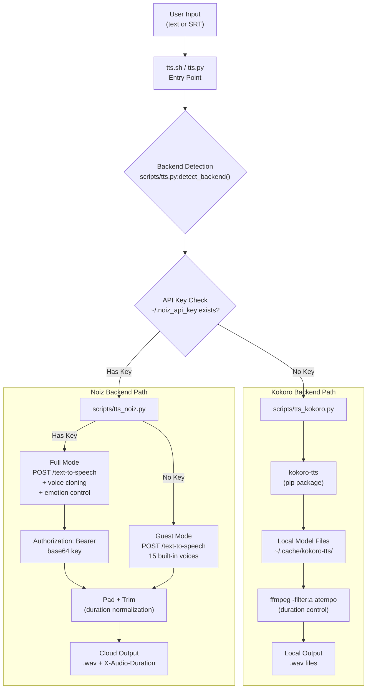
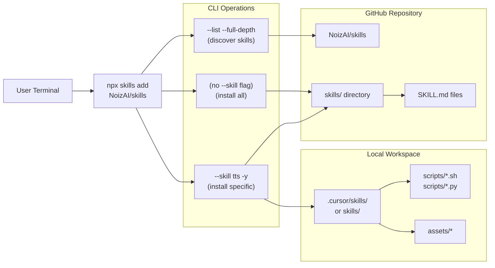
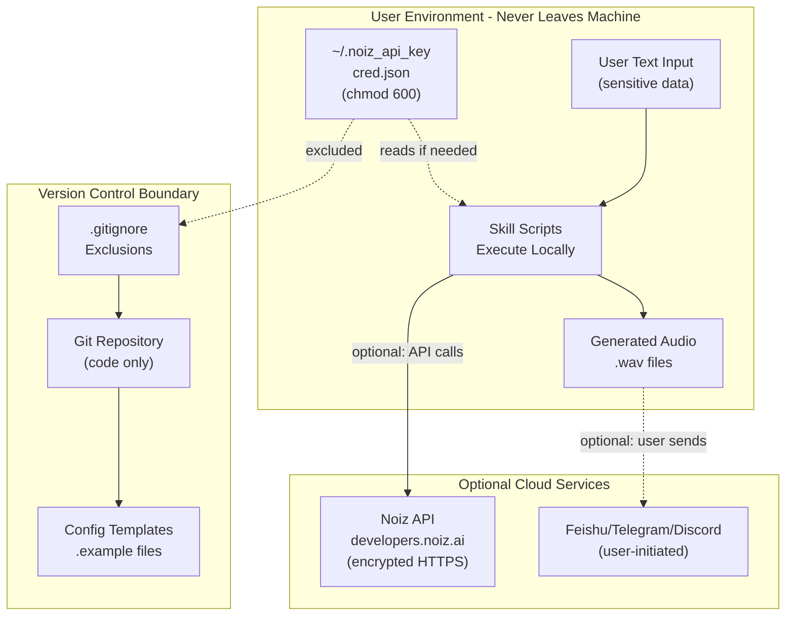
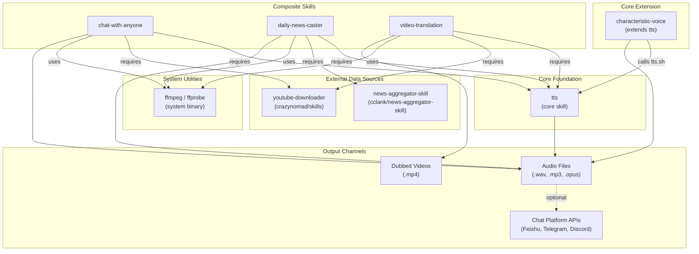

<!-- source: DeepWiki mcp.deepwiki.com · repo NoizAI/skills · page 1.2 System Architecture Overview · fetched 2026-10-26 -->

# System Architecture Overview

<details>
<summary>Relevant source files</summary>

The following files were used as context for generating this wiki page:

- [CONTRIBUTING.md](CONTRIBUTING.md)
- [README.md](README.md)
- [skills/README.md](skills/README.md)
- [skills/chat-with-anyone/SKILL.md](skills/chat-with-anyone/SKILL.md)
- [skills/daily-news-caster/SKILL.md](skills/daily-news-caster/SKILL.md)
- [skills/template-skill/SKILL.md](skills/template-skill/SKILL.md)
- [skills/template-skill/SKILL.zh-CN.md](skills/template-skill/SKILL.zh-CN.md)

</details>


## Purpose and Scope

This document describes the high-level architecture of the NoizAI/skills repository, explaining how skills are organized, how they relate to each other, and how the backend system operates. It covers the three-tier skill hierarchy (core, composite, external), the dual backend architecture, skill installation mechanisms, and security principles.

For installation instructions, see [Quick Start Guide](#1.1). For detailed backend configuration and API usage, see [Backend System](#2). For individual skill documentation, see sections 3-5.

## Architectural Principles

The skills repository is built on four core architectural principles:

1. **Local-First Execution**: All skills run on the user's local machine. Sensitive text and generated audio remain under user control, with cloud services used only optionally for advanced features.

2. **Hierarchical Skill Composition**: Skills are organized into three tiers—core skills provide foundational capabilities, composite skills orchestrate workflows, and external skills are pluggable dependencies.

3. **Backend Agnosticism**: The TTS core skill supports dual backends (Kokoro local, Noiz cloud) with automatic selection based on API key presence, enabling users to choose between privacy and advanced features.

4. **Declarative Skill Definition**: Each skill is defined by a `SKILL.md` file with structured front matter, making skills discoverable and executable by agents without custom code.

**Sources:** [README.md:1-110]()

## Skill Hierarchy and Organization

### Directory Structure



**Skill Directory Structure**

Each skill follows a standardized directory convention with kebab-case naming:

| Component | Location | Purpose |
|-----------|----------|---------|
| Skill Definition | `skills/<skill-name>/SKILL.md` | Declarative metadata with front matter (name, description) and workflow instructions |
| Localized Docs | `skills/<skill-name>/SKILL.zh-CN.md` | Chinese documentation (optional) |
| Executable Scripts | `skills/<skill-name>/scripts/*.sh` or `*.py` | Shell or Python entry points |
| Assets | `skills/<skill-name>/assets/` | Reference audio, example files (optional) |

**Sources:** [skills/README.md:1-16](), [CONTRIBUTING.md:1-29](), [skills/template-skill/SKILL.md:1-55]()

### Three-Tier Skill Taxonomy

#### Skill Type Classification with Code Entities



**Tier 1: Core Skills** are self-contained capabilities with no dependencies on other skills:

- **`tts`**: Text-to-speech engine with entry points `tts.sh` and `tts.py`. Provides subcommands: `speak` (simple mode), `render` (timeline mode), `to-srt` (subtitle generation), `config` (API key management).
- **`characteristic-voice`**: Extends `tts` with emotional presets and filler insertion via `speak.sh`.

**Tier 2: Composite Skills** orchestrate workflows by combining core skills with external dependencies:

- **`chat-with-anyone`**: Multi-step workflow defined in `SKILL.md` that invokes `download_video.py`, `ffmpeg` for audio extraction, and `tts.sh speak --ref-audio` for voice cloning.
- **`daily-news-caster`**: Fetches news via `fetch_news.py`, generates scripts internally, then calls `tts.sh speak` line-by-line and concatenates with `ffmpeg -f concat`.
- **`video-translation`**: Downloads videos, translates subtitles, calls `tts.sh render` in timeline mode, and mixes audio with `ffmpeg` filters.

**Tier 3: External Dependencies** are either:
- Skills from other GitHub repositories (e.g., `cclank/news-aggregator-skill`)
- System utilities (e.g., `ffmpeg`, `ffprobe`)

**Sources:** [README.md:31-39](), [skills/daily-news-caster/SKILL.md:1-89](), [skills/chat-with-anyone/SKILL.md:1-76]()

## Backend Architecture

### Dual Backend Design

The TTS skill implements a dual backend architecture with automatic selection logic:



**Backend Selection Logic**

The backend is chosen automatically in [scripts/tts.py]():

1. Check for `~/.noiz_api_key` file
2. If present and valid → Noiz backend (full features)
3. If absent but `--backend noiz` specified → Noiz guest mode (limited)
4. Default → Kokoro backend (local-only)

**Feature Comparison Matrix**

| Feature | Kokoro Backend | Noiz Guest Mode | Noiz Full Mode |
|---------|----------------|-----------------|----------------|
| **API Key Required** | No | No | Yes |
| **Network Required** | No | Yes | Yes |
| **Voice Cloning** | No | No | Yes (`--ref-audio`) |
| **Emotion Control** | No | No | Yes (`--emo`, `--auto-emotion`) |
| **Voice Selection** | `--voice` parameter | `--voice-id` (15 built-in) | `--voice-id` + cloning |
| **Duration Control** | `atempo` filter (tempo adjustment) | Server-side + pad/trim | Server-side + pad/trim |
| **Voice Blending** | Yes (`v1:60,v2:40`) | No | No |
| **EPUB/PDF Support** | Yes | No | No |

**Sources:** [README.md:84-92](), [skills/tts/SKILL.md]()

## Skill Installation and Management

### NPX Skills Add CLI



**Installation Commands**

| Command | Purpose | Result |
|---------|---------|--------|
| `npx skills add NoizAI/skills --list --full-depth` | List all available skills from repository | Displays skill catalog with descriptions |
| `npx skills add NoizAI/skills --skill tts -y` | Install specific skill (`tts`) | Downloads `skills/tts/` to local workspace |
| `npx skills add NoizAI/skills` | Install all skills | Downloads entire `skills/` directory |
| `npx skills add . --list --full-depth` | Local development mode | List skills from current directory |

**Installation Targets**: Skills are installed to either `.cursor/skills/` (Cursor IDE) or `skills/` (generic workspace) depending on the environment.

**Sources:** [README.md:8-22]()

## Composite Skill Execution Pattern

### Line-by-Line Generation Workflow

Composite skills follow a consistent pattern where audio generation happens incrementally rather than monolithically:

```mermaid
sequenceDiagram
    participant Agent
    participant ExternalSkill["External Skill<br/>(fetch_news.py or<br/>download_video.py)"]
    participant InternalLogic["Agent Internal Logic<br/>(script generation)"]
    participant TTSScript["skills/tts/scripts/tts.sh"]
    participant FFmpeg["ffmpeg concat"]
    participant Output["Final Output"]
    
    Agent->>ExternalSkill: "Fetch data<br/>(news or video)"
    ExternalSkill-->>Agent: "JSON or audio file"
    
    Agent->>InternalLogic: "Transform data<br/>(generate script)"
    InternalLogic-->>Agent: "Structured content<br/>(lines or segments)"
    
    loop For each line/segment
        Agent->>TTSScript: "tts.sh speak -t 'text'<br/>--ref-audio host.wav<br/>-o line_N.wav"
        TTSScript-->>Agent: "line_N.wav"
    end
    
    Agent->>Agent: "Create list.txt:<br/>file 'line_01.wav'<br/>file 'line_02.wav'"
    
    Agent->>FFmpeg: "ffmpeg -f concat<br/>-safe 0 -i list.txt<br/>-c copy output.wav"
    FFmpeg-->>Output: "output.wav"
```

**Why Line-by-Line?** This pattern provides three architectural benefits:

1. **Per-Segment Voice Control**: Each line can use different `--ref-audio` (e.g., Host A vs Host B in podcasts)
2. **API Efficiency**: Avoids sending full scripts to TTS APIs, reducing token usage
3. **Incremental Progress**: Enables progress tracking and partial recovery on failure

**Example from daily-news-caster**: [skills/daily-news-caster/SKILL.md:58-82]() demonstrates this pattern:

```bash
# Generate audio for each dialogue line
bash path/to/tts.sh speak -t "Welcome to today's news..." \
  --backend noiz --ref-audio host_A.wav -o line_01.wav

bash path/to/tts.sh speak -t "The main takeaway is..." \
  --backend noiz --ref-audio host_B.wav -o line_02.wav

# Concatenate all segments
ffmpeg -f concat -safe 0 -i list.txt -c copy podcast_output.wav
```

**Sources:** [skills/daily-news-caster/SKILL.md:58-82](), [skills/chat-with-anyone/SKILL.md:48-54]()

## Security and Configuration Model

### Local-First Data Flow



**Security Principles**

1. **Credential Isolation**: API keys stored in `~/.noiz_api_key` with `chmod 600` permissions, excluded via `.gitignore`
2. **Local Execution**: All scripts run on user's machine; text never transmitted unless user explicitly chooses Noiz backend
3. **Zero-Trust Cloud**: Kokoro backend option enables 100% offline operation
4. **Explicit Opt-In**: Cloud features require user action (`tts.sh config --set-api-key`)

**Configuration Precedence**:
1. Environment variables (e.g., `NOIZ_API_KEY`)
2. File-based keys (`~/.noiz_api_key`)
3. Default to local backend (Kokoro)

**Sources:** [README.md:25-26](), [README.md:84-92](), [CONTRIBUTING.md:1-29]()

## Cross-Skill Dependency Graph



**Dependency Installation Pattern**

Composite skills declare dependencies in their `SKILL.md` workflow sections. For example, [skills/daily-news-caster/SKILL.md:14-19]():

```bash
# Install external skill from different repository
npx skills add https://github.com/cclank/news-aggregator-skill \
  --skill news-aggregator-skill -y

# Install core skill from NoizAI/skills
npx skills add https://github.com/noizai/skills --skill tts -y
```

**Execution Pattern**: Composite skills invoke external dependencies directly via their script paths (e.g., `python3 path/to/fetch_news.py --source all --limit 10`).

**Sources:** [skills/daily-news-caster/SKILL.md:14-28](), [skills/chat-with-anyone/SKILL.md:73-76](), [README.md:31-39]()

## Skill Definition Format

Every skill is defined by a `SKILL.md` file with YAML front matter:

```markdown
---
name: skill-name
description: One-line description of what this skill does and when to use it
---

# Skill Name

## Triggers
- User phrases that should activate this skill

## Workflow
1. Step-by-step execution instructions
2. Including exact commands to run

## Dependencies
- Other skills or external tools required

## Limitations
- Capability boundaries and known failure modes
```

This declarative format enables agents to discover capabilities, understand prerequisites, and execute workflows without hardcoded logic. For detailed specification, see [Skill Definition Format](#7.2).

**Sources:** [skills/template-skill/SKILL.md:1-55](), [CONTRIBUTING.md:10-15]()

---

