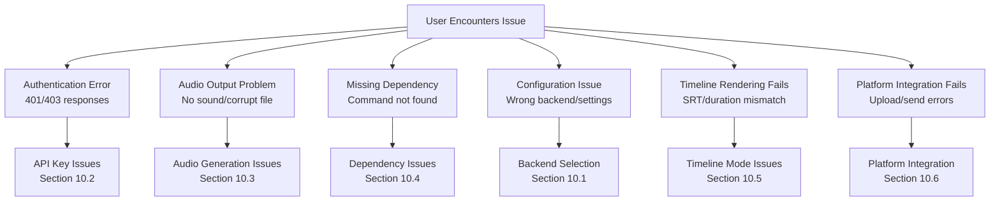
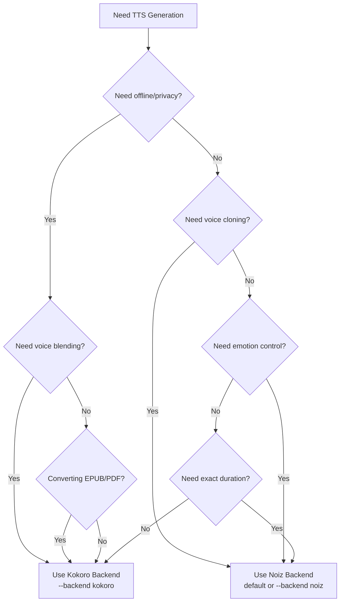
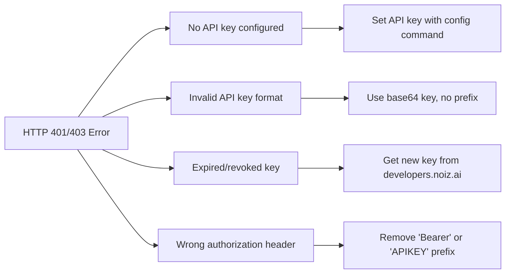
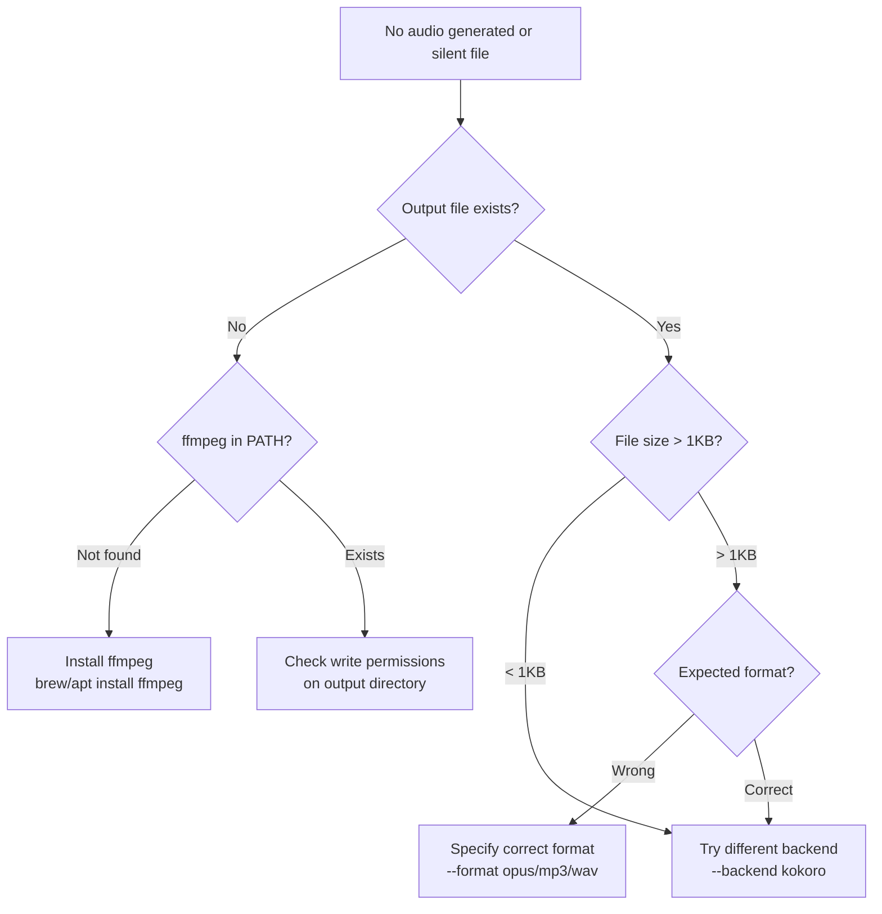
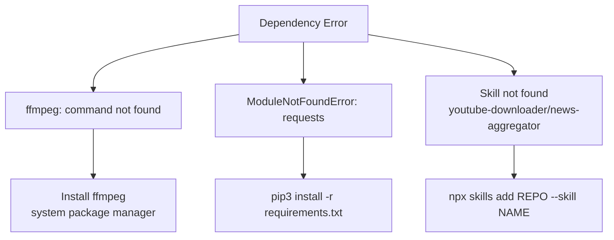
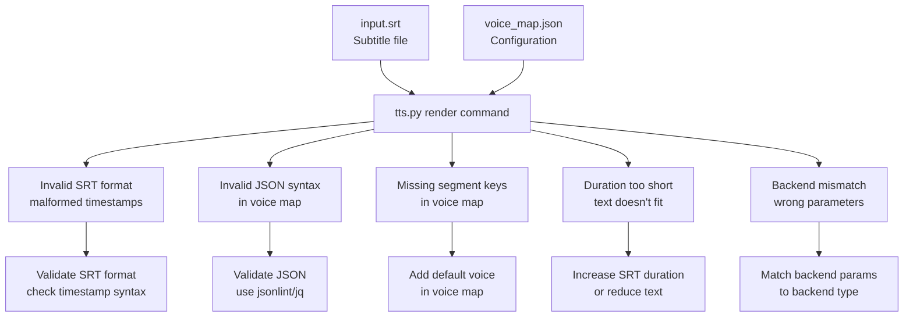
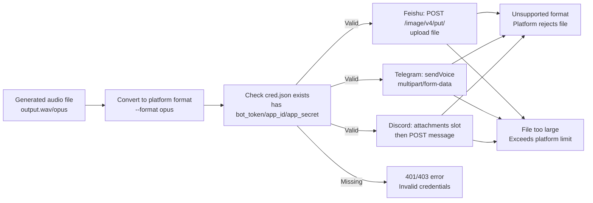

<!-- source: DeepWiki mcp.deepwiki.com · repo NoizAI/skills · page 10 Troubleshooting and FAQ · fetched 2026-10-26 -->

# Troubleshooting and FAQ

<details>
<summary>Relevant source files</summary>

The following files were used as context for generating this wiki page:

- [README.md](README.md)
- [skills/chat-with-anyone/SKILL.md](skills/chat-with-anyone/SKILL.md)
- [skills/daily-news-caster/SKILL.md](skills/daily-news-caster/SKILL.md)
- [skills/tts/SKILL.md](skills/tts/SKILL.md)

</details>


This page provides solutions to common issues encountered when using the NoizAI/skills system, including error messages, configuration problems, and frequently asked questions. For general system setup, see [Quick Start Guide](#1.1). For backend-specific configuration details, see [Backend System](#2).

---

## Common Error Categories

The following diagram maps error symptoms to their underlying causes and the sections below that address them:



**Sources:** [skills/tts/SKILL.md](), [README.md]()

---

## 10.1 Backend Selection Issues

### Problem: Don't know which backend to use

**Decision flowchart:**



**Feature comparison:**

| Feature | Kokoro | Noiz Guest | Noiz Full |
|---------|--------|------------|-----------|
| Requires API key | No | No | Yes |
| Requires internet | No | Yes | Yes |
| Voice cloning (`--ref-audio`) | No | No | Yes |
| Emotion control (`--emo`) | No | No | Yes |
| Voice blending (`v1:60,v2:40`) | Yes | No | No |
| EPUB/PDF native support | Yes | No | No |
| Timeline mode | Yes | No | Yes |
| Exact duration control | atempo only | No | Server-side |
| Number of voices | ~40 | 15 | Unlimited (clone) |

**Solution:**
- For **privacy-first/offline** work: use `--backend kokoro`
- For **voice cloning** from reference audio: use Noiz with API key
- For **emotion control**: use Noiz with API key
- For **EPUB/audiobook** conversion: use Kokoro
- For **testing without setup**: use Noiz guest mode (no key required)

**Sources:** [skills/tts/SKILL.md:96-108]()

---

## 10.2 API Key and Authentication Issues

### Error: `401 Unauthorized` or `403 Forbidden`

**Common causes:**



**Solution 1: No API key configured**

If you see `401` and haven't set an API key:

```bash
# Set your API key
python3 skills/tts/scripts/tts.py config --set-api-key YOUR_BASE64_KEY
```

The key is stored at `~/.noiz_api_key`. Verify it exists:
```bash
cat ~/.noiz_api_key
```

**Solution 2: Invalid authorization format**

The Noiz API requires **only** the base64-encoded key with **no prefix**. Common mistakes:

```bash
# ❌ WRONG - has "Bearer " prefix
Authorization: Bearer YOUR_KEY

# ❌ WRONG - has "APIKEY " prefix
Authorization: APIKEY YOUR_KEY

# ✅ CORRECT - base64 key only
Authorization: YOUR_BASE64_KEY
```

**Solution 3: Guest mode fallback**

If you don't have an API key, the system auto-detects this and uses guest mode with 15 built-in voices. Guest mode limitations:
- No voice cloning (`--ref-audio` ignored)
- No emotion control (`--emo` ignored)
- No timeline mode rendering
- Only basic `--voice-id`, `--speed`, `--format` supported

To explicitly use guest mode:
```bash
python3 skills/tts/scripts/tts.py -t "Hello" --voice-id 883b6b7c -o hello.wav
```

**Solution 4: Verify key validity**

Get a new API key from [developers.noiz.ai/api-keys](https://developers.noiz.ai/api-keys), then reconfigure:
```bash
# Remove old key
rm ~/.noiz_api_key

# Set new key
python3 skills/tts/scripts/tts.py config --set-api-key NEW_KEY
```

**Sources:** [skills/tts/SKILL.md:147-149](), [README.md:84-92]()

---

## 10.3 Audio Generation Issues

### Problem: No audio output or silent file

**Diagnostic decision tree:**



**Common scenarios:**

| Symptom | Likely Cause | Solution |
|---------|-------------|----------|
| File not created | Missing ffmpeg | `which ffmpeg` → install if not found |
| File exists but 0 bytes | Write permission error | Check directory permissions |
| File < 1KB | API error/empty response | Check API key, try `--backend kokoro` |
| Correct size but no sound | Wrong audio codec | Use `ffprobe output.wav` to inspect |
| Timeline mode fails | Missing SRT or voice map | Verify both files exist and are valid JSON/SRT |

**Solution: Install ffmpeg**

Timeline mode and some audio processing requires `ffmpeg`:

```bash
# macOS
brew install ffmpeg

# Ubuntu/Debian
sudo apt-get install ffmpeg

# Verify installation
ffmpeg -version
ffprobe -version
```

**Solution: Test with simplest command**

Strip away all options to isolate the issue:

```bash
# Minimal test - Kokoro backend (no network)
python3 skills/tts/scripts/tts.py -t "Test" --backend kokoro -o test.wav

# Minimal test - Noiz guest (no API key)
python3 skills/tts/scripts/tts.py -t "Test" --voice-id 883b6b7c -o test.wav
```

If the minimal command works, add options one at a time to find the problematic parameter.

**Sources:** [skills/tts/SKILL.md:141-145](), [README.md:24-29]()

---

## 10.4 Dependency Issues

### Error: `ModuleNotFoundError` or `Command not found`

**Dependency resolution map:**



### Missing external skills

**Problem:** `news-aggregator-skill` or `youtube-downloader` not found

Composite skills like `daily-news-caster` and `chat-with-anyone` depend on external skills that must be installed separately.

**Solution for daily-news-caster:**

```bash
# Install news-aggregator-skill
npx skills add https://github.com/cclank/news-aggregator-skill --skill news-aggregator-skill -y

# Install tts skill
npx skills add https://github.com/noizai/skills --skill tts -y
```

**Solution for chat-with-anyone:**

```bash
# Install youtube-downloader skill
npx skills add https://github.com/crazynomad/skills --skill youtube-downloader -y

# Install tts skill
npx skills add https://github.com/noizai/skills --skill tts -y
```

Verify installation:
```bash
# List installed skills
npx skills add . --list --full-depth
```

**Sources:** [skills/daily-news-caster/SKILL.md:14-19](), [skills/chat-with-anyone/SKILL.md:72-75]()

---

## 10.5 Timeline Mode Issues

### Error: Duration mismatch or audio/subtitle desync

**Timeline rendering pipeline and common failure points:**



### Problem 1: SRT format errors

Valid SRT format:
```
1
00:00:00,000 --> 00:00:03,500
First subtitle text

2
00:00:03,500 --> 00:00:07,000
Second subtitle text
```

Common issues:
- Missing sequence numbers
- Wrong timestamp format (must be `HH:MM:SS,mmm`)
- Missing blank line between segments

**Solution:**
```bash
# Validate SRT structure
python3 -c "
import pysrt
subs = pysrt.open('input.srt')
for sub in subs:
    print(f'{sub.index}: {sub.start} -> {sub.end}')
"
```

### Problem 2: Voice map JSON errors

**Valid Kokoro voice map:**
```json
{
  "default": { "voice": "af_bella", "lang": "en-us" },
  "segments": {
    "1": { "voice": "af_sarah" },
    "3-5": { "voice": "am_adam", "speed": 1.1 }
  }
}
```

**Valid Noiz voice map:**
```json
{
  "default": { "voice_id": "883b6b7c" },
  "segments": {
    "1": { "voice_id": "a9249ce7", "emo": { "Joy": 0.8 } },
    "2-4": { "reference_audio": "./ref.wav" }
  }
}
```

Common errors:
- Missing `"default"` key
- Backend-specific parameters in wrong backend (e.g., `emo` in Kokoro map)
- Invalid segment range format (must be `"N"` or `"N-M"` as strings)

**Solution:**
```bash
# Validate JSON syntax
cat voice_map.json | python3 -m json.tool

# Check for required keys
python3 -c "
import json
with open('voice_map.json') as f:
    vm = json.load(f)
    assert 'default' in vm, 'Missing default key'
    print('Valid voice map structure')
"
```

### Problem 3: Duration too short for text

If the SRT segment duration is shorter than the time needed to speak the text, rendering may fail or produce cut-off audio.

**Solution:**
```bash
# Generate SRT with appropriate CPS (characters per second)
# Lower CPS = longer duration per segment

# For English (15 CPS recommended)
python3 skills/tts/scripts/tts.py to-srt -i text.txt -o output.srt --cps 15

# For Chinese (4 CPS recommended)
python3 skills/tts/scripts/tts.py to-srt -i text.txt -o output.srt --cps 4

# Increase gap between segments if needed (milliseconds)
python3 skills/tts/scripts/tts.py to-srt -i text.txt -o output.srt --gap 800
```

**Sources:** [skills/tts/SKILL.md:38-93]()

---

## 10.6 Voice Cloning Issues

### Problem: Voice cloning produces poor quality or generic voice

**Voice cloning quality factors:**

| Factor | Requirement | Impact if violated |
|--------|-------------|-------------------|
| Reference audio duration | 10-30 seconds | Too short: poor quality<br/>Too long: inconsistent |
| Audio clarity | Clean speech, no music | Background noise bleeds through |
| Sample rate | ≥ 16kHz (24kHz recommended) | Low quality cloning |
| Format | WAV/MP3/OPUS | Some formats may fail |
| Speaker consistency | Single speaker only | Voice mixing artifacts |
| Language match | Reference ≈ target language | Accent bleeding |

**Solution: Extract clean reference audio**

From video with `ffmpeg`:
```bash
# Extract 15 seconds of audio from video
# -ss: start time, -to: end time
# -ar 24000: resample to 24kHz
# -ac 1: mono audio
ffmpeg -y -i video.mp4 -ss 00:01:15 -to 00:01:30 \
  -c:a pcm_s16le -ar 24000 -ac 1 reference.wav
```

From YouTube video (using youtube-downloader skill):
```bash
# Download video with subtitles
python3 skills/youtube-downloader/scripts/download_video.py \
  "VIDEO_URL" -o tmp/audio --audio-only --subtitles

# Read subtitles to find clean speech segment (10-30s)
# Then extract with ffmpeg as above
```

**Solution: Test reference audio quality**

```bash
# Test voice cloning with simple text
python3 skills/tts/scripts/tts.py -t "This is a test of voice cloning quality." \
  --ref-audio reference.wav -o test_clone.wav

# Compare with non-cloned version
python3 skills/tts/scripts/tts.py -t "This is a test of voice cloning quality." \
  --voice-id 883b6b7c -o test_baseline.wav
```

If quality is poor:
1. Try different segment from source video
2. Ensure reference audio has no background music
3. Verify reference audio is 10-30 seconds
4. Check that speaker is clearly audible

**Sources:** [skills/chat-with-anyone/SKILL.md:38-46](), [skills/tts/SKILL.md:26-34]()

---

## 10.7 Platform Integration Issues

### Error: Failed to send voice message to Feishu/Telegram/Discord

**Platform integration data flow:**



### Problem 1: Missing credentials file

Platform integrations require `cred.json` with bot credentials.

**Expected structure:**

```json
{
  "feishu": {
    "app_id": "cli_xxxxxxxxxxxx",
    "app_secret": "xxxxxxxxxxxxxxxxxxxxx"
  },
  "telegram": {
    "bot_token": "123456789:ABCdefGHIjklMNOpqrsTUVwxyz",
    "chat_id": "-100123456789"
  },
  "discord": {
    "bot_token": "MTIzNDU2Nzg5MDEyMzQ1Njc4OQ.ABCDEF.xxxxxxxxxxxxxxxxxxxxxxxx",
    "channel_id": "123456789012345678"
  }
}
```

**Solution:**
1. Create `cred.json` in skill directory or workspace root
2. Ensure file is in `.gitignore` (security requirement)
3. Set appropriate permissions: `chmod 600 cred.json`

### Problem 2: Wrong audio format for platform

| Platform | Required Format | Max Size |
|----------|----------------|----------|
| Feishu | opus, ogg | 100 MB |
| Telegram | ogg, mp3 | 50 MB |
| Discord | mp3, ogg, wav | 8 MB (free) / 50 MB (Nitro) |

**Solution:**

```bash
# Generate in correct format directly
python3 skills/tts/scripts/tts.py -t "Hello" --format opus -o voice.opus

# Or convert existing file
ffmpeg -i output.wav -c:a libopus -b:a 64k voice.opus
```

### Problem 3: File size exceeds platform limit

**Solution: Reduce bitrate or duration**

```bash
# Lower bitrate for smaller file
ffmpeg -i large.wav -c:a libopus -b:a 32k smaller.opus

# Or split into multiple messages
# (segment text into multiple TTS calls)
```

**Sources:** [skills/tts/SKILL.md:31-36](), [README.md:29]()

---

## 10.8 Frequently Asked Questions

### Q: Which backend should I use by default?

**A:** If you have a Noiz API key, use Noiz by default for the best features (voice cloning, emotion control). If you need offline operation or privacy-first processing, use Kokoro. The system will auto-select guest mode if no API key is configured.

See [Backend System](#2) for detailed comparison.

---

### Q: Can I use voice cloning without an API key?

**A:** No. Voice cloning via `--ref-audio` requires the Noiz backend with a valid API key. Guest mode and Kokoro backend do not support voice cloning.

See [Noiz Backend](#2.2) for authentication setup.

---

### Q: How do I convert an EPUB book to audiobook?

**A:** Use the Kokoro backend with native EPUB support:

```bash
python3 skills/tts/scripts/tts.py -f book.epub --backend kokoro -o audiobook.mp3
```

Kokoro automatically splits by chapters and processes the full book.

See [Kokoro Backend](#2.1) for EPUB/PDF features.

---

### Q: Why is my timeline mode audio out of sync with subtitles?

**A:** Common causes:
1. SRT durations too short for text length → regenerate SRT with lower `--cps`
2. Voice map missing segment configurations → add `default` voice in voice map
3. Backend duration normalization differences → use Noiz for exact duration

See [Timeline Mode](#3.2) and [Duration Control](#3.4) for details.

---

### Q: Can I use multiple voices in one audio file?

**A:** Yes, in timeline mode. Create a voice map with different voices per segment:

```json
{
  "default": { "voice_id": "host_a" },
  "segments": {
    "2-4": { "voice_id": "host_b" },
    "5": { "reference_audio": "./guest.wav" }
  }
}
```

Then render with timeline mode.

See [Voice Maps](#3.3) for full specification.

---

### Q: How do I add emotion to speech?

**A:** Use Noiz backend with `--emo` parameter (requires API key):

```bash
# Via command line (simple mode)
python3 skills/tts/scripts/tts.py -t "Great news!" \
  --emo '{"Joy": 0.8, "Excitement": 0.6}' -o happy.wav

# Via voice map (timeline mode)
# Add "emo": {"Joy": 0.8} to segment config
```

Available emotions: Joy, Sadness, Anger, Fear, Surprise, Disgust, Calmness, Excitement.

See [Characteristic Voice](#4) for emotional presets.

---

### Q: What's the difference between `tts.py` and `speak.sh`?

**A:** 
- `tts.py` / `tts.sh`: Core TTS skill with full features (simple mode, timeline mode, voice cloning)
- `speak.sh`: Characteristic-voice skill wrapper that adds personality presets (goodnight, morning, comfort, celebrate, chat) and non-lexical fillers

Both ultimately call the TTS backend, but `speak.sh` adds a personality layer.

See [TTS Skill](#3) vs [Characteristic Voice](#4).

---

### Q: Can I run skills completely offline?

**A:** Yes, use Kokoro backend:

```bash
python3 skills/tts/scripts/tts.py -t "Hello" --backend kokoro -o hello.wav
```

Kokoro processes everything locally with no network requests. However, composite skills like `chat-with-anyone` and `daily-news-caster` require external services (YouTube, news APIs) and cannot run fully offline.

See [Local-First Architecture](#8.1).

---

### Q: How do I clone a character's voice from YouTube?

**A:** Use the `chat-with-anyone` skill workflow:

1. Find a YouTube video of the character speaking clearly
2. Download with youtube-downloader skill
3. Extract 10-30 second clean speech segment with ffmpeg
4. Use extracted audio as `--ref-audio` for TTS

Full workflow documented in [Chat With Anyone](#5.1).

---

### Q: Why does daily-news-caster generate audio line-by-line?

**A:** This enables per-line voice control. Instead of sending the entire script to TTS at once, each dialogue line is generated separately, allowing different voices for different hosts via `--ref-audio`, then concatenated with ffmpeg.

See [Daily News Caster](#5.2) for the four-phase workflow.

---

### Q: What file formats are supported for output?

**A:** Supported formats via `--format` parameter:
- `wav` (default, lossless)
- `mp3` (compressed, widely compatible)
- `opus` (best for voice messages, Telegram/Discord)
- `ogg` (alternative compressed format)

Conversion is handled automatically by ffmpeg.

---

### Q: How do I contribute a new skill?

**A:** Follow the template in `CONTRIBUTING.md`:

1. Create `skills/your-skill-name/` directory
2. Add `SKILL.md` with front matter and triggers
3. Add `scripts/` with your implementation
4. Add `examples/` with sample inputs/outputs
5. Submit PR with pre-submission checklist

See [Creating a New Skill](#7.1) for step-by-step guide.

---

### Q: Where are API keys stored? Are they secure?

**A:** API keys are stored at `~/.noiz_api_key` with `chmod 600` permissions. This file is explicitly excluded from version control via `.gitignore`. Keys are never transmitted to GitHub or shared repositories.

Platform credentials (`cred.json`) follow the same pattern: local storage with `.gitignore` exclusion.

See [Credential Management](#8.2) for security architecture.

---

### Q: Can I use environment variables instead of `~/.noiz_api_key`?

**A:** Yes. The system checks for API keys in this order:
1. Environment variable `NOIZ_API_KEY`
2. File at `~/.noiz_api_key`

Set the environment variable for temporary/development use:
```bash
export NOIZ_API_KEY="your_base64_key"
python3 skills/tts/scripts/tts.py -t "Hello" -o hello.wav
```

---

### Q: What Python version is required?

**A:** Python 3.7+ is required. The codebase uses modern Python features including type hints and f-strings. Verify your version:

```bash
python3 --version
# Should show 3.7.0 or higher
```

---

### Q: How do I report a bug or request a feature?

**A:** 
- For bugs: Open a GitHub issue with error logs, command used, and expected vs actual behavior
- For features: Join [Discord](https://discord.gg/kKqKnmCCPq) to discuss, then submit a GitHub issue with detailed proposal

See [Contribution Guidelines](#7.4) for PR process.

---

**Sources:** [skills/tts/SKILL.md](), [README.md](), [skills/daily-news-caster/SKILL.md](), [skills/chat-with-anyone/SKILL.md]()