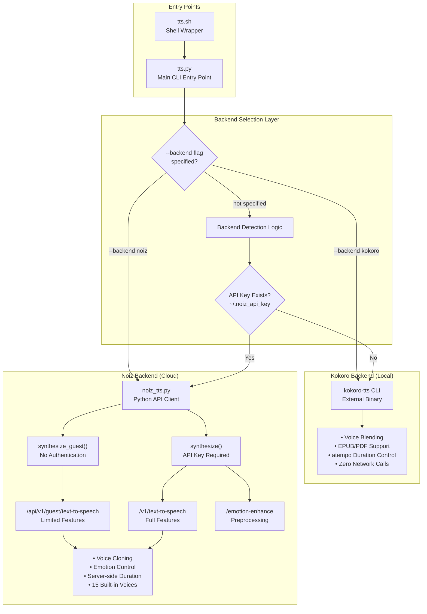
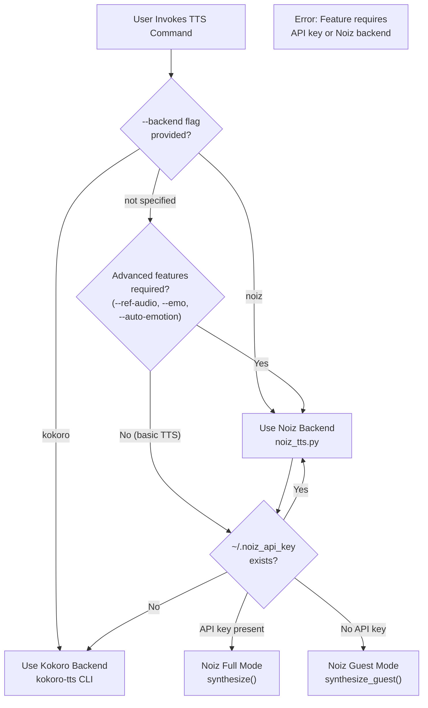
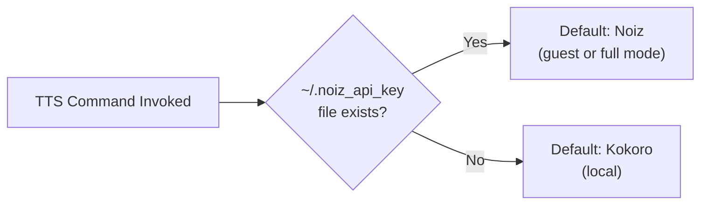

<!-- source: DeepWiki mcp.deepwiki.com · repo NoizAI/skills · page 2 Backend System · fetched 2026-10-26 -->

# Backend System

<details>
<summary>Relevant source files</summary>

The following files were used as context for generating this wiki page:

- [README.md](README.md)
- [skills/chat-with-anyone/SKILL.md](skills/chat-with-anyone/SKILL.md)
- [skills/daily-news-caster/SKILL.md](skills/daily-news-caster/SKILL.md)
- [skills/tts/SKILL.md](skills/tts/SKILL.md)
- [skills/tts/scripts/noiz_tts.py](skills/tts/scripts/noiz_tts.py)

</details>


## Purpose and Scope

This document provides a comprehensive technical overview of the dual backend architecture that powers text-to-speech synthesis in the NoizAI/skills repository. The system supports two distinct backends: **Kokoro** (local, privacy-focused) and **Noiz** (cloud-based, feature-rich), with automatic backend selection and fallback mechanisms.

For implementation details of each backend, see [Kokoro Backend (Local)](#2.1) and [Noiz Backend (Cloud)](#2.2). For API key setup and credential management, see [API Key Configuration](#2.3). For TTS skill usage and command-line interface, see [TTS (Text-to-Speech) Skill](#3).

---

## Backend Architecture Overview

The backend system implements a dual-path architecture where requests are routed to either a local TTS engine or a cloud API based on configuration and feature requirements.



**Sources:** [skills/tts/SKILL.md:1-152](), [skills/tts/scripts/noiz_tts.py:1-263]()

---

## Backend Selection Decision Flow

The backend selection process follows a priority-based decision tree that considers explicit user flags, API key availability, and feature requirements.



**Backend Selection Rules:**

1. **Explicit flag takes precedence**: `--backend kokoro` or `--backend noiz` overrides automatic detection
2. **Feature-based routing**: Commands with `--ref-audio`, `--emo`, or `--auto-emotion` require Noiz backend
3. **API key detection**: If no explicit backend is specified and no advanced features are requested, presence of `~/.noiz_api_key` determines the default
4. **Guest mode fallback**: Noiz backend can operate without API key in limited guest mode

**Sources:** [skills/tts/SKILL.md:96-119](), [skills/tts/scripts/noiz_tts.py:199-201]()

---

## Feature Comparison Matrix

The two backends offer different capabilities optimized for different use cases.

| Feature | Kokoro (Local) | Noiz Guest Mode | Noiz Full Mode |
|---------|----------------|-----------------|----------------|
| **Network Requirement** | None (fully offline) | HTTPS to `noiz.ai` | HTTPS to `noiz.ai` |
| **Authentication** | Not required | Not required | `~/.noiz_api_key` required |
| **Voice Selection** | `--voice` parameter<br/>Built-in voice names | `--voice-id` parameter<br/>15 pre-defined IDs | `--voice-id` parameter<br/>All available voices |
| **Voice Cloning** | ❌ Not supported | ❌ Not supported | ✅ `--ref-audio` (local path or URL) |
| **Voice Blending** | ✅ `"v1:60,v2:40"` syntax | ❌ Not supported | ❌ Not supported |
| **Emotion Control** | ❌ Not supported | ❌ Not supported | ✅ `--emo` JSON parameter |
| **Auto-Emotion** | ❌ Not supported | ❌ Not supported | ✅ `--auto-emotion` flag |
| **Duration Control** | ✅ `atempo` filter (tempo-based) | ❌ Not supported | ✅ `--duration` parameter (pad/trim) |
| **EPUB/PDF Input** | ✅ Native support | ❌ Not supported | ❌ Not supported |
| **Timeline Mode** | ✅ Supported | ❌ Not supported | ✅ Supported |
| **Output Formats** | WAV, MP3 | WAV, MP3, OPUS | WAV, MP3, OPUS |
| **Speed Control** | ✅ `--speed` parameter | ✅ `--speed` parameter | ✅ `--speed` parameter |
| **Target Language** | `--lang` parameter | ❌ Not supported | ✅ `--target-lang` parameter |
| **Similarity Enhancement** | ❌ Not supported | ❌ Not supported | ✅ `--similarity-enh` flag |
| **Voice Persistence** | ❌ Not supported | ❌ Not supported | ✅ `--save-voice` flag |

**Sources:** [skills/tts/SKILL.md:96-108](), [skills/tts/SKILL.md:121-140]()

---

## Code Implementation Details

### Noiz Backend API Client

The Noiz backend is implemented in [skills/tts/scripts/noiz_tts.py:1-263]() with two primary synthesis functions:

**Guest Mode Synthesis**

```python
def synthesize_guest(
    base_url: str,
    text: str,
    voice_id: str,
    output_format: str,
    speed: float,
    timeout: int,
    out_path: Path,
) -> float
```

Calls the guest endpoint at `/api/v1/guest/text-to-speech` without authentication. Only supports `text`, `voice_id`, `output_format`, and `speed` parameters.

[skills/tts/scripts/noiz_tts.py:135-168]()

**Full Mode Synthesis**

```python
def synthesize(
    base_url: str,
    api_key: str,
    text: str,
    voice_id: Optional[str],
    reference_audio: Optional[Path],
    output_format: str,
    speed: float,
    emo: Optional[str],
    target_lang: Optional[str],
    similarity_enh: bool,
    save_voice: bool,
    duration: Optional[float],
    timeout: int,
    out_path: Path,
) -> float
```

Calls the authenticated endpoint at `/v1/text-to-speech` with full feature support including voice cloning, emotion control, and duration forcing.

[skills/tts/scripts/noiz_tts.py:58-132]()

**Sources:** [skills/tts/scripts/noiz_tts.py:58-168]()

---

### API Authentication Implementation

The Noiz API uses base64-encoded API keys passed directly in the `Authorization` header without any prefix (no `Bearer` or `APIKEY` prefix).

**Key Normalization Logic**

```python
def normalize_api_key_base64(api_key: str) -> str:
    key = api_key.strip()
    if not key:
        return key
    padded = key + ("=" * (-len(key) % 4))
    try:
        decoded = base64.b64decode(padded, validate=True)
        canonical = base64.b64encode(decoded).decode("ascii").rstrip("=")
        if decoded and canonical == key.rstrip("="):
            return key
    except binascii.Error:
        pass
    return base64.b64encode(key.encode("utf-8")).decode("ascii")
```

This function ensures the API key is properly base64-encoded. If the provided key is already valid base64, it is returned as-is. Otherwise, it encodes the raw string to base64.

[skills/tts/scripts/noiz_tts.py:24-36]()

**Authentication Headers**

```python
headers={"Authorization": api_key, "Content-Type": "application/json"}
```

The key is passed directly without prefix, as documented in [skills/tts/SKILL.md:147-149]():

> Use **only** the base64-encoded API key as `Authorization`—no prefix (e.g. no `APIKEY ` or `Bearer `). Any prefix causes 401.

**Sources:** [skills/tts/scripts/noiz_tts.py:24-36](), [skills/tts/scripts/noiz_tts.py:44](), [skills/tts/SKILL.md:147-149]()

---

### Emotion Enhancement Preprocessing

The Noiz backend supports optional emotion enhancement preprocessing via the `/emotion-enhance` endpoint.

```python
def call_emotion_enhance(
    base_url: str, api_key: str, text: str, timeout: int
) -> str:
    resp = requests.post(
        f"{base_url.rstrip('/')}/emotion-enhance",
        headers={"Authorization": api_key, "Content-Type": "application/json"},
        json={"text": text},
        timeout=timeout,
    )
    if resp.status_code != 200:
        raise RuntimeError(
            f"/emotion-enhance failed: status={resp.status_code}, body={resp.text}"
        )
    enhanced = resp.json().get("data", {}).get("emotion_enhance")
    if not enhanced:
        raise RuntimeError(f"/emotion-enhance returned no data: {resp.text}")
    return enhanced
```

When `--auto-emotion` flag is provided, the text is sent to this endpoint before synthesis to automatically detect and enhance emotional content.

[skills/tts/scripts/noiz_tts.py:39-55](), [skills/tts/scripts/noiz_tts.py:233-236]()

**Sources:** [skills/tts/scripts/noiz_tts.py:39-55]()

---

### Duration Metadata Extraction

Both synthesis functions extract audio duration from the response headers and persist it to a sidecar file:

```python
out_path.parent.mkdir(parents=True, exist_ok=True)
out_path.write_bytes(resp.content)
dur = resp.headers.get("X-Audio-Duration")
duration_val = float(dur) if dur else -1.0
out_path.with_suffix(".duration").write_text(str(duration_val))
return duration_val
```

The `X-Audio-Duration` header from the API response is saved to a `.duration` file alongside the audio output. This duration metadata is used by timeline rendering to align segments precisely.

[skills/tts/scripts/noiz_tts.py:127-132](), [skills/tts/scripts/noiz_tts.py:163-167]()

**Sources:** [skills/tts/scripts/noiz_tts.py:127-132]()

---

## Guest Voice Catalog

The Noiz guest mode provides 15 pre-configured voices without authentication. These voices are accessed via their voice ID.

**Available Guest Voices:**

| voice_id | name | lang | gender | tone |
|----------|------|------|--------|------|
| `063a4491` | 販売員（なおみ） | ja | F | 喜び |
| `4252b9c8` | 落ち着いた女性 | ja | F | 穏やか |
| `578b4be2` | 熱血漢（たける） | ja | M | 怒り |
| `a9249ce7` | 安らぎ（みなと） | ja | M | 穏やか |
| `f00e45a1` | 旅人（かいと） | ja | M | 穏やか |
| `b4775100` | 悦悦｜社交分享 | zh | F | Joyful |
| `77e15f2c` | 婉青｜情绪抚慰 | zh | F | Calm |
| `ac09aeb4` | 阿豪｜磁性主持 | zh | M | Calm |
| `87cb2405` | 建国｜知识科普 | zh | M | Calm |
| `3b9f1e27` | 小明｜科技达人 | zh | M | Joyful |
| `95814add` | Science Narration | en | M | Calm |
| `883b6b7c` | The Mentor (Alex) | en | M | Joyful |
| `a845c7de` | The Naturalist (Silas) | en | M | Calm |
| `5a68d66b` | The Healer (Serena) | en | F | Calm |
| `0e4ab6ec` | The Mentor (Maya) | en | F | Calm |

Guest mode usage example:

```bash
python3 skills/tts/scripts/tts.py -t "Hello" --voice-id 883b6b7c -o hello.wav
```

When no API key is configured, the system automatically routes to guest mode. To explicitly force Kokoro instead, use `--backend kokoro`.

**Sources:** [skills/tts/SKILL.md:121-140]()

---

## Backend Integration Points

### Composite Skills Usage

Composite skills depend on the backend system for audio generation. The backend selection impacts feature availability:

**chat-with-anyone skill** requires voice cloning (`--ref-audio`), which necessitates Noiz Full Mode with API key:

```bash
bash skills/tts/scripts/tts.sh speak -t "Hello there!" \
  --ref-audio "skills/chat-with-anyone/trump_ref.wav" -o "output.wav"
```

[skills/chat-with-anyone/SKILL.md:49-54]()

**daily-news-caster skill** generates audio line-by-line with optional voice cloning for dual-host podcasts:

```bash
bash path/to/tts.sh speak -t "Welcome to today's news..." \
  --backend noiz --ref-audio path/to/host_A.wav -o line_01.wav
```

[skills/daily-news-caster/SKILL.md:64-71]()

**Sources:** [skills/chat-with-anyone/SKILL.md:49-54](), [skills/daily-news-caster/SKILL.md:64-71]()

---

### Timeline Rendering Integration

Both backends support timeline mode via the `render` subcommand, but with different duration control strategies:

- **Kokoro**: Uses ffmpeg `atempo` filter to adjust tempo without pitch changes
- **Noiz**: Uses `--duration` parameter for server-side duration forcing, with client-side padding/trimming

For detailed timeline mode documentation, see [Timeline Mode - SRT to Audio](#3.2).

**Sources:** [skills/tts/SKILL.md:38-95]()

---

## Default Backend Behavior

The default backend is determined by a simple algorithm implemented in the TTS skill:



When no `--backend` flag is provided and no advanced features are requested, the system checks for the existence of `~/.noiz_api_key`. If present, Noiz is selected; otherwise, Kokoro is selected.

This ensures privacy-first operation by default (Kokoro when unconfigured) while enabling seamless cloud features when users have explicitly configured API keys.

**Sources:** [skills/tts/SKILL.md:96-119](), [README.md:84-92]()

---

