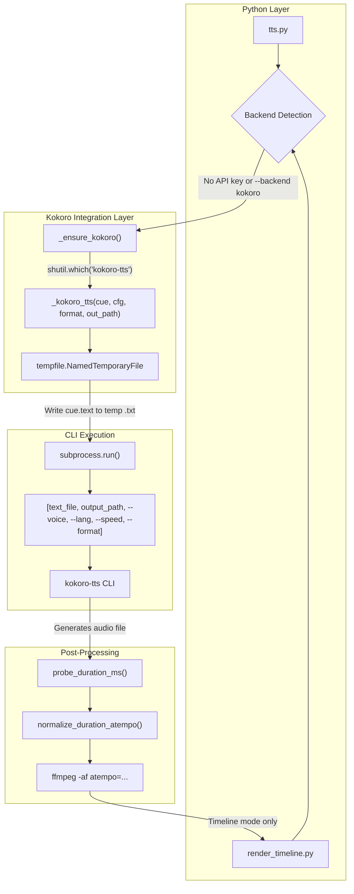
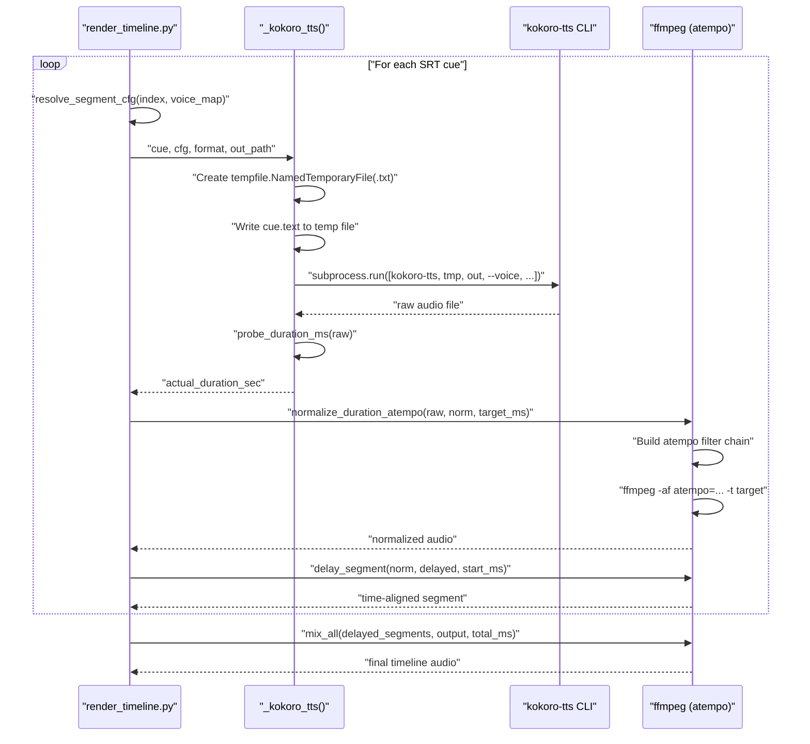

<!-- source: DeepWiki mcp.deepwiki.com · repo NoizAI/skills · page 2.1 Kokoro Backend (Local) · fetched 2026-10-26 -->

# Kokoro Backend (Local)

<details>
<summary>Relevant source files</summary>

The following files were used as context for generating this wiki page:

- [skills/tts/SKILL.md](skills/tts/SKILL.md)
- [skills/tts/scripts/render_timeline.py](skills/tts/scripts/render_timeline.py)

</details>


This document covers the **Kokoro** TTS backend, a fully local, offline text-to-speech engine used by the `tts` skill. Kokoro is one of two backend options in the system; for cloud-based features like voice cloning and emotion control, see [Noiz Backend (Cloud)](#2.2). For general API key configuration applicable to both backends, see [API Key Configuration](#2.3).

## Overview

Kokoro is the **default backend** for the `tts` skill, providing local-first text-to-speech synthesis that requires no network connectivity or API keys. It operates as a command-line interface (`kokoro-tts`) that the system invokes as a subprocess for each synthesis request.

**Key characteristics:**
- **Fully offline**: No network calls, all processing happens locally
- **Privacy-first**: Input text never leaves the user's machine
- **Voice blending**: Mix multiple voice models with weighted ratios (e.g., `"v1:60,v2:40"`)
- **EPUB/PDF support**: Native chapter-aware audiobook generation
- **No authentication**: Zero configuration required beyond having `kokoro-tts` in PATH

Kokoro is automatically selected when no API key is configured, or can be explicitly requested via `--backend kokoro`.

Sources: [skills/tts/SKILL.md:100-106](), [skills/tts/scripts/render_timeline.py:307-313]()

## Architecture

The Kokoro backend follows a subprocess invocation pattern where Python scripts orchestrate the `kokoro-tts` CLI tool for all synthesis operations.



**Processing Flow:**

1. **Detection**: [render_timeline.py:385-386]() checks if backend is `"kokoro"` and calls `_ensure_kokoro()` to validate CLI availability
2. **Text preparation**: [render_timeline.py:321-325]() writes input text to a temporary file (Kokoro CLI reads from files, not stdin)
3. **CLI invocation**: [render_timeline.py:328-344]() constructs command array and executes via `subprocess.run()`
4. **Duration probing**: [render_timeline.py:348-350]() uses `ffprobe` to determine actual audio duration
5. **Normalization** (timeline mode only): [render_timeline.py:433]() applies `atempo` filters to match target duration

Sources: [skills/tts/scripts/render_timeline.py:307-350](), [skills/tts/scripts/render_timeline.py:385-386]()

## Voice Configuration

Kokoro backend accepts voice configuration through a subset of parameters compared to the Noiz backend.

### Supported Parameters

| Parameter | Type | Description | Example |
|-----------|------|-------------|---------|
| `voice` | string | Voice model name or blend expression | `"zf_xiaoni"`, `"v1:60,v2:40"` |
| `lang` | string | Language code | `"cmn"`, `"en-us"`, `"ja"` |
| `speed` | float | Playback speed multiplier | `0.9`, `1.0`, `1.2` |

Voice blending syntax allows weighted mixing of multiple models: `"voice1:weight1,voice2:weight2"` where weights are percentages.

### Voice Map Example

In timeline mode, voice configuration is specified per-segment via JSON:

```json
{
  "default": { 
    "voice": "zf_xiaoni", 
    "lang": "cmn" 
  },
  "segments": {
    "1": { "voice": "zm_yunxi" },
    "5-8": { 
      "voice": "af_sarah:70,bf_emma:30", 
      "lang": "en-us", 
      "speed": 0.9 
    }
  }
}
```

The `resolve_segment_cfg()` function [render_timeline.py:103-109]() merges default settings with segment-specific overrides for each cue.

Sources: [skills/tts/SKILL.md:60-67](), [skills/tts/scripts/render_timeline.py:103-109](), [skills/tts/scripts/render_timeline.py:328-338]()

## Duration Normalization Strategy

Kokoro backend uses **atempo-based duration normalization** to match timeline requirements, preserving pitch while adjusting tempo.

```mermaid
graph LR
    subgraph "Input"
        RawAudio["Raw audio from kokoro-tts"]
        ActualDur["Actual: 3200ms"]
        TargetDur["Target: 2500ms (from SRT)"]
    end
    
    subgraph "Duration Probing"
        FFprobe["ffprobe -show_entries format=duration"]
        ProbeDurMs["probe_duration_ms()"]
        RatioCalc["ratio = actual_ms / target_ms"]
    end
    
    subgraph "Atempo Filter Chain"
        RatioCheck{"ratio within 0.5-100.0?"}
        ChainBuilder["Build atempo chain"]
        Extreme["ratio > 100 or < 0.5"]
        Normal["0.5 ≤ ratio ≤ 100"]
        
        MultipleFilters["atempo=100.0, atempo=100.0, atempo=1.28"]
        SingleFilter["atempo=1.28"]
    end
    
    subgraph "FFmpeg Execution"
        AtempoCommand["ffmpeg -af atempo=... -t target_sec"]
        NormAudio["Normalized audio at exact target duration"]
    end
    
    RawAudio --> FFprobe
    FFprobe --> ProbeDurMs
    ProbeDurMs --> RatioCalc
    TargetDur --> RatioCalc
    
    RatioCalc --> RatioCheck
    RatioCheck -->|"Yes"| Normal
    RatioCheck -->|"No"| Extreme
    
    Normal --> SingleFilter
    Extreme --> ChainBuilder
    ChainBuilder --> MultipleFilters
    
    SingleFilter --> AtempoCommand
    MultipleFilters --> AtempoCommand
    AtempoCommand --> NormAudio
```



### Atempo Filter Algorithm

The `normalize_duration_atempo()` function [render_timeline.py:149-172]() implements a filter chain strategy to handle extreme ratios:

```python
ratio = actual_ms / target_ms
# atempo accepts 0.5–100.0; chain filters for extreme ratios
filters = []
r = ratio
while r > 100.0:
    filters.append("atempo=100.0")
    r /= 100.0
while r < 0.5:
    filters.append("atempo=0.5")
    r /= 0.5
filters.append(f"atempo={r:.6f}")
```

**Example**: To slow down by 12800× (ratio=128.0):
1. Apply `atempo=100.0` → ratio becomes 1.28
2. Apply `atempo=1.28` → final target reached

This chaining approach works around ffmpeg's single-filter limitation while preserving audio quality.

**Fallback**: If `probe_duration_ms()` returns ≤0 (corrupt audio), the system falls back to `normalize_duration_pad_trim()` [render_timeline.py:152-154]().

Sources: [skills/tts/scripts/render_timeline.py:149-172](), [skills/tts/scripts/render_timeline.py:126-136]()

## Command-Line Interface

### CLI Invocation Pattern

The `_kokoro_tts()` function constructs command arrays following this structure:

```bash
kokoro-tts <text_file> <output_path> [--voice VOICE] [--lang LANG] [--speed SPEED] --format FORMAT
```

**Code implementation** [render_timeline.py:328-344]():

```python
cmd = ["kokoro-tts", tmp_path, str(out_path)]
voice = cfg.get("voice")
if voice:
    cmd += ["--voice", str(voice)]
lang = cfg.get("lang")
if lang:
    cmd += ["--lang", str(lang)]
speed = cfg.get("speed")
if speed is not None:
    cmd += ["--speed", str(speed)]
cmd += ["--format", output_format]

proc = subprocess.run(cmd, capture_output=True, text=True)
```

### Error Handling

The subprocess execution captures both stdout and stderr. Non-zero exit codes raise `RuntimeError` with diagnostic information [render_timeline.py:340-343]():

```python
if proc.returncode != 0:
    raise RuntimeError(
        f"kokoro-tts failed for cue {cue.index}: {proc.stderr}"
    )
```

Sources: [skills/tts/scripts/render_timeline.py:328-344]()

## Feature Comparison

### Kokoro-Specific Features

| Feature | Availability | Implementation |
|---------|--------------|----------------|
| Voice blending | Kokoro only | Via `--voice "v1:60,v2:40"` syntax |
| EPUB/PDF chapters | Kokoro only | Native CLI support |
| Offline operation | Kokoro only | No network calls |
| Atempo normalization | Kokoro only | Preserves pitch during time-stretch |

### Kokoro Limitations

The following features are **not available** with Kokoro backend:

- **Voice cloning** from reference audio (`--ref-audio`) - requires Noiz
- **Emotion control** via `emo` parameters - requires Noiz
- **Server-side duration forcing** - Kokoro uses client-side `atempo` instead
- **Dynamic reference audio slicing** (`--ref-audio-track`) - requires Noiz for cloning

When these features are required, the system must use `--backend noiz` with proper API key configuration.

Sources: [skills/tts/SKILL.md:100-107]()

## Prerequisites and Setup

### Required Dependencies

1. **kokoro-tts CLI**: Must be available in system PATH
   - Verified via: [render_timeline.py:310-312]() `shutil.which("kokoro-tts")`
   - Installation method: (project-specific, not documented in provided files)

2. **ffmpeg/ffprobe**: Required for timeline mode
   - Verified via: [render_timeline.py:121-123]() `ensure_ffmpeg()`
   - Used for: duration probing and atempo normalization

### Zero-Configuration Operation

Unlike the Noiz backend, Kokoro requires **no configuration files or API keys**. If `kokoro-tts` is in PATH, the backend is ready to use:

```bash
# Automatic backend selection (uses Kokoro if no API key)
python3 skills/tts/scripts/tts.py -t "Hello world"

# Explicit backend selection
python3 skills/tts/scripts/tts.py -t "Hello world" --backend kokoro
```

Sources: [skills/tts/scripts/render_timeline.py:310-312](), [skills/tts/scripts/render_timeline.py:121-123]()

## Timeline Mode Integration

In timeline mode, Kokoro processes each SRT cue independently through a three-stage pipeline:



**Key steps:**

1. **Voice resolution**: [render_timeline.py:398]() - Apply default + segment overrides
2. **Synthesis**: [render_timeline.py:432]() - Invoke `_kokoro_tts()` to generate raw audio
3. **Normalization**: [render_timeline.py:433]() - Apply `atempo` to match SRT duration
4. **Delay**: [render_timeline.py:435]() - Insert silence via `adelay` filter to align to start time
5. **Mixing**: [render_timeline.py:457]() - Combine all segments with `amix` filter

Sources: [skills/tts/scripts/render_timeline.py:397-457]()

## Comparison: Kokoro vs Noiz

| Aspect | Kokoro Backend | Noiz Backend |
|--------|----------------|--------------|
| **Network** | None (fully offline) | HTTPS API calls |
| **Authentication** | None required | API key required (guest mode limited) |
| **Duration strategy** | Client-side `atempo` | Server-side pad+trim |
| **Voice cloning** | Not supported | Via `--ref-audio` |
| **Emotion control** | Not supported | Via `emo` JSON params |
| **Voice blending** | Yes (`"v1:60,v2:40"`) | Not supported |
| **EPUB/PDF** | Native support | Not supported |
| **Processing location** | Local machine | Cloud server |
| **API response** | File output only | File + `X-Audio-Duration` header |

For most basic use cases (reading text aloud, audiobooks), Kokoro is sufficient and preferred for privacy. For advanced workflows requiring voice cloning or emotion control, Noiz is necessary.

Sources: [skills/tts/SKILL.md:100-107](), [skills/tts/scripts/render_timeline.py:139-172]()

---

