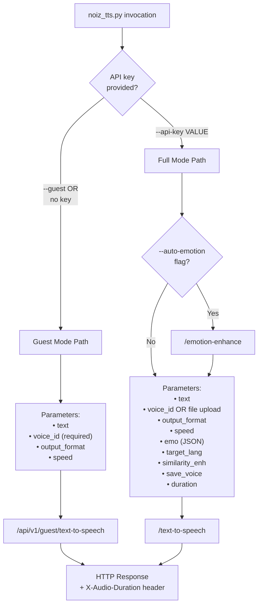
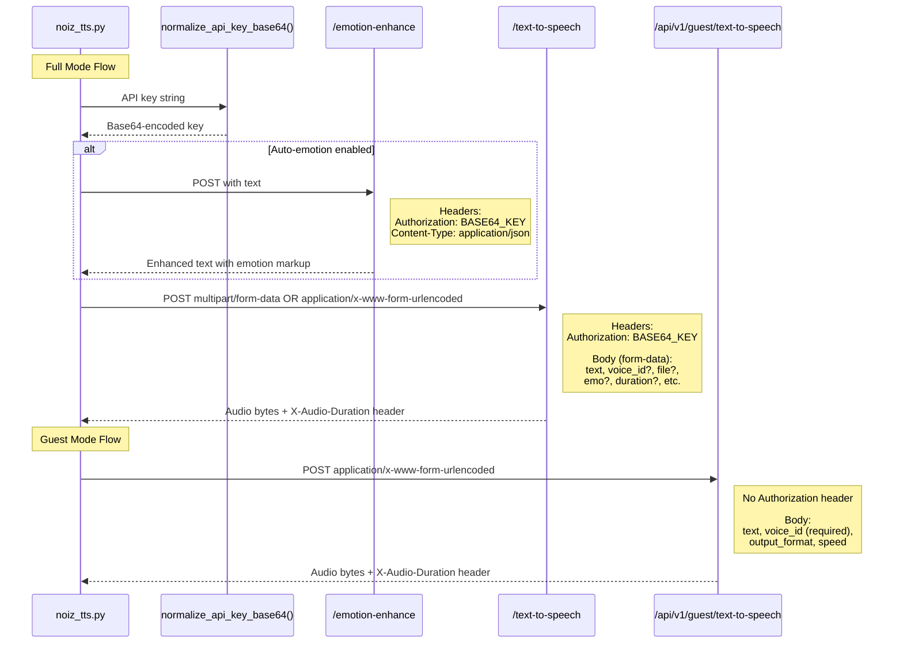
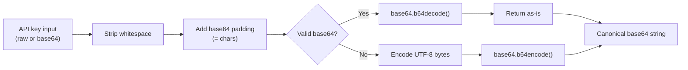
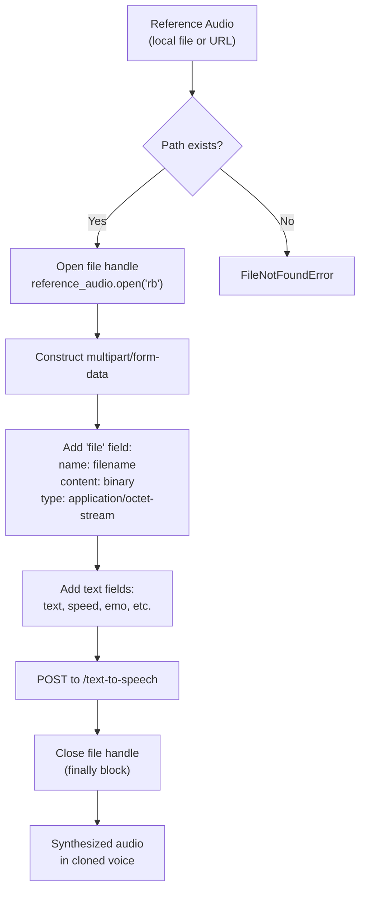
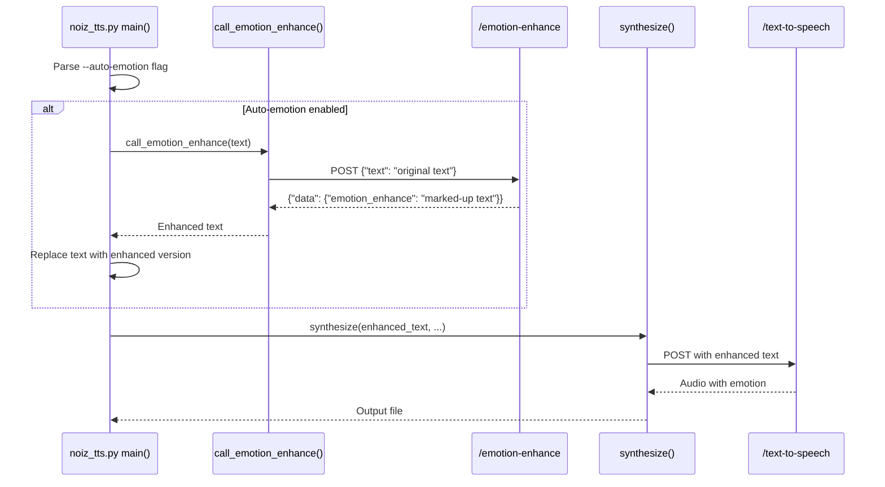
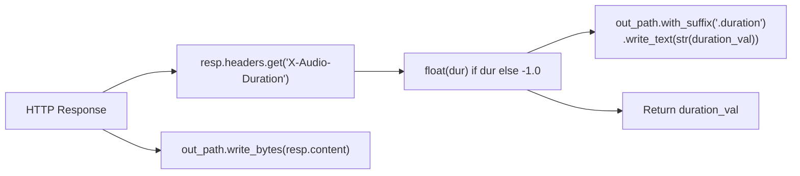
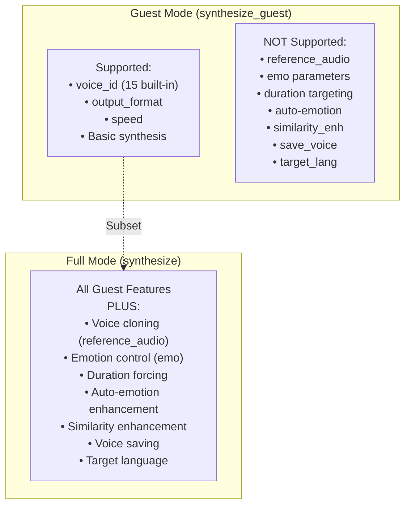

<!-- source: DeepWiki mcp.deepwiki.com · repo NoizAI/skills · page 2.2 Noiz Backend (Cloud) · fetched 2026-10-26 -->

# Noiz Backend (Cloud)

<details>
<summary>Relevant source files</summary>

The following files were used as context for generating this wiki page:

- [README.md](README.md)
- [skills/chat-with-anyone/SKILL.md](skills/chat-with-anyone/SKILL.md)
- [skills/daily-news-caster/SKILL.md](skills/daily-news-caster/SKILL.md)
- [skills/tts/SKILL.md](skills/tts/SKILL.md)
- [skills/tts/scripts/noiz_tts.py](skills/tts/scripts/noiz_tts.py)

</details>


The Noiz backend is a cloud-based TTS service accessible via HTTPS API that provides advanced speech synthesis capabilities including voice cloning, emotion control, and precise duration targeting. It operates in two authentication modes: guest mode for limited feature access without credentials, and full mode requiring an API key for advanced features.

This page documents the Noiz backend architecture, API endpoints, authentication flow, and feature implementation. For the local alternative, see [Kokoro Backend (Local)](#2.1). For API key setup instructions, see [API Key Configuration](#2.3).

---

## Authentication Modes and Endpoint Selection

The Noiz backend implements a two-tier access model that automatically selects between guest and authenticated endpoints based on API key availability.



**Mode Selection Logic**

The authentication mode is determined at runtime by [skills/tts/scripts/noiz_tts.py:199-202]():

```python
if not args.guest and not args.api_key:
    parser.error("--api-key is required unless --guest is specified")
```

When `--guest` is specified or no API key is configured, the script invokes `synthesize_guest()` at [skills/tts/scripts/noiz_tts.py:220-231](). Otherwise, it calls `synthesize()` at [skills/tts/scripts/noiz_tts.py:238-253]().

**Sources:** [skills/tts/scripts/noiz_tts.py:1-263](), [skills/tts/SKILL.md:109-119]()

---

## API Endpoints and Request Flow

The Noiz backend exposes three primary endpoints, each serving a distinct purpose in the synthesis pipeline.



### Endpoint: `/emotion-enhance`

**Purpose:** Pre-processes input text to add emotion markup based on semantic analysis.

**Implementation:** [skills/tts/scripts/noiz_tts.py:39-55]()

```python
def call_emotion_enhance(
    base_url: str, api_key: str, text: str, timeout: int
) -> str:
    resp = requests.post(
        f"{base_url.rstrip('/')}/emotion-enhance",
        headers={"Authorization": api_key, "Content-Type": "application/json"},
        json={"text": text},
        timeout=timeout,
    )
```

**Request Format:**
- Method: `POST`
- Headers: `Authorization: {base64_api_key}`, `Content-Type: application/json`
- Body: `{"text": "input text"}`

**Response:** JSON object with `data.emotion_enhance` field containing enhanced text.

### Endpoint: `/text-to-speech` (Authenticated)

**Purpose:** Full-featured synthesis with voice cloning, emotion control, and duration targeting.

**Implementation:** [skills/tts/scripts/noiz_tts.py:58-132]()

The function constructs a multipart form-data request when `reference_audio` is provided, or a standard form-encoded request for voice ID-based synthesis:

```python
def synthesize(
    base_url: str,
    api_key: str,
    text: str,
    voice_id: Optional[str],
    reference_audio: Optional[Path],
    ...
) -> float:
    url = f"{base_url.rstrip('/')}/text-to-speech"
    data: Dict[str, str] = {
        "text": text,
        "output_format": normalized_format,
        "speed": str(speed),
    }
    if voice_id:
        data["voice_id"] = voice_id
    if emo:
        data["emo"] = emo
    # ... additional parameters
    
    files = None
    if reference_audio:
        files = {
            "file": (
                reference_audio.name,
                reference_audio.open("rb"),
                "application/octet-stream",
            )
        }
```

**Request Parameters:**

| Parameter | Type | Required | Description |
|-----------|------|----------|-------------|
| `text` | string | Yes | Input text (max 5000 chars) |
| `voice_id` | string | Conditional | Required if no `file` uploaded |
| `file` | binary | Conditional | Reference audio for cloning |
| `output_format` | enum | No | `wav`, `mp3`, `opus` (default: `wav`) |
| `speed` | float | No | Playback speed multiplier (default: 1.0) |
| `emo` | JSON string | No | Emotion parameters, e.g. `{"Joy": 0.5}` |
| `target_lang` | string | No | Target language code |
| `duration` | float | No | Target duration in seconds (0, 36] |
| `similarity_enh` | boolean | No | Enable similarity enhancement |
| `save_voice` | boolean | No | Save cloned voice for reuse |

**Duration Constraint:** The API enforces `0 < duration <= 36` seconds at [skills/tts/scripts/noiz_tts.py:74-75]():

```python
if duration is not None and not (0 < duration <= 36):
    raise ValueError("duration must be in range (0, 36] seconds")
```

### Endpoint: `/api/v1/guest/text-to-speech`

**Purpose:** Limited synthesis without authentication for testing and basic use cases.

**Implementation:** [skills/tts/scripts/noiz_tts.py:135-168]()

The guest endpoint uses a different URL construction that strips the `/v1` suffix from `base_url`:

```python
def synthesize_guest(
    base_url: str,
    text: str,
    voice_id: str,
    output_format: str,
    speed: float,
    timeout: int,
    out_path: Path,
) -> float:
    root = base_url.rstrip("/")
    if root.endswith("/v1"):
        root = root[:-3]
    url = f"{root}/api/v1/guest/text-to-speech"
```

**Request Parameters:**

| Parameter | Type | Required | Description |
|-----------|------|----------|-------------|
| `text` | string | Yes | Input text |
| `voice_id` | string | Yes | One of 15 built-in voices |
| `output_format` | enum | No | `wav`, `mp3`, `opus` |
| `speed` | float | No | Speed multiplier |

**Limitations:** No voice cloning, no emotion control, no duration targeting, no `save_voice` or `similarity_enh`.

**Sources:** [skills/tts/scripts/noiz_tts.py:39-168](), [skills/tts/SKILL.md:109-140]()

---

## API Key Normalization and Authentication

The Noiz API requires base64-encoded API keys in the `Authorization` header with no prefix (no `Bearer`, no `APIKEY`). The normalization function handles both raw and pre-encoded keys.



**Implementation:** [skills/tts/scripts/noiz_tts.py:24-36]()

```python
def normalize_api_key_base64(api_key: str) -> str:
    key = api_key.strip()
    if not key:
        return key
    padded = key + ("=" * (-len(key) % 4))
    try:
        decoded = base64.b64decode(padded, validate=True)
        canonical = base64.b64encode(decoded).decode("ascii").rstrip("=")
        if decoded and canonical == key.rstrip("="):
            return key  # Already valid base64
    except binascii.Error:
        pass
    return base64.b64encode(key.encode("utf-8")).decode("ascii")
```

**Authentication Header Usage:** The normalized key is passed directly in the `Authorization` header without any prefix scheme:

- ✅ Correct: `Authorization: eyJhbGciOiJIUzI1NiIsInR5cCI6IkpXVCJ9...`
- ❌ Incorrect: `Authorization: Bearer eyJhbGciOi...`
- ❌ Incorrect: `Authorization: APIKEY eyJhbGciOi...`

This requirement is documented in [skills/tts/SKILL.md:147-149](): "Use **only** the base64-encoded API key as `Authorization`—no prefix (e.g. no `APIKEY ` or `Bearer `). Any prefix causes 401."

**Sources:** [skills/tts/scripts/noiz_tts.py:24-36](), [skills/tts/SKILL.md:147-149]()

---

## Voice Cloning via Reference Audio

Voice cloning allows synthesis in any voice by uploading a reference audio file. The feature is exclusive to the authenticated `/text-to-speech` endpoint.



**Implementation Details:**

The reference audio file is uploaded as a multipart form field at [skills/tts/scripts/noiz_tts.py:96-106]():

```python
files = None
if reference_audio:
    if not reference_audio.exists():
        raise FileNotFoundError(f"Reference audio not found: {reference_audio}")
    files = {
        "file": (
            reference_audio.name,
            reference_audio.open("rb"),
            "application/octet-stream",
        )
    }
```

The file handle is guaranteed to be closed via a `finally` block at [skills/tts/scripts/noiz_tts.py:118-120]():

```python
finally:
    if files and files["file"][1]:
        files["file"][1].close()
```

**Mutual Exclusivity:** Either `voice_id` or `reference_audio` must be provided, enforced at [skills/tts/scripts/noiz_tts.py:107-108]():

```python
elif not voice_id:
    raise ValueError("Either --voice-id or --reference-audio is required.")
```

**Usage Example from SKILL.md:**

```bash
# Local file path
python3 skills/tts/scripts/tts.py -t "Hello" --ref-audio ./ref.wav

# URL (downloaded automatically by wrapper)
python3 skills/tts/scripts/tts.py -t "Hello" --ref-audio https://example.com/my_voice.wav -o clone.wav
```

**Sources:** [skills/tts/scripts/noiz_tts.py:96-120](), [skills/tts/SKILL.md:27-29]()

---

## Emotion Control and Auto-Emotion

The Noiz backend supports two mechanisms for emotion control: manual emotion parameters and automatic emotion enhancement.

### Manual Emotion Parameters

Emotions are specified as a JSON string mapping emotion names to intensity values (0.0 to 1.0).

**Parameter Format:** `--emo '{"Joy": 0.6, "Sadness": 0.2}'`

The JSON string is passed directly to the API at [skills/tts/scripts/noiz_tts.py:85-86]():

```python
if emo:
    data["emo"] = emo
```

**Supported Emotions:** The exact emotion vocabulary depends on the Noiz API version, but common values include `Joy`, `Sadness`, `Anger`, `Fear`, `Surprise`, `Disgust`, `Calm`.

### Auto-Emotion Enhancement

When `--auto-emotion` is specified, the text is first sent to `/emotion-enhance` for automatic emotion markup before synthesis.

**Flow Diagram:**



**Implementation:** [skills/tts/scripts/noiz_tts.py:233-236]()

```python
if args.auto_emotion:
    text = call_emotion_enhance(
        args.base_url, args.api_key, text, args.timeout_sec
    )
```

The enhanced text replaces the original before being passed to `synthesize()`.

**Error Handling:** If the API returns no data or an error status, the function raises a `RuntimeError` at [skills/tts/scripts/noiz_tts.py:48-54]():

```python
if resp.status_code != 200:
    raise RuntimeError(
        f"/emotion-enhance failed: status={resp.status_code}, body={resp.text}"
    )
enhanced = resp.json().get("data", {}).get("emotion_enhance")
if not enhanced:
    raise RuntimeError(f"/emotion-enhance returned no data: {resp.text}")
```

**Sources:** [skills/tts/scripts/noiz_tts.py:39-55](), [skills/tts/scripts/noiz_tts.py:233-236](), [skills/tts/SKILL.md:93]()

---

## Duration Control and Response Handling

The Noiz backend provides server-side duration control, allowing precise audio length specification. The actual duration is returned via the `X-Audio-Duration` HTTP header.

### Duration Parameter

The `--duration` parameter enforces a target audio length, with the server handling timing internally (no client-side tempo manipulation).

**Validation:** [skills/tts/scripts/noiz_tts.py:74-75]()

```python
if duration is not None and not (0 < duration <= 36):
    raise ValueError("duration must be in range (0, 36] seconds")
```

**API Submission:** [skills/tts/scripts/noiz_tts.py:93-94]()

```python
if duration is not None:
    data["duration"] = str(duration)
```

### Response Header Extraction

Both `synthesize()` and `synthesize_guest()` extract the duration from the `X-Audio-Duration` response header and persist it to a sidecar file.



**Implementation:** [skills/tts/scripts/noiz_tts.py:127-132]() and [skills/tts/scripts/noiz_tts.py:163-168]()

```python
out_path.parent.mkdir(parents=True, exist_ok=True)
out_path.write_bytes(resp.content)
dur = resp.headers.get("X-Audio-Duration")
duration_val = float(dur) if dur else -1.0
out_path.with_suffix(".duration").write_text(str(duration_val))
return duration_val
```

**Sidecar File Naming:** For output file `output.wav`, the duration is written to `output.duration` as a plain text float value.

**Fallback Value:** If the header is missing, the function returns `-1.0` to indicate unknown duration.

**Sources:** [skills/tts/scripts/noiz_tts.py:74-75](), [skills/tts/scripts/noiz_tts.py:127-132](), [skills/tts/scripts/noiz_tts.py:163-168]()

---

## Guest Mode: Voices and Limitations

Guest mode provides access to 15 pre-configured voices without requiring authentication. This mode is automatically activated when no API key is provided or when `--guest` is explicitly specified.

### Available Guest Voices

The following table lists all voices available in guest mode as documented in [skills/tts/SKILL.md:122-139]():

| voice_id | name | lang | gender | tone |
|----------|------|------|--------|------|
| `063a4491` | 販売員（なおみ） | ja | F | 喜び |
| `4252b9c8` | 落ち着いた女性 | ja | F | 穏やか |
| `578b4be2` | 熱血漢（たける） | ja | M | 怒り |
| `a9249ce7` | 安らぎ（みなと） | ja | M | 穏やか |
| `f00e45a1` | 旅人（かいと） | ja | M | 穏やか |
| `b4775100` | 悦悦｜社交分享 | zh | F | Joyful |
| `77e15f2c` | 婉青｜情绪抚慰 | zh | F | Calm |
| `ac09aeb4` | 阿豪｜磁性主持 | zh | M | Calm |
| `87cb2405` | 建国｜知识科普 | zh | M | Calm |
| `3b9f1e27` | 小明｜科技达人 | zh | M | Joyful |
| `95814add` | Science Narration | en | M | Calm |
| `883b6b7c` | The Mentor (Alex) | en | M | Joyful |
| `a845c7de` | The Naturalist (Silas) | en | M | Calm |
| `5a68d66b` | The Healer (Serena) | en | F | Calm |
| `0e4ab6ec` | The Mentor (Maya) | en | F | Calm |

### Feature Comparison



### Guest Mode Enforcement

When guest mode is used, `voice_id` becomes mandatory. This is enforced at [skills/tts/scripts/noiz_tts.py:221-222]():

```python
if not args.voice_id:
    raise ValueError("--voice-id is required in guest mode")
```

The guest endpoint does not accept file uploads or extended parameters, only the four basic fields shown in the `synthesize_guest()` function signature.

**Usage Example:**

```bash
# Guest mode (auto-detected when no API key is set)
python3 skills/tts/scripts/noiz_tts.py -t "Hello" --voice-id 883b6b7c -o hello.wav

# Explicit backend override to use kokoro instead
python3 skills/tts/scripts/noiz_tts.py -t "Hello" --backend kokoro
```

**Sources:** [skills/tts/SKILL.md:109-140](), [skills/tts/scripts/noiz_tts.py:135-168](), [skills/tts/scripts/noiz_tts.py:221-222]()

---

## Output Format Handling

The Noiz backend supports three output formats: `wav`, `mp3`, and `opus`. The `ogg` format is treated as an alias for `opus`.

### Format Normalization

Format normalization occurs at [skills/tts/scripts/noiz_tts.py:19-21]():

```python
def normalize_output_format(output_format: str) -> str:
    # "ogg" is treated as an alias to opus.
    return "opus" if output_format == "ogg" else output_format
```

This normalization is applied before sending the request to the API at [skills/tts/scripts/noiz_tts.py:77]() and [skills/tts/scripts/noiz_tts.py:149]():

```python
normalized_format = normalize_output_format(output_format)
```

### Format Use Cases

| Format | Use Case | Command Example |
|--------|----------|-----------------|
| `wav` | Default, lossless | `-o output.wav` |
| `mp3` | Compressed, universal | `--format mp3 -o output.mp3` |
| `opus` | Voice messages, low bitrate | `--format opus -o voice.opus` |
| `ogg` | Alias for opus | `--format ogg -o voice.ogg` |

**Voice Message Integration:** The `opus` format is optimized for chat platform voice messages as documented in [skills/tts/SKILL.md:31-33]():

```bash
python3 skills/tts/scripts/tts.py -t "Hello" --format opus -o voice.opus
python3 skills/tts/scripts/tts.py -t "Hello" --format ogg -o voice.ogg
```

For integration with Feishu, Telegram, and Discord, see [Integration with Chat Platforms](#6).

**Sources:** [skills/tts/scripts/noiz_tts.py:19-21](), [skills/tts/SKILL.md:31-33]()

---

## Error Handling and Timeouts

The Noiz backend implementation includes comprehensive error handling for network failures, API errors, and invalid inputs.

### HTTP Error Handling

Both synthesis functions check the HTTP status code and raise descriptive errors:

**For `/text-to-speech`:** [skills/tts/scripts/noiz_tts.py:122-125]()

```python
if resp.status_code != 200:
    raise RuntimeError(
        f"/text-to-speech failed: status={resp.status_code}, body={resp.text}"
    )
```

**For `/api/v1/guest/text-to-speech`:** [skills/tts/scripts/noiz_tts.py:158-161]()

```python
if resp.status_code != 200:
    raise RuntimeError(
        f"/guest/text-to-speech failed: status={resp.status_code}, body={resp.text}"
    )
```

### Timeout Configuration

All HTTP requests accept a configurable timeout value, defaulting to 120 seconds:

**Command-line argument:** [skills/tts/scripts/noiz_tts.py:196]()

```python
parser.add_argument("--timeout-sec", type=int, default=120)
```

**Usage in requests:** The timeout is passed to all `requests.post()` calls via the `timeout` parameter.

### Input Validation

**Text Length Warning:** [skills/tts/scripts/noiz_tts.py:213-218]()

```python
if len(text) > 5000:
    print(
        f"Warning: text is {len(text)} chars (max 5000). "
        "Consider chunking for long texts.",
        file=sys.stderr,
    )
```

**Empty Text Check:** [skills/tts/scripts/noiz_tts.py:210-211]()

```python
if not text:
    raise ValueError("Input text is empty.")
```

### Top-Level Exception Handling

The main function wraps all operations in a try-except block at [skills/tts/scripts/noiz_tts.py:204-258]():

```python
try:
    # ... all processing logic
    print(f"Done. Output: {args.output} (duration: {out_duration}s)")
    return 0
except Exception as exc:
    print(f"Error: {exc}", file=sys.stderr)
    return 1
```

This ensures that any unhandled exceptions are caught and the script exits with status code 1.

**Sources:** [skills/tts/scripts/noiz_tts.py:122-125](), [skills/tts/scripts/noiz_tts.py:158-161](), [skills/tts/scripts/noiz_tts.py:196](), [skills/tts/scripts/noiz_tts.py:204-258]()

---

## Integration with Timeline Mode

While `noiz_tts.py` handles simple text-to-speech synthesis, the Noiz backend is also invoked by the timeline rendering system for SRT-based dubbing workflows. This integration is documented in [Timeline Mode - SRT to Audio](#3.2).

**Key Integration Points:**

1. **Per-segment synthesis:** Timeline mode calls `noiz_tts.py` once per subtitle segment with segment-specific parameters from the voice map.

2. **Voice map support:** The voice map JSON can specify `voice_id`, `emo`, and `reference_audio` on a per-segment basis. See [Voice Maps and Segment Configuration](#3.3).

3. **Duration enforcement:** When rendering to SRT timecodes, the `--duration` parameter is calculated from subtitle timing to ensure audio matches the timeline exactly.

4. **Reference audio slicing:** The `--ref-audio-track` feature automatically extracts reference audio from the original video at each segment's timestamp for voice cloning.

**Example voice map from SKILL.md:**

```json
{
  "default": { "voice_id": "voice_123", "target_lang": "zh" },
  "segments": {
    "1": { "voice_id": "voice_host", "emo": { "Joy": 0.6 } },
    "2-4": { "reference_audio": "./refs/guest.wav" }
  }
}
```

**Sources:** [skills/tts/SKILL.md:69-79](), [skills/tts/SKILL.md:81-85]()

---

