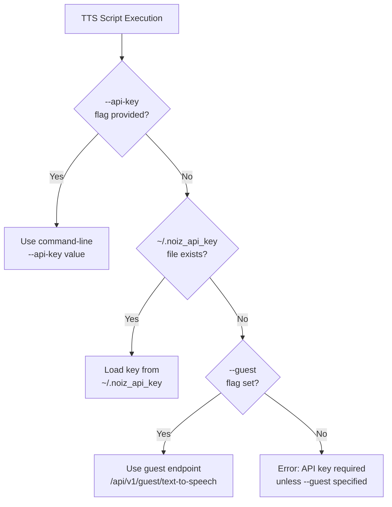
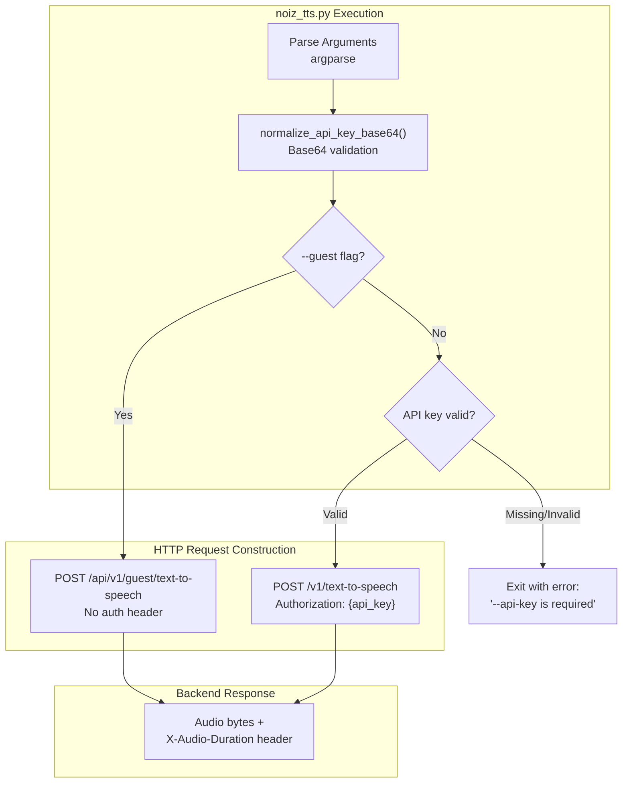
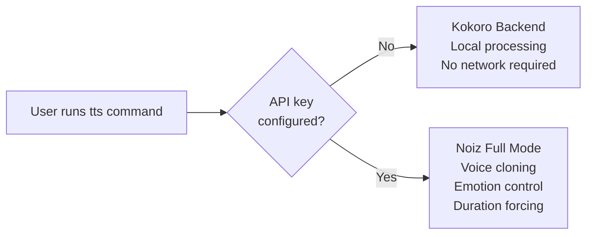

<!-- source: DeepWiki mcp.deepwiki.com · repo NoizAI/skills · page 2.3 API Key Configuration · fetched 2026-10-26 -->

# API Key Configuration

<details>
<summary>Relevant source files</summary>

The following files were used as context for generating this wiki page:

- [.gitignore](.gitignore)
- [README.md](README.md)
- [skills/chat-with-anyone/SKILL.md](skills/chat-with-anyone/SKILL.md)
- [skills/daily-news-caster/SKILL.md](skills/daily-news-caster/SKILL.md)
- [skills/tts/scripts/noiz_tts.py](skills/tts/scripts/noiz_tts.py)

</details>


This document explains how to obtain, configure, and manage Noiz API keys for accessing cloud-based TTS features. The API key enables advanced capabilities including voice cloning, emotion control, and precise duration forcing that are not available in the local Kokoro backend or guest mode.

For information about choosing between Kokoro and Noiz backends, see [Backend System](#2). For details on Noiz-specific features, see [Noiz Backend (Cloud)](#2.2).

---

## Overview: API Key Access Tiers

The Noiz backend supports three access modes:

| Mode | API Key Required | Features Available | Use Case |
|------|------------------|-------------------|----------|
| **Kokoro (local)** | No | Basic TTS, voice blending, offline operation | Privacy-first, no network required |
| **Noiz Guest** | No | 15 built-in voices, basic synthesis | Testing without registration |
| **Noiz Full** | Yes | Voice cloning (`--ref-audio`), emotion control, duration forcing, auto-emotion | Production use, advanced features |

**Sources:** [README.md:84-92](), [skills/tts/scripts/noiz_tts.py:176-177](), [skills/tts/scripts/noiz_tts.py:199-202]()

---

## Obtaining an API Key

Noiz API keys are issued through the Noiz developer portal:

1. Navigate to `https://developers.noiz.ai/api-keys`
2. Register or log in to your account
3. Generate a new API key
4. Copy the key for configuration (see next section)

The API key is a base64-encoded string that authenticates your requests to the Noiz cloud service.

**Sources:** [README.md:86]()

---

## Configuration Methods

### Method 1: File-Based Storage (Recommended)

The standard approach is to persist the API key in `~/.noiz_api_key` using the `config` subcommand:

```bash
bash skills/tts/scripts/tts.sh config --set-api-key YOUR_KEY
```

This command:
- Writes the normalized key to `~/.noiz_api_key` in the user's home directory
- Sets appropriate file permissions (`chmod 600` equivalent)
- Validates the key format (base64 encoding)

**File Location:** `~/.noiz_api_key`

**Example content:**
```
dGhpc19pc19hbl9leGFtcGxlX2tleQ==
```

Once configured, the key is automatically loaded by all TTS operations without needing to specify `--api-key` on every command.

**Sources:** [README.md:89-92](), [skills/tts/scripts/noiz_tts.py:176]()

---

### Method 2: Command-Line Flag

For one-time use or testing, pass the API key directly via the `--api-key` flag:

```bash
python skills/tts/scripts/noiz_tts.py \
  --text "Hello world" \
  --api-key YOUR_KEY \
  --voice-id af_sarah \
  --output test.wav
```

This method takes precedence over file-based storage when both are present.

**Sources:** [skills/tts/scripts/noiz_tts.py:176]()

---

### Configuration Precedence Diagram



**Sources:** [skills/tts/scripts/noiz_tts.py:176](), [skills/tts/scripts/noiz_tts.py:199-202]()

---

## Base64 Normalization

The `normalize_api_key_base64()` function in [skills/tts/scripts/noiz_tts.py:23-36]() ensures API keys are properly formatted:

### Normalization Logic

1. **Padding Addition:** Adds `=` padding to align to 4-byte boundaries (base64 requirement)
2. **Validation:** Attempts to decode the key to verify it's valid base64
3. **Canonical Form:** Re-encodes to canonical base64 (without trailing `=`)
4. **Fallback Encoding:** If the key is not valid base64, encodes it as UTF-8 bytes, then converts to base64

```python
def normalize_api_key_base64(api_key: str) -> str:
    key = api_key.strip()
    if not key:
        return key
    padded = key + ("=" * (-len(key) % 4))
    try:
        decoded = base64.b64decode(padded, validate=True)
        canonical = base64.b64encode(decoded).decode("ascii").rstrip("=")
        if decoded and canonical == key.rstrip("="):
            return key
    except binascii.Error:
        pass
    return base64.b64encode(key.encode("utf-8")).decode("ascii")
```

This normalization ensures compatibility with keys that may be copied with or without padding, or provided in plain text.

**Sources:** [skills/tts/scripts/noiz_tts.py:23-36]()

---

## Guest Mode: Using Noiz Without an API Key

Guest mode provides limited access to Noiz TTS without authentication:

```bash
python skills/tts/scripts/noiz_tts.py \
  --text "Hello world" \
  --guest \
  --voice-id af_sarah \
  --output test.wav
```

### Guest Mode Endpoint

- **URL:** `/api/v1/guest/text-to-speech` (different from authenticated endpoint)
- **Available Voices:** 15 pre-configured voice IDs
- **Limitations:** No voice cloning, no emotion control, no `--ref-audio` support
- **Parameters:** `text`, `voice_id`, `output_format`, `speed`

**Sources:** [skills/tts/scripts/noiz_tts.py:135-168](), [skills/tts/scripts/noiz_tts.py:177]()

---

## API Key Usage Flow



**Sources:** [skills/tts/scripts/noiz_tts.py:110-132](), [skills/tts/scripts/noiz_tts.py:135-168](), [skills/tts/scripts/noiz_tts.py:199-202]()

---

## Security Considerations

### Version Control Exclusion

The `.gitignore` file explicitly excludes API keys from version control:

```gitignore
# credentials
**/cred.json
.noiz_api_key
```

**File Location:** [.gitignore:18-20]()

This ensures that:
- API keys are never committed to Git repositories
- Keys remain local to each developer's machine
- No accidental exposure in public repositories

### File Permissions

The `~/.noiz_api_key` file should have restricted permissions:

```bash
chmod 600 ~/.noiz_api_key
```

This prevents other users on the same system from reading your API key.

### Best Practices

| Practice | Rationale |
|----------|-----------|
| Never commit `~/.noiz_api_key` | Prevents credential leakage |
| Use file-based storage for production | Persistent configuration |
| Use `--api-key` flag for testing/CI | Temporary, environment-specific |
| Rotate keys periodically | Limits exposure window |
| Use environment variables in containerized deployments | Follows 12-factor app principles |

**Sources:** [.gitignore:18-20](), [README.md:92]()

---

## Backend Selection Logic

The presence or absence of an API key determines which backend is used:



The TTS skill automatically selects:
- **Kokoro backend** when no API key is configured
- **Noiz backend** when `~/.noiz_api_key` exists or `--api-key` is provided

This auto-selection enables a seamless fallback to local processing for privacy-conscious users.

**Sources:** [README.md:92](), [skills/tts/scripts/noiz_tts.py:199-202]()

---

## Verifying Configuration

After configuring your API key, test it with a simple synthesis command:

```bash
bash skills/tts/scripts/tts.sh speak \
  -t "Hello, this is a test of my API key configuration." \
  -o test_api_key.wav
```

If configured correctly:
- The command completes without errors
- The output file `test_api_key.wav` is created
- No prompt for `--api-key` appears

If the API key is missing or invalid:
- Error message: `"Error: --api-key is required unless --guest is specified"`
- The system falls back to Kokoro backend (if installed)

**Sources:** [skills/tts/scripts/noiz_tts.py:199-202]()

---

## Common Configuration Patterns

### Development Workflow

```bash
# One-time setup
bash skills/tts/scripts/tts.sh config --set-api-key YOUR_KEY

# Use in all subsequent commands automatically
bash skills/tts/scripts/tts.sh speak -t "Test" -o out.wav
```

### CI/CD Pipeline

```bash
# Pass key via environment/flag without persisting to filesystem
python skills/tts/scripts/noiz_tts.py \
  --api-key "${NOIZ_API_KEY}" \
  --text "Automated build test" \
  --voice-id af_sarah \
  --output ci_test.wav
```

### Multi-User Server

Each user maintains their own `~/.noiz_api_key`:

```bash
# User 1
/home/user1/.noiz_api_key  # User 1's key

# User 2
/home/user2/.noiz_api_key  # User 2's key
```

**Sources:** [README.md:89-92](), [skills/tts/scripts/noiz_tts.py:176]()

---

