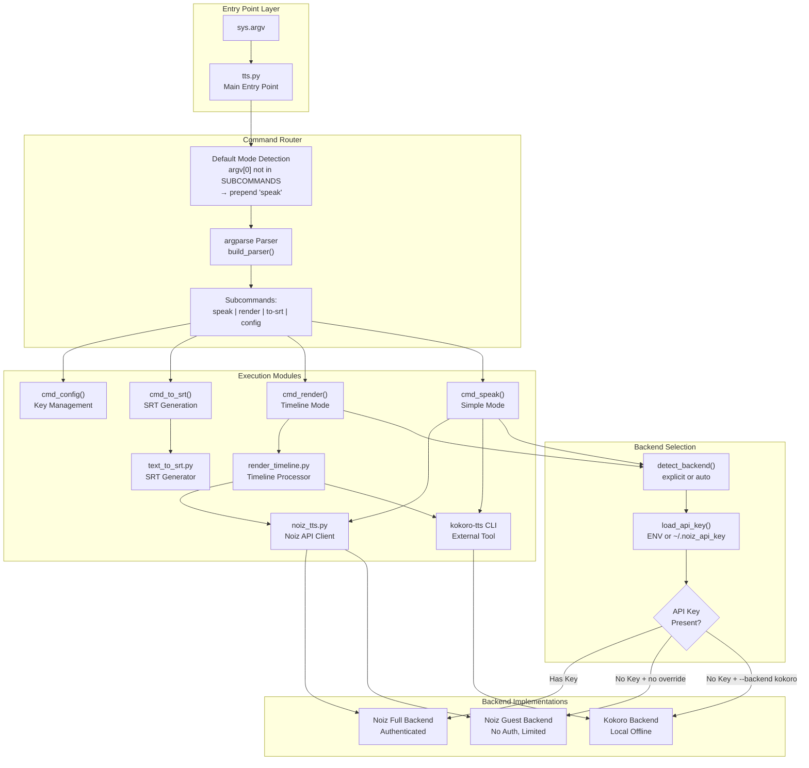
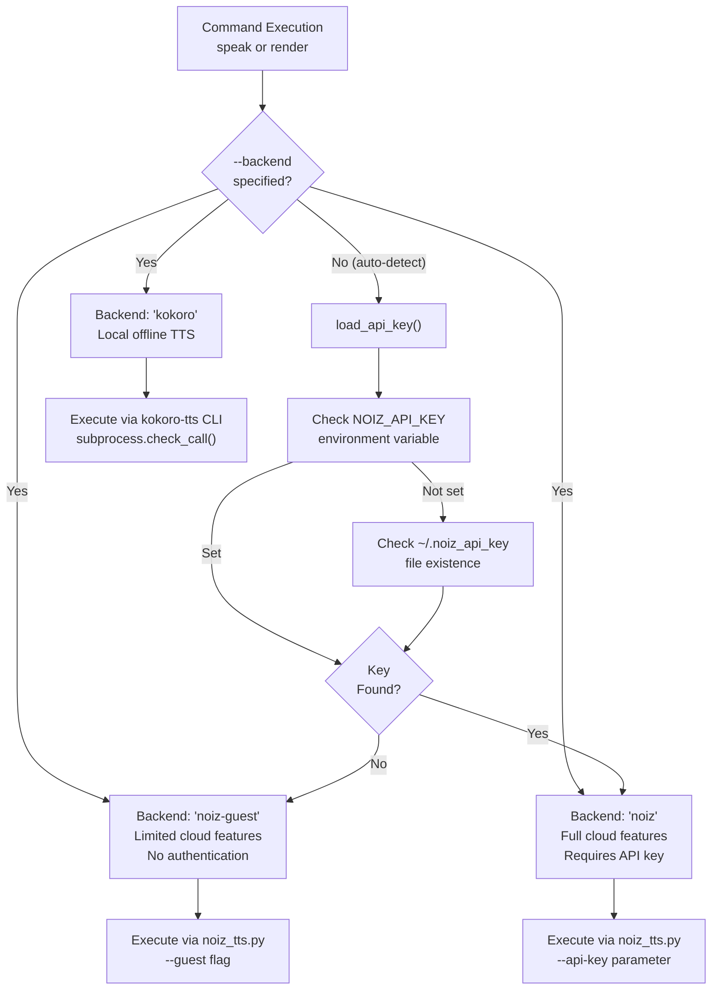
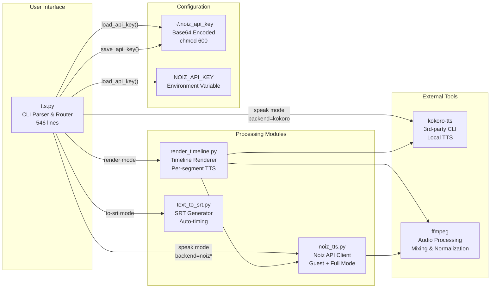
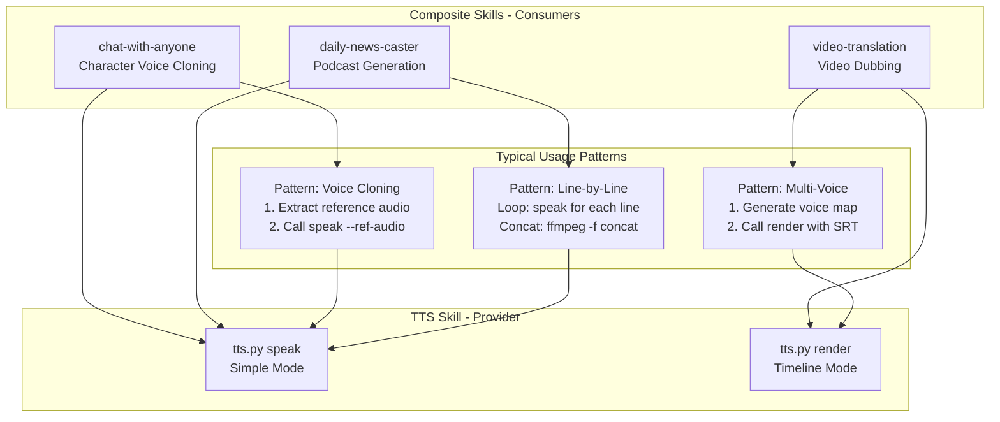

<!-- source: DeepWiki mcp.deepwiki.com · repo NoizAI/skills · page 3 TTS (Text-to-Speech) Skill · fetched 2026-10-26 -->

# TTS (Text-to-Speech) Skill

<details>
<summary>Relevant source files</summary>

The following files were used as context for generating this wiki page:

- [skills/tts/SKILL.md](skills/tts/SKILL.md)
- [skills/tts/scripts/tts.py](skills/tts/scripts/tts.py)

</details>


## Purpose and Scope

The TTS skill is a **core skill** that provides text-to-speech synthesis with dual backend support (local and cloud), multiple modes of operation, and advanced features including voice cloning, emotion control, and timeline-accurate rendering. This skill serves as the foundational audio generation component for all composite skills in the repository.

This page documents the overall architecture, entry points, and mode selection logic. For detailed usage of specific modes:
- Simple text-to-audio conversion: see [Simple Mode](#3.1)
- Timeline-accurate SRT rendering: see [Timeline Mode](#3.2)
- Voice configuration: see [Voice Maps and Segment Configuration](#3.3)
- Audio duration handling: see [Duration Control and Audio Normalization](#3.4)

For backend-specific details, see [Kokoro Backend](#2.1) and [Noiz Backend](#2.2).

**Sources:** [skills/tts/SKILL.md:1-152]()

---

## Architecture Overview

The TTS skill is implemented as a multi-mode command-line tool with automatic backend detection and pluggable processing pipelines.



**Entry Point and Command Structure**

The skill uses a unified entry point at [skills/tts/scripts/tts.py]() with automatic mode detection. When no subcommand is provided, the system defaults to `speak` mode, allowing abbreviated commands like `tts.py -t "Hello"` instead of `tts.py speak -t "Hello"`.

**Sources:** [skills/tts/scripts/tts.py:509-542](), [skills/tts/scripts/tts.py:421-503]()

---

## Command-Line Interface Structure

The TTS skill exposes four subcommands through a unified CLI:

| Subcommand | Purpose | Primary Module | Detailed Docs |
|------------|---------|----------------|---------------|
| `speak` | Text → Audio (simple mode) | [tts.py:139-309]() → [noiz_tts.py]() or `kokoro-tts` | [Simple Mode](#3.1) |
| `render` | SRT → Timeline-accurate audio | [tts.py:315-365]() → [render_timeline.py]() | [Timeline Mode](#3.2) |
| `to-srt` | Text → SRT with auto-timing | [tts.py:371-383]() → [text_to_srt.py]() | [Timeline Mode](#3.2) |
| `config` | API key management | [tts.py:389-415]() | [API Key Configuration](#2.3) |

### Default Mode Behavior

The parser implements intelligent mode detection at [tts.py:509-513]():

```python
argv = sys.argv[1:]
if not argv or argv[0] not in _SUBCOMMANDS:
    argv = ["speak"] + argv
```

This allows users to omit the `speak` subcommand for the most common use case, improving ergonomics.

**Sources:** [skills/tts/scripts/tts.py:421-503](), [skills/tts/scripts/tts.py:509-542](), [skills/tts/SKILL.md:18-35]()

---

## Backend Detection and Selection

The TTS skill supports three backend configurations with automatic detection based on API key presence and explicit overrides.



### Backend Detection Logic

The `detect_backend()` function at [tts.py:72-75]() implements the selection algorithm:

```python
def detect_backend(explicit: str = "") -> str:
    if explicit:
        return explicit
    return "noiz" if load_api_key() else "noiz-guest"
```

The `load_api_key()` function at [tts.py:48-60]() checks two locations in order:
1. `NOIZ_API_KEY` environment variable
2. `~/.noiz_api_key` file

Both sources are normalized to base64 encoding via `normalize_api_key_base64()` at [tts.py:33-45]().

### Backend Capabilities Matrix

| Feature | Kokoro | Noiz Guest | Noiz Full |
|---------|--------|------------|-----------|
| API Key Required | No | No | Yes |
| Network Required | No | Yes | Yes |
| Voice Cloning | No | No | Yes (`--ref-audio`) |
| Emotion Control | No | No | Yes (`--emo`, `--auto-emotion`) |
| Timeline Rendering | Yes | No | Yes |
| Voice Blending | Yes (`v1:60,v2:40`) | No | No |
| EPUB/PDF Support | Yes | No | No |
| Duration Control | atempo filter | N/A | Server-side + padding |

**Sources:** [skills/tts/scripts/tts.py:72-75](), [skills/tts/scripts/tts.py:48-60](), [skills/tts/scripts/tts.py:33-45](), [skills/tts/SKILL.md:96-107]()

---

## Modes of Operation

The TTS skill operates in four distinct modes, each optimized for different use cases.

### 1. Simple Mode (`speak`)

Converts text to audio in a single operation without timeline constraints. Supports both inline text (`-t`) and file input (`-f`).

**Entry Function:** [tts.py:139-309]()

**Key Features:**
- Direct text-to-audio conversion
- Voice cloning via `--ref-audio` (Noiz only)
- Automatic playback when output path is omitted
- Format selection: WAV, MP3, Opus, OGG

**Detailed documentation:** [Simple Mode](#3.1)

### 2. Timeline Mode (`render`)

Generates timeline-accurate audio from SRT files with per-segment voice control. Used for dubbing, video translation, and multi-speaker scenarios.

**Entry Function:** [tts.py:315-365]()

**Key Components:**
- Requires SRT file (`--srt`) and voice map JSON (`--voice-map`)
- Delegates to `render_timeline.py` for segment-by-segment processing
- Supports dynamic reference audio slicing via `--ref-audio-track`

**Detailed documentation:** [Timeline Mode](#3.2)

### 3. SRT Generation (`to-srt`)

Converts plain text to SRT format with automatic timing calculation based on character-per-second rates.

**Entry Function:** [tts.py:371-383]()

**Parameters:**
- `--cps`: Characters per second (default 4 for Chinese, ~15 for English)
- `--gap`: Gap between segments in milliseconds

**Workflow:**
```
Text File → text_to_srt.py → SRT File → render mode
```

### 4. Configuration (`config`)

Manages Noiz API key storage and displays current backend configuration.

**Entry Function:** [tts.py:389-415]()

**Operations:**
- `--set-api-key KEY`: Save API key to `~/.noiz_api_key` with chmod 600
- No arguments: Display current configuration and masked key

**Sources:** [skills/tts/scripts/tts.py:139-415](), [skills/tts/SKILL.md:18-95]()

---

## Module Decomposition

The TTS skill is decomposed into focused modules with clear separation of concerns:



### Key Modules and Responsibilities

| Module | Path | Responsibility | Lines of Code |
|--------|------|----------------|---------------|
| `tts.py` | [skills/tts/scripts/tts.py]() | CLI parsing, routing, backend detection, API key management | 546 |
| `noiz_tts.py` | [skills/tts/scripts/noiz_tts.py]() | Noiz API HTTP client, guest mode, full mode, emotion enhancement | Not shown |
| `render_timeline.py` | [skills/tts/scripts/render_timeline.py]() | SRT parsing, per-segment TTS invocation, audio mixing | Not shown |
| `text_to_srt.py` | [skills/tts/scripts/text_to_srt.py]() | Text segmentation, timing calculation, SRT formatting | Not shown |

### Dependency Flow

The skill has minimal external dependencies:
- **Required:** Python 3.6+ standard library
- **Optional (Noiz):** `requests` library (auto-installed via `uv pip install`)
- **Optional (Timeline):** `ffmpeg` and `ffprobe` binaries in PATH
- **Optional (Kokoro):** `kokoro-tts` installed via `uv tool install`

**Sources:** [skills/tts/scripts/tts.py:1-546](), [skills/tts/SKILL.md:141-145]()

---

## Integration with Composite Skills

The TTS skill is designed as a reusable component for composite skills. All three composite skills in the repository depend on it:



### Common Integration Patterns

**Pattern 1: Voice Cloning for Character Speech**
Used by `chat-with-anyone`:
1. Extract reference audio from character video using `ffmpeg`
2. Invoke `tts.py speak --ref-audio path/to/character.wav -t "Response text"`
3. Return cloned voice audio

**Pattern 2: Multi-Voice Timeline Rendering**
Used by `video-translation`:
1. Generate translated SRT file
2. Create voice map JSON with per-segment voice configurations
3. Invoke `tts.py render --srt translated.srt --voice-map vm.json --ref-audio-track original.mp4`
4. Replace video audio track

**Pattern 3: Line-by-Line Sequential Generation**
Used by `daily-news-caster`:
1. Split script into individual dialogue lines
2. Loop: `tts.py speak -t "Line text" --ref-audio hostA.wav -o line_N.wav`
3. Create `list.txt` with file paths
4. Concatenate: `ffmpeg -f concat -safe 0 -i list.txt -c copy output.wav`

This pattern allows different voices per line without using timeline mode.

**Sources:** [skills/tts/SKILL.md:1-152]()

---

## Reference Audio Handling

The TTS skill supports reference audio for voice cloning in both local file and remote URL formats.

### Reference Audio Sources

| Input Type | Example | Processing |
|------------|---------|------------|
| Local Path | `./my_voice.wav` | Direct file read |
| HTTP URL | `https://example.com/voice.mp3` | Download to temp file via `urllib.request.urlretrieve()` |
| HTTPS URL | `https://storage.googleapis.com/...` | Download to temp file |
| Default (CN) | Auto-selected when `--lang zh` | `DEFAULT_NOIZ_REF_AUDIO_URL_CN` |
| Default (EN) | Auto-selected when `--lang en` | `DEFAULT_NOIZ_REF_AUDIO_URL_EN` |

### URL Download Implementation

The `prepare_ref_audio()` function at [tts.py:108-120]() handles URL detection and download:

```python
def prepare_ref_audio(ref_audio_input: str) -> str:
    """Download ref audio if URL; return local path."""
    if ref_audio_input.startswith("http://") or ref_audio_input.startswith("https://"):
        import urllib.request
        tmp = mktemp_suffixed(".wav")
        print("[noiz] Downloading reference audio: {}".format(ref_audio_input), file=sys.stderr)
        urllib.request.urlretrieve(ref_audio_input, str(tmp))
        return str(tmp)
    return ref_audio_input
```

Downloaded files are stored in temporary files and cleaned up after synthesis at [tts.py:299-303]().

### Default Reference Audio Selection

When neither `--voice-id` nor `--ref-audio` is provided in Noiz mode, the system auto-selects a default reference audio based on language detection at [tts.py:245-258]():

1. Determine language via `--lang` argument
2. If no `--lang`, detect from text using `detect_text_lang()` (checks for Chinese characters)
3. Select default URL: CN or EN
4. Download and use as reference audio

**Sources:** [skills/tts/scripts/tts.py:108-120](), [skills/tts/scripts/tts.py:245-258](), [skills/tts/scripts/tts.py:23-28]()

---

## Audio Playback and Output

The TTS skill supports both file output and immediate playback modes.

### Playback Mode Detection

When the `--output` (`-o`) argument is **omitted**, the skill enters playback mode at [tts.py:142-148]():

```python
play_mode = args.output is None
tmp_output = None  # type: Optional[Path]
if play_mode:
    tmp_output = mktemp_suffixed(".wav")
    output = str(tmp_output)
else:
    output = args.output
```

After synthesis completes, `play_audio()` is invoked at [tts.py:305-307]() to automatically play the generated audio.

### Audio Player Detection

The `play_audio()` function at [tts.py:123-133]() attempts to find an available audio player:

```python
def play_audio(path: str) -> None:
    for player in ("afplay", "aplay", "paplay"):
        if shutil.which(player):
            print("[tts] Playing audio...", file=sys.stderr)
            subprocess.call([player, path])
            return
    print("[tts] No audio player found (tried afplay, aplay, paplay). "
          "Audio saved to: {}".format(path), file=sys.stderr)
```

**Supported Players:**
- `afplay` (macOS)
- `aplay` (ALSA on Linux)
- `paplay` (PulseAudio on Linux)

### Output Format Support

The skill supports multiple audio formats via the `--format` argument:

| Format | Extension | Use Case | Backend Support |
|--------|-----------|----------|-----------------|
| `wav` | `.wav` | High quality, uncompressed | Kokoro, Noiz |
| `mp3` | `.mp3` | Compressed, universal | Kokoro, Noiz |
| `opus` | `.opus` | Voice-optimized, small size | Kokoro, Noiz |
| `ogg` | `.ogg` | Alias for `opus` | Kokoro, Noiz |

Format is normalized at [tts.py:140]():
```python
fmt = "opus" if args.format == "ogg" else args.format
```

**Sources:** [skills/tts/scripts/tts.py:123-133](), [skills/tts/scripts/tts.py:142-148](), [skills/tts/scripts/tts.py:305-307](), [skills/tts/scripts/tts.py:140](), [skills/tts/SKILL.md:31-34]()

---

## Error Handling and User Guidance

The TTS skill implements contextual error messages that guide users toward solutions based on their current configuration.

### Guest Mode Limitations

When a user attempts to use advanced features without an API key, the skill provides explicit upgrade instructions at [tts.py:182-204]():

```python
if not args.voice_id:
    print("Error: --voice-id is required in guest mode (no API key configured).", file=sys.stderr)
    print("", file=sys.stderr)
    print("  To unlock all features (voice cloning, emotion, etc.), configure your API key:", file=sys.stderr)
    print("    1. Get your API key from https://developers.noiz.ai/api-keys", file=sys.stderr)
    print("    2. Run: python3 skills/tts/scripts/tts.py config --set-api-key YOUR_KEY", file=sys.stderr)
    print("", file=sys.stderr)
    print("  Or use Kokoro for offline local TTS:", file=sys.stderr)
    print("    uv tool install kokoro-tts", file=sys.stderr)
    print("    Then pass --backend kokoro", file=sys.stderr)
    return 1
```

### Timeline Mode Restrictions

Guest mode cannot use timeline rendering. The error message at [tts.py:319-338]() provides two alternatives:

**Option A: Noiz with API Key**
- Get key from developers.noiz.ai
- Configure via `tts.py config --set-api-key`

**Option B: Kokoro Backend**
- Install via `uv tool install kokoro-tts`
- Use `--backend kokoro` flag

### Missing Dependencies

When Noiz features are requested but the `requests` library is not installed, the skill auto-installs it at [tts.py:96-99]():

```python
def ensure_noiz_ready() -> None:
    if importlib.util.find_spec("requests") is None:
        print("[noiz] Installing requests...", file=sys.stderr)
        subprocess.check_call(["uv", "pip", "install", "requests"])
```

**Sources:** [skills/tts/scripts/tts.py:182-204](), [skills/tts/scripts/tts.py:319-338](), [skills/tts/scripts/tts.py:96-99]()

---

## Configuration Management

The TTS skill uses a file-based configuration system for API key storage with security best practices.

### API Key Storage

**Primary Location:** `~/.noiz_api_key`

**Security Properties:**
- File permissions: `0o600` (readable/writable only by owner)
- Content: Base64-encoded API key
- Never committed to version control (excluded via `.gitignore`)

### Configuration Subcommand

The `config` subcommand provides two operations:

**1. Set API Key**
```bash
python3 skills/tts/scripts/tts.py config --set-api-key YOUR_KEY
```

Implementation at [tts.py:389-393]():
- Normalizes key to base64 via `save_api_key()` → `normalize_api_key_base64()`
- Writes to `~/.noiz_api_key`
- Sets file permissions to `0o600` at [tts.py:63-66]()

**2. Display Current Configuration**
```bash
python3 skills/tts/scripts/tts.py config
```

Output includes:
- Masked API key (first 4 + last 4 characters)
- Current backend mode
- Configuration instructions if no key is set

Example output (with key):
```
NOIZ_API_KEY is configured: abcd****wxyz
  Backend: noiz (full features)
```

Example output (without key):
```
NOIZ_API_KEY is not configured.
  Current fallback: noiz-guest (limited features, no API key required)

Option A — Noiz with API key (recommended, full features):
  1. Get your API key from https://developers.noiz.ai/api-keys
  2. Run:
     python3 skills/tts/scripts/tts.py config --set-api-key YOUR_KEY
  The key will be saved to ~/.noiz_api_key and loaded automatically.

Option B — Kokoro (offline, local):
  uv tool install kokoro-tts
  Then pass --backend kokoro
```

### Environment Variable Override

The API key can also be provided via the `NOIZ_API_KEY` environment variable, which takes precedence over the file-based configuration. Both sources are checked and normalized at [tts.py:48-60]().

**Sources:** [skills/tts/scripts/tts.py:389-415](), [skills/tts/scripts/tts.py:63-66](), [skills/tts/scripts/tts.py:48-60](), [skills/tts/scripts/tts.py:22]()

---

## Python Compatibility

The TTS skill is designed to support a wide range of Python versions from 3.6 to 3.11+, using only standard library features and minimal external dependencies.

### Type Annotations

Type hints use the `typing` module for compatibility with Python 3.6:

```python
from typing import List, Optional
```

Example from [tts.py:19]():
- Uses `Optional[str]` instead of `str | None` (Python 3.10+ syntax)
- Uses `List[str]` instead of `list[str]` (Python 3.9+ syntax)

### String Formatting

Uses `.format()` instead of f-strings for better compatibility:

```python
print("[noiz] Downloading reference audio: {}".format(ref_audio_input), file=sys.stderr)
```

### Path Handling

Uses `pathlib.Path` from the standard library for cross-platform file path operations:

```python
SCRIPT_DIR = Path(__file__).parent
NOIZ_KEY_FILE = Path.home() / ".noiz_api_key"
```

### Temporary File Management

Uses `tempfile.mkstemp()` for secure temporary file creation:

```python
def mktemp_suffixed(suffix: str) -> Path:
    fd, path = tempfile.mkstemp(suffix=suffix)
    os.close(fd)
    return Path(path)
```

This creates a unique temporary file with the specified suffix and returns its path as a `Path` object.

**Sources:** [skills/tts/scripts/tts.py:1-19](), [skills/tts/scripts/tts.py:81-84](), [skills/tts/scripts/tts.py:21-22]()

---

