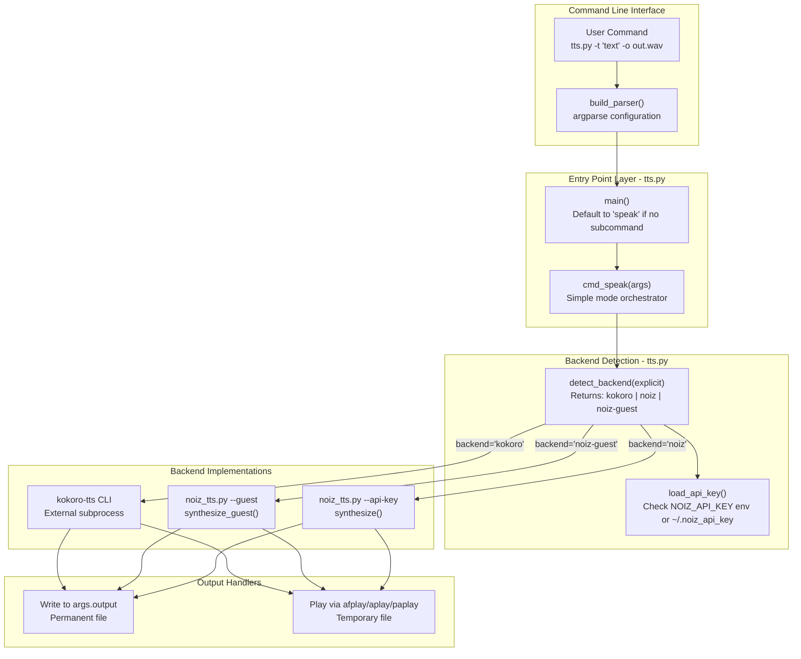
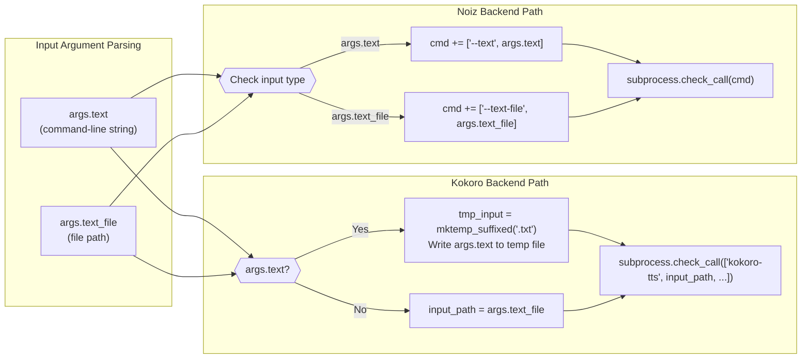
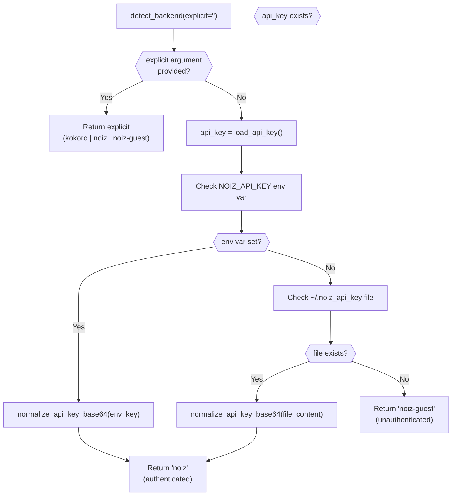
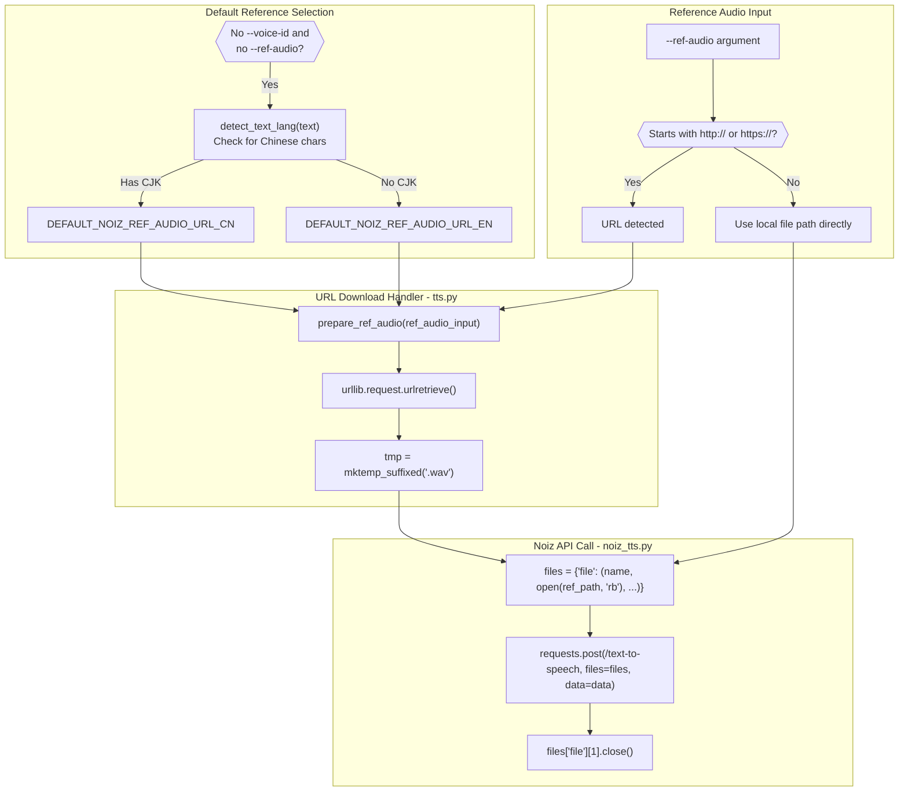
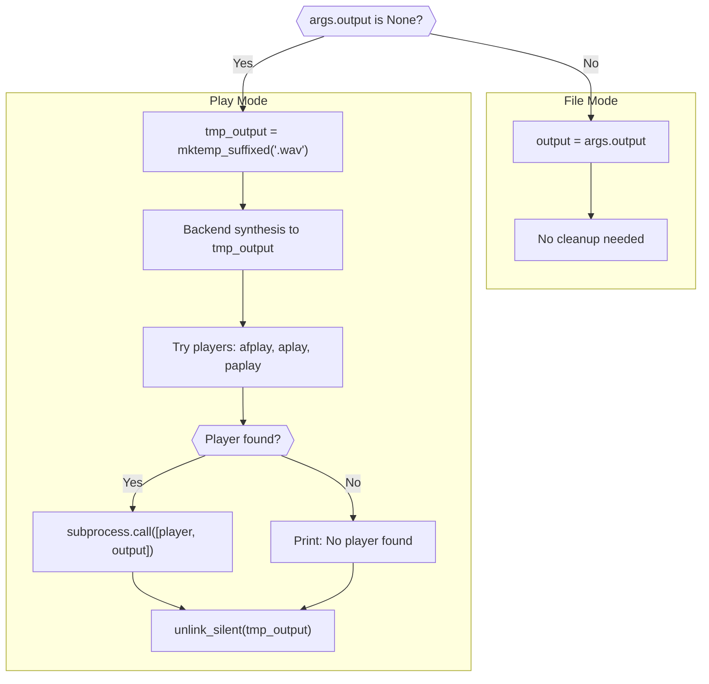
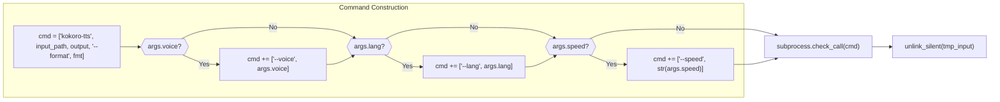
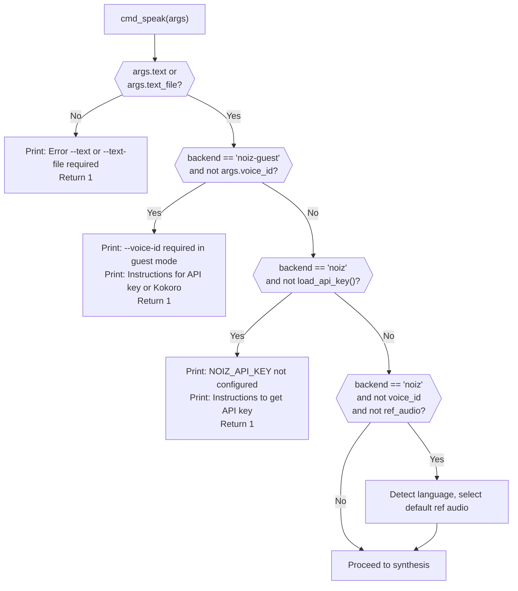

<!-- source: DeepWiki mcp.deepwiki.com · repo NoizAI/skills · page 3.1 Simple Mode - Text to Audio · fetched 2026-10-26 -->

# Simple Mode - Text to Audio

<details>
<summary>Relevant source files</summary>

The following files were used as context for generating this wiki page:

- [skills/tts/SKILL.md](skills/tts/SKILL.md)
- [skills/tts/scripts/noiz_tts.py](skills/tts/scripts/noiz_tts.py)
- [skills/tts/scripts/tts.py](skills/tts/scripts/tts.py)

</details>


## Purpose and Scope

Simple Mode provides direct text-to-audio conversion without timeline constraints. This mode accepts text input (either as a string or file) and produces a single audio file using the configured backend (Kokoro local or Noiz cloud). Simple Mode is the default operation mode of the TTS skill—the `speak` subcommand can be omitted from the command line.

For timeline-accurate rendering with per-segment voice control and SRT-based synchronization, see [Timeline Mode - SRT to Audio](#3.2). For integration with chat platforms, see [Integration with Chat Platforms](#6).

**Sources:** [skills/tts/SKILL.md:18-36]()

---

## Architecture Overview

Simple Mode operates through a multi-layer architecture that handles backend detection, input normalization, and audio synthesis delegation.



**Diagram: Simple Mode Architecture and Control Flow**

**Sources:** [skills/tts/scripts/tts.py:139-309](), [skills/tts/scripts/tts.py:424-503](), [skills/tts/scripts/tts.py:72-76]()

---

## Input Methods

Simple Mode supports two mutually exclusive input methods, defined in [skills/tts/scripts/tts.py:443-444]():

| Argument | Type | Description | Code Reference |
|----------|------|-------------|----------------|
| `-t`, `--text` | String | Direct text string to synthesize | [tts.py:443]() |
| `-f`, `--text-file` | File path | Read text from file (UTF-8 encoded) | [tts.py:444]() |

### Input Processing Flow



**Diagram: Input Method Handling by Backend**

The Kokoro backend requires file input for its CLI, so text strings are written to temporary files via `mktemp_suffixed('.txt')` at [tts.py:161-163](). The Noiz backend accepts both input types directly through `noiz_tts.py` arguments at [tts.py:217-220]().

**Sources:** [skills/tts/scripts/tts.py:150-176](), [skills/tts/scripts/tts.py:217-220](), [skills/tts/scripts/noiz_tts.py:171-208]()

---

## Backend Selection Logic

Backend selection follows a three-tier priority system implemented in `detect_backend()`:



**Diagram: Backend Detection Decision Tree**

### Backend Priority

1. **Explicit override** (`--backend` flag): Directly returns the specified backend [tts.py:72-76]()
2. **API key presence**: If `NOIZ_API_KEY` environment variable or `~/.noiz_api_key` file exists, returns `"noiz"` [tts.py:48-60]()
3. **Default fallback**: Returns `"noiz-guest"` when no API key is configured [tts.py:75]()

### Guest Mode Limitations

When operating in `noiz-guest` mode (no API key), only the following parameters are supported [SKILL.md:109-119]():

- `--voice-id`: Voice selection from 15 built-in voices
- `--speed`: Playback speed multiplier  
- `--format`: Output audio format

Voice cloning (`--ref-audio`), emotion control (`--emo`), duration forcing (`--duration`), and timeline rendering are **not available** in guest mode. The implementation explicitly checks for these constraints at [tts.py:179-204]().

**Sources:** [skills/tts/scripts/tts.py:72-76](), [skills/tts/scripts/tts.py:48-60](), [skills/tts/scripts/tts.py:179-204](), [skills/tts/SKILL.md:109-119]()

---

## Voice Configuration

Voice configuration varies by backend, with Kokoro using voice names and Noiz using voice IDs or reference audio.

### Kokoro Voice Parameters

| Parameter | Flag | Default Behavior | Implementation |
|-----------|------|------------------|----------------|
| Voice name | `--voice` | Kokoro's default voice | [tts.py:166-167]() |
| Language | `--lang` | Auto-detected | [tts.py:168-169]() |
| Speed | `--speed` | 1.0 | [tts.py:170-171]() |

Kokoro voices are specified as simple string identifiers (e.g., `zf_xiaoni`, `af_sarah`) passed directly to the `kokoro-tts` CLI.

### Noiz Voice Parameters

| Parameter | Flag | Purpose | Mode Availability |
|-----------|------|---------|-------------------|
| Voice ID | `--voice-id` | Select from predefined voices | Guest + Full |
| Reference Audio | `--ref-audio` | Clone voice from audio file/URL | Full only |
| Emotion | `--emo` | JSON emotion parameters | Full only |
| Auto-emotion | `--auto-emotion` | Pre-process via `/emotion-enhance` | Full only |
| Target Language | `--lang` | Cross-lingual synthesis | Full only |
| Duration | `--duration` | Force specific duration (0, 36]s | Full only |

**Voice Cloning Flow:**



**Diagram: Voice Cloning Reference Audio Handling**

### Default Reference Audio Selection

When neither `--voice-id` nor `--ref-audio` is provided for Noiz backend, the system automatically selects a default reference audio based on language detection [tts.py:245-258]():

- **Chinese text detection**: Uses `DEFAULT_NOIZ_REF_AUDIO_URL_CN`
- **English/other**: Uses `DEFAULT_NOIZ_REF_AUDIO_URL_EN`

Language detection uses a simple regex check for CJK characters: `re.search(r"[\u4e00-\u9fff\u3400-\u4dbf]", text)` at [tts.py:102-105]().

**Sources:** [skills/tts/scripts/tts.py:242-264](), [skills/tts/scripts/tts.py:108-120](), [skills/tts/scripts/tts.py:102-105](), [skills/tts/scripts/noiz_tts.py:58-133](), [skills/tts/scripts/tts.py:445-475]()

---

## Output Formats and Playback

### Supported Formats

| Format | Extension | Usage | Normalization |
|--------|-----------|-------|---------------|
| `wav` | `.wav` | Lossless, default format | No change |
| `mp3` | `.mp3` | Compressed, universal compatibility | No change |
| `opus` | `.opus` | High quality, low bitrate | No change |
| `ogg` | `.ogg` | Treated as alias for `opus` | Normalized to `opus` [noiz_tts.py:19-21]() |

Format normalization occurs in both entry points:
- `normalize_output_format()` at [noiz_tts.py:19-21]()
- Direct normalization in `cmd_speak()` at [tts.py:140]()

### Output Modes

Simple Mode supports two output modes determined by the presence of the `-o`/`--output` flag:

**File Mode** (output path specified):
```python
python3 skills/tts/scripts/tts.py -t "Hello" -o output.wav
```

**Play Mode** (no output path):
```python
python3 skills/tts/scripts/tts.py -t "Hello"
# Creates temporary file, plays audio, then deletes temp file
```

### Play Mode Implementation



**Diagram: Output Mode Selection and Playback Logic**

The playback implementation at [tts.py:123-133]() iterates through platform-specific audio players:
- **macOS**: `afplay`
- **Linux (ALSA)**: `aplay`
- **Linux (PulseAudio)**: `paplay`

**Sources:** [skills/tts/scripts/tts.py:139-148](), [skills/tts/scripts/tts.py:123-133](), [skills/tts/scripts/tts.py:305-307](), [skills/tts/scripts/noiz_tts.py:19-21]()

---

## Backend-Specific Processing

### Kokoro Backend Execution



**Diagram: Kokoro Backend Command Construction**

Kokoro execution is a direct subprocess call to the external `kokoro-tts` CLI tool [tts.py:165-176](). No HTTP requests or API authentication is required.

### Noiz Backend Execution (Guest Mode)

Guest mode uses `synthesize_guest()` at [noiz_tts.py:135-168]():

```python
# URL construction adjusts for base URL variations
root = base_url.rstrip("/")
if root.endswith("/v1"):
    root = root[:-3]
url = f"{root}/api/v1/guest/text-to-speech"

# Simple POST with form data (no multipart)
data = {
    "text": text,
    "voice_id": voice_id,
    "output_format": normalized_format,
    "speed": str(speed),
}
resp = requests.post(url, data=data, timeout=timeout)
```

**Key constraints:**
- No `Authorization` header required
- Only `voice_id`, `output_format`, and `speed` parameters accepted
- Endpoint: `/api/v1/guest/text-to-speech` (not the standard `/v1/text-to-speech`)

### Noiz Backend Execution (Full Mode)

Full mode uses `synthesize()` at [noiz_tts.py:58-133]():

```python
# All parameters supported
data = {
    "text": text,
    "output_format": normalized_format,
    "speed": str(speed),
}
if voice_id:
    data["voice_id"] = voice_id
if emo:
    data["emo"] = emo
if target_lang:
    data["target_lang"] = target_lang
if similarity_enh:
    data["similarity_enh"] = "true"
if save_voice:
    data["save_voice"] = "true"
if duration is not None:
    data["duration"] = str(duration)

# Multipart upload for reference audio
if reference_audio:
    files = {
        "file": (
            reference_audio.name,
            reference_audio.open("rb"),
            "application/octet-stream",
        )
    }
```

**Authentication:**
- API key passed as `Authorization` header (base64-encoded, no prefix)
- API key normalized via `normalize_api_key_base64()` at [tts.py:33-45]()

**Duration metadata:**
The Noiz API returns audio duration in the `X-Audio-Duration` response header, which is saved to a `.duration` file alongside the audio output [noiz_tts.py:129-131]():

```python
dur = resp.headers.get("X-Audio-Duration")
duration_val = float(dur) if dur else -1.0
out_path.with_suffix(".duration").write_text(str(duration_val))
```

**Sources:** [skills/tts/scripts/tts.py:156-176](), [skills/tts/scripts/noiz_tts.py:135-168](), [skills/tts/scripts/noiz_tts.py:58-133](), [skills/tts/scripts/tts.py:33-45]()

---

## Command-Line Examples

### Basic Text Synthesis

```bash
# Default backend (auto-detected), play immediately
python3 skills/tts/scripts/tts.py -t "Hello world"

# Save to file
python3 skills/tts/scripts/tts.py -t "Hello world" -o output.wav

# Read from file
python3 skills/tts/scripts/tts.py -f article.txt -o article.mp3
```

### Voice Selection

```bash
# Kokoro backend with specific voice
python3 skills/tts/scripts/tts.py -t "你好" --backend kokoro --voice zf_xiaoni --lang cmn

# Noiz guest mode with voice ID
python3 skills/tts/scripts/tts.py -t "Hello" --voice-id 883b6b7c -o hello.wav
```

### Voice Cloning

```bash
# Clone from local file
python3 skills/tts/scripts/tts.py -t "Hello in my voice" --ref-audio ./my_voice.wav -o cloned.wav

# Clone from URL
python3 skills/tts/scripts/tts.py -t "Hello" --ref-audio https://example.com/voice.wav -o output.wav
```

### Advanced Noiz Features

```bash
# Emotion control
python3 skills/tts/scripts/tts.py -t "I'm so happy!" --emo '{"Joy":0.8}' -o happy.wav

# Auto-emotion enhancement (calls /emotion-enhance first)
python3 skills/tts/scripts/tts.py -t "This is amazing news!" --auto-emotion -o enhanced.wav

# Force specific duration
python3 skills/tts/scripts/tts.py -t "Quick message" --duration 2.5 -o fixed.wav

# Voice message format for chat platforms
python3 skills/tts/scripts/tts.py -t "Voice message" --format opus -o voice.opus
```

**Sources:** [skills/tts/SKILL.md:22-34](), [skills/tts/scripts/tts.py:443-475]()

---

## Error Handling and Validation

### Input Validation



**Diagram: Input Validation and Error Handling Flow**

### Common Error Scenarios

| Error Condition | Error Message | Resolution | Code Location |
|-----------------|---------------|------------|---------------|
| Missing input text | "Error: --text or --text-file is required" | Provide either `-t` or `-f` | [tts.py:150-152]() |
| Guest mode without voice ID | "--voice-id is required in guest mode" | Add `--voice-id` or configure API key | [tts.py:181-204]() |
| Missing API key for full features | "NOIZ_API_KEY not configured" | Run `config --set-api-key` | [tts.py:230-238]() |
| Text length warning | "Warning: text is X chars (max 5000)" | Split text into chunks | [noiz_tts.py:213-218]() |

### API Key Normalization

The `normalize_api_key_base64()` function handles multiple input formats [tts.py:33-45]():

1. **Already base64-encoded**: Returned as-is (with padding preserved)
2. **Plain text**: Automatically encoded to base64
3. **Empty string**: Returned unchanged

This normalization prevents authentication failures from incorrect encoding.

**Sources:** [skills/tts/scripts/tts.py:150-152](), [skills/tts/scripts/tts.py:181-204](), [skills/tts/scripts/tts.py:230-238](), [skills/tts/scripts/noiz_tts.py:213-218](), [skills/tts/scripts/tts.py:33-45]()

---

## Integration Points

### Subcommand Registration

Simple Mode is registered as the `speak` subcommand but defaults when no subcommand is specified:

```python
# In main() at tts.py:509-513
argv = sys.argv[1:]
if not argv or argv[0] not in _SUBCOMMANDS:
    argv = ["speak"] + argv
```

This allows both explicit and implicit invocation:
```bash
python3 tts.py speak -t "Hello"  # Explicit
python3 tts.py -t "Hello"        # Implicit (defaults to speak)
```

### Interaction with Other Modes

Simple Mode shares several utility functions with Timeline Mode ([#3.2](#3.2)):

- `load_api_key()`: Shared API key loading logic [tts.py:48-60]()
- `detect_backend()`: Shared backend selection [tts.py:72-76]()
- `prepare_ref_audio()`: URL download for reference audio [tts.py:108-120]()
- `normalize_api_key_base64()`: API key normalization [tts.py:33-45]()

The configuration subcommand stores API keys that Simple Mode automatically loads [tts.py:389-415]().

**Sources:** [skills/tts/scripts/tts.py:509-513](), [skills/tts/scripts/tts.py:421](), [skills/tts/scripts/tts.py:48-60](), [skills/tts/scripts/tts.py:72-76]()

---

