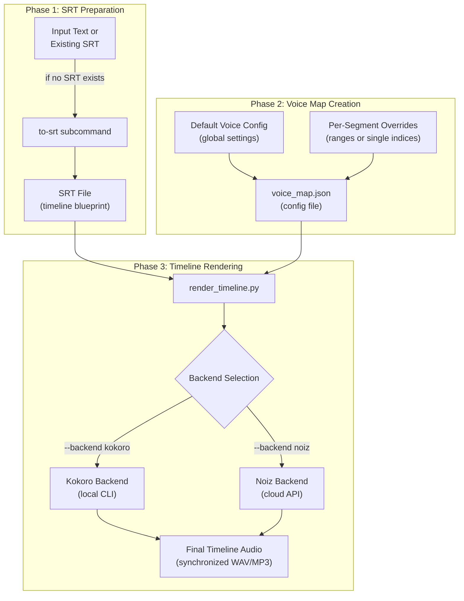
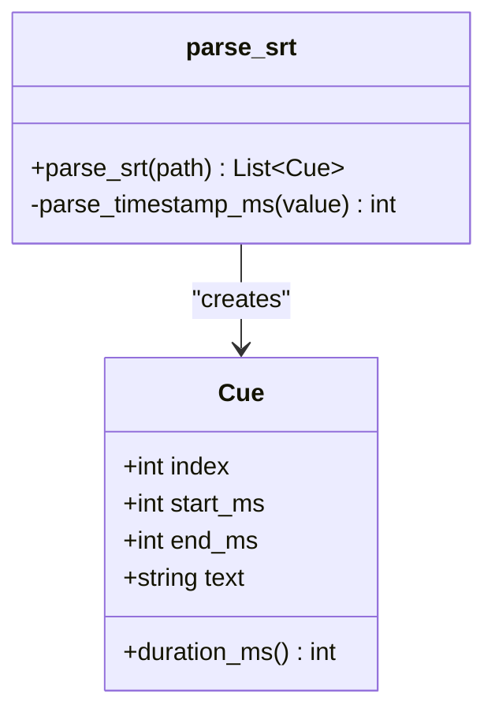
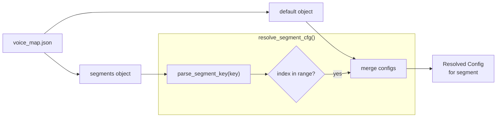
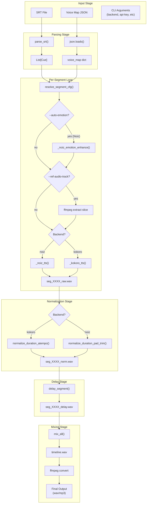
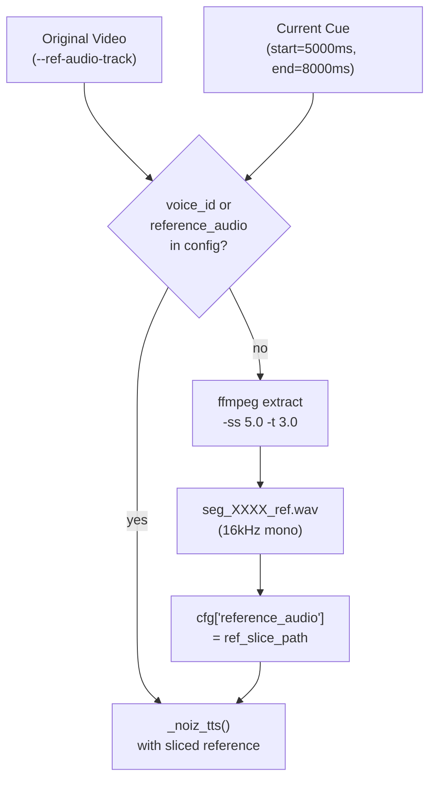
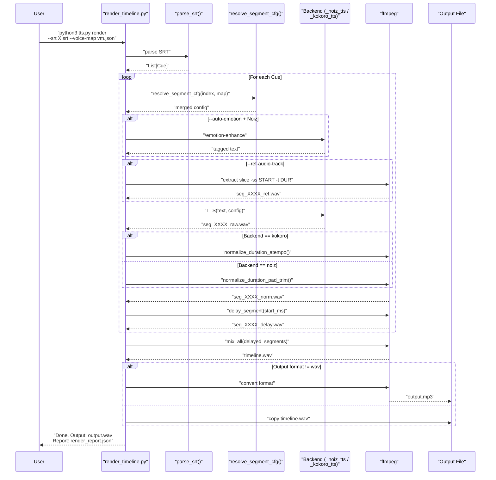

<!-- source: DeepWiki mcp.deepwiki.com · repo NoizAI/skills · page 3.2 Timeline Mode - SRT to Audio · fetched 2026-10-26 -->

# Timeline Mode - SRT to Audio

<details>
<summary>Relevant source files</summary>

The following files were used as context for generating this wiki page:

- [skills/tts/SKILL.md](skills/tts/SKILL.md)
- [skills/tts/scripts/render_timeline.py](skills/tts/scripts/render_timeline.py)

</details>


## Purpose and Scope

Timeline Mode is the precision dubbing mode of the TTS skill, designed to generate time-aligned audio where each segment must start and end at exact timestamps. This mode is essential for video dubbing, subtitle-synchronized narration, multi-voice podcasts, and any scenario requiring per-segment timing guarantees.

Unlike Simple Mode ([3.1](#3.1)), which produces continuous audio from text, Timeline Mode uses **SRT subtitle files** as the timeline blueprint and renders each segment independently before mixing them into a single synchronized track. This architecture enables per-segment voice control, precise timestamp alignment, and backend-specific duration normalization.

For voice map configuration details, see [3.3](#3.3). For duration control mechanisms, see [3.4](#3.4).

---

## Three-Step Workflow Overview

Timeline Mode follows a strict three-phase process:



**Sources:** [skills/tts/SKILL.md:38-95](), [skills/tts/scripts/render_timeline.py:1-11]()

---

## Step 1: SRT File Preparation

The SRT file defines the timeline structure. Each subtitle entry becomes one audio segment with mandatory start/end timestamps.

### Creating SRT from Text

Use the `to-srt` subcommand to auto-generate SRT from plain text:

```bash
python3 skills/tts/scripts/tts.py to-srt -i article.txt -o article.srt --cps 15 --gap 500
```

| Parameter | Purpose | Default |
|-----------|---------|---------|
| `--cps` | Characters per second (reading speed) | 4 (Chinese-optimized) |
| `--gap` | Milliseconds between segments | 300 |

For English text, use `--cps 15` for natural pacing. For Chinese, the default `4` is appropriate.

### SRT Format Requirements

```
1
00:00:00,000 --> 00:00:03,500
First line of dialogue

2
00:00:04,000 --> 00:00:07,200
Second line of dialogue
```

**Parsing Logic:** The `parse_srt()` function ([skills/tts/scripts/render_timeline.py:66-88]()) extracts each block into a `Cue` dataclass ([render_timeline.py:43-52]()):



The parser tolerates both comma (`,`) and period (`.`) as millisecond separators ([render_timeline.py:25]()).

**Sources:** [skills/tts/SKILL.md:42-51](), [skills/tts/scripts/render_timeline.py:25-88]()

---

## Step 2: Voice Map Configuration

The voice map is a JSON file controlling default and per-segment voice settings. This enables multi-speaker scenarios where different segments use different voices or parameters.

### Voice Map Structure

```json
{
  "default": {
    "voice_id": "883b6b7c",
    "speed": 1.0
  },
  "segments": {
    "1": { "voice_id": "voice_host_a" },
    "3-7": { "voice_id": "voice_host_b", "emo": { "Joy": 0.7 } },
    "9": { "reference_audio": "./speaker_sample.wav" }
  }
}
```

### Configuration Resolution Process



**Resolution Algorithm ([render_timeline.py:103-109]()):**
1. Start with `default` object as base
2. Iterate through `segments` keys
3. Parse key as single index (`"3"`) or range (`"5-8"`) via `parse_segment_key()` ([render_timeline.py:94-100]())
4. If current segment index falls in range, merge that config into base
5. Later matches override earlier ones

**Sources:** [skills/tts/SKILL.md:54-88](), [skills/tts/scripts/render_timeline.py:92-109]()

---

## Step 3: Rendering Process

The `render_timeline.py` script orchestrates the entire rendering pipeline.

### Core Rendering Pipeline



**Command Example:**

```bash
python3 skills/tts/scripts/tts.py render \
  --srt input.srt \
  --voice-map vm.json \
  --backend noiz \
  --auto-emotion \
  -o output.wav
```

**Sources:** [skills/tts/scripts/render_timeline.py:356-486]()

---

## Backend-Specific Processing

### Kokoro Backend Implementation

The `_kokoro_tts()` function ([render_timeline.py:315-350]()) invokes the local `kokoro-tts` CLI:

**Process:**
1. Write cue text to temporary file
2. Build command: `["kokoro-tts", tmp_path, output_path, "--voice", ..., "--lang", ..., "--speed", ...]`
3. Execute subprocess
4. Probe output duration with `ffprobe`

**Supported Config Keys:**
- `voice` - Voice model identifier
- `lang` - Language code (e.g., `"cmn"`, `"en-us"`)
- `speed` - Speed multiplier

### Noiz Backend Implementation

The `_noiz_tts()` function ([render_timeline.py:241-304]()) calls the cloud API:

**Process:**
1. Build multipart form payload with `text`, `duration`, `output_format`
2. Add optional fields: `voice_id`, `quality_preset`, `speed`, `target_lang`, `similarity_enh`, `save_voice`, `emo`
3. If `reference_audio` specified:
   - Resolve via `_resolve_reference_audio()` ([render_timeline.py:224-238]())
   - If URL, download to temp file
   - If local path, validate existence
   - Attach as multipart file
4. POST to `/text-to-speech` with `Authorization: <base64_api_key>`
5. Extract duration from `X-Audio-Duration` header

**Supported Config Keys:**
- `voice_id` - Voice identifier
- `reference_audio` - Local path or URL to reference audio
- `emo` - Emotion parameters (dict or JSON string)
- `speed`, `quality_preset`, `target_lang`, `similarity_enh`, `save_voice`

**Sources:** [skills/tts/scripts/render_timeline.py:196-350]()

---

## Duration Normalization Strategies

Timeline Mode enforces exact durations per SRT timestamp. Each backend uses a different normalization approach.

### Kokoro: atempo Filter Chain

**Function:** `normalize_duration_atempo()` ([render_timeline.py:149-172]())

**Strategy:**
1. Probe actual duration of raw audio
2. Calculate ratio: `actual_ms / target_ms`
3. Build `atempo` filter chain to handle ratio
   - `atempo` accepts range `[0.5, 100.0]`
   - For extreme ratios, chain multiple filters
   - Example: ratio=250 → `atempo=100.0,atempo=2.5`
4. Apply filter and trim to exact target duration

**Advantage:** Preserves pitch while adjusting speed.

**Example Filter Chain:**
```
-af "atempo=100.0,atempo=2.5" -t "3.500"
```

### Noiz: Pad and Trim

**Function:** `normalize_duration_pad_trim()` ([render_timeline.py:139-146]())

**Strategy:**
1. Pad audio with silence to target duration
2. Trim to exact target duration

```
-af "apad=pad_dur=3.500" -t "3.500"
```

**Rationale:** Noiz API includes `duration` parameter in request, so server attempts to pre-generate audio at target duration. Client-side normalization is just safety margin correction.

**Sources:** [skills/tts/scripts/render_timeline.py:139-172]()

---

## Dynamic Reference Audio Slicing

The `--ref-audio-track` feature ([render_timeline.py:372]()) enables **automatic temporal alignment** for video dubbing scenarios.

### Use Case

When dubbing a video into another language:
- Original video has speaker at 00:00:05-00:00:08
- Translated subtitle for same timespan exists
- Want to clone that specific speaker's voice for that exact segment

### Implementation



**Code ([render_timeline.py:400-411]()):**

```python
if args.ref_audio_track and not cfg.get("voice_id") and not cfg.get("reference_audio"):
    ref_slice_path = work / f"seg_{cue.index:04d}_ref.wav"
    if not ref_slice_path.exists():
        _run_ff([
            "ffmpeg", "-y",
            "-ss", f"{cue.start_ms / 1000.0:.3f}",
            "-i", str(args.ref_audio_track),
            "-t", f"{cue.duration_ms / 1000.0:.3f}",
            "-acodec", "pcm_s16le", "-ar", "16000", "-ac", "1",
            str(ref_slice_path)
        ])
    cfg["reference_audio"] = str(ref_slice_path)
```

**Result:** Each dubbed segment automatically uses the original speaker's voice from the exact same timestamp as reference audio for cloning.

**Sources:** [skills/tts/SKILL.md:81-86](), [skills/tts/scripts/render_timeline.py:400-411]()

---

## Segment Delay and Mixing

After normalization, segments must be positioned at correct timeline offsets.

### Delay Application

**Function:** `delay_segment()` ([render_timeline.py:175-179]())

Uses `ffmpeg`'s `adelay` filter to shift audio forward in time:

```bash
ffmpeg -y -i seg_0001_norm.wav \
  -af "adelay=5000:all=1" \
  seg_0001_delay.wav
```

This prepends 5000ms of silence before the audio.

### Timeline Mixing

**Function:** `mix_all()` ([render_timeline.py:182-193]())

Combines all delayed segments into single track:

```bash
ffmpeg -y \
  -i seg_0001_delay.wav \
  -i seg_0002_delay.wav \
  -i seg_0003_delay.wav \
  -filter_complex "amix=inputs=3:duration=longest:dropout_transition=0" \
  -t "45.500" \
  timeline.wav
```

| Parameter | Purpose |
|-----------|---------|
| `inputs=N` | Number of input files |
| `duration=longest` | Output duration matches longest input |
| `dropout_transition=0` | No crossfade when streams end |
| `-t` | Trim to exact timeline end time |

**Sources:** [skills/tts/scripts/render_timeline.py:175-193]()

---

## Auto-Emotion Enhancement

When `--auto-emotion` flag is set with Noiz backend, text is preprocessed before TTS.

### Emotion Enhancement API

**Function:** `_noiz_emotion_enhance()` ([render_timeline.py:199-217]())

**Process:**
1. POST to `/emotion-enhance` with original text
2. API analyzes text and returns emotion-tagged version
3. Tagged text is passed to TTS instead of original

**Example Request:**
```python
resp = requests.post(
    f"{base_url}/emotion-enhance",
    headers={"Authorization": api_key, "Content-Type": "application/json"},
    json={"text": cue.text},
    timeout=timeout,
)
```

**Response:**
```json
{
  "data": {
    "emotion_enhance": "[Joy:0.7]Hello everyone![Neutral]Today we'll discuss..."
  }
}
```

This feature is Noiz-only and automatically adds emotional inflection without manual `emo` parameter configuration.

**Sources:** [skills/tts/scripts/render_timeline.py:199-217, 415-418]()

---

## Output and Reporting

### Generated Files

**Working Directory Structure** (`--work-dir .tmp/tts`):
```
.tmp/tts/
├── seg_0001_raw.wav        # Raw TTS output
├── seg_0001_norm.wav       # Duration-normalized
├── seg_0001_delay.wav      # Timeline-positioned
├── seg_0002_raw.wav
├── seg_0002_norm.wav
├── seg_0002_delay.wav
├── ...
├── timeline.wav            # Mixed result
└── render_report.json      # Metadata report
```

### Render Report Format

**File:** `render_report.json` ([render_timeline.py:466-476]())

```json
{
  "srt": "input.srt",
  "output": "output.wav",
  "backend": "noiz",
  "total_ms": 45500,
  "segments": [
    {
      "index": 1,
      "start_ms": 0,
      "end_ms": 3500,
      "duration_ms": 3500,
      "raw_duration_sec": 3.51,
      "backend": "noiz",
      "voice_id": "883b6b7c",
      "reference_audio": null,
      "emo": null
    },
    {
      "index": 2,
      "start_ms": 4000,
      "end_ms": 7200,
      "duration_ms": 3200,
      "raw_duration_sec": 3.19,
      "backend": "noiz",
      "voice_id": null,
      "reference_audio": "./ref/speaker.wav",
      "emo": {"Joy": 0.6}
    }
  ]
}
```

**Report Fields:**
- `raw_duration_sec` - Actual duration from TTS backend (before normalization)
- Backend-specific fields:
  - **Noiz:** `voice_id`, `reference_audio`, `emo`
  - **Kokoro:** `voice`, `lang`

This report enables debugging duration mismatches and verifying per-segment configuration.

**Sources:** [skills/tts/scripts/render_timeline.py:438-476]()

---

## Complete Execution Flow



**Sources:** [skills/tts/scripts/render_timeline.py:356-486]()

---

## Related Documentation

- **Simple Mode:** For basic text-to-audio without timeline requirements, see [3.1](#3.1)
- **Voice Maps:** For detailed voice map schema and examples, see [3.3](#3.3)
- **Duration Control:** For technical details on normalization strategies, see [3.4](#3.4)
- **Kokoro Backend:** For local backend capabilities and configuration, see [2.1](#2.1)
- **Noiz Backend:** For cloud backend features (emotion, cloning), see [2.2](#2.2)

---

